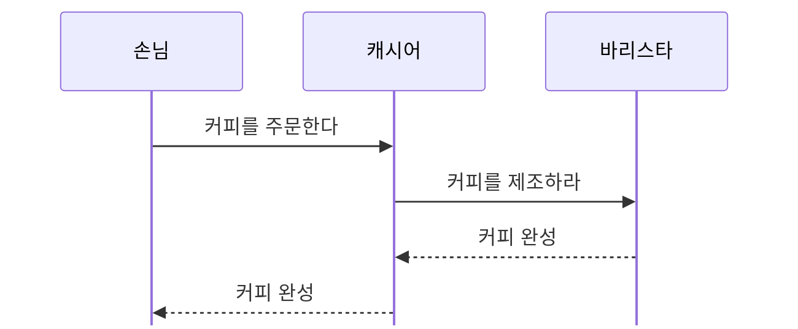

# 1장. 협력하는 객체들의 공동체

## 실세계의 모방이라는 오해

“객체지향이란 실세계를 직접적이고 직관적으로 모델링할 수 있는 패러다임”

- 실세계의 사물을 최대한 유사하게 모방해 소프트웨어 내부로 옮기는 작업이라는 설명
- 철학적 개념을 설명하는 데는 적합하지만, 실용적인 분석·설계를 설명하기에는 부적합

> 👀 객체지향의 목표는 실세계를 모방하는 것이 아니라 **새로운 세계를 창조**하는 것이다
>
> 소프트웨어 개발자의 역할 : 고객과 사용자를 만족시킬 수 있는 신세계를 창조하는 것

그럼에도 실세계 비유를 쓰는 이유

- 객체의 다양한 측면을 이해하고 학습하는 데 매우 효과적
- 스스로 생각하고 결정하는 생명체 비유 → 상태와 행위의 **캡슐화 encapsulation**, 객체의 **자율성 autonomy** 설명
- 사람들이 약속과 계약을 기반으로 협력하는 과정 → **메시지 message**를 주고받으며 **협력 collaboration**하는 객체들의 관계 설명

---

## 협력하는 사람들

### 커피 공화국의 아침

<mark>손님은 커피를 주문하고, 캐시어는 주문을 받고, 바리스타는 커피를 제조한다</mark>

<mark>→ 커피 한 잔을 주문하는 작은 이벤트에도 여러 사람의 협력이 필요하다</mark>

> 👀 객체지향에서 가장 중요한 개념 세 가지<br>
> : **역할, 책임, 협력**

### 요청과 응답으로 구성된 협력

혼자 해결하기 어려운 문제 → 다른 사람에게 도움을 **요청 request**

- 하나의 문제 해결에 여러 사람이 필요 → 요청은 연쇄적으로 발생
- 요청을 받은 사람은 필요한 지식이나 서비스를 제공하며 **응답 response**
- 응답은 요청의 반대 방향으로 연쇄적으로 전달



### 역할과 책임

**역할 role**

: 협력에 참여하는 사람이 협력 안에서 차지하는 책임이나 임무

**책임 responsibility**

: 역할에 적합하게 수행해야 하는 일 → 역할은 책임을 내포한다

- <mark>손님 : 커피를 주문할 책임</mark>
- <mark>캐시어 : 주문 내용을 바리스타에게 전달할 책임, 커피가 준비됐음을 손님에게 알릴 책임</mark>
- <mark>바리스타 : 커피를 제조할 책임</mark>

역할과 책임이 제시하는 중요한 개념

- **여러 사람이 동일한 역할을 수행할 수 있다**
  - <mark>손님은 오늘의 캐시어가 어제의 캐시어가 아니어도 개의치 않는다</mark>
- **역할은 대체 가능성을 의미한다**
  - 동일한 역할을 수행할 수 있다면 누가 수행해도 문제없다 → 대체 가능 substitutable
- **책임을 수행하는 방법은 자율적으로 선택할 수 있다**
  - <mark>같은 제조 요청을 받아도 바리스타마다 자신만의 방식으로 커피를 제조</mark>
  - **다형성 polymorphism** : 동일한 요청에 서로 다른 방식으로 응답할 수 있는 능력
- **한 사람이 동시에 여러 역할을 수행할 수 있다**
  - <mark>한 사람이 캐시어와 바리스타 역할을 동시에 수행할 수도 있다</mark>

---

## 역할, 책임, 협력

### 기능을 구현하기 위해 협력하는 객체들

> 👀 사람 → **객체**<br>
> 에이전트의 요청 → **메시지**<br>
> 요청을 처리하는 방법 → **메서드**
>
> 커피 주문 과정은 객체지향의 핵심 개념을 거의 대부분 포함한다

### 역할과 책임을 수행하며 협력하는 객체들

“어떤 객체도 섬이 아니다” (워드 커닝햄, 켄트 벡)

- 객체는 주어진 역할과 책임을 다하는 동시에 다른 객체와 적극적으로 협력한다
- 사용자가 인식하는 시스템의 기능 = 객체들이 협력해서 만든 결실
- 사람과의 차이 : 객체들은 애플리케이션의 기능을 구현하기 위해 협력한다

객체지향에서의 역할

- 특정한 협력 안에서 수행하는 책임의 집합 → **역할은 관련성 높은 책임의 집합**
- 객체의 역할은 사람의 역할과 비슷한 특징을 지닌다
  - 여러 객체가 동일한 역할 수행 / 대체 가능 / 자율적인 수행 방법 선택 / 여러 역할 동시 수행
- 역할은 유연하고 재사용 가능한 협력 관계를 구축하는 데 중요한 설계 요소

  대체 가능한 역할은 **다형성**과 깊이 연관

---

## 협력 속에 사는 객체

객체지향 애플리케이션의 윤곽 결정 → 역할, 책임, 협력

실제로 협력에 참여하는 주체 → **객체**

> 👀 협력의 품질을 결정하는 것은 객체의 품질이다

협력 공동체의 일원으로서 객체가 갖춰야 할 두 가지 덕목

- **충분히 협력적이어야 한다**
  - 다른 객체의 요청에 귀 기울이고, 적극적으로 도움을 요청
  - 모든 것을 스스로 처리하려는 **전지전능한 객체 god object**는 내부 복잡도에 의해 자멸
  - 협력적 ≠ 다른 객체의 명령에 따라 움직이는 수동적인 존재
- **충분히 자율적이어야 한다**
  - 스스로의 판단과 결정에 따라 행동
  - <mark>캐시어는 주문을 받는 절차, 바리스타에게 전달하는 방법을 스스로 결정</mark>

⇒ 객체지향 설계의 묘미 : 충분히 협력적이면서 충분히 자율적인 객체들의 공동체를 설계하는 것

### 상태와 행동을 함께 지닌 자율적인 객체

객체 = **상태 state**와 **행동 behavior**을 함께 지닌 실체

- 행동을 하려면 그 행동에 필요한 상태도 함께 지녀야 한다
  - <mark>커피를 제조하는 바리스타가 제조 방법을 모른다는 것은 말이 되지 않는다</mark>

객체의 자율성은 내부와 외부를 명확히 구분하는 것에서 나온다

- 사적인 부분은 객체 스스로 관리, 외부의 간섭 차단
- 외부에서는 허락된 수단을 통해서만 의사소통
- 다른 객체가 **무엇 what**을 수행하는지는 알 수 있지만 **어떻게 how** 수행하는지는 알 수 없다

> 👀 전통적인 개발 방법 : 데이터와 프로세스를 엄격히 구분
>
> 객체지향 : 데이터와 프로세스를 객체라는 하나의 틀 안에 묶어 자율성 보장
>
> → 전통적인 개발 방법과 객체지향을 구분 짓는 가장 핵심적인 차이

### 협력과 메시지

객체지향 세계의 유일한 의사소통 수단 → **메시지**

- 메시지를 **전송**하는 객체 : **송신자 sender**
- 메시지를 **수신**하는 객체 : **수신자 receiver**
- 협력 = 메시지를 전송하는 객체와 수신하는 객체 사이의 관계

### 메서드와 자율성

**메서드 method**

: 객체가 수신된 메시지를 처리하는 방법

- 메시지를 수신한 객체가 실행 시간에 메서드를 선택할 수 있다
- 메시지와 메서드의 분리 → 협력에 참여하는 객체들의 자율성 증진

<mark>커피 제조 요청 = 메시지, 커피를 제조하는 구체적인 방법 = 메서드</mark>

<mark>캐시어는 커피가 제조될 것을 기대할 뿐, 구체적인 방법에는 관여하지 않는다</mark>

```py
class MachineBarista:
    def make_coffee(self):
        return "머신으로 만든 커피"


class HandDripBarista:
    def make_coffee(self):
        return "핸드드립 커피"


def take_order(barista):
    return barista.make_coffee()      # 어떻게 만드는지는 몰라도 됨
```

> 👀 메시지와 메서드의 분리는 객체의 자율성을 높이는 핵심 메커니즘<br>
> → **캡슐화**와 깊이 관련

---

## 객체지향의 본질

> 객체지향이란 시스템을 **상호작용하는 자율적인 객체들의 공동체**로 바라보고 객체를 이용해 시스템을 분할하는 방법이다(p.35)

- **자율적인 객체** : 상태와 행위를 함께 지니며 스스로 자기 자신을 책임지는 객체
- 객체는 시스템의 행위를 구현하기 위해 다른 객체와 **협력**한다
- 각 객체는 협력 내에서 정해진 **역할**을 수행하며, 역할은 관련된 **책임**의 집합이다
- 객체는 다른 객체와 협력하기 위해 **메시지**를 전송하고, 수신한 객체는 적합한 **메서드**를 자율적으로 선택한다

### 객체를 지향하라

*<mark>“에스키모인들의 언어에는 눈을 의미하는 어휘가 400여 개에 이른다”</mark>*

- <mark>사실이 아닌 미신 → 실제로는 2개, 후하게 쳐도 4개</mark>
- <mark>한 다리 건널 때마다 부풀려지는 도시전설처럼 숫자가 커짐</mark>

객체지향의 세계에서 **클래스 class**는 에스키모인들의 눈과 유사하다

- 클래스 기반 언어의 유행 → 클래스의 중요성이 과하게 강조됨
- 사람들은 객체지향의 중심에 있어야 할 객체로부터 멀어짐
- 프로토타입 기반 언어(자바스크립트)에는 클래스가 존재하지 않고 오직 객체만 존재
- 클래스를 강조하는 관점 → 객체의 캡슐화 저해, 클래스 간 강한 결합

> 👀 중요한 것은 어떤 클래스가 필요한가가 아니라 **어떤 객체들이 어떤 메시지를 주고받으며 협력하는가**
>
> 클래스는 객체들의 협력 관계를 코드로 옮기는 도구에 불과하다<br>
> → 클래스는 객체지향 세계의 **도시전설**

- 클래스의 구조와 메서드가 아니라 객체의 역할, 책임, 협력에 집중하라
- 객체지향은 객체를 지향하는 것이지 클래스를 지향하는 것이 아니다

---

## 적용

### 1. 기능을 만들 때 클래스보다 호출 흐름부터 적는다

> **근거:** 시스템의 기능은 객체들이 협력해서 만든 결실이다(p.30).

- 새 기능을 구현하기 전에 어떤 객체가 어떤 객체에게 무슨 요청을 보내는지 먼저 적는다.
- 흐름에 나온 요청이 그대로 메서드 이름이 된다.

```txt
주문하기 기능
OrderController → OrderService     : 주문해줘 place_order()
OrderService    → PaymentGateway   : 결제해줘 pay()
OrderService    → Notifier         : 주문 완료를 알려줘 notify_order_completed()
```

→ 필요한 클래스와 메서드가 흐름에서 나오므로, 쓰이지 않는 클래스나 메서드를 미리 만들지 않는다.

### 2. 호출하는 쪽은 "무엇"만 요청하고, "어떻게"는 받는 쪽이 정한다

> **근거:** 메시지와 메서드의 분리가 객체의 자율성을 높인다(p.34~35).

- 호출하는 쪽은 같은 요청만 보내고, 처리 방법은 요청을 받은 객체가 정한다.
- 같은 요청에 응답할 수 있다면 구현을 바꿔 끼워도 호출하는 쪽은 그대로다.

```py
class SmsNotifier:
    def notify_order_completed(self, order):
        ...  # 문자 발송


class KakaoNotifier:
    def notify_order_completed(self, order):
        ...  # 카카오톡 알림 발송


class OrderService:
    def __init__(self, notifier):
        self.notifier = notifier

    def place_order(self, order):
        ...
        self.notifier.notify_order_completed(order)  # 어떤 방식으로 보낼지는 몰라도 됨


OrderService(SmsNotifier())     # 문자로 알림
OrderService(KakaoNotifier())   # 코드 수정 없이 카카오톡으로 교체
```

→ 알림 방식이 바뀌어도 주문 서비스는 고치지 않고, 테스트에서는 가짜 notifier로 바꿔 끼울 수 있다.

### 3. 혼자 다 하는 클래스를 나눈다

> **근거:** 모든 것을 스스로 처리하려는 전지전능한 객체는 내부 복잡도에 의해 자멸한다(p.31~32).

- 한 클래스가 너무 많은 일을 하는 신호: 파일이 수백 줄이고, 주입받는 의존성이 많고, 작은 수정에도 이 클래스를 건드려야 한다.
- 책임별로 나누고, 나눈 객체들이 협력하게 만든다.

```py
# 피할 것: OrderService가 결제, 재고, 쿠폰, 알림을 모두 직접 처리
class OrderService:
    def place_order(self, order):
        ...  # 쿠폰 할인 계산
        ...  # 재고 차감
        ...  # 결제 API 호출
        ...  # 문자 발송

# 권장: 각 책임을 맡은 객체에게 요청
class OrderService:
    def place_order(self, order):
        self.coupon.apply(order)
        self.stock.decrease(order)
        self.payment.pay(order)
        self.notifier.notify_order_completed(order)
```

→ 쿠폰 규칙이 바뀌면 쿠폰 객체만 고치면 되고, 각 책임을 따로 테스트할 수 있다.
