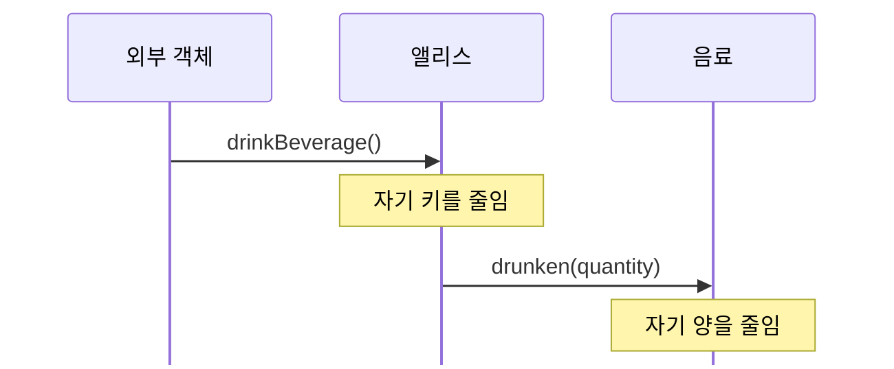
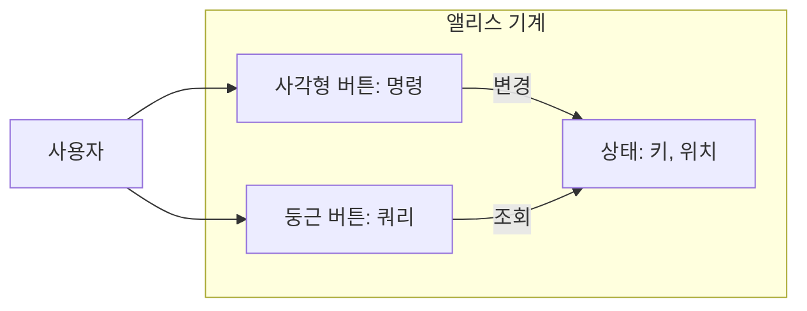
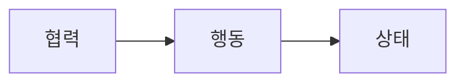

# 2장. 이상한 나라의 객체

## 객체지향과 인지 능력

### 아기와 막대 실험

<mark>가림막 뒤에서 두 막대를 함께 움직인 뒤 가림막을 치움</mark>

- <mark>하나의 막대가 나타남 → 아기는 놀람</mark>
- <mark>두 개의 짧은 막대가 나타남 → 아기는 지루해함</mark>

> 👀 인간은 태어난 지 얼마 안 된 시기부터 **명확한 경계를 가지고 함께 행동하는 물체**를 하나의 단위로 인지한다

인간은 세상을 **식별 가능한 객체의 집합**으로 바라본다

- 물리적인 경계를 지닌 구체적인 사물 : <mark>거리의 사람들, 자동차, 책상 위의 컴퓨터</mark>
- 개념적으로 경계 지을 수 있는 추상적인 개념 : <mark>주문, 계좌 이체</mark>
  - <mark>오늘의 주문과 어제의 주문, 동일한 금액의 계좌 이체도 명확하게 구분 가능</mark>

객체지향 패러다임 → 인간의 인지 능력을 이용해 세상을 객체의 집합으로 이해

### 객체, 그리고 이상한 나라

현실의 객체와 소프트웨어 객체의 유사성은 여기까지

- 현실의 전등은 사람의 손길 없이 불을 밝힐 수 없지만 소프트웨어의 전등은 스스로 전원을 켠다
- 소프트웨어 객체는 현실의 객체와 전혀 다른 모습을 지닌 **이상한 나라**에 산다

---

## 이상한 나라의 앨리스

<mark>앨리스는 정원으로 통하는 40센티미터의 작은 문을 통과하기 위해 키를 줄이거나 늘린다</mark>

- <mark>음료를 마시거나, 부채질을 하거나, 버섯 한쪽을 먹으면 → 작아짐</mark>
- <mark>케이크를 먹거나, 버섯의 반대쪽을 먹으면 → 커짐</mark>

### 앨리스 객체

**상태 : 특정 시점의 앨리스의 키**

- 앨리스의 키를 변화시키는 것은 앨리스의 **행동**
- 행동의 결과를 결정하는 것은 **상태**
  - <mark>키 130cm에서 케이크(+150cm) → 280cm, 이후 부채질(-20cm) → 260cm</mark>
- 행동 간의 순서가 중요하다
  - <mark>문을 통과하려면 먼저 키를 줄이는 행동이 선행돼야 한다</mark>
- 상태가 변해도 앨리스는 앨리스다
  - <mark>키가 집채만큼 커지거나 쐐기벌레를 올려다볼 만큼 작아져도 앨리스는 앨리스</mark>

> 👀
> - 앨리스는 상태를 가지며 상태는 변경 가능하다
> - 앨리스의 상태를 변경시키는 것은 앨리스의 행동이다
>   - 행동의 결과는 상태에 의존적이며 상태를 이용해 서술할 수 있다
>   - 행동의 순서가 결과에 영향을 미친다
> - 앨리스는 어떤 상태에 있더라도 유일하게 식별 가능하다

---

## 객체, 그리고 소프트웨어 나라

객체 = **상태 state**, **행동 behavior**, **식별자 identity**를 지닌 실체

> 객체란 식별 가능한 개체 또는 사물이다. 자동차처럼 만질 수 있는 구체적인 사물일 수도, 시간처럼 추상적인 개념일 수도 있다. 객체는 구별 가능한 식별자, 특징적인 행동, 변경 가능한 상태를 가진다. 소프트웨어 안에서 객체는 저장된 상태와 실행 가능한 코드를 통해 구현된다(p.47).

### 상태

**왜 상태가 필요한가**

어떤 행동의 결과는 과거에 어떤 행동들이 일어났느냐에 의존한다

- <mark>항공권을 발권해야 비행기에 탑승 가능</mark>
- <mark>자판기에 금액을 투입해야 음료 선택 가능</mark>
- <mark>TV 전원을 켜야 채널 변경 가능</mark>

> 👀 과거의 행동 이력으로 현재를 판단하는 방식은 복잡하고 번거롭다
>
> → 행동의 과정과 결과를 단순하게 기술하기 위해 **상태**라는 개념 고안
>
> 상태는 세상의 복잡성을 완화하고 인지 과부하를 줄여주는 중요한 개념

**상태와 프로퍼티**

모든 것이 객체는 아니다

- 숫자, 문자열, 양, 속도, 시간, 날짜, 참/거짓 같은 **단순한 값**은 객체가 아니다
  - <mark>앨리스의 키와 위치, 음료의 양, 문이 열렸는지 여부</mark>
- 단순한 값은 다른 객체의 상태를 표현하는 데 사용된다
- 때로는 객체를 사용해 다른 객체의 상태를 표현한다
  - <mark>앨리스가 음료를 들고 있는 상태 → 앨리스 객체와 음료 객체가 연결</mark>

**프로퍼티 property**

: 객체의 상태를 구성하는 모든 특징

- 프로퍼티 → 일반적으로 변경되지 않음, **정적**
- **프로퍼티 값 property value** → 시간에 따라 변경, **동적**
- <mark>앨리스의 프로퍼티 : 키, 위치, 음료</mark>

프로퍼티의 두 종류

- **속성 attribute** : 객체를 구성하는 단순한 값
  - <mark>앨리스의 키, 위치</mark>
- **링크 link** : 객체와 객체 사이의 의미 있는 연결
  - 링크가 존재해야만 메시지를 주고받을 수 있다
  - 한 객체가 다른 객체의 식별자를 알고 있는 것으로 표현
  - <mark>음료를 버린 뒤에는 링크가 사라져 앨리스와 음료의 협력 불가능</mark>

> 👀 상태는 특정 시점에 객체가 가지고 있는 정보의 집합으로 객체의 구조적 특징을 표현한다
>
> 객체의 상태 = 정적인 프로퍼티 + 동적인 프로퍼티 값<br>
> 프로퍼티 = 단순한 값(속성) + 다른 객체를 참조하는 링크

### 행동

**상태와 행동**

객체의 상태를 변경하는 것은 객체의 자발적인 행동뿐이다

- 행동이 상태를 변경시킨다 → 행동은 **부수 효과 side effect**를 초래한다
  - <mark>케이크를 먹는 행동 → 앨리스의 키 변화 + 케이크의 양 감소</mark>
- 행동의 결과는 상태에 의존적이다
  - <mark>문을 통과할 수 있는지는 현재 키에 달려 있다</mark>

상태를 이용한 행동의 두 가지 서술 관점

- 상호작용이 현재의 상태에 어떤 방식으로 의존하는가
- 상호작용이 어떻게 현재의 상태를 변경시키는가

**협력과 행동**

“어떤 객체도 섬이 아니다”

- 객체가 다른 객체와 협력하는 유일한 방법 → 요청(메시지)을 보내는 것
- 객체는 수신한 메시지에 따라 적절히 행동하면서 협력에 참여하고 그 결과로 자신의 상태를 변경
- 다른 객체의 상태 변경을 유발할 수도 있다
  - <mark>음료를 마시면 앨리스의 키가 작아지는 동시에 음료의 양도 줄어야 한다</mark>

행동의 결과를 서술하는 두 가지 관점

- 객체 자신의 상태 변경
- 행동 내에서 협력하는 다른 객체에 대한 메시지 전송

> 행동이란 외부의 요청 또는 수신된 메시지에 응답하기 위해 동작하고 반응하는 활동이다. 행동의 결과로 객체는 자신의 상태를 변경하거나 다른 객체에게 메시지를 전달할 수 있다. 객체는 행동을 통해 다른 객체와의 협력에 참여하므로 행동은 외부에 가시적이어야 한다(p.55).

**상태 캡슐화**

<mark>현실 세계 : 음료는 수동적인 존재, 음료의 양을 줄이는 주체는 앨리스</mark>

<mark>객체지향 세계 : 음료의 양을 줄이는 것은 음료 자신 → 앨리스는 마셨다는 메시지를 전달할 뿐</mark>



<sub>그림 2.5 메시지를 통한 앨리스와 음료 사이의 협력 관계</sub>

- 메시지 송신자는 수신자의 상태 변경에 대해 전혀 알지 못한다
- 객체가 외부에 노출하는 것은 행동뿐, 상태 변경 여부는 수신자가 자율적으로 결정

> 👀 상태를 잘 정의된 행동 집합 뒤로 캡슐화 → 객체의 자율성 ↑ → 협력 단순·유연

### 식별자

**식별자**

: 객체를 서로 구별할 수 있는 특정한 프로퍼티

- 모든 객체는 식별자를 가진다
- 단순한 값은 식별자를 가지지 않는다 → 값과 객체의 가장 큰 차이

**동등성 equality** - 값

- 상태를 이용해 두 값이 같은지 판단
- 값의 상태는 변하지 않는다 → **불변 상태 immutable state**
- <mark>종이에 적힌 두 개의 숫자 1은 같은 것으로 간주</mark>

**동일성 identical** - 객체

- 식별자를 기반으로 같은 객체인지 판단
- 객체의 상태는 변한다 → **가변 상태 mutable state**
- <mark>이름과 키가 같은 두 앨리스는 서로 다른 사람</mark>
- <mark>어린 시절의 나와 지금의 나는 상태가 달라도 동일한 인물</mark>

```py
from dataclasses import dataclass


@dataclass(frozen=True)
class Height:                         # 값: 상태로 비교(동등성)
    cm: int


class Person:                         # 객체: 식별자로 비교(동일성)
    def __init__(self, name):
        self.name = name


Height(130) == Height(130)            # True
Person("앨리스") == Person("앨리스")    # False
```

용어 구분

- **참조 객체 reference object** / **엔티티 entity** : 식별자를 지닌 전통적인 의미의 객체
- **값 객체 value object** : 식별자를 가지지 않는 값

> 👀 객체지향 언어에서는 값과 객체 모두 클래스로 구현되기 때문에 혼란스러울 수 있다
>
> 객체지향 세계는 상태가 변하지 않는 값과 상태가 변하는 객체들이 균형을 맞추며 조화를 이루는 사회여야 한다

**객체의 특성 요약**

- 객체는 상태를 가지며 상태는 변경 가능하다
- 객체의 상태를 변경시키는 것은 객체의 행동이다
  - 행동의 결과는 상태에 의존적이며 상태를 이용해 서술할 수 있다
  - 행동의 순서가 실행 결과에 영향을 미친다
- 객체는 어떤 상태에 있더라도 유일하게 식별 가능하다

---

## 기계로서의 객체

버트란드 마이어의 은유

- **쿼리 query** : 객체의 상태를 조회하는 작업
- **명령 command** : 객체의 상태를 변경하는 작업

객체 = 차가운 금속 외피로 둘러싸인 블랙박스

- 내부를 직접 볼 수 없고, 외부의 버튼으로만 상호작용
- <mark>사각형 버튼(명령) : 음료를 마시다, 케이크를 먹다, 부채질하다, 버섯을 먹다, 문을 통과하다</mark>
- <mark>둥근 버튼(쿼리) : 위치, 키</mark>



기계 은유가 설명하는 것

- **메시지** : 버튼을 누르는 것 = 메시지 전송, 어떻게 동작할지는 기계 스스로 결정
- **캡슐화** : 버튼 이외의 방법으로는 상태에 접근할 수 없다
- **식별자** : 상태가 동일한 두 기계도 별개의 객체로 인식
- **협력** : <mark>앨리스 기계의 '음료를 마시다' 버튼 → 링크로 연결된 음료 기계의 '마셔지다' 버튼 요청</mark>

> 👀 기계 은유의 가장 큰 장점 : 객체의 캡슐화를 직관적이고 시각적으로 묘사
>
> 상태와 행동이 하나의 단위로 캡슐화된다는 객체의 정의를 효과적으로 표현

---

## 행동이 상태를 결정한다

초보자가 가장 쉽게 빠지는 함정 → 상태를 중심으로 객체를 바라보는 것

<mark>앨리스 객체 설계 시 키와 위치부터 추가하고, 그다음 행동을 고민</mark>

상태를 먼저 결정할 때의 문제

- **캡슐화가 저해된다**
  - 상태가 공용 인터페이스에 그대로 노출될 확률 ↑
- **객체를 협력자가 아닌 고립된 섬으로 만든다**
  - 협력이라는 문맥에서 벗어나 객체를 설계 → 협력에 적합하지 않은 객체
- **객체의 재사용성이 저하된다**
  - 상태에 초점을 맞춘 객체는 다양한 협력에 참여하기 어렵다

> 👀 객체의 적합성을 결정하는 것은 상태가 아니라 **행동**
>
> 협력 → 협력에 필요한 행동 → 행동을 수행할 객체 선택 → 행동에 필요한 상태 결정



- 협력 안에서 객체의 행동 = 객체가 완수해야 하는 **책임**
- **책임-주도 설계 Responsibility-Driven Design, RDD**

  : 협력이라는 문맥 안에서 객체의 행동을 생각하도록 도와 응집도 높고 재사용 가능한 객체를 만든다

### “행동이 상태를 결정한다”

---

## 은유와 객체

### 두 번째 도시전설

“객체지향이란 현실 세계의 모방이다”

- 현실 세계의 객체를 모방한 후 필요한 부분만 취해 소프트웨어 객체로 구현한다는 관점
- **추상화 abstraction** : 실제 사물에서 원하는 특성만 취하고 필요 없는 부분은 추려 핵심만 표현

> 👀 객체지향 세계는 현실 세계의 단순한 모방이 아니다
>
> <mark>소프트웨어 상품은 실제 상품이 하지 못하는 가격 계산을 스스로 수행</mark>

### 의인화 anthropomorphism

소프트웨어 객체는 현실 객체가 가지지 못한 추가적인 능력을 보유한다

- <mark>현실의 트럼프는 스스로 뒤집을 수도, 말할 수도, 걸을 수도 없다</mark>
- <mark>전화기는 스스로 통화 버튼을 누를 수 없고, 계좌는 스스로 금액을 이체할 수 없다</mark>
- 소프트웨어 객체는 현실에서 할 수 없는 일도 할 수 있는 전지전능한 존재
- 현실에 존재하지 않는 것들도 소프트웨어 안에서는 생명을 가진 존재로 재탄생

### 은유 metaphor

: 실제로는 적용되지 않는 한 가지 개념을 이용해 다른 개념을 서술하는 대화의 한 형태

- <mark>“그 여자는 양 같아요” → 순한 양을 이용해 성격 묘사</mark>
- 현실 속 객체의 의미 일부가 소프트웨어 객체로 전달 → 소프트웨어 객체는 현실 객체에 대한 은유
- <mark>현실의 전화기는 스스로 전화를 걸 수 없지만, 전화기라는 개념을 이용하면 전화를 걸 수 있는 객체를 쉽게 이해</mark>

**표현적 차이 representational gap** / **의미적 차이 semantic gap**

: 소프트웨어에 대해 사람들이 생각하는 모습과 실제 소프트웨어 표현 사이의 차이

- 현실 객체의 이름을 소프트웨어 객체의 이름으로 사용하면 표현적 차이가 줄어든다
- → 이해하기 쉽고 유지보수가 용이한 소프트웨어
- 그래서 도메인에서 사용되는 이름을 객체에게 부여하라고 한다

### 이상한 나라를 창조하라

<mark>이상한 나라의 트럼프는 손발이 달려 있고, 체셔 고양이는 웃고, 토끼는 옷을 입은 채 두 발로 선다</mark>

<mark>→ 그럼에도 트럼프가 쉽게 뒤집히고 토끼가 빠르게 달릴 것을 쉽게 예상할 수 있다</mark>

> 👀 객체지향 설계자의 목적은 현실을 모방하는 것이 아니라 **이상한 나라를 창조**하는 것
>
> 현실 객체의 이름이 도움이 된다면 빌려 쓰고, 그렇지 않다면 현실을 무시하고 자유롭게 새로운 세계를 창조하라

---

## 적용

### 1. 값 객체와 엔티티를 구분한다

> **근거:** 값은 동등성, 객체는 식별자를 이용한 동일성으로 비교한다(p.57~59).

- **값 객체:** 금액, 기간, 주소, 좌표처럼 값이 같으면 같은 것으로 본다. 불변으로 만든다.
- **엔티티:** 회원, 주문처럼 상태가 바뀌어도 같은 대상으로 추적한다. ID로 비교한다.

```py
from dataclasses import dataclass


@dataclass(frozen=True)                         # 값 객체: 불변, 값으로 비교(동등성)
class Money:
    amount: int


class Order:                                    # 엔티티: ID로 구별
    def __init__(self, order_id, amount):
        self.order_id = order_id
        self.amount = amount                    # 상태는 바뀔 수 있음

    def __eq__(self, other):                    # 상태가 아니라 ID로 비교(동일성)
        return isinstance(other, Order) and self.order_id == other.order_id


Money(1000) == Money(1000)                      # True: 값이 같으면 같은 금액
Order(1, Money(1000)) == Order(2, Money(1000))  # False: 금액이 같아도 다른 주문
Order(1, Money(1000)) == Order(1, Money(3000))  # True: 금액이 달라도 같은 주문
```

→ 내용이 같은 두 주문을 같은 주문으로 판단하거나, 금액이 바뀐 주문을 다른 주문로 판단하는 버그를 막을 수 있다.

### 2. 상태를 꺼내서 바꾸지 말고 요청한다

> **근거:** 앨리스는 음료의 양을 직접 줄이지 않고, 마셨다는 메시지를 보낼 뿐이다(p.55~56).

- 서비스나 API 핸들러에서 필드를 직접 바꾸지 않고, 객체의 메서드를 호출한다.
- 취소 가능 여부 같은 규칙은 그 객체 안에 둔다.

```py
# 피할 것: 같은 취소 규칙이 세 곳에 흩어짐

# API: 사용자가 앱에서 직접 취소
if order.status == "PAID":
    order.status = "CANCELED"

# 배치: 처리되지 않은 주문을 자동 취소
if order.status == "PAID":
    order.status = "CANCELED"

# 관리자 기능: 운영자가 관리자 페이지에서 취소
if order.status == "PAID":
    order.status = "CANCELED"
```

```py
# 권장: 취소 규칙이 Order 한곳에 있음
class Order:
    def cancel(self):
        if self._status != "PAID":
            raise ValueError("취소할 수 없는 주문")  # 취소 가능 여부는 Order가 판단
        self._status = "CANCELED"                    # 상태 변경도 Order가 직접


# API, 배치, 관리자 기능 모두 요청만 보냄
order.cancel()
```

→ 취소 규칙이 바뀌어도 `cancel()` 하나만 고치면 되고, 테스트도 `Order` 단위로 작성할 수 있다.

### 3. 조회와 변경을 분리한다

> **근거:** 객체의 행동은 상태를 변경하는 명령과 상태를 조회하는 쿼리로 나뉜다(p.60~62).

- `get_`, `is_`로 시작하는 메서드는 상태를 바꾸지 않는다.
- API에서도 GET 요청이 데이터를 바꾸지 않게 한다. 크롤러나 캐시가 GET을 반복 호출해도 안전해야 한다.

```py
# 피할 것: 조회처럼 보이는데 조회수를 올림
def get_post(self, post_id):
    post = self.repo.find(post_id)
    post.views += 1
    return post

# 권장: 조회와 변경을 분리
post = service.get_post(post_id)
service.increase_views(post_id)
```

→ 조회 메서드를 여러 번 호출해도 결과가 바뀌지 않아 디버깅과 캐싱이 쉬워진다.

### 4. 테이블보다 기능을 먼저 정한다

> **근거:** 행동이 상태를 결정한다(p.64~66).

- 새 기능을 만들 때 ERD부터 그리지 않고, API 명세나 유스케이스로 필요한 요청 목록을 먼저 적는다.
- 각 요청에 필요한 데이터만 필드와 컬럼으로 추가한다.

```txt
쿠폰 기능
1. 행동: 발급한다, 사용한다, 만료됐는지 확인한다
2. 필요한 상태: 만료일, 사용 여부, 사용 일시
3. 이후 테이블 설계
```

→ 쓰이지 않는 컬럼이 줄고, 테이블 구조가 그대로 코드 구조가 되는 것을 막을 수 있다.
