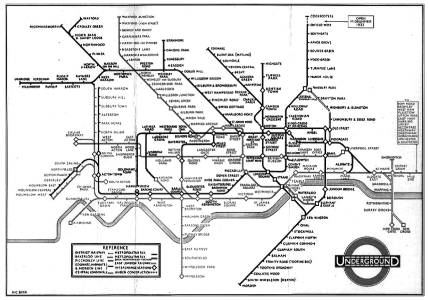
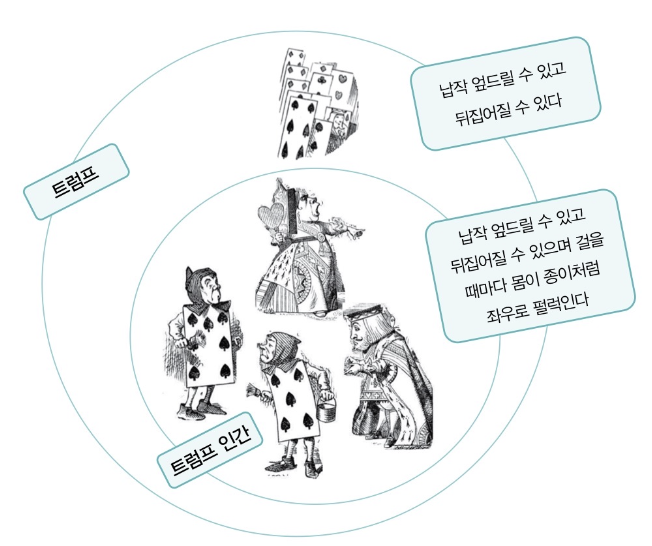
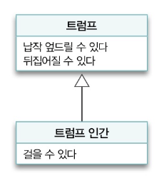

# 3장. 타입과 추상화

## 런던 지하철 노선도

초기의 노선도


- 실제와 유사한 물리적 지형
- 역 간 거리 사실적 묘사

> 👀 지하철 이용객들의 목적<br>
> : 역과 역 간의 이동, 출발지와 환승지, 가장 쉽고 빠른 이동 방법
>
> → 역과 역 사이의 연결성의 직관적이고 단순한 표현 요구

해리 벡의 노선도

**“추상화”**



- 사실적인 지형과 축척 무시

> 👀 몰라도 되는 정보는 무시 → 이해하기 쉽고 단순하며 목적에 부합

---

## 추상화를 통한 복잡성 극복

“추상화”

- 현실에서 출발하되 불필요한 부분을 도려내가면서 사물의 본질을 드러나게 하는 과정(Root-Bernstein 2001)
- 어떤 양상, 세부 사항, 구조를 좀 더 명확하게 이해하기 위해 특정 절차나 물체를 의도적으로 생략하거나 감춤으로써 복잡도를 극복하는 방법

추상화가 이루어지는 두 차원 (Kramer 2007)

: 복잡성 → 단순화

- 구체적인 사물들 간의 공통점은 취하고 차이점은 버린다
- 중요한 부분을 강조하기 위해 불필요한 세부사항은 제거한다

---

## 객체지향과 추상화

*<mark>“기껏해야 트럼프에 불과해”</mark>*

<mark>정원사들, 병사들, 왕자와 공주, 왕과 왕비들, 하트 왕과 하트 여왕, 신하와 하트 잭 → 트럼프</mark>

### 그룹으로 나누어 단순화하기

각 인물들에게는 서로를 구별할 수 있는 독특한 특징 존재

> 👀 객체지향 패러다임에서의 **객체**<br>
> : 명확한 경계를 가지고 서로 구별할 수 있는 구체적인 사람 또는 사물

<mark>‘트럼프’를 떠올렸을 때 떠오르는 일반적인 외형과 행동 방식에 해당되는가?</mark>

<mark>→ 정원사들, 병사들, 왕자와 공주, 왕과 왕비들, 하트 왕과 하트 여왕, 신하와 하트 잭 (O)</mark>

<mark>→ 시계토끼 (X)</mark>

### 개념 Concept

: 공통점을 기반으로 객체들을 묶기 위한 그릇<br>
: 다양한 사물이나 객체에 적용할 수 있는 아이디어 또는 관념

- 개념을 기반으로 **분류 Classification**할 수 있다
- **인스턴스 Instance** : 객체에 어떤 개념을 적용하는 것이 가능해서 개념 그룹의 일원이 될 때 그 객체
  - 객체 : 특정한 개념을 적용할 수 있는 구체적인 사물
  - 객체 + 개념 → 그 객체는 개념의 인스턴스

> 👀 <mark>정원사들, 병사들, 왕자와 공주, 왕과 왕비들, 하트 왕과 하트 여왕, 신하와 하트 잭 → 트럼프의 인스턴스</mark>
>
> 복잡한 객체들 → 몇 가지 개념의 인스턴스

### 개념의 세 가지 관점

객체의 분류 장치로서의 개념

- 심볼 symbol : 개념을 가리키는 간략한 이름 또는 명칭

  <sub>타입 명</sub>

  - <mark>트럼프</mark>
- 내연 intension : 개념의 완전한 정의 → 객체가 개념에 속하는지 여부 확인 가능

  <sub>타입에 속하기 위한 조건</sub>

  - <mark>몸이 납작하고 두 손과 두 발은 네모 귀퉁이에 달려 있는 등장인물</mark>
- 외연 extension : 개념에 속하는 모든 객체의 집합

  <sub>타입에 속하는 객체들</sub>

  - <mark>정원사들, 병사들, 왕자와 공주, 왕과 왕비들, 하트 왕과 하트 여왕, 신하와 하트 잭</mark>

### 객체를 분류하기 위한 틀 / 분류는 추상화를 위한 도구다

**분류**

: 객체에 특정한 개념을 적용하는 작업

- 어떤 객체를 어떤 개념으로 분류할지 → 객체지향의 품질 결정
- 추상화가 이루어지는 두 차원을 통해 분류
  - 객체 간의 차이 무시, 공통점만 취함

    <mark>정원사들, 병사들, 왕자와 공주, 왕과 왕비들, 하트 왕과 하트 여왕, 신하와 하트 잭 → 트럼프</mark>
  - 불필요한 세부 사항 제거

    <mark>몸이 납작하고 두 손과 두 발이 네모난 몸 모서리에 달려 있다는 특징만 남기고, 나머지는 무시</mark>

---

## 타입

### 타입은 개념이다

type = 개념

: 공통점을 기반으로 객체들을 묶기 위한 틀

- 심볼, 내연, 외연을 이용해 서술 가능
- 타입에 속하는 객체 → 그 타입의 인스턴스

### 데이터 타입

메모리 안에 저장된 데이터의 종류를 분류하는 데 사용하는 메모리 집합에 관한 메타데이터

→ 어떤 종류의 연산이 해당 데이터에 대해 수행될 수 있는지 결정

> 👀 메모리 안에는 0과 1의 비트열만 존재
>
> - 값이 어떤 의미인지 말할 수 X
> - 값을 사용하는 외부의 해석가(e.g. 애플리케이션)에 의해 의미 결정

타입 시스템 type system

- 데이터를 목적에 따라 분류
- 데이터가 잘못 사용되지 않도록 제약사항 부과

**01) 타입은 데이터가 어떻게 사용되느냐에 관한 것이다**

데이터에 적용할 수 있는 작업이 타입을 결정

- 연산자 operator : 데이터를 이용해 수행할 수 있는 작업

  “ 어떤 데이터에 어떤 연산자를 적용할 수 있는가 “

**02) 타입에 속한 데이터 메모리에 표현하는 방식은 외부로부터 철저히 감춰진다**

개발자는 해당 데이터 타입을 사용하기 위해 적용 가능한 연산자만 알고 있으면 된다

### 객체와 타입 / 행동이 우선이다

> 👀 객체는 행위에 따라 변할 수 있는 상태를 가지고 있다
>
> 객체 ≠ 데이터
>
> 객체에서 가장 중요한 것은 객체의 행동

- 어떤 객체가 어떤 타입에 속하는지를 결정하는 것은 객체가 수행하는 행동이다
  - 객체가 어떤 데이터를 보유하고 있는지는 영향을 미치지 않는다
  - 동일한 행동 = 동일한 책임 = 동일한 메시지 수신

    다형성 : 동일한 요청에 서로 다른 방식으로 응답할 수 있는 능력

    동일한 메시지를 서로 다른 방식으로 처리한다 → 동일한 메시지를 수신할 수 있어야 한다.
- 객체의 내부적인 표현은 외부로부터 철저하게 감춰진다
  - 캡슐화 : 외부에 행동만을 제공, 데이터는 뒤로 감추기

> 책임 - 주도 설계 (Responsibility - Driven Design)

<mark>정원사들, 병사들, 왕자와 공주, 왕과 왕비들, 하트 왕과 하트 여왕, 신하와 하트 잭을</mark>

<mark>트럼프라는 타입으로 분류</mark>

<mark>그들이 동일한 방식에 따라 행동했기 때문</mark>

- <mark>납작한 몸 → 종이처럼 납작 엎드림, 강한 바람에 뒤집어짐</mark>
- <mark>네모 귀퉁이에 손과 발 → 걸을 때마다 몸이 좌우로 펄럭거림</mark>

---

## 타입의 계층

### 트럼프 계층



<sub>트럼프 인간 타입의 외연은 트럼프 타입의 외연의 부분집합</sub>

<mark>트럼프 카드 : 납작 엎드리기, 뒤집어지기</mark> - 일반적인 개념

<mark>트럼프 인간 : 납작 엎드리기, 뒤집어지기 + 걸어다니기</mark> - 특수한 개념

<mark>→ 트럼프 인간은 트럼프의 일종이지만 좀 더 특화된 행동을 하는 트럼프</mark>

### 일반화 generalization / 특수화 specialization 관계

일반화와 특수화는 동시에 발생

“ 더 특수하다 “ = 일반적인 개념보다 범위가 좁다 → 객체 수가 더 적다

객체가 외부에 제공하는 **행동**에 따라 결정

- 일반적 타입 : 특수한 타입이 가진 모든 행동들 중 일부만 가지는 타입
  - 더 적은 수의 행동
  - 더 큰 크기의 외연 집합
- 특수한 타입 : 일반적 타입이 가진 모든 행동 포함 + 자신만의 행동
  - 더 많은 수의 행동
  - 더 작은 크기의 외연 집합

### 슈퍼타입 Supertype과 서브타입 Subtype

일반적인 타입 - Supertype / 특수한 타입 - Subtype

- 두 타입 간의 관계는 행동에 의해 결정
- 서브타입은 슈퍼타입의 행동과 호환되어 슈퍼타입을 대체할 수 있어야 함

일반화/특수화 관계 표기법



- 상단 : 일반적인 타입, 슈퍼 타입 / 하단 : 특수한 타입, 서브 타입
- 중복된 행위 생략 가능
- 슈퍼타입의 행동은 서브타입에게 자동 상속

### 일반화는 추상화를 위한 도구다

*<mark>“기껏해야 트럼프에 불과해”</mark>*

- <mark>정원사들, 병사들, 왕자와 공주, 왕과 왕비들, 하트 왕과 하트 여왕, 신하와 하트 잭 → 트럼프 인간</mark>

  추상화의 첫 번째 차원 : 공통점 강조 - 분류
- <mark>트럼프 인간의 특수한 능력은 제거, 트럼프의 특성에 집중 → 트럼프</mark>

  추상화의 두 번째 차원 : 불필요한 세부사항 제거 - 일반화

⇒ 객체지향의 패러다임 : 분류 + 일반화/특수화 동시 적용

---

## 정적 모델

### 타입의 목적

시간에 따라 동적으로 변하는 객체의 복잡성을 극복하기 어렵기 때문이다

<mark>동적으로 변하는 앨리스의 키에 관계없이 시간에 독립적인 정적인 모습으로 생각할 수 있게 한다</mark>

### 그래서 결국 타입은 추상화다

앨리스의 키가 구체적으로 얼마인가보다 키가 변할 수 있다는 가능성에 집중

→ 타입은 시간에 따른 객체의 상태 변경이라는 복잡성을 단순화

### 동적 모델과 정적 모델

특정 시점에 구체적으로 어떤 상태를 가지느냐<br>
\- 객체의 스냅샷 snapshot / 객체 다이어그램 object diagram

- 동적 모델 dynamic model<br>
  : 객체가 살아 움직이는 동안 상태가 어떻게 변하고 행동하는지 포착

모든 상태와 모든 행동을 시간에 독립적으로 표현<br>
\- 타입 모델 type diagram

- 정적 모델 static model<br>
  : 객체가 속한 타입의 정적인 모습 표현

### 클래스

타입을 구현하는 가장 보편적인 방법

타입을 구현할 수 있는 여러 구현 메커니즘 중 하나

- 타입 : 객체를 분류하는 기준
- 객체의 행동이 타입을 나누는 기준
- 클래스 : 프로그래밍 언어를 이용해 타입을 구현할 수 있는 한 가지 방법

---

## 적용

### 1. 필드가 아니라 메서드로 타입을 나눈다

> **근거:** 객체의 타입은 행동이 결정하고, 데이터는 영향을 주지 않는다(p.93). 클래스는 타입을 구현하는 수단 중 하나다(p.104~105).

- 필드가 비슷하다고 같은 타입으로 묶지 않고, 같은 메서드에 응답하는지로 판단한다.
- 필요한 행동 묶음을 먼저 정의하고, 구현은 나중에 맞춘다. Python에서는 Protocol로 상속 없이 행동만으로 타입을 정의할 수 있다.

```py
# 피할 것: 가진 필드가 다르다고 다른 타입으로 취급
class SmsNotifier:
    def __init__(self, api_key, sender_phone):  # 문자 발송에 필요한 필드
        ...

    def send_sms(self, phone, message): ...


class EmailNotifier:
    def __init__(self, smtp_host, sender_email):  # 이메일 발송에 필요한 필드
        ...

    def send_email(self, email, message): ...


# 호출하는 쪽이 종류마다 분기해야 함
if isinstance(notifier, SmsNotifier):
    notifier.send_sms(user.phone, message)
elif isinstance(notifier, EmailNotifier):
    notifier.send_email(user.email, message)
```

```py
# 권장: "알림을 보낸다"는 행동으로 타입을 정의
from typing import Protocol


class Notifier(Protocol):                       # 타입: "알림을 보낼 수 있는 것"
    def send(self, user, message): ...


class SmsNotifier:                              # Notifier를 상속하지 않아도
    def send(self, user, message): ...          # send()가 있으면 Notifier 타입


class EmailNotifier:
    def send(self, user, message): ...

# 호출하는 쪽은 종류와 상관없이 같은 요청
notifier.send(user, message)
```

→ 필드가 전혀 다른 구현이라도 같은 행동만 있으면 같은 타입으로 다룰 수 있고, 새 알림 방식이 추가돼도 분기문을 고칠 필요가 없다.

### 2. 대체할 수 있을 때만 상속한다

> **근거:** 서브타입은 슈퍼타입의 행동과 호환되어 슈퍼타입을 대체할 수 있어야 한다(p.99~100).

- 상속하기 전에 "슈퍼타입이 쓰이는 모든 곳에 넣어도 문제없는가"를 확인한다.
- 슈퍼타입의 기능을 지원하지 못한다면 상속하지 않고 타입을 나눈다.

```py
# 피할 것: 저장을 못 하는데 저장소를 상속
class Storage:                                # 슈퍼타입: 불러온다, 저장한다
    def load(self, key): ...
    def save(self, file): ...


class ReadOnlyStorage(Storage):               # 서브타입: 저장은 못 함
    def save(self, file):
        raise NotImplementedError


def upload_profile(storage: Storage, file):   # Storage라면 저장할 수 있다고 믿고 호출
    storage.save(file)


upload_profile(Storage(), file)               # 정상 동작
upload_profile(ReadOnlyStorage(), file)       # 에러: Storage 자리에 넣었는데 대체가 안 됨
```

```py
# 권장: 읽기 타입을 따로 두고, 할 수 있는 것만 구현
class Reader(Protocol):
    def load(self, key): ...


class ReadOnlyStorage:                        # load()만 있으므로 Reader 타입
    def load(self, key): ...


def show_profile(reader: Reader, key):        # 읽기만 필요한 곳에서만 사용
    return reader.load(key)
```

→ 저장소 자리에 잘못 넣었다가 실행 중에 에러가 나는 일이 없고, 읽기만 필요한 곳에서만 쓰이게 된다.

<details>
<summary>대체는 되지만 상속하면 안 되는 경우 - Stack</summary>

<br>

스택은 접시를 쌓듯이 **마지막에 넣은 것을 먼저 꺼내는** 자료구조다.<br>
위에 올리기(`push`)와 위에서 꺼내기(`pop`)만 할 수 있어야 한다.

```py
# 피할 것: list 기능을 재사용하려고 상속
class Stack(list):
    def push(self, item):
        self.append(item)


stack = Stack()
stack.push("A")
stack.push("B")
stack.insert(0, "C")         # list에서 물려받은 기능으로 맨 아래에 끼워 넣음
stack[1]                     # 중간 원소에도 접근 가능
```

Stack은 list의 기능을 전부 가졌으므로 list 자리에 넣어도 문제없이 동작한다. 그래서 대체 가능성 기준은 통과한다.

- **문제점:** `insert()`, 인덱스 접근처럼 스택에 없어야 할 기능까지 물려받아, 접시 더미 중간에 접시를 끼우는 일이 가능해진다. 책은 같은 데이터를 가져도 다른 행동을 하면 다른 타입으로 분류해야 한다고 한다(p.93). 이 기준으로 보면 스택은 list와 다른 타입이다.

```py
# 권장: list를 내부에 두고 필요한 행동만 공개
class Stack:
    def __init__(self):
        self._items = []     # list는 안에서만 사용

    def push(self, item):
        self._items.append(item)

    def pop(self):
        return self._items.pop()


stack = Stack()
stack.insert(0, "C")         # 에러: Stack에는 insert()가 없음
```

→ 기능만 빌려 쓰고 싶다면 상속 대신 내부에 두면, 스택 규칙을 깨는 기능이 밖으로 노출되지 않는다.

**실제 사례: Java의 `Stack extends Vector`**

- Java의 `Stack`은 크기가 바뀌는 배열 리스트인 `Vector`를 상속해 만들어졌다.
- 그 결과 `stack.get(3)`처럼 중간 원소에 접근할 수 있고, 반복문으로 순회하면 꺼내는 순서가 아니라 넣은 순서대로 나온다.
- Java 공식 문서도 `Stack` 대신 `Deque` 사용을 권장한다.

</details>

### 3. 사용하는 쪽은 필요한 행동만 가진 타입에 의존한다

> **근거:** 일반화는 불필요한 특수 행동을 버리는 추상화다(p.100~101). 앨리스는 걷는 능력이 필요 없어서 트럼프 인간을 트럼프로 봤다. 해리 벡이 지형을 버리고 연결만 남긴 것처럼, 목적에 필요 없는 정보는 버린다.

- 함수의 매개변수는 구체적인 클래스가 아니라, 실제로 쓰는 행동만 가진 슈퍼타입으로 받는다.

```py
class PaymentMethod(Protocol):                          # 슈퍼타입: 결제한다
    def pay(self, amount): ...


class CardPayment:                                      # 서브타입: 결제한다 + 할부한다
    def pay(self, amount): ...
    def pay_in_installments(self, amount, months): ...  # 카드만의 행동


# 피할 것: 카드 결제만 받을 수 있음
def place_order(order, payment: CardPayment):
    payment.pay(order.amount)


# 권장: 주문에는 pay()만 필요하므로 할부는 몰라도 됨
def place_order(order, payment: PaymentMethod):
    payment.pay(order.amount)
```

→ 새 결제 수단이 추가돼도 주문 코드는 그대로고, 테스트에서는 가짜 결제 수단을 넣을 수 있다.
