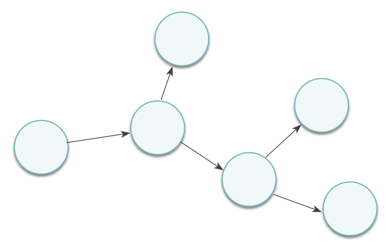
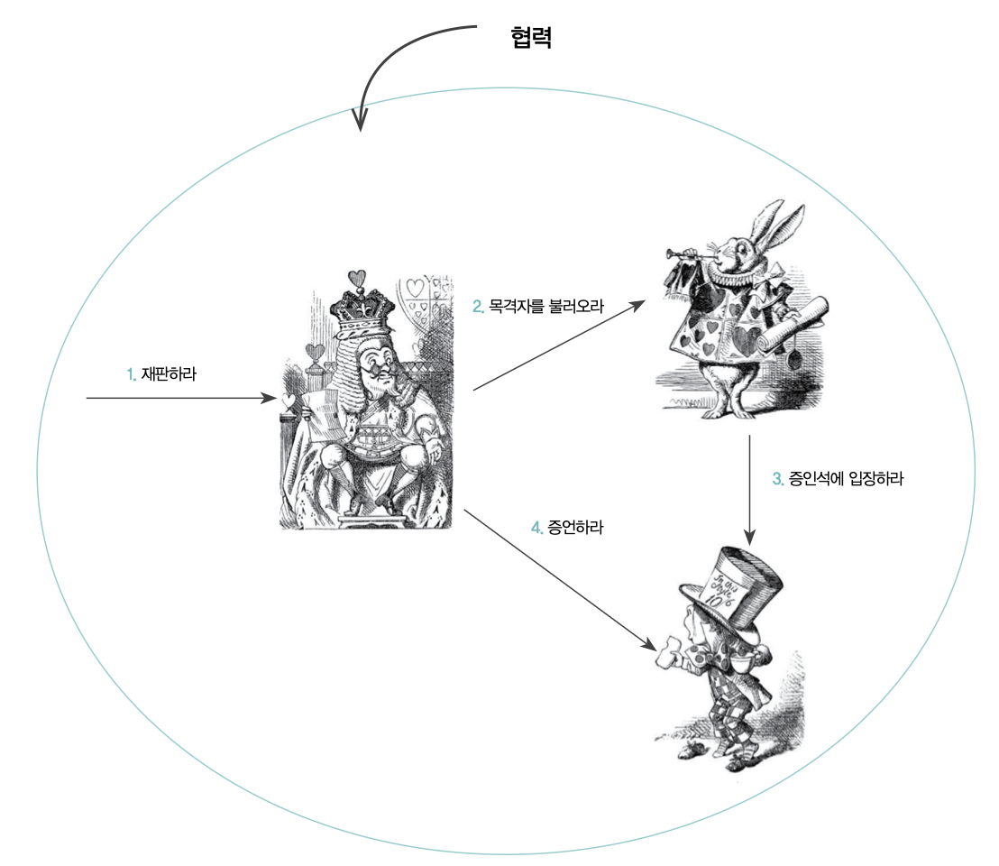
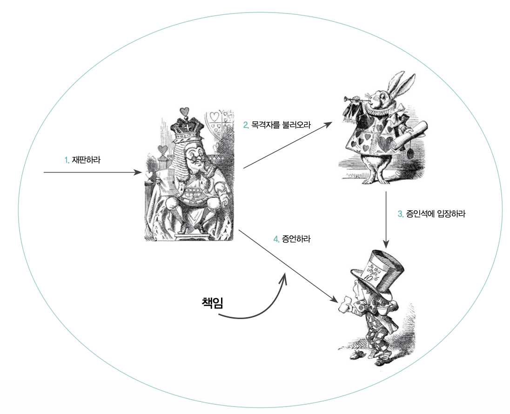
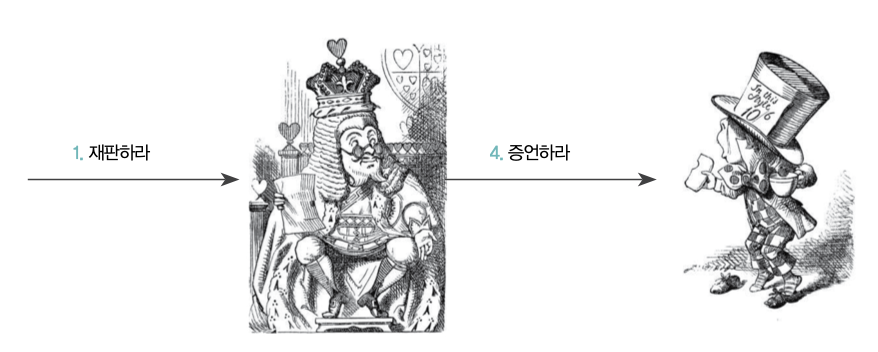
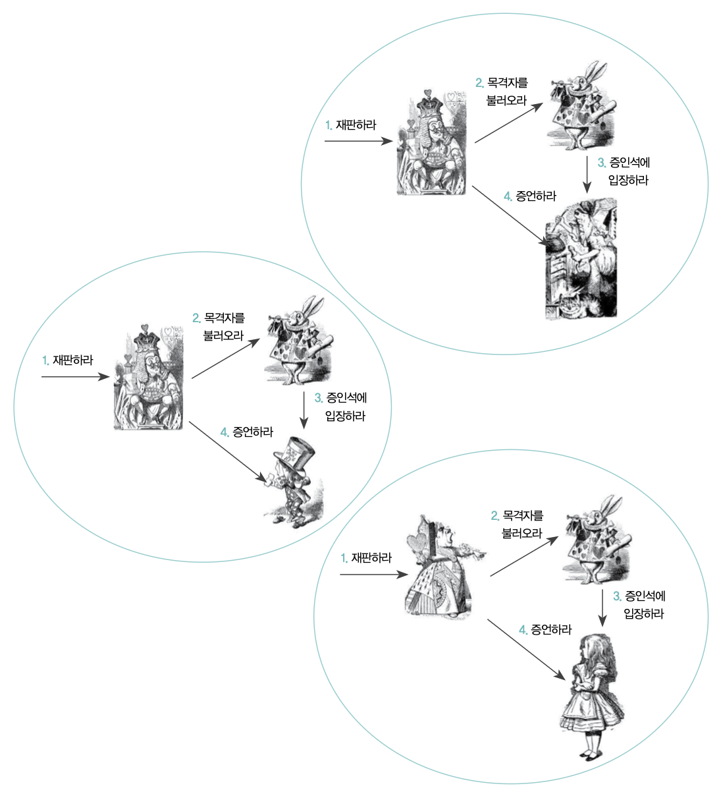
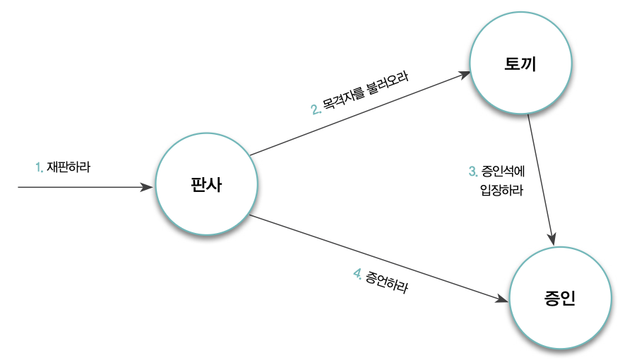
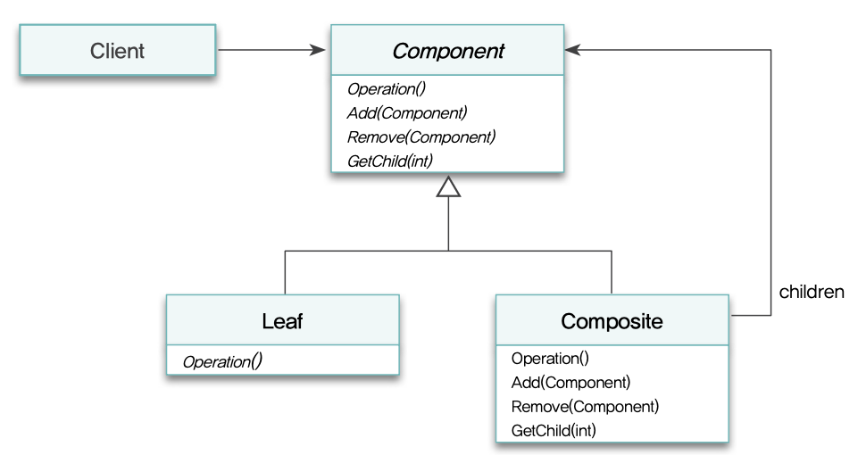
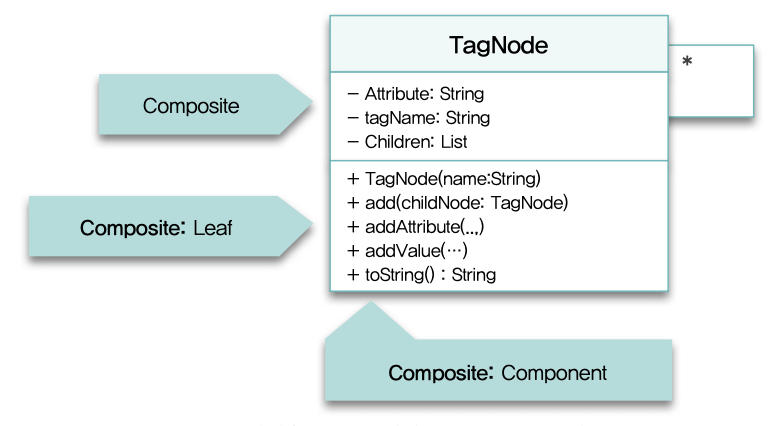

# 4장. 역할, 책임, 협력

## 우리 모두를 합친 것보다 더 현명한 사람은 없다

### 경제학 게임 “최후통첩 게임” - 베르너 귀스

- 제안자가 일정 금액을 응답자와 나눠 가져야 하며, 단 한 번의 기회가 주어진다.
- 제안자가 응답자에게 비율을 제안하고, 응답자는 승낙 또는 거절할 수 있다.
  - 승낙 → 제안한 비율대로 나눠 가진다.
  - 거부 → 제안자와 응답자 모두 한 푼의 돈도 바을 수 없다.

“인간이 이기적인 존재라면”

제안자는 응답자에게 항상 최소한의 금액만을 제시할 것이다

→ 결과 : 40% 이상을 제안한 비율이 가장 높았다

“인간이 합리적인 존재라면”

응답자는 제안자가 제시한 금액을 무조건 수용할 것이다.

→ 결과 : 20% 이하의 금액을 제안받은 경우 대부분의 응답자가 제안 거부

> 👀 “가지려면 받고 아니면 말라” 
> : 인간은 합리적인 선택을 하지 못하고 감정적으로 대응한다.
>
> 인간의 본질적인 특성이 아닌, 
> 개인이 처해 있는 정황 또는 문맥이 인간의 행동 방식을 결정한다.
>
> **인간의 행동을 결정하는 문맥은 타인과의 협력이다.**

> 👀 객체지향의 협력
>
> 어떤 협력에 참여하는가? → 객체에 필요한 행동 결정 → 객체의 상태 결정

## 협력

### 요청하고 응답하며 협력하는 사람들

- 시작 : 한 사람이 다른 사람에게 도움을 요청
- 다수의 연쇄적인 요청과 응답의 흐름

### 누가 파이를 훔쳤지?

<mark>목적 : 하트 잭에게 죄가 있는지 판단하고, 만약 죄가 있다면 어떤 형량을 부과할지 결정</mark>

<mark>왕과 하얀 토끼, 모자 장수 라고 불리는 객체들은 동일한 목적을 달성하기 위해 협력하고 있다</mark>

객체지향의 세계 
: 동일한 목적을 달성하기 위해 협력하는 객들의 공동체

### 재판 속의 협력

<mark>모자 장수의 증언</mark>

- <mark>시작 : 누군가 왕에게 재판 요청</mark>
- <mark>왕 → 하얀 토끼 : 증인을 부를 것을 요청</mark>
- <mark>하얀 토끼 → 모자 장수 : 증인석으로 입장할 것은 요청</mark>

<mark>→ 모자 장수가 증인석에 입장</mark>

- <mark>토끼의 요청에 응답</mark>
- <mark>왕이 토끼에게 요청했던 증인 호출에 대한 응답</mark>

<mark>특정한 요청을 받아들일 수 있는 이유는 그 요청에 대해 적절한 방식으로 응답하는 데 필요한 지식과 행동 방식을 가지고 있기 때문이다</mark>

- <mark>왕 : 재판에 필요한 지식을 알고 있음</mark>
- <mark>하얀 토끼 : 목격자에 대해 알고 있으며, 목격자를 부를 의무 존재</mark>
- <mark>모자 장수 : 재판에 도움이 될 만한 사건의 내용에 대해 조금이라도 알고 있으며, 증언할 의무 존재</mark>

요청-응답은 협력에 참여하는 객체가 수행할 책임을 정의

## 책임

“책임을 가진다” in 객체지향의 세계

어떤 객체가 어떤 요청에 대해 대답해 줄 수 있거나, 적절한 행동을 할 의무가 있는 경우

> “객체지향 개발에서 가장 중요한 능력은 책임을 능숙하게 소프트웨어 객체에 할당하는 것” - 크레이그 라만(Craig Larman)

### 책임의 분류

- knowing - 무엇을 알고 있는가
  - 개인적인 정보에 관해 아는 것
  - 관련된 객체에 관해 아는 것
  - 자신이 유도하거나 계산할 수 있는 것에 관해 아는 것
- doing - 무엇을 할 수 있는가
  - 객체를 생성, 계산하는 등의 스스로 하는 것
  - 다른 객체의 행동을 시작시키는 것
  - 다른 객체의 활동을 제어, 조절하는 것

<mark>[재판을 수행하라] 요청 → 재판을 수행할 책임</mark>

- doing : 다른 객체들의 활동을 제어 및 조율

<mark>[목격자를 불러오라] 요청 → 목격자를 불러올 책임</mark>

- knowing : 관련된 객체에 대해 아는 것
- doing : 다른 객체의 행동을 시작시키는 것

<mark>[증인석에 입장] [증언] 요청 → 증인석에 입장해 증언할 책임</mark>

- doing : 객체를 생성하거나 계산을 하는 듯의 스스로 하는 것
- knowing : 자신이 유도하거나 계산할 수 있는 것에 관해 아는 것

> 👀 객체의 책임 전제 : 외부에서 접근 가능한 공용 서비스 관점
>
> 책임 = 외부에 제공해 줄 수 있는 정보[아는 것] + 외부에 제공해 줄 수 있는 서비스[하는 것]
>
> → 책임은 객체의 공용 인터페이스 public interface를 구성

### 책임과 메시지

메시지 전송 message-send

: 객체가 다른 객체에세 주어진 **책임**을 수행하도록 요청을 보내는 것

→ 두 객체의 **협력**은 메시지를 통해 이루어진다

<mark>왕과 모자 장수가 협력할 수 있는 이유</mark>

<mark>: 왕이 모자 장수가 이해할 수 있는 메시지를 전송할 수 있고, 
모자 장수는 왕이 전송하는 메시지에 대해 적절한 책임을 수행할 수 있기 때문</mark>

책임 결정 → 협력 정제 → 메시지 변환 : 하나의 메시지가 여러 메시지로 분할

> 👀 객체지향 설계는
>
> 협력에 참여하기 위해 
> 어떤 객체가 어떤 책임을 수행해야 하고 
> 어떤 객체로부터 메시지를 수신할 것인지 결정하는 것
>
> 으로부터 시작

## 역할

### 판사와 증인

- → 왕 : 재판 요청 ⇒ 재판 시작[응답]
- 왕 → 하얀토끼 : 증인 부를 것 요청
- 하얀토끼 → 모자 장수 : 증인석으로 입장할 것을 요청 ⇒ 입장[응답]
- 왕 → 모자 장수 : 증언할 것을 요청 ⇒ 증언[응답]

---

- → 왕 : 재판 요청 ⇒ 재판 시작[응답]
- 왕 → 하얀토끼 : 증인 부를 것 요청
- 하얀토끼 → 요리사 : 증인석으로 입장할 것을 요청 ⇒ 입장[응답]
- 왕 → 요리사 : 증언할 것을 요청 ⇒ 증언[응답]

---

- → 여왕 : 재판 요청 ⇒ 재판 시작[응답]
- 여왕 → 하얀토끼 : 증인 부를 것 요청
- 하얀토끼 → 앨리스 : 증인석으로 입장할 것을 요청 ⇒ 입장[응답]
- 여왕 → 앨리스 : 증언할 것을 요청 ⇒ 증언[응답]

### 역할이 답이다

판사 : 하트 왕 / 하트 여왕

증인 : 모자 장수 / 요리사 / 앨리스

- → 판사 : 재판 요청 ⇒ 재판 시작[응답]
- 판사 → 하얀토끼 : 증인 부를 것 요청
- 하얀토끼 → 증인 : 증인석으로 입장할 것을 요청 ⇒ 입장[응답]
- 판사 → 증인 : 증언할 것을 요청 ⇒ 증언[응답]

역할 role

“ 이 자리는 해당 역할을 수행할 수 있는 어떤 객체라도 대신할 수 있습니다”

협력 내에서 다른 객체로 대체할 수 있음을 나타내는 일종의 표식

- 어떤 객체 : 동일한 메시지를 이해할 수 있는 객체

  \*\* 메시지 = 책임

> 👀 동일한 역할을 수행할 수 있다 
> = 동일한 책임의 집합을 수행할 수 있다 
> = 동일한 메시지를 수신할 수 있다
>
> - 단순성 simplicity : 인지 과부하 감소
> - 유연성 flexibility : 유연한 협력
> - 재사용성 reusability : 다양한 객체들이 동일한 협력에 참여 가능

### 협력의 추상화

- 설계자가 다뤄야 하는 협력의 개수 감소
- 구체적인 객체를 추상적인 역할로 대체

→ 애플리케이션의 설계 이해 용이

왕<mark> - 하얀 토끼 - 모자 장수</mark>

<mark>왕 - 하얀 토끼 - 요리사</mark>

<mark>왕 - 하얀 토끼 - 앨리스</mark>

<mark>판사 - 하얀 토끼 - 증인</mark>

### 대체 가능성

역할 
= 구체적인 객체로 대체될 수 있는 추상적인 협력자 
= 다른 객체에 의해 대체 가능

[일반화] 역할이 암시하는 책임 + [특수화] @

> 👀 대체 가능성 = 행위 호환성 = 동일한 책임 수행

## 객체의 모양을 결정하는 협력

### 흔한 오류

오류01 ) 객체는 시스템에 피요한 데이터를 저장하기 위해 존재한다

→ 객체는 행위를 수행하며 협력에 참여하기 위해 존재한다

오류02 ) 객체지향이 클래스와 클래스 간의 관계를 표현하는 시스템 정적인 측면에 중점을 둔다

→ 협력에 참여하는 동적인 객체가 중요하고, 클래스는 단지 객체를 표현하기 위한 구현 메커니즘

왕

- 수염 + 근엄하게 앉아있는 모습 (X)
- 재판이라는 협력에 ‘판사’역할로 죄인의 죄를 판결하는 책임 수행 가능 (O)

### 협력을 따라 흐르는 객체의 책임

올바른 객체 설계 → 먼저 견고하고 깔끔한 협력 설계

- 협력 설계 = 객체들이 주고받을 요청과 응답의 흐름 결정
- 결정된 요청과 응답의 흐름 = 객체가 협력에 참여하기 위해 수행할 책임

객체에게 책임 할당 → 책임 = 객체가 외부에 제공하게 될 행동

협력 → 책임(행동) → 행동에 필요한 데이터 → 클래스 구현 방법

→ 클래스와 데이터는 협력과 책임의 집합이 결정된 후에야 등장

<mark>재판에 필요한 책임 고안 : 재판 진행, 증인 호출, 증언</mark>

- <mark>책임을 수행할 객체 선택 → 왕, 하얀 토끼, 모자 장수에게 할당</mark>
- <mark>할당된 책임 → 각 객체가 외부에 제공할 행동 정의</mark>
- <mark>행동 결정 → 각 객체에 필요한 데이터 정의</mark>
- <mark>데이터와 행동 결정 → 왕, 하얀 토끼, 모자 장수를 구현하는 클래스 개발</mark>

> 👀 객체지향 설계의 품질 
> : 협력에 필요한 책임을 결정하고 객체에게 할당하는 과정을 얼마나 합리적이고 적절하게 수행했는가
>
> 객체의 상태와 행위를 고민하기 전에 객체가 참여할 문맥인 **협력**을 정의하라
>
> 충분히 자율적인 동시에 충분히 협력적인 객체 만들기 
> : 먼저 충분히 협력적으로 → 협력이라는 문맥 안에서 충분히 자율적으로

## 객체지향 설계 기법

### 책임-주도 설계 Responsibility-Driven Design

협력에 필요한 책임들을 식별하고 적합한 객체에게 책임을 할당하는 방식

- 시스템이 사용자에게 제공해야 하는 기능인 시스템 책임 파악
- 시스템 책임을 더 작은 책임으로 분할
- 분할된 책임을 수행 가능한 적절한 객체 또는 역할을 찾아 책임 할당
- 객체가 책임을 수행하는 중 다른 객체의 도움이 필요한 경우 적절한 객체 또는 역할을 찾아 책임 할당

⇒ 두 객체의 협력

### 디자인 패턴 Design Pattern

전문가들이 반복적으로 사용하는 해결 방법을 정의해둔 설계 템플릿 모음

- “부분과 전체가 투명하고 동일한 인터페이스를 제공해야 한다”
- 유사한 상황에서 반복적으로 적용할 수 있는 책임-주도 설계의 결과물

**COMPOSITE 패턴** 
: 전체와 부분을 하나의 단위로 추상화

→ 클라이언트 입장에서 메시지 수신자가 부분[파일]인지 전체[폴더]인지 상관없이 동일한 메시지[경로변경]를 이용해 동일한 방식으로 대상과 상호작용하고 싶을 때 사용

ex) 폴더의 경로 변경 → 그 안에 포함된 모든 파일 경로 변경

클래스와 메서드 X → 협력에 참여하는 역할과 책임

- Component

  클라이언트와 협력할 수 있는 공용 인터페이스 정의

  다른 Component 추가 Add() / 제거 Remove() 
  / 포함된 Component반환 GetChild() 책임을 가짐
- Leaf

  공용 인터페이스에 대한 오퍼레이션 호출에 응답할 수 있는 기본적인 행위 구현
- Composite

  외부로부터 부분에 대한 세부 사항을 감추고 포함된 부분을 하나의 단위로 행동
- Client

  Component에게 메시지를 요청함으로써 협력하는 임의의 역할

> 👀 Component, Leaf, Composite이 역할이라는 사실은 
> 실제 구현 시 다양한 방식으로 역할을 구현할 수 있다는 사실을 암시한다
>
> 

### 테스트-주도 개발 Test-Driven Development

테스트를 먼저 작성하고 테스트를 통과하는 코드를 추가하며 완성하는 방식

> 👀 책임-주도 설계의 기본 개념과 다양한 원칙, 프랙티스, 패턴을 종합적으로 이해하고 좋은 설계에 대한 감각과 경험을 길러야만 적용할 수 있다
