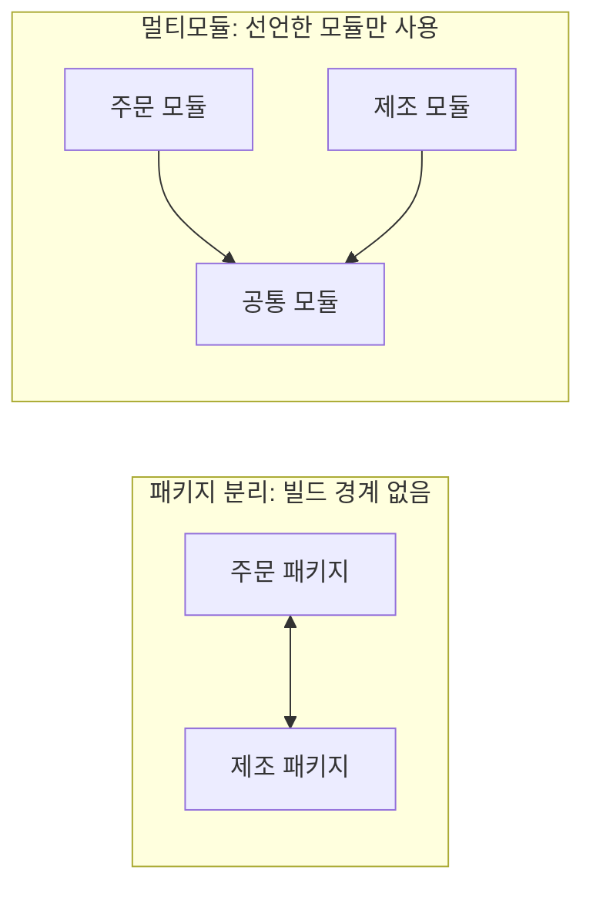
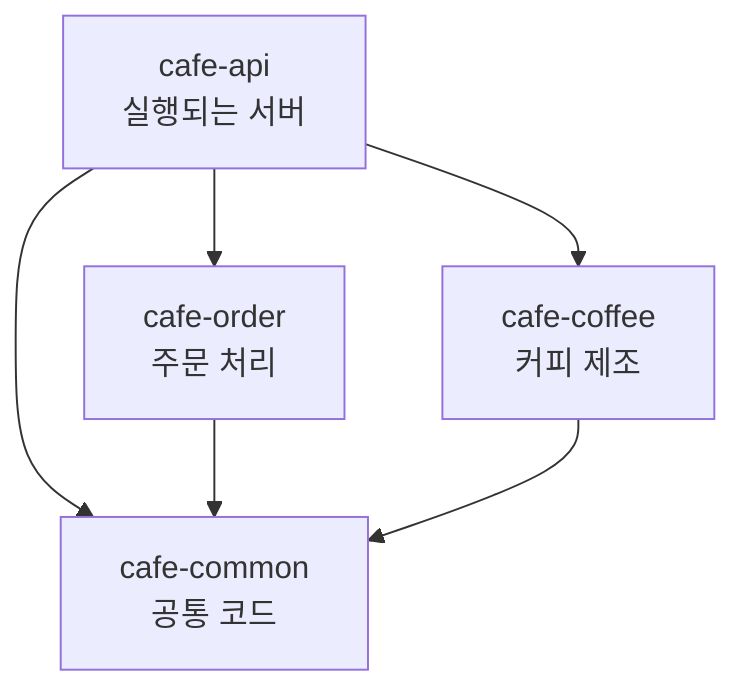

# 객체의 역할과 책임으로 보는 멀티모듈

## 1. 한 줄로 말하면

멀티모듈은 **하나의 프로젝트를 역할별로 나누고, 서로 사용할 수 있는 범위를 정해 두는 구조**입니다.

## 2. 카페로 이해하기

책에 나온 카페를 코드라고 생각해 보겠습니다.

| 구조 | 카페 비유 | 코드에서는 |
| --- | --- | --- |
| 패키지 분리 | 한 공간에 "주문 구역", "제조 구역" 팻말만 세워 둔 상태 | 폴더는 나뉘어 있지만 `public` 클래스는 쉽게 가져다 쓸 수 있음 |
| 멀티모듈 | 같은 건물 안에 방을 나누고 출입 권한을 정한 상태 | 사용한다고 선언한 모듈의 코드만 쓸 수 있음 |



코드는 여러 모듈로 나뉘어 있어도, 실행되는 서버는 하나일 수 있습니다.

## 3. 모듈이란

모듈은 **따로 빌드할 수 있는 코드 묶음**입니다.
각 모듈은 자신의 코드와 설정 파일(`build.gradle`)을 가집니다.

아래 카페 프로젝트는 설명을 위해 만든 예시입니다.

```text
cafe/
├── settings.gradle   프로젝트에 어떤 모듈이 있는지 등록
├── cafe-api/         요청을 받는 곳. 실행되는 서버
├── cafe-order/       주문 처리
├── cafe-coffee/      커피 제조
└── cafe-common/      모두가 쓰는 공통 코드
```



## 4. 어떻게 동작할까

### 1단계: 모듈 등록

```groovy
// settings.gradle
rootProject.name = 'cafe'
include 'cafe-api'
include 'cafe-order'
include 'cafe-coffee'
include 'cafe-common'
```

### 2단계: 사용할 모듈 선언

```groovy
// cafe-api/build.gradle
dependencies {
    implementation project(":cafe-order")
    implementation project(":cafe-coffee")
    implementation project(":cafe-common")
}

// cafe-order/build.gradle
dependencies {
    implementation project(":cafe-common")
}
```

`cafe-api`는 세 모듈을 쓸 수 있습니다.
`cafe-order`는 `cafe-common`만 쓸 수 있습니다.

### 3단계: 선언하지 않은 코드는 사용 불가

`cafe-order`에서 `cafe-coffee`의 클래스를 가져오면 컴파일 에러가 납니다.

```java
// cafe-order 모듈
import com.cafe.coffee.CoffeeMachine; // 컴파일 에러
```

"주문 코드는 커피 머신을 직접 건드리지 말자"는 약속을 빌드 단계에서 확인할 수 있습니다.

### 4단계: 실행은 하나로

`cafe-order` 같은 모듈은 혼자 실행되지 않고 부품처럼 쓰입니다.
`cafe-api`를 빌드하면 필요한 모듈까지 함께 묶여 실행 파일이 됩니다.

## 5. 왜 쓸까

| 이유 | 쉽게 말하면 |
| --- | --- |
| 경계 지키기 | 쓰면 안 되는 코드를 쓰면 빌드에서 바로 알 수 있습니다. |
| 수정 영향 파악 | 어떤 모듈이 영향을 받는지 따라가기 쉽습니다. |
| 코드 재사용 | API 서버와 배치 서버가 같은 주문 모듈을 함께 쓸 수 있습니다. |
| 의존성 분리 | DB가 필요 없는 모듈에는 DB 라이브러리를 넣지 않아도 됩니다. |

## 6. 객체의 역할, 책임과 무엇이 닮았을까

책은 모듈을 직접 다루지 않습니다. 아래 내용은 책의 관점을 넓혀 본 제 해석입니다.

| 객체에서 하는 고민 | 모듈에서 하는 고민 |
| --- | --- |
| 이 객체의 책임은 무엇인가? (p.30) | 이 모듈의 책임은 무엇인가? |
| 어떻게 하는지까지 알아야 하는가? (p.33) | 다른 모듈의 내부까지 알아야 하는가? |
| 혼자 다 하는 객체가 있는가? (p.31~32) | 뭐든 들어가는 모듈이 있는가? |

캐시어가 커피 머신 사용법까지 알 필요가 없듯이, 주문 모듈도 커피 제조 방식을 몰라도 됩니다.

다만 객체와 모듈이 같은 것은 아닙니다.
객체는 실행 중에 메시지를 주고받고 상태를 가지지만, 모듈은 코드를 나누는 단위입니다.
그래서 빌려 올 것은 **책임과 경계를 따져 보는 관점**입니다.

## 7. 모듈을 나누는 기준

정답이 하나 있는 것은 아닙니다. 대표적인 기준은 다음과 같습니다.

### 계층별로 나누기

```text
cafe-api / cafe-domain / cafe-infra
```

기술 역할이 눈에 잘 들어오고 처음 시작하기 쉽습니다.
대신 주문 기능 하나를 고칠 때 여러 모듈을 함께 수정할 수 있습니다.

### 도메인별로 나누기

```text
cafe-order / cafe-coffee / cafe-payment
```

업무 영역별로 코드를 찾기 쉽고, 나중에 서비스를 분리할 때도 경계를 참고할 수 있습니다.
대신 도메인 경계를 잘못 잡으면 모듈끼리 계속 서로를 필요로 하게 됩니다.

### 어디까지 아는지로 나누기

[우아한 멀티 모듈 세미나 정리](https://hyeon9mak.github.io/woowahan-multi-module/)는 모듈을 다음과 같이 구분합니다.

| 모듈 | 역할 | 알아야 하는 범위 |
| --- | --- | --- |
| 애플리케이션 모듈 | 필요한 모듈을 조합해 서비스 흐름 제어 | 서비스의 전체 흐름 |
| 도메인 모듈 | 도메인 로직 | 도메인은 알지만 애플리케이션 흐름은 모름 |
| 내부 모듈 | 외부 시스템 통신 | 외부 시스템 스펙은 알지만 비즈니스는 모름 |
| 독립 모듈 | 시스템과 무관한 범용 기능 | 우리 서비스를 몰라도 됨 |
| 공통 모듈 | 타입, Enum, 유틸 | 가능한 한 아무것도 몰라도 됨 |

객체의 책임을 나눌 때 하는 고민과 가장 닮은 기준이라고 생각합니다.

## 8. common 관리하기

`common`은 편해서 코드가 쉽게 모이는 곳입니다.
여러 모듈이 의존하기 때문에, 여기에 있는 코드를 고치면 영향도 넓어집니다.

| 넣어도 괜찮은 코드 | 넣지 않는 게 좋은 코드 |
| --- | --- |
| 공통 응답 형식 | 주문 할인 같은 특정 도메인 규칙 |
| 에러 코드 인터페이스 | 특정 모듈만 쓰는 코드 |
| 도메인을 모르는 범용 유틸 | 외부 API 연동 코드 |
| 단순한 공통 타입 | DB나 인프라 설정 |

코드가 두 곳에서 비슷해 보여도 바로 옮기지 않아도 됩니다.
같은 이유로 함께 바뀌는 코드인지, 지금만 우연히 비슷한 코드인지 먼저 확인해 보면 좋습니다.

세미나 정리 글에서는 `common`에 비즈니스 로직과 의존성이 쌓이면서 생긴 문제를 다룹니다.
일부 기능을 제거하기 어려워지고, 쓰지 않는 의존성이나 설정까지 모든 앱에 퍼질 수 있습니다.

## 9. implementation과 api

`cafe-order`가 내부에서 `cafe-payment`를 쓴다고 해 보겠습니다.
이때 `cafe-api`에도 `cafe-payment`를 보여 줄지 정하는 것이 두 선언의 차이입니다.

```groovy
// cafe-order/build.gradle
dependencies {
    implementation project(":cafe-payment") // cafe-api에는 공개하지 않음
    // api project(":cafe-payment")         // cafe-api에도 공개함
}
```

| 선언 | 카페 비유 | 의미 |
| --- | --- | --- |
| `implementation` | 주문 담당자만 결제 단말기를 사용 | 나를 쓰는 모듈의 컴파일 경로에는 노출되지 않음 |
| `api` | 주문을 요청하는 사람에게도 결제 단말기를 공개 | 나를 쓰는 모듈의 컴파일 경로에도 노출됨 |

`api` 선언은 `java-library` 플러그인을 적용해야 쓸 수 있습니다.
`cafe-order`의 공개 메서드가 `cafe-payment`의 타입을 그대로 주고받는 경우처럼 꼭 공개해야 할 때가 아니라면 `implementation`으로 시작하면 좋습니다.

## 10. Spring에서 주의할 점

### bootJar와 jar

`bootJar`는 실행 가능한 jar를, `jar`는 다른 모듈이 가져다 쓰는 일반 jar를 만듭니다.
Spring Boot 플러그인을 모든 모듈에 적용했다면 다음처럼 나누어 설정할 수 있습니다.

```groovy
// cafe-api/build.gradle: 실행되는 모듈
bootJar { enabled = true }
jar { enabled = false }

// cafe-order/build.gradle: 부품처럼 쓰이는 모듈
bootJar { enabled = false }
jar { enabled = true }
```

### 컴포넌트 스캔

Spring Boot는 기본적으로 `@SpringBootApplication` 클래스의 패키지와 그 하위 패키지를 스캔합니다.

```java
package com.cafe;

@SpringBootApplication
public class CafeApplication { }
```

이 경우 `com.cafe.order`, `com.cafe.coffee`의 Bean은 기본 설정으로 찾을 수 있습니다.
실행 클래스가 `com.cafe.api`에 있으면 `com.cafe.order`는 범위 밖이라 찾지 못합니다.
이때는 실행 클래스를 상위 패키지로 옮기거나 스캔 범위를 직접 지정해야 합니다.

## 11. 주의할 점

- **`common`이 커지기 쉽습니다.** 중복 코드를 모두 넣다 보면 모듈판 god object가 됩니다.
- **처음 설정할 것이 많습니다.** 작은 프로젝트에서는 관리 비용이 더 클 수 있습니다.
- **나눈다고 설계가 좋아지지는 않습니다.** 책임을 잘못 나누면 복잡함만 늘어납니다.
- **선언한 모듈의 `public` 클래스는 쓸 수 있습니다.** 공개할 범위도 함께 고민해야 합니다.

## 12. 언제 고민하면 좋을까

- 실행할 서버가 여러 개로 늘어날 가능성이 있을 때
- 패키지 규칙만으로 경계를 지키기 어려울 때
- 팀이 모듈 구조를 함께 관리할 수 있을 때

그렇지 않다면 패키지로 잘 나누어 시작한 뒤, 필요할 때 분리해도 괜찮습니다.

## 참고 자료

- [우아한 멀티 모듈 세미나 정리](https://hyeon9mak.github.io/woowahan-multi-module/)
- [Gradle: Multi-Project Builds](https://docs.gradle.org/current/userguide/multi_project_builds.html)
- [Gradle: The Java Library Plugin](https://docs.gradle.org/current/userguide/java_library_plugin.html)
