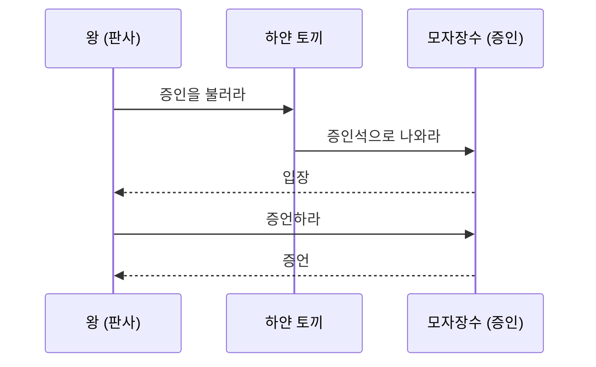
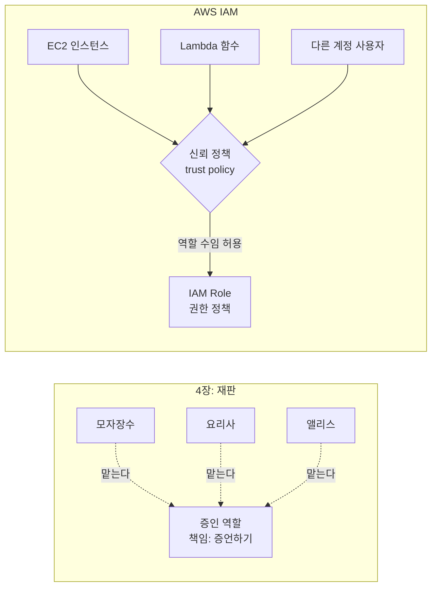
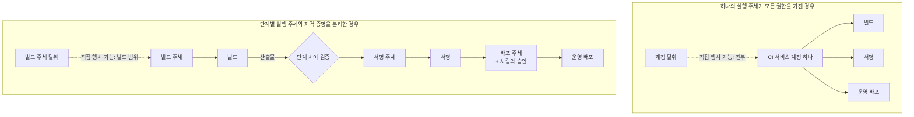
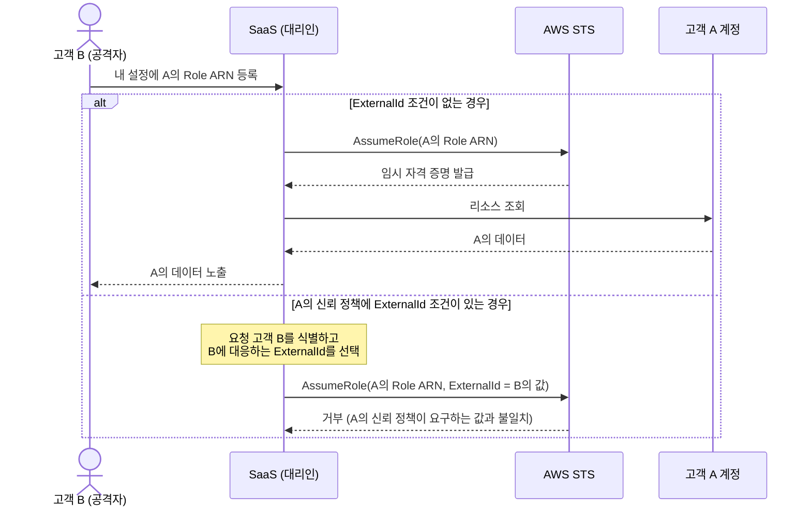
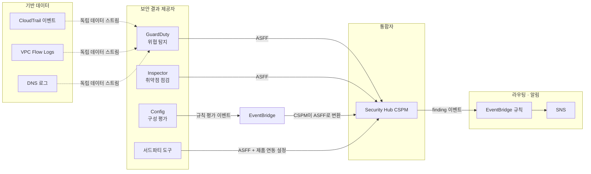

# Week 4. 역할, 책임, 협력 — 보안의 언어로 다시 읽기

> 읽은 범위: 4장 「역할, 책임, 협력」 (p.106~137)
>
> 발표 주제: 책임을 잘 나누는 것만으로 안전한 협력이 만들어질까?
>
> 1절은 책 내용, 2절부터는 4장의 개념을 보안 설계에 적용해 본 개인적인 해석이다. 책에는 보안 이야기가 나오지 않는다.

## 1. 이번 발표에서 다룰 4장의 핵심

4장의 마지막 절인 디자인 패턴과 테스트 주도 개발은 이번 기록에서 다루지 않는다.

### 협력 — 요청과 응답의 연쇄

4장은 이상한 나라의 재판 장면으로 시작한다. 왕이 하얀 토끼에게 증인을 부르라고 요청하고, 불려 온 모자장수는 왕의 요청에 따라 증언한다. 하나의 재판은 이렇게 요청과 응답이 꼬리를 물며 진행된다.

요청을 받은 쪽은 그 요청을 처리하기 위해 다시 다른 누군가에게 요청할 수 있다. 협력은 이런 요청의 연쇄를 통해 하나의 기능을 완성하는 과정이라고 이해했다.

### 책임 — 하는 것과 아는 것

책임은 객체가 협력 안에서 맡아야 하는 일이고, 크게 두 가지로 나뉜다.

| 구분 | 의미 | 재판에서의 예 |
| --- | --- | --- |
| 하는 것 (doing) | 무언가를 수행하거나, 다른 객체에게 일을 시키는 것 | 토끼가 증인을 부른다 |
| 아는 것 (knowing) | 자신이나 관련된 정보를 알고 있는 것 | 모자장수가 자신이 본 것을 안다 |

책임은 객체가 바깥에 약속하는 것이다. 외부에서는 메시지를 보내 그 책임을 수행해 달라고 요청할 뿐, 객체 안에서 어떻게 처리하는지는 알 필요가 없다.

### 역할 — 대체할 수 있는 책임의 묶음

왕 대신 여왕이 재판을 진행하거나, 모자장수 대신 요리사나 앨리스가 증인석에 서도 재판의 흐름은 그대로다. 협력에서 중요한 것은 누가 하는지보다 판사나 증인으로서 해야 할 일을 할 수 있는지다.

그래서 역할은 대체 가능한 책임의 집합이라고 정리했다. 역할 덕분에 구체적인 객체마다 협력을 따로 만들지 않고, 하나의 협력을 추상화해서 재사용할 수 있다. 또 한 객체가 여러 협력에서 서로 다른 역할을 맡을 수도 있다.

### 객체의 모양을 결정하는 것은 협력이다

객체를 설계할 때 어떤 데이터를 가질지부터 정하지 않는다. 먼저 애플리케이션에 필요한 기능을 생각하고, 그 기능에 필요한 책임을 찾는다. 그 책임을 객체에 배분하고, 혼자 처리할 수 없는 일은 다른 객체와의 협력으로 해결한다. 이 과정에서 메시지와 책임 배분은 한 번에 정해지지 않고 반복적으로 조정된다.

2장의 '상태보다 행동이 먼저'라는 관점이 협력 수준으로 이어진다고 이해했다. 이렇게 데이터보다 책임을 중심으로 생각하는 방식이 책임 주도 설계(Responsibility-Driven Design)다.

---

## 2. 보안으로 읽어보기

보안에서도 역할(Role), 권한, 요청을 대신 처리하는 대리인 같은 단어가 자주 쓰인다. 구조가 닮은 지점과 다른 지점을 함께 살펴보았다.

### 2-1. 객체지향의 역할과 보안의 역할 — 닮았지만 같지는 않다

보안의 역할 기반 접근 제어(RBAC)도 권한을 특정 사람에게 직접 묶지 않고 역할을 매개로 연결한다. 구체적인 대상과 역할을 분리한다는 구조는 4장의 역할과 닮았다.

다만 기준이 다르다. 객체지향의 역할은 책임을, 보안의 역할은 접근 권한을 중심으로 정의된다. AWS IAM Role을 예로 들면 다음과 같이 비교할 수 있다.

| 4장 | AWS IAM |
| --- | --- |
| 역할 (판사, 증인) | IAM Role |
| 역할이 수행할 책임 | Role에 연결된 권한 정책 (permission policy) |
| 그 역할을 맡는 객체 | 신뢰 정책(trust policy)에서 허용한 주체 |
| 한 객체가 여러 역할을 맡음 | 하나의 주체가 상황에 따라 여러 Role을 맡음 |

> 개념 비교를 위한 그림이다. 실제로는 주체마다 역할을 맡는 방식이 다르다. Lambda 같은 서비스는 AWS 서비스가 역할을 맡아 코드에 자격 증명을 제공하고, 다른 계정 사용자는 호출하는 쪽의 권한과 대상 Role의 신뢰 정책이 모두 허용해야 한다.

책의 재판 예시는 역할을 수행하는 데 필요한 책임에 초점을 맞추고, 누가 그 역할을 맡을 자격이 있는지는 따로 다루지 않는다. 보안은 바로 그 질문, 즉 이 주체에게 이 역할을 허용해도 되는가를 추가로 묻는다.

책임과 권한의 연결도 정리해 보았다. 책임은 무엇을 할 수 있어야 하는가이고, 권한은 무엇을 해도 되는가다. 최소 권한 원칙(Principle of Least Privilege)을 책임의 언어로 바꾸면 다음과 같다.

> 권한은 맡은 책임에서 도출되어야 한다. 이때 필요한 작업뿐 아니라 접근할 자원과 허용 조건까지 한정해야 한다.

예를 들어 고객 B의 보고서를 만드는 책임에 데이터 읽기 권한이 필요하더라도, 모든 고객의 데이터를 읽을 권한까지 필요한 것은 아니다.

### 2-2. 책임 분리는 피해 범위를 줄이는 출발점이 될 수 있다

책임이 지나치게 많은 객체(God Object)는 보통 유지보수 문제로 이야기한다. 보안 관점에서는 침해되었을 때 공격자가 얻게 되는 범위의 문제로도 볼 수 있다.

CI/CD 파이프라인을 예로 들 수 있다. 빌드, 아티팩트 서명, 운영 배포를 하나의 서비스 계정에 모두 맡기면, 그 계정 하나만 탈취되어도 공격자는 세 가지 권한을 모두 직접 행사할 수 있다.

> 각 단계의 권한과 자격 증명 접근을 분리하고, 빌드 단계가 서명·배포 권한을 얻을 수 없도록 통제한 경우에 한해, 빌드 주체가 직접 행사할 수 있는 권한을 제한할 수 있다.

여기에는 두 가지 한계가 있다.

첫째, 객체의 책임을 나누는 것과 보안 경계를 나누는 것은 같은 일이 아니다. 코드에서 `Builder`, `Signer`, `Deployer` 클래스로 나눴더라도 같은 실행 환경에서 같은 관리자 자격 증명을 쓴다면 권한은 격리되지 않는다. 책임 분리가 보안 효과로 이어지려면 실행 주체의 권한과 자격 증명 접근도 실제로 나뉘어야 한다.

둘째, 권한을 나눠도 오염된 산출물은 다음 단계로 넘어갈 수 있다. 빌드 단계에서 악성 코드가 들어간 산출물이 만들어지고, 서명 단계가 이를 검증 없이 서명한다면 운영 환경까지 영향을 받는다. 2020년 SolarWinds 사건이 이런 경로였다. 빌드 서버에 심어진 SUNSPOT이 빌드 과정에서 백도어를 넣었고, 그 결과물은 정상 인증서로 서명되어 고객에게 배포되었다. 그래서 위 그림에 단계 사이 검증을 넣었다.

### 2-3. 하얀 토끼와 혼동된 대리인 (Confused Deputy)

재판 장면을 보안 관점에서 다시 보면, 하얀 토끼는 왕을 대신해 증인을 부르는 대리인이다.

대리인이 자신의 권한으로 일을 처리하는 것 자체는 정상적인 위임이다. 문제는 권한이 없는 요청자가 대리인을 속여, 자신에게 허용되지 않은 일에 대리인의 권한을 쓰게 만드는 것이다. 토끼가 누가 시켰는지 확인하지 않는다면, 증인을 부를 자격이 없는 누군가도 토끼를 통해 증인을 부를 수 있다. 이것이 혼동된 대리인 문제다.

AWS에서도 같은 구조가 있다.

1. 고객 A는 자기 계정의 IAM Role을 제3자 SaaS가 맡을 수 있도록 신뢰 정책에 등록해 두었다.
2. 악의적인 고객 B가 SaaS의 자기 설정 화면에 고객 A의 Role ARN을 입력한다. Role ARN은 비밀값이 아니므로 B가 알아낼 수 있다.
3. 별도의 통제가 없다면 SaaS는 자신의 권한으로 A의 Role을 맡고, 그 결과를 B에게 보여준다.

AWS는 이를 막기 위해 신뢰 정책에 `sts:ExternalId` 조건을 둔다. ExternalId는 비밀번호처럼 숨겨서 보호하는 값이 아니다. 핵심은 다음 전제다.

> SaaS가 고객마다 고유한 ExternalId를 발급·관리하고, 요청한 고객을 식별한 뒤 그 고객에 대응하는 ExternalId를 넣어 역할을 맡는다. 요청 고객은 SaaS가 보내는 값을 다른 고객의 것으로 바꿀 수 없다.

중요한 것은 B가 A의 값을 알고 있느냐가 아니라, SaaS가 AWS에 보내는 값을 B가 A의 것으로 바꿀 수 있느냐다.

이 사례에서 4장과 연결되는 지점은 ExternalId라는 기능보다 검증 책임의 배분이다. SaaS는 요청 고객과 식별값을 올바르게 연결할 책임을, AWS STS는 역할의 신뢰 정책 조건을 검사할 책임을 맡는다. 기능을 수행하는 책임뿐 아니라, 그 기능을 허용해도 되는지 확인하는 책임도 협력 안에서 빠짐없이 배분해야 한다.

1장과 4장에서 객체는 요청받은 일을 어떻게 수행할지 스스로 결정한다고 했다. 다만 이 자율성이 모든 객체가 직접 인증·인가를 해야 한다는 뜻은 아니다. 객체가 책임을 수행하는 방법을 정하는 것과, 요청을 허용할지 판단하는 책임을 어디에 둘지는 별개의 설계 문제다.

### 2-4. 보안 모니터링 구조를 역할로 나눠 보기

개인적으로 설계하고 있는 AWS 보안 모니터링 구조(수집 → 결과 생성 → 통합 → 알림)를 4장의 관점으로 정리해 보았다. 아직 설계 단계이며 실제로 구축한 결과는 아니다.

| 역할 | 책임 | 이 역할을 맡는 서비스 |
| --- | --- | --- |
| 기반 데이터 | 활동과 트래픽에 관한 원천 데이터를 제공한다 | CloudTrail 이벤트, VPC Flow Logs, DNS 로그 |
| 보안 결과 제공자 | 각자의 기준으로 탐지·점검·평가한 결과(finding)를 제공한다 | GuardDuty(위협 탐지), Inspector(취약점 점검), Config(구성 평가), 서드파티 도구 |
| 통합자 | 여러 제공자의 결과를 공통 형식으로 모은다 | Security Hub CSPM |
| 라우팅·알림 | 조건에 맞는 결과를 골라 사람에게 전달한다 | EventBridge 규칙 → SNS |

> GuardDuty는 사용자가 따로 저장한 로그를 받아 분석하는 것이 아니라, 기반 데이터를 독립적인 스트림으로 분석한다. 그래서 점선으로 표시했다. Config는 ASFF를 직접 만들어 보내지 않는다. 규칙 평가 결과가 EventBridge를 거치면 Security Hub CSPM이 ASFF finding으로 변환한다.

대체 가능성은 역할을 어떤 책임으로 정의했느냐에 따라 달라진다.

GuardDuty와 Inspector의 결과는 Security Hub CSPM에서 같은 형식(ASFF, AWS Security Finding Format)으로 처리할 수 있다. 그래서 통합자 입장에서는 둘 다 보안 결과 제공자라는 공통 역할로 볼 수 있다.

하지만 이것이 두 서비스가 서로를 대신할 수 있다는 뜻은 아니다. GuardDuty는 위협과 이상 행위를 탐지하고, Inspector는 취약점과 의도하지 않은 노출을 점검한다. 어떤 알림 규칙이 GuardDuty의 위협 탐지 결과를 전제로 한다면, 입력을 Inspector 결과로 바꿔도 형식은 처리되겠지만 원래 기대한 위협 탐지를 대신했다고 말할 수는 없다.

> 결과를 받아 처리하는 인터페이스가 호환되는 것과, 탐지 범위와 의미가 동등한 것은 별개의 문제다. 대체 가능성은 그 역할이 약속하는 범위 안에서만 판단해야 한다.

ASFF도 연동 계약의 전부는 아니다. 서드파티 도구가 결과를 보내려면 형식뿐 아니라 제품 연동 설정과 호출 권한 같은 조건도 갖춰야 한다.

#### 참고: 계약이 바뀐 사례

AWS는 기존 Security Hub의 이름을 Security Hub CSPM으로 바꾸고, 새로운 Security Hub를 출시했다. CSPM은 ASFF를 쓰고, 새 Security Hub는 OCSF(Open Cybersecurity Schema Framework)를 쓴다. 그래서 ASFF 기준으로 만든 자동화 규칙을 새 서비스로 옮기려면 변환이 필요하다. CSPM에서는 기존 자동화가 그대로 동작한다.

비슷한 책임을 수행하는 서비스라도 데이터 형식과 API 계약이 다르면 기존 연동을 그대로 재사용할 수는 없다. 교체 가능성을 판단할 때는 서비스 이름보다 실제 계약과 동작을 확인해야 한다.

#### 시나리오에서 출발하기

4장의 관점을 탐지 설계에 적용하면, 로그를 먼저 다 모으기보다 탐지하고 싶은 시나리오에서 출발하게 된다. 예를 들어 "낯선 위치에서 IAM 권한 변경"을 탐지하려면 다음을 먼저 정해야 한다.

- 어떤 이벤트가 필요한가 — 콘솔 로그인, IAM 정책 변경 API 호출 등
- 무엇을 '낯선 위치'로 판단할 것인가
- 그 판단을 관리형 서비스에 맡길 수 있는가, 아니면 별도 분석 로직이 필요한가

현재 그림은 이 판단 기준까지 정의하지 않았으므로, 이 시나리오가 구현되었다고 볼 수는 없다.

또한 지금 탐지 규칙에서 쓰지 않는 로그라도 감사나 사후 조사에는 필요할 수 있다. 탐지용 수집 범위와 로그 보존 정책은 따로 판단해야 한다.

---

## 3. 객체지향과 보안은 같은 협력에 다른 질문을 던진다

처음에는 "객체지향은 대체 가능성을 넓히고, 보안은 좁힌다"고 정리했다. 하지만 이는 서로 다른 두 질문을 한 축에 놓은 비교였다.

| 관점 | 묻는 질문 |
| --- | --- |
| 객체지향의 대체 가능성 | 이 구현이 요구된 책임을 충족해서 협력에 참여할 수 있는가? |
| 보안의 접근 통제 | 이 주체에게 이 작업을 수행하도록 허용해도 되는가? |

두 질문은 반대 관계가 아니다. 예를 들어 승인된 플러그인끼리는 자유롭게 교체할 수 있으면서, 승인되지 않은 플러그인은 실행하지 않는 설계가 가능하다. 이 설계는 유연성과 접근 통제를 동시에 충족한다.

그래서 이렇게 정리했다.

> 객체지향과 보안은 서로 반대되는 목표라기보다, 같은 협력에 서로 다른 조건을 추가한다. 객체지향은 "이 역할의 책임을 수행할 수 있는가"를 묻고, 보안은 "이 주체에게 그 일을 허용해도 되는가"를 묻는다.

## 4. 토론하고 싶은 질문

1. 고객별 보고서를 만드는 서비스에서, '보고서를 생성하는 책임'과 '요청자가 그 고객의 데이터에 접근할 수 있는지 확인하는 책임'을 어떻게 나누는 게 좋을까? 검증을 중복 구현하지 않으면서도 우회되지 않게 하려면 어느 경계에서 확인해야 할까?
2. 책임과 권한은 어디까지 맞춰야 할까? 하나의 Repository가 DB 전체에 접근할 수 있는 상황처럼, 맡은 책임보다 권한이 큰 경우를 코드 수준에서 줄일 수 있을까?

## 5. 마무리

1장에서 소개된 역할·책임·협력의 관점을, 4장에서는 책임을 배분하고 협력을 설계하는 문제로 더 구체화해서 이해했다.

보안 관점에서 다시 읽어 보니 여기에 두 질문이 더 필요했다. 그 책임을 수행하는 데 어떤 권한이 필요한가, 그리고 누구의 어떤 요청을 허용해야 하는가다. 이번에 살펴본 과잉 권한과 혼동된 대리인 사례에서는 책임과 권한, 요청의 신뢰 조건을 함께 설계해야 한다는 점을 확인할 수 있었다.

책임을 잘 나누는 것은 안전한 설계의 출발점이 될 수 있지만, 그것만으로 안전성이 보장되지는 않는다. 다만 책임이 명확해야 필요한 권한과 검증 책임도 구체적으로 설계할 수 있다고 생각한다.

---

### 참고

- [객체지향의 사실과 오해 — 위키북스](https://wikibook.co.kr/object-orientation/)
- [AWS IAM — The confused deputy problem](https://docs.aws.amazon.com/IAM/latest/UserGuide/confused-deputy.html)
- [AWS IAM — Access to AWS accounts owned by third parties](https://docs.aws.amazon.com/IAM/latest/UserGuide/id_roles_common-scenarios_third-party.html)
- [Amazon GuardDuty — Foundational data sources](https://docs.aws.amazon.com/guardduty/latest/ug/guardduty_data-sources.html)
- [Security Hub CSPM — AWS service integrations](https://docs.aws.amazon.com/securityhub/latest/userguide/securityhub-internal-providers.html)
- [AWS Security Finding Format (ASFF)](https://docs.aws.amazon.com/securityhub/latest/userguide/securityhub-findings-format-syntax.html)
- [Security Hub and OCSF](https://docs.aws.amazon.com/securityhub/latest/userguide/securityhub-ocsf.html)
- [Security Hub CSPM 자동화 규칙을 새 Security Hub로 마이그레이션하기 (AWS Security Blog)](https://aws.amazon.com/blogs/security/security-hub-cspm-automation-rule-migration-to-security-hub)
- [OWASP — CI/CD Security Cheat Sheet](https://cheatsheetseries.owasp.org/cheatsheets/CI_CD_Security_Cheat_Sheet.html)
- [CrowdStrike — SUNSPOT: An Implant in the Build Process](https://www.crowdstrike.com/blog/sunspot-malware-technical-analysis/)
