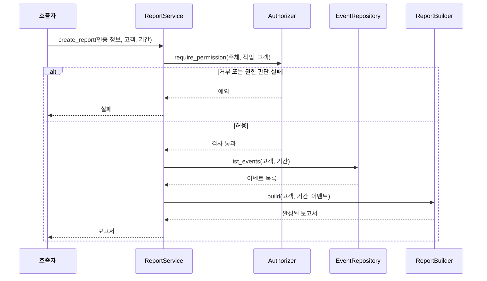

# Week 5. 책임과 메시지 — 무엇을 요청하고, 무엇을 숨겨야 할까?

> 읽은 범위: 5장 「책임과 메시지」 (p.138~176)
>
> 발표 주제: 객체의 구현을 모른 채 협력하려면, 메시지에 어떤 약속이 필요할까?
>
> 1절은 5장의 핵심 개념을 정리한 내용이다. 2~3절의 고객별 보안 보고서는 개념을 적용해 본 가상 설계이며, 책에 등장하는 사례나 실제 구현한 프로젝트는 아니다.

## 1. 5장의 핵심 정리

[지난주 기록](week4.md)에서는 협력에 필요한 책임을 어떤 객체에게 맡길지, 그리고 그 책임을 수행할 권한은 어디까지 허용할지 살펴봤다. 이번에는 책임을 맡은 객체에게 **어떤 메시지를 보내야 내부 구현에 덜 의존하면서 협력할 수 있을지**에 초점을 맞췄다.

### 1-1. 자율적인 책임은 무엇을 해야 하는지 드러낸다

객체의 자율성은 아무 제약 없이 행동한다는 뜻이 아니다. 협력에서 약속한 책임을 지키면서, 그 일을 수행하는 구체적인 방법을 스스로 선택할 수 있다는 뜻으로 이해했다.

보고서 생성을 요청하는 상황에 적용하면 다음과 같다.

| 요청 | 문제 또는 장점 |
| --- | --- |
| “처리해 줘.” | 무엇을 완료해야 하는지 알기 어렵다. |
| “이 테이블을 열고, 이 컬럼을 읽어서, 이 반복문으로 집계해 줘.” | 호출자가 처리 방법까지 정해 구현에 강하게 의존한다. |
| “이 고객의 이 기간 보안 이벤트 보고서를 만들어 줘.” | 수행할 일과 범위를 드러내면서, 조회·집계 방법은 맡길 수 있다. |

책임을 추상적으로 표현한다고 무조건 좋은 것은 아니다. **협력의 목적을 이해할 만큼 구체적이면서, 수행 방법을 선택할 여지는 남아 있어야 한다.** 결과 형식이나 처리 대상 같은 필요한 조건까지 숨기는 것은 자율성과 다르다.

### 1-2. 메시지는 요청이고, 메서드는 그 요청을 처리하는 구현이다

예를 들어 다음과 같은 호출을 생각할 수 있다.

```python
report_service.create_report(auth_context, customer_id, period)
```

| 구분 | 이 예시에서의 의미 |
| --- | --- |
| 수신 객체 | `report_service` |
| 메시지 | 해당 고객·기간의 보고서를 생성해 달라는 요청과 처리에 필요한 정보 |
| 메서드 | 수신 객체가 그 요청을 처리하기 위해 실행하는 구체적인 구현 |

호출자는 무엇을 요청할 수 있는지 알아야 하지만, 수신 객체가 어떤 저장소를 사용하고 어떤 순서로 데이터를 집계하는지까지 알 필요는 없다.

여기서 객체지향의 **메시지**는 객체 사이의 요청을 설명하는 개념이다. 반드시 네트워크 통신이나 비동기 메시지 큐를 사용해야 한다는 뜻은 아니다.

### 1-3. 메시지에서 출발하면 객체가 필요한 이유가 선명해진다

책에서 다루는 What/Who 관점을 다음과 같이 이해했다.

- 먼저 협력에 **무엇을 수행하는 책임이 필요한지** 생각한다.
- 그다음 **누가 그 책임을 맡을지** 결정한다.
- 혼자 수행하기 어려운 부분은 다른 객체에게 요청하고, 필요한 메시지와 책임을 다시 조정한다.

“일단 `Report` 클래스를 만들고 필드를 채운 다음 기능을 붙이자”보다, “고객별 보고서를 제공하려면 어떤 요청과 응답이 필요한가?”에서 시작하는 관점이다. 다만 실제 설계에서 이 순서가 한 번에 끝나는 고정 공식은 아니다. 협력을 구체화하면서 책임과 인터페이스를 함께 다듬는다. 책임 주도 설계에 관한 Rebecca Wirfs-Brock의 설명도 데이터 구조보다 역할·책임·협력을 먼저 살펴보는 관점을 강조한다.[^rdd]

### 1-4. ‘묻지 말고 시켜라’는 조회를 없애라는 뜻이 아니다

다른 객체의 내부 상태를 꺼내서, 그 객체가 맡아야 할 판단과 처리를 호출자가 대신 수행하면 내부 구조에 대한 의존성이 생긴다. 가능하다면 관련 정보와 행동을 책임을 맡은 객체 안에 함께 두는 편이 좋다.

예를 들어 호출자가 권한 정책의 내부 목록을 직접 읽어 허용 여부를 계산하기보다, 권한 판단을 맡은 객체에게 해당 작업의 허용 여부를 판단하도록 요청할 수 있다.

그렇다고 모든 getter, 조회 메서드, 반환값을 금지하는 것은 아니다. 필요한 이벤트를 조회하거나 완성된 보고서를 반환하는 것도 정상적인 협력이다. Martin Fowler도 Tell, Don’t Ask를 설명하면서 모든 조회를 제거하려는 해석을 경계한다.[^tell]

내가 구분할 기준은 다음과 같다.

> 협력에 필요한 정보를 요청하는가, 아니면 다른 객체의 내부 표현을 가져와 그 객체의 책임까지 대신 수행하는가?

### 1-5. 다형성은 같은 요청을 서로 다른 구현이 처리하게 한다

같은 메시지를 받은 객체들이 각자의 방식으로 책임을 수행할 수 있다면, 호출자는 구체적인 구현마다 처리 흐름을 따로 작성하지 않아도 된다.

가령 이벤트 저장소가 다음 메시지를 제공한다고 가정할 수 있다.

```python
events = event_repository.list_events(customer_id, period)
```

| 수신 객체의 구현 | 내부 처리 방식 |
| --- | --- |
| `JsonEventRepository` | JSON 파일에서 조건에 맞는 이벤트를 찾는다. |
| `SqlEventRepository` | SQL 쿼리로 조건에 맞는 이벤트를 조회한다. |

하지만 메서드 이름과 매개변수가 같다는 이유만으로 두 구현이 서로 대체 가능한 것은 아니다. 이 예시에서 호출자가 의존하는 약속에는 다음도 포함된다.

- 지정한 고객과 기간에 해당하는 이벤트만 반환한다.
- 호출자가 기대하는 필드와 의미를 가진 결과를 반환한다.
- 조회 실패를 정상적인 “이벤트 0건”으로 바꿔 반환하지 않는다.

동일한 데이터와 조건을 전제로 이 약속을 지켜야 호출부가 구현을 교체해도 의도한 협력을 유지할 수 있다. 한쪽이 다른 고객의 이벤트까지 섞어 반환한다면 같은 책임을 제대로 수행했다고 볼 수 없다.

### 1-6. 인터페이스는 약속을 드러내고, 구현은 그 약속을 수행한다

객체의 공용 인터페이스는 외부에서 어떤 메시지로 상호작용할 수 있는지 보여준다. 여기서 인터페이스는 특정 언어의 `interface` 문법만을 뜻하지 않는다.

보고서 예시라면 호출자가 알아야 할 것은 요청 방법, 필요한 입력, 결과와 실패의 의미다. SQL 문장이나 내부 자료구조는 호출자가 알지 않아도 되는 구현 세부 사항에 가깝다.

인터페이스와 구현을 분리하면, 외부에 약속한 동작을 유지하면서 내부를 바꿀 여지가 생긴다. 다만 반환 형식이나 실패 의미까지 바뀌면 호출자에게 영향을 줄 수 있으므로, “메서드 안에 넣었으니 어떤 변경도 외부에 영향이 없다”고 이해하면 안 된다.

자율적인 책임과 캡슐화가 협력의 품질에 도움이 되는 이유도 여기에 있다고 생각한다. 각 객체가 알아야 할 정보와 다른 객체에 의존하는 부분을 줄이고, 관련 판단을 책임을 맡은 곳에 모을 수 있기 때문이다.

---

## 2. 적용해 보기 — 고객별 보안 보고서

지난주에는 “보고서 생성과 접근 권한 확인을 어떻게 나누면 좋을까?”라는 질문을 남겼다. 이번에는 그 협력을 어떤 메시지로 표현할지 생각해 봤다.

### 2-1. 먼저 이 예시의 약속을 정한다

이 예시는 **요청받은 고객·기간의 보안 이벤트를 모아, 이번 호출에서 완성된 보고서를 반환하는 동기 처리**를 가정한다. 보고서를 저장하거나 외부로 전송하는 기능은 포함하지 않는다.

| 항목 | 이 예시에서 정한 약속 |
| --- | --- |
| 요청자 정보 | 서버가 인증 결과를 검증해 구성한 `auth_context`를 사용한다. 요청 본문에 적힌 사용자 정보를 그대로 신뢰하지 않는다. |
| 대상 고객 | `customer_id`는 처리할 고객을 선택하는 값이다. 그 값 자체가 접근 권한을 증명하지 않는다. |
| 조회 기간 | 입력 단계에서 시작·종료를 검증한 기간을 받는다. 조회 범위는 UTC 기준 `시작 이상, 종료 미만`으로 통일한다. |
| 성공 | 권한이 허용된 고객과 기간의 이벤트로 완성한 보고서를 반환한다. 정상 조회 결과가 0건인 경우도 표현한다. |
| 거부·실패 | 권한이 없거나 권한 판단에 실패하면 조회·생성을 진행하지 않는다. 저장소 장애도 성공한 빈 보고서로 바꾸지 않는다. |

고객 식별자를 선택자로 취급하고, 검증된 신원과 해당 고객에 대한 권한을 연결하는 조건은 OWASP의 멀티테넌트 보안 지침을 참고했다.[^tenant]

### 2-2. 호출자는 요청하고, 수신 객체는 협력한다

아래는 책임 배분을 설명하기 위한 **Python 형태의 의사 코드**다. 인증 처리, 입력 검증, 구체적인 정책·저장소 구현과 HTTP 오류 변환은 생략했다. 검증된 인증 정보와 기간이 전달된다는 앞의 조건을 전제로 한다.

```python
class ReportService:
    def __init__(self, authorizer, event_repository, report_builder):
        self.authorizer = authorizer
        self.event_repository = event_repository
        self.report_builder = report_builder

    def create_report(self, auth_context, customer_id, period):
        # 허용되면 진행하고, 거부되거나 판단할 수 없으면 예외로 중단한다.
        self.authorizer.require_permission(
            subject=auth_context.subject,
            action="report:create",
            customer_id=customer_id,
        )

        # 조회 실패는 예외로 전달하며, 정상적인 0건과 구별한다.
        events = self.event_repository.list_events(customer_id, period)

        return self.report_builder.build(customer_id, period, events)
```

호출자는 `create_report(...)`를 요청하고, `ReportService`는 필요한 협력을 조정한다.

| 객체 | 맡은 책임 |
| --- | --- |
| `ReportService` | 허용된 요청에 대해 조회와 보고서 구성을 연결한다. |
| `Authorizer` | 이 요청자가 이 고객의 보고서를 생성할 수 있는지 판단한다. 허용되지 않으면 진행을 중단시킨다. |
| `EventRepository` | 지정된 고객·기간에 맞는 이벤트를 조회한다. |
| `ReportBuilder` | 전달받은 이벤트를 보고서 결과로 구성한다. |

중요한 것은 호출을 한 줄로 줄였다는 사실이 아니다. 권한 정책의 표현, 이벤트 조회 방식, 보고서 구성 방식에 대한 지식을 각각의 책임을 맡은 곳에 두고, 의미 있는 메시지로 연결했다는 점이다.

이 네 객체가 모든 시스템에 필요한 정답도 아니다. 여기서는 서로 다른 변경 이유를 설명하기 위해 나눴다. 기능과 복잡도에 따라 책임을 묶거나 더 나누는 선택도 가능하다.

### 2-3. 메시지의 흐름



그림은 권한 판단에 따른 분기에 초점을 맞췄다. 조회나 보고서 구성에 실패하는 경로는 생략했으며, 그 경우에도 성공한 보고서를 반환하지 않는다는 계약은 유지한다.

### 2-4. 어디까지 교체할 수 있을까?

`ReportService`가 저장소의 내부 구조 대신 `list_events(...)`의 약속에 의존한다면, 그 약속을 지키는 JSON 저장소와 SQL 저장소를 선택해 사용할 수 있다. 다만 데이터 이전이나 운영 설정까지 자동으로 해결되는 것은 아니다.

반대로 `create_report(...)`의 반환값을 완성된 보고서에서 “나중에 결과를 받을 작업 ID”로 바꾸면 어떨까? 메서드 이름이 같아도 호출자가 기대하는 결과와 사용 순서가 달라진다. 비동기 생성이 필요하다면 요청 접수와 결과 조회라는 별도의 계약을 설계해야 한다.

즉, 구현을 바꿀 자유는 **외부에 약속한 동작을 지키는 범위 안에서** 생긴다.

---

## 3. 보안과 연결할 때 구분해야 할 것

### ‘메시지를 믿어라’와 외부 입력을 신뢰하는 것은 다른 이야기다

설계에서는 수신 객체의 내부를 일일이 들여다보는 대신, 정해진 메시지와 책임에 의존해 협력한다. 그러나 외부 요청의 사용자 정보나 고객 ID를 검증 없이 믿어도 된다는 뜻은 아니다.

이 예시에서는 인증된 주체를 확인하고, 그 주체가 선택한 고객의 보고서를 만들 권한이 있는지 판단한 뒤에 조회를 수행한다. 다른 고객의 ID를 알고 있다는 사실만으로 그 고객의 보고서에 접근할 수 있어서는 안 된다.[^tenant]

### 캡슐화는 접근 통제를 자동으로 만들어 주지 않는다

권한 판단을 `Authorizer`에 모으면 관련 정책을 한곳에서 이해하고 변경하기 쉬워질 수 있다. 하지만 그 클래스를 만들었다는 사실만으로 모든 요청이 검사되는 것은 아니다.

이 예시의 `ReportService`를 통과하는 경로만 검사하면서, 다른 API가 같은 고객 데이터를 검사 없이 반환한다면 그 경로는 보호되지 않는다. 보안상 필요한 조건은 **보호할 작업에 이르는 각 요청 경로에서 권한 검사가 빠지거나 우회되지 않는 것**이다. OWASP도 매 요청에 권한을 검증하고, 공통 적용 장치와 서버 측 집행을 활용할 것을 권고한다.[^authorization]

이를 위해 모든 객체에 같은 검사를 복사해야 하는 것은 아니다. 또한 같은 프로세스 안에서 클래스를 나누는 것만으로 실행 권한이나 데이터 접근 권한까지 격리되는 것도 아니다.

> 의미 있는 메시지는 호출자가 알아야 할 구현 세부 사항을 줄여 준다. 안전한 협력을 위해서는 그 메시지를 누가 어떤 조건에서 요청할 수 있는지, 거부될 때 무엇을 해야 하는지도 함께 정해야 한다.

---

## 4. 함께 이야기하고 싶은 질문

1. “이 고객의 보고서를 만들어 줘”라는 메시지에 어떤 조건까지 드러내야 할까? 결과 형식, 조회 기간, 실패의 의미를 어디까지 약속해야 구현을 바꾸면서도 협력을 유지할 수 있을까?
2. 다른 객체에게 필요한 정보를 조회하는 것과, 그 객체의 내부 상태를 가져와 책임을 대신 수행하는 것은 어떻게 구분할 수 있을까? 각자 작성한 코드에서 떠오르는 사례가 있는가?

## 5. 이번 장에서 정리한 관점

객체의 메서드를 많이 만드는 것보다, 협력에 필요한 요청을 정하고 그 요청을 받을 객체가 책임을 자율적으로 수행하게 하는 것이 중요하다고 이해했다.

이번 보고서 예시에서는 호출자가 조회·권한 정책·보고서 조립의 내부를 모두 알지 않도록 메시지를 나눠 봤다. 동시에 구현을 감춘다는 이유로 입력 조건, 결과와 실패의 의미까지 모호하게 만들면 대체 가능성과 안전한 협력을 판단하기 어려워진다는 점도 생각해 볼 수 있었다.

앞으로 설계를 볼 때는 다음 두 질문을 함께 확인하고 싶다.

- 호출자가 알아야 할 약속과 몰라도 되는 구현을 잘 구분했는가?
- 책임을 맡은 객체가 그 약속을 지키면서 처리 방법을 바꿀 수 있는가?

---

## 참고 자료

책의 장 구성은 [위키북스 도서 소개와 목차](https://wikibook.co.kr/object-orientation/)를 참고했다. 아래 자료는 책임 주도 설계의 배경, 조회에 관한 오해, 가상 사례의 보안 조건을 보완하기 위해 확인했다. 본문은 직접 인용문이 아니라 학습 내용을 정리하고 적용한 글이다.

[^rdd]: Rebecca Wirfs-Brock, [Responsibility-Driven Design](https://www.wirfs-brock.com/Design.html).
[^tell]: Martin Fowler, [Tell, Don’t Ask](https://martinfowler.com/bliki/TellDontAsk.html). 조회 메서드를 모두 없애는 식의 해석에는 주의가 필요하다는 설명을 참고했다.
[^tenant]: OWASP, [Multi-Tenant Security Cheat Sheet](https://cheatsheetseries.owasp.org/cheatsheets/Multi_Tenant_Security_Cheat_Sheet.html), Tenant Identification & Context Management. 고객 식별자와 검증된 요청자·권한을 연결하는 조건을 참고했다.
[^authorization]: OWASP, [Authorization Cheat Sheet](https://cheatsheetseries.owasp.org/cheatsheets/Authorization_Cheat_Sheet.html), Deny by Default, Validate the Permissions on Every Request, Verify that Authorization Checks are Performed in the Right Location.
