# Week 1 · 1장 협력하는 객체들의 공동체

> **객체지향의 사실과 오해 · 1장 학습 기록**
> 각 목은 해설 → 보충 → 정리 순서로 구성했음. '해설'은 원서의 핵심을 개념 중심으로 정리한 것이고, '보충'은 실무 관점과 최근 흐름을 덧붙인 설명임.
> 📎 단어는 전역 단어장 [`단어장.md`](단어장.md)에 모음.

## 1장 Summary · 한눈에 보기

> **핵심 메시지** 객체지향의 본질은 클래스가 아니라, 적절한 책임을 맡은 객체들이 요청과 응답으로 협력하는 것임.

1. **실세계 모방은 오해임** — 비유는 이해를 돕지만 설계 원리는 아님 (들어가며)
2. **협력은 요청과 응답의 연쇄임** — 커피 주문처럼 각자 맡은 일을 부탁하고 돌려줌 (1.1)
3. **역할은 책임의 묶음임** — 같은 역할이면 바꿔 끼울 수 있고(대체 가능성), 같은 요청에 다르게 응답함(다형성) (1.1.3, 1.2)
4. **객체는 협력적이면서 자율적임** — 메시지로만 소통하고, 처리 방법(메서드)은 스스로 정함 (1.3)
5. **결론: 객체를 지향할 것** — 클래스가 아니라 협력하는 객체에 초점을 두어야 함 (1.4)

**핵심 용어** 협력 · 책임 · 역할 · 메시지 · 메서드 · 자율성 · 캡슐화 · 다형성 · 대체 가능성

**바로 가기** 이 장의 **인사이트**와 **더 살펴보기 · 최근 논쟁과 트렌드**는 맨 끝 '1장 정리'에 있음

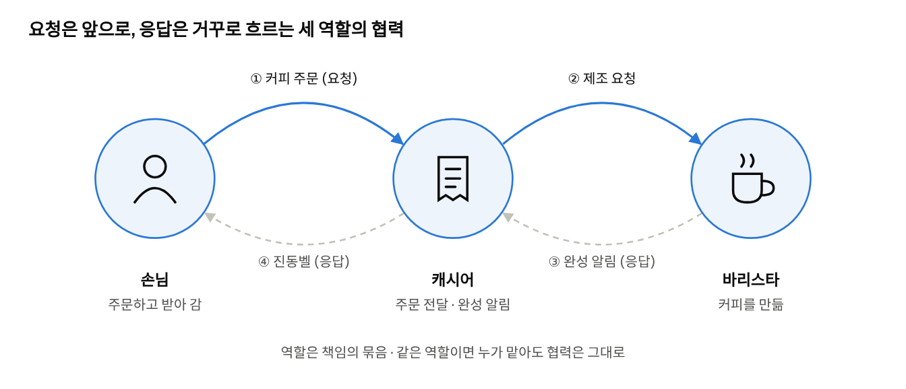

1장 전체를 한 장에 담은 그림임. 실선은 요청, 점선은 응답이며, 세 사람은 각자 맡은 책임만 수행함.

---

## 들어가며 (21\~22쪽)

> **이 절의 맥락** 책의 제목이 말하는 '오해' 가운데 첫 번째를 꺼내는 자리다. 많은 입문서가 '객체지향은 현실 세계를 그대로 옮기는 것'이라고 설명하는데, 저자는 그 설명이 이해에는 도움이 되지만 설계 원리로는 틀렸다고 말함. 이후 1장 전체는 그 빈자리를 역할, 책임, 협력으로 채워 감.

#### 해설

**요지** 실세계 비유는 설계의 원리가 아니라, 개념 이해를 돕는 도구임.

**① 실세계 모방론에 대한 비판**

저자는 방화벽을 예로 듦.

- 네트워크 방화벽은 이름을 건물의 방화벽에서 빌려 왔음.
- 그러나 막는 대상은 화재가 아니라 외부 침입임.
- 이름과 기능의 거리가 이만큼 멀어도 아무 문제가 없음.

저자는 소프트웨어 객체와 실세계 사물의 관계도 이 정도로 느슨하다고 봄. 쿠키, 스레드, 파이프라인, 힙 같은 용어도 같은 유형임.

**② 모방이 아닌 창조**

- **객체지향의 목표**: 실세계의 모방이 아니라 새로운 세계의 창조
- **개발자의 과제**: 고객과 사용자의 요구를 충족하는 세계를 구축하는 것

Eiffel 언어의 설계자 버트런드 마이어는 소프트웨어가 다루는 실재를 기껏해야 '먼 친척'이라고 표현했음.

**③ 그럼에도 비유가 유지되는 이유**

실세계 비유는 객체지향을 이해하고 학습하는 데 효과적임.

| 실세계 비유 | 설명하는 객체지향 개념 |
| --- | --- |
| 스스로 생각하고 결정하는 생명체 | 자율성, 캡슐화 |
| 약속과 계약을 바탕으로 협력하는 사람들 | 메시지, 협력 |
| 실세계 사물에서 출발해 구현까지 이어지는 과정 | 연결완전성(seamlessness) |

- **연결완전성**
  - 정의: 분석에서 식별한 개념이 설계와 구현까지 같은 이름과 의미로 이어지는 성질
  - 예: 업무의 '주문' → 설계 문서의 '주문' → 코드의 `Order`
  - 관련 개념: 6장의 표현적 차이, DDD의 유비쿼터스 언어

**④ 1장의 서술 전략**

저자는 이 장에 한해 '실세계 모방' 관점을 의도적으로 빌려 쓴다고 밝힌다. 따라서 뒤에 이어지는 커피 전문점 사례는 설계 지침이 아니라, 개념을 이해하기 위한 수단으로 읽어야 함.

#### 보충

**① 단일한 '실세계'는 존재하지 않음**

같은 대상도 보는 사람의 목적에 따라 다르게 인식됨.

| 관점 | '상품'에서 중요한 속성 |
| --- | --- |
| 판매 부서 | 가격, 할인율, 재고 수량 |
| 물류 부서 | 무게, 부피, 출고 창고 |
| 회계 부서 | 원가, 세율, 매출 인식 시점 |

옮겨야 할 하나의 실세계가 없으므로, '실세계를 그대로 옮긴다'는 말은 성립하기 어려움. 이 관찰은 설계에 다음과 같은 함의를 줌.

1. **하나의 클래스에 모든 관점을 담지 않음.**
   - 판매 로직을 고칠 때 물류와 회계 코드까지 영향을 받음.
   - 수십 개의 필드를 가진 비대한 클래스가 됨.
2. **맥락마다 별도의 모델을 둠.**
   - 도메인 주도 설계에서는 이 경계를 바운디드 컨텍스트(Bounded Context)라 함.
3. **시스템의 목적이 모델의 범위를 정함.**
   - 배송비 계산에는 원가가 필요 없음.
   - 매출 집계에는 부피가 필요 없음.

```java
// 판매 컨텍스트: 가격과 할인에 관심을 둔다
class SaleProduct {
    Money price;
    DiscountPolicy discountPolicy;
    int stock;
}

// 물류 컨텍스트: 무게와 부피에 관심을 둔다
class ShippingItem {
    Weight weight;
    Volume volume;
    Warehouse origin;
}
```

**② 소프트웨어 객체는 실세계 사물보다 능동적임**

- 실세계의 문서는 스스로 저장되지 않음. → 코드에서는 `document.save()`
- 실세계의 주문서는 스스로 합계를 내지 않음. → 코드에서는 `order.calculateTotal()`

```java
// 실세계 관점: 외부의 관리자가 전등을 조작한다
lightManager.turnOn(light);

// 객체지향 관점: 전등이 스스로 상태를 관리한다
light.turnOn();
```

- 두 번째 방식에서는 전등이 켜질 때의 규칙이 전등 객체 안에 모임.
  - 예: 전원이 연결되어 있어야 함. 이미 켜져 있으면 무시함.
- 규칙이 바뀌어도 수정할 곳은 한 곳뿐임.

객체에 실세계 사물이 갖지 않는 능력을 주는 것은 왜곡이 아니라, 책임을 알맞은 곳에 두기 위한 설계 선택임. 저자는 이 성질을 2장에서 '의인화'로 다시 다룸.

**③ 실세계 모방 접근의 부작용: 빈약한 도메인 모델**

요구사항 문서의 명사를 그대로 클래스로 만들면 흔히 다음 구조가 됨.

```java
class Order {            // 데이터만 보관한다
    List<Item> items;
    int discount;
}

class OrderService {     // 판단과 계산이 모두 여기에 몰린다
    int calculateTotal(Order order) { ... }
    void applyDiscount(Order order) { ... }
}
```

| 문제 | 설명 |
| --- | --- |
| 규칙의 분산 | 할인 규칙이 여러 서비스에 중복되어, 한 곳을 고칠 때 다른 곳을 놓치기 쉽다 |
| 무결성의 취약 | 공개된 setter로 `order.setDiscount(-100)` 같은 잘못된 상태를 만들 수 있음 |
| 의도의 은폐 | 행위가 흩어져 있어, 주문이 무엇을 할 수 있는지 코드에서 읽히지 않음 |

책임 중심으로 고치면 다음과 같음.

```java
class Order {
    private final List<Item> items;
    private Discount discount;

    public Money calculateTotal() {
        return discount.applyTo(sumOfItems());
    }

    public void applyDiscount(Discount discount) {
        if (!discount.isApplicableTo(this)) {
            throw new IllegalArgumentException("적용할 수 없는 할인입니다");
        }
        this.discount = discount;
    }
}
```

- 할인 규칙이 `Order` 안에 모임.
- 잘못된 상태를 외부에서 만들 수 없음.
- 공개 메서드만 보아도 객체의 책임이 드러남.

단, 모든 로직을 도메인 객체에 넣으라는 뜻은 아님. 여러 객체의 조율, 트랜잭션, 외부 시스템 호출은 서비스 계층이 맡음. 핵심은 **특정 데이터에 관한 판단을 그 데이터를 가진 객체에 두는 것**임.

**④ 연결완전성이 깨질 때의 비용**

같은 개념이 다음처럼 서로 다른 이름으로 불린다고 하자.

- 기획 문서: 주문
- 데이터베이스: `TB_ORD_MST`
- 코드: `PurchaseRequestDto`

'주문 취소 로직을 바꿔 달라'는 요청을 받으면 개발자는 세 이름 사이를 머릿속에서 번역해야 하고, 번역이 반복될수록 오해가 끼어듦.

- **흔한 원인**
  - 데이터베이스나 레거시 시스템의 명칭이 도메인 코드에 그대로 들어옴.
  - `Manager`, `Processor`, `Data`처럼 의미가 모호한 이름을 씀.
  - 같은 개념을 팀마다 다르게 부름.
- **완화 방법**
  - 업무 담당자와 용어집을 만들고, 클래스와 메서드 이름을 그에 맞춤.
  - 데이터베이스와 외부 API의 명칭은 리포지토리나 어댑터 같은 경계에서 변환함.
  - 회의의 문장이 코드로 그대로 읽히는지 점검함. 예: '주문이 결제되면 재고를 차감한다' → `order.pay()`, `inventory.decrease(order)`

#### 정리

- 실세계 비유는 객체지향의 가치를 직관적으로 이해하게 해 주는 **학습 도구**임.
- 객체를 나누는 실제 기준은 실세계와의 유사성이 아니라 **협력 안에서 맡는 책임**임.
- 1장은 이 두 측면을 구분하며 읽어야 함.

**논의해 보기**

Q. 실세계 비유가 오히려 설계를 망친 사례를 떠올려 보자. 예를 들어 '현실의 계좌는 스스로 이체하지 않는다'는 이유로 이체 로직을 밖으로 빼 버린 경우는 어떤가?

**생각 거리:** 현실을 기준으로 삼으면 계좌는 수동적인 데이터가 되고, 규칙은 서비스 클래스에 흩어짐. 소프트웨어의 계좌는 잔액을 가장 잘 아는 객체이므로 이체 가능 여부를 스스로 판단하게 하는 편이 낫다. 2장의 '의인화'가 바로 이 이야기다.

---

## 1.1 협력하는 사람들

> **이 절의 맥락** 용어를 정의하기 전에 누구나 겪어 본 장면, 커피 주문을 먼저 보여 줌. 손님, 캐시어, 바리스타가 각자 맡은 일을 하며 서로에게 부탁하는 모습에서 1장의 세 단어(역할, 책임, 협력)가 모두 나옴. 이 절의 장면은 1.2에서 그대로 객체의 언어로 번역됨.

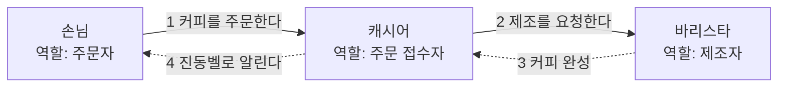

실선은 요청, 점선은 응답임. 요청이 오른쪽으로 흐른 뒤 응답이 같은 길을 거꾸로 돌아오는 모양이 1.1.2의 주제가 됨.

### 1.1.1 커피 공화국의 아침 (23\~25쪽)

#### 해설

**요지** 커피 한 잔을 주문하는 일상적인 일도 역할, 책임, 협력이 맞물려야 완성됨.

**① 장면의 구조**

| 역할 | 책임 | 협력 상대 |
| --- | --- | --- |
| 손님 | 커피를 주문하고, 준비된 커피를 수령함 | 캐시어 |
| 캐시어 | 주문을 받아 바리스타에게 전달하고, 준비 완료를 손님에게 알림 | 손님, 바리스타 |
| 바리스타 | 주문된 커피를 제조함 | 캐시어 |

**② 간접적인 협력**

- 손님은 바리스타와 직접 소통하지 않음.
- 각 참여자는 자신의 책임만 수행하고, 나머지는 상대가 책임을 다할 것이라고 신뢰함.

**③ 세 개념의 보편성** (25쪽)

- 역할, 책임, 협력은 정비소, 식당, 소프트웨어 개발 프로젝트처럼 사람이 관계를 맺는 모든 곳에 존재함.
- 따라서 독자는 이미 객체지향의 핵심 세 개념을 경험적으로 알고 있다는 것이 저자의 설명임.

**④ 역할의 일시성** (25쪽)

- 커피를 받아 자리로 돌아가면 '손님'이라는 역할은 끝남.
- 역할은 사람에게 고정된 속성이 아니라 협력에 귀속됨.
  - 같은 사람이 카페에서는 손님, 회사에서는 개발자임.
  - 이 개념은 4장의 '역할'과 '대체 가능성'으로 이어짐.

**⑤ 협력의 시작과 종료**

- 협력은 주문으로 시작해 커피를 수령하는 순간 끝남.
- 소프트웨어에서도 '주문하기', '결제하기'처럼 기능마다 별도의 협력이 존재함.
- 이 책이 이후 '객체보다 협력을 먼저 설계하라'고 주장하는 근거이다(4장, 7장).

#### 보충

**① 커피 전문점을 사례로 택한 이유**

- 대부분의 독자가 직접 경험한 상황임.
- 역할이 위치, 언어, 도구로 외형상 명확히 구분됨.
- 요청, 처리, 통지, 수령이 모두 포함되어 있어, 이후 장에서도 반복 활용되고 7장에서는 코드로 구현됨.

**② 각 역할이 알지 않아도 되는 것: 결합도와 응집도**

| 역할 | 알아야 하는 것 | 알지 않아도 되는 것 |
| --- | --- | --- |
| 손님 | 원하는 메뉴, 주문 창구 | 원두의 종류, 추출 방법, 머신 사용법 |
| 캐시어 | 메뉴, 결제 방법, 주문 전달 방법 | 제조법, 바리스타의 작업 순서 |
| 바리스타 | 제조법, 머신 사용법 | 손님의 신원, 결제 수단 |

바리스타가 머신을 바꾸거나 제조법을 개선해도 손님과 캐시어는 바뀔 것이 없음.

```java
// 결합도가 높은 구조: 캐시어가 바리스타의 작업 절차를 지시한다
class Cashier {
    void takeOrder(String menu) {
        barista.grindBeans();
        barista.extractEspresso(2);
        barista.addWater(200);
    }
}

// 결합도가 낮은 구조: 캐시어는 필요한 결과만 요청한다
class Cashier {
    void takeOrder(String menu) {
        barista.makeCoffee(menu);
    }
}
```

- **결합도(coupling)**: 한 요소가 다른 요소에 대해 아는 정도. 높을수록 상대의 변경이 자신에게 전파됨.
- **응집도(cohesion)**: 관련된 책임이 한 요소 안에 모인 정도. 제조 지식이 모두 바리스타에게 있으면 응집도가 높음.
- 좋은 설계는 **낮은 결합도와 높은 응집도**를 지향함. 5장의 캡슐화와 인터페이스 분리는 위 표의 오른쪽 열을 보장하는 기법임.

**③ 요청의 기록: 주문이 적힌 컵과 대기열**

- 구두로만 전달하면 바리스타가 바쁠 때 주문이 누락될 수 있음.
- 컵에 적어 두면 주문이 유실되지 않고, 접수 순서가 보존됨.
- 소프트웨어의 대응물: 메시지 큐(Kafka, Amazon SQS), 작업 대기열, 이벤트 로그

| 특성 | 직접 전달 (구두) | 대기열 전달 (컵에 기록) |
| --- | --- | --- |
| 요청자의 대기 | 처리가 시작될 때까지 기다림 | 기록 후 바로 다음 업무를 함 |
| 처리 속도의 차이 | 처리자가 느리면 요청자도 지연됨 | 대기열이 완충 역할을 함 |
| 처리자의 일시적 부재 | 요청이 유실됨 | 요청이 보존됨 |
| 처리자의 증원 | 요청자가 전달 대상을 정해야 함 | 바리스타를 늘려도 캐시어는 그대로임 |
| 구조의 단순성 | 단순하고 즉각적임 | 구성 요소가 늘고, 순서와 중복 처리를 관리해야 함 |

손님이 적은 시간대에는 구두 전달이 더 빠르고 간단함. 설계는 언제나 상황에 따른 선택(trade-off)임.

**④ 완료의 통지: 진동벨과 비동기 처리**

손님은 창구 앞에서 대기하지 않고, 진동벨로 완료 통지를 받음. 이는 콜백(callback)이나 Future를 이용한 비동기 처리와 같은 구조임.

```java
// 동기 방식: 커피가 나올 때까지 손님은 다른 일을 할 수 없다
Coffee coffee = cashier.takeOrder("아메리카노");
drink(coffee);

// 비동기 방식: 진동벨(CompletableFuture)을 받고 다른 일을 한다
CompletableFuture<Coffee> buzzer = cashier.takeOrderAsync("아메리카노");
readNews();
buzzer.thenAccept(this::drink);   // 커피가 준비되면 호출됨
```

- 장점: 요청자의 시간을 효율적으로 씀.
- 비용
  - 결과의 도착 시점을 알 수 없어 실행 흐름을 추적하기 어려움.
  - 진동벨이 울리지 않는 경우, 즉 처리 실패에 대비해야 함. → 타임아웃, 재시도 정책

**⑤ 역할이 분리되지 않은 경우: 갓 오브젝트**

소규모 카페에서는 한 사람이 주문, 제조, 제공을 모두 맡기도 함.

- 규모가 작을 때는 단순하고 효율적임.
- 손님이 늘면 그 한 사람이 병목이 됨.
- 메뉴나 결제 방식이 바뀔 때마다 한 사람의 업무 전체를 재조정해야 함.

코드에서 지나치게 많은 책임을 가진 클래스를 갓 오브젝트(God Object)라 함. 다음 징후가 보이면 역할 분리를 검토함.

- 이름이 `Manager`, `Handler`, `Util`처럼 무엇이든 담을 수 있음.
- 수정해야 하는 이유가 여러 가지임. → 단일 책임 원칙(Single Responsibility Principle, SRP) 위반
- 같은 클래스의 메서드들이 서로 다른 필드만 사용함.
- 테스트를 위해 준비할 의존 객체가 지나치게 많음.

캐시어와 바리스타를 분리한 이유도 같음. 결제 방식의 변경과 제조법의 변경은 서로 다른 이유로 일어남.

**⑥ 역할과 역할 수행자를 코드로 구분하기**

```java
interface Cashier {                 // 역할: 수행해야 할 책임을 정의한다
    Coffee takeOrder(String menu);
}

interface Barista {
    Coffee makeCoffee(String menu);
}

class PartTimer implements Cashier, Barista {   // 역할을 수행하는 구체적인 대상
    public Coffee takeOrder(String menu) { ... }
    public Coffee makeCoffee(String menu) { ... }
}
```

- 손님의 코드는 `Cashier` 역할에만 의존하므로, 정규 직원, 아르바이트 직원, 무인 주문기 중 무엇으로 바꾸어도 영향을 받지 않음.
- 테스트에서는 실제 캐시어 대신 대역 객체를 쓸 수 있음.

```java
class FakeCashier implements Cashier {
    public Coffee takeOrder(String menu) {
        return new Coffee(menu);
    }
}
```

단, interface를 만드는 것 자체가 목적은 아님. 저자가 강조하는 것은 설계 단계에서 '이 협력에 필요한 것은 특정 대상이 아니라 특정 책임'이라고 사고하는 방식임. 이 내용은 4장에서 상세히 다룸.

#### 정리

- 커피 주문은 손님, 캐시어, 바리스타라는 세 역할의 협력으로 완성됨.
- 각 참여자는 자신의 책임만 수행하며, 상대의 내부 사정은 알 필요가 없음.
- 역할은 사람이 아니라 협력에 속하고, 협력이 끝나면 함께 끝남.
- 메시지 큐, 콜백 등의 대응 관계는 보충 해석이며, 원서의 주장은 세 개념이 일상에 이미 존재한다는 데까지임.

### 1.1.2 요청과 응답으로 구성된 협력 (26\~27쪽)

#### 해설

**요지** 협력은 요청과 응답의 연쇄이며, 응답은 요청과 반대 방향으로 전달됨.

**① 요청의 발생**

- 일상의 문제는 대부분 혼자 해결하기에 복잡함.
- 그래서 사람들은 필요한 지식이나 서비스를 가진 사람에게 도움을 청함. 이것이 요청(request)임.

**② 요청의 연쇄**

하나의 문제를 해결하려면 여러 역할이 필요하므로, 한 요청이 다른 요청을 유발함.

- 손님 → 캐시어: 커피를 제공해 달라는 요청
- 캐시어 → 바리스타: 주문 내역이 적힌 컵을 전달함으로써 하는 제조 요청

**③ 응답의 역방향 전달**

요청을 받은 사람은 책임을 수행하여 지식이나 서비스를 제공함. 이것이 응답(response)임.

- 바리스타 → 캐시어: 제조 완료를 알림.
- 캐시어 → 손님: 진동벨을 울려 준비 완료를 알림.

**④ 협력의 의미와 성공 조건** (27쪽)

- 요청과 응답으로 협력하는 능력은 인간이 공동체를 이루어 거대하고 복잡한 문제를 해결하게 함.
- 협력의 성공은 각 역할을 맡은 개인이 요청을 얼마나 성실히 이행하는가에 달려 있음.

#### 보충

**① 메서드 호출과 반환으로서의 요청과 응답**

```java
class Customer {
    void order(Cashier cashier) {
        Coffee coffee = cashier.takeOrder("아메리카노"); // 요청을 보내고, 응답을 받는다
    }
}

class Cashier {
    private final Barista barista = new Barista();

    Coffee takeOrder(String menu) {
        return barista.makeCoffee(menu);          // 요청을 연쇄하고, 받은 응답을 반환한다
    }
}

class Barista {
    Coffee makeCoffee(String menu) {
        return new Coffee(menu);                  // 제조 방법은 바리스타만 안다
    }
}
```

- 호출이 콜 스택에 쌓이는 순서: `order` → `takeOrder` → `makeCoffee`
- 반환이 해소되는 순서: `makeCoffee` → `takeOrder` → `order`
- 두 순서가 정확히 반대인 이유는 스택이 후입선출(LIFO) 구조이기 때문임.
- 예외도 같은 경로로 전파됨.
  - 원두가 떨어져 바리스타가 예외를 던지면, 캐시어를 거쳐 손님에게 전달됨.
  - 캐시어가 예외를 받아 다른 메뉴를 권한다면, 손님은 내부 사정을 모른 채 대체 응답을 받음.
  - 어느 참여자가 어떤 실패를 책임질지도 협력 설계의 일부임.
- HTTP의 요청과 응답, 마이크로서비스의 연쇄 호출(A → B → C)도 같은 구조임.

**② 요청하는 쪽이 알아야 하는 것**

손님이 아는 것은 '무엇을 원하는가'와 '누구에게 요청하는가'뿐임. 다음 두 요청을 비교해 보자.

- "아메리카노 한 잔 주세요." → 원하는 결과(what)를 표현함.
- "원두 18그램을 곱게 갈아 9기압으로 25초간 추출한 뒤 물 200밀리리터를 부어 주세요." → 수행 절차(how)를 지시함.

두 번째 방식에서는 바리스타가 더 나은 방법을 쓸 수 없고, 손님은 자신의 책임이 아닌 지식을 갖추어야 함. 이 문제는 5장의 "'어떻게'가 아니라 '무엇'을"에서 다시 다룸.

**③ 요청이 책임을 낳는다: 책임 주도 설계의 절차**

요청은 상대의 책임을 활성화하는 계기이고, 응답은 그 책임을 수행한 결과임. 이 관계를 설계 절차로 옮기면 다음과 같음.

1. 시스템이 수행할 기능에서 출발해, 필요한 요청을 찾음.
2. 그 요청을 처리할 책임을 정의함.
3. 그 책임을 수행하기에 가장 적합한 객체를 고름.
4. 그 객체가 혼자 처리할 수 없는 부분이 있으면 새 요청을 정의하고 2단계로 돌아감.

이것이 4장과 5장에서 다루는 책임 주도 설계(Responsibility-Driven Design)의 기본 흐름임. 객체를 먼저 정하지 않고, **요청 → 책임 → 객체** 순서로 결정한다는 점에 유의함.

**④ 응답의 두 가지 형태와 선택 기준**

| 형태 | 커피 전문점 | 코드 | 방식 |
| --- | --- | --- | --- |
| 결과물을 반환함 | 커피를 건넨다 | 반환값 | 동기: 결과가 나올 때까지 기다림 |
| 완료를 통지함 | 진동벨을 울림 | 콜백, 이벤트 | 비동기: 다른 일을 하다가 통지를 받는다 |

| 판단 기준 | 동기가 적합한 경우 | 비동기가 적합한 경우 |
| --- | --- | --- |
| 처리 시간 | 짧고 예측 가능함 | 길거나 변동이 크다 |
| 결과가 필요한 시점 | 다음 단계에 즉시 필요함 | 결과 없이도 진행할 수 있음 |
| 요청량 | 적고 일정함 | 많거나 특정 시점에 몰림 |
| 구현 복잡도 | 단순성이 우선임 | 복잡도를 감수할 이점이 있음 |

- 결제 승인처럼 결과를 확인해야 다음으로 넘어가는 작업 → 동기
- 주문 후 영수증 이메일 발송처럼 기다릴 필요가 없는 작업 → 비동기

**⑤ 직접적인 협력 상대만 알아야 한다: 디미터 법칙**

```java
// 바람직하지 않은 예: 캐시어를 거쳐 바리스타를 직접 조작한다
customer.getCashier().getBarista().makeCoffee("아메리카노");

// 바람직한 예: 직접적인 협력 상대에게만 요청한다
cashier.takeOrder("아메리카노");
```

첫 번째 코드는 카페가 바리스타 대신 자동 머신을 들이기만 해도 손님 코드를 고쳐야 함. 디미터 법칙(Law of Demeter)은 메서드 안에서 다음 대상에게만 메시지를 보내라고 말함.

1. 객체 자신(`this`)
2. 메서드의 파라미터로 전달된 객체
3. 메서드 안에서 생성한 객체
4. 필드로 직접 보유한 객체

- 호출이 마침표로 길게 이어지는 첫 번째 코드를 '기차 충돌(train wreck)'이라고도 부름.
- 단, 마침표의 개수 자체가 기준은 아님.
  - `list.stream().filter(...).map(...)`이나 빌더 패턴은 위반으로 보지 않음.
  - 핵심은 다른 객체의 내부 구조를 탐색해 그 사정에 의존하게 되는가임.
- 5장의 '묻지 말고 시켜라'와 같은 맥락임.

**⑥ '성실한 이행'과 계약에 의한 설계**

소프트웨어에서 요청을 성실히 이행한다는 것은, 객체가 약속한 책임을 정확히 지킨다는 뜻임. 버트런드 마이어는 이를 계약에 의한 설계(Design by Contract)로 체계화했음.

| 요소 | 의미 | 커피 전문점의 예 |
| --- | --- | --- |
| 사전 조건 | 요청자가 요청 전에 보장할 조건 | 메뉴에 있는 음료를 주문하고 결제함 |
| 사후 조건 | 처리자가 처리 후 보장할 조건 | 음료가 준비되면 반드시 손님에게 알림 |
| 불변식 | 처리 전후에 항상 유지될 조건 | 결제되지 않은 주문은 제조 대기열에 오르지 않음 |

```java
class Cashier {
    Receipt takeOrder(Menu menu, Payment payment) {
        // 사전 조건
        if (!menuBoard.contains(menu)) throw new IllegalArgumentException("판매하지 않는 메뉴입니다");
        if (!payment.isApproved()) throw new IllegalStateException("결제가 완료되지 않았습니다");

        Receipt receipt = orderQueue.add(menu);
        // 사후 조건
        assert orderQueue.contains(receipt);
        return receipt;
    }
}
```

계약이 명확하면 각 참여자는 상대가 보장하는 바를 신뢰할 수 있고, 계약이 지켜지는 한 상대의 내부가 바뀌어도 협력은 유지됨. 이는 1.1.3의 대체 가능성과 직결됨.

**⑦ '협력하는 객체들의 공동체'라는 장 제목의 의미**

- 개별 객체는 대개 단순한 책임만 가짐.
- 그러나 객체들이 요청과 응답으로 협력하면, 어느 한 객체도 홀로 수행할 수 없는 기능이 구현됨.
- 따라서 객체지향 프로그램은 정교한 개별 객체의 집합이 아니라, **협력하는 객체들의 공동체**로 보아야 함.

#### 정리

- 협력은 요청과 응답의 연쇄로 이루어짐.
- 요청은 참여자들의 책임을 차례로 활성화하며 전파되고, 응답은 반대 방향으로 돌아옴.
- 각 참여자는 직접적인 협력 상대만 알며, 그 너머의 처리 과정은 알 필요가 없음.
- 협력의 성공은 각자가 맡은 요청을 성실히 이행하는 데 달려 있음.

### 1.1.3 역할과 책임 (27\~28쪽)

#### 해설

**요지** 역할은 책임을 내포하며, 이로부터 대체 가능성, 자율성, 다형성이 도출됨.

**① 역할의 정의**

- 역할(role)은 협력에 참여하는 사람이 그 협력 안에서 차지하는 책임이나 임무임.
- 커피 주문 협력에는 손님, 캐시어, 바리스타라는 세 역할이 있음.

**② 역할은 책임을 내포함**

역할이라는 단어는 의미상 책임을 포함함.

- 선생님이라는 역할에는 학생을 가르칠 책임이 따름.
- 범죄자를 검거할 책임을 거부하는 사람은 경찰관이 될 수 없음.
- 프로그래머라는 역할은 좋은 프로그램을 만들 책임을 받아들이는 것임.

즉 역할은 단순한 명칭이 아니라 그 명칭에 결부된 **책임의 묶음**임.

**③ 커피 주문 협력의 역할과 책임**

| 역할 | 책임 |
| --- | --- |
| 손님 | 커피를 주문함 |
| 캐시어 | 주문 내용을 바리스타에게 전달함. 커피가 준비되었음을 손님에게 알림 |
| 바리스타 | 커피를 제조함 |

- 캐시어는 책임이 두 개임. 하나의 역할은 여러 책임의 집합일 수 있음.
- 저자는 역할과 책임을 협력이 원활하게 진행되기 위한 핵심 구성 요소로 봄.

**④ 역할과 책임에서 도출되는 네 가지 성질**

1. **여러 사람이 동일한 역할을 수행할 수 있음.**
   - 손님은 주문한 커피만 받을 수 있다면 어떤 캐시어가 주문을 받든 상관하지 않음.
   - 캐시어가 그만두면, 같은 책임을 수행할 수 있는 다른 사람을 고용하면 됨.
2. **역할은 대체 가능성을 의미함.**
   - 두 사람이 같은 역할을 수행할 수 있다면, 요청자 입장에서는 누가 수행하든 문제가 없음.
   - 이를 대체 가능성(substitutability)이라 함. 요청자가 의존하는 것은 사람이 아니라 역할임.
3. **책임을 수행하는 방법은 자율적으로 선택할 수 있음.**
   - 요청받은 사람은 처리 방법을 스스로 정함.
   - 어떤 바리스타는 라테 아트를 하고, 어떤 바리스타는 향을 더 살림.
   - 이처럼 **동일한 요청에 서로 다른 방식으로 응답하는 능력**을 다형성(polymorphism)이라 함.
4. **한 사람이 동시에 여러 역할을 수행할 수 있음.**
   - 한 사람이 캐시어와 바리스타를 함께 맡을 수 있음.
   - 현실에서도 사람은 회사의 사원이자 가정의 부모이고 배우자임.

#### 보충

**① 대체 가능성과 리스코프 치환 원칙**

```java
interface Cashier {
    Buzzer takeOrder(Menu menu);
}

class StaffCashier implements Cashier { ... }   // 직원이 주문을 받는다
class Kiosk implements Cashier { ... }          // 무인 주문기가 주문을 받는다

class Customer {
    private final Cashier cashier;              // 역할에만 의존한다

    Customer(Cashier cashier) {
        this.cashier = cashier;
    }

    void orderCoffee() {
        Buzzer buzzer = cashier.takeOrder(Menu.AMERICANO);
    }
}

// 어느 쪽을 넘겨도 Customer의 코드는 바뀌지 않는다
new Customer(new StaffCashier());
new Customer(new Kiosk());
```

- 대체 가능성은 '같은 이름의 메서드를 가졌다'는 것만으로 성립하지 않음.
- 무인 주문기가 주문은 받되 진동벨을 울리지 않는다면, 형식상 `Cashier`를 구현했어도 캐시어를 대체할 수 없음.
- 대체하는 대상은 요청자가 기대하는 책임, 곧 1.1.2 보충 ⑥에서 본 **계약**을 그대로 지켜야 함.
- 이 원칙을 리스코프 치환 원칙(Liskov Substitution Principle)이라 하며, 객체지향 설계 원칙 SOLID의 L에 해당함.

**② 다형성의 작동 방식과 개방-폐쇄 원칙**

```java
// 다형성이 없는 경우: 요청자가 상대의 종류를 판별해야 한다
if (barista instanceof LatteArtBarista) {
    ((LatteArtBarista) barista).makeWithLatteArt(menu);
} else if (barista instanceof AromaBarista) {
    ((AromaBarista) barista).makeWithRichAroma(menu);
}

// 다형성을 활용한 경우: 요청자는 같은 요청만 보낸다
barista.makeCoffee(menu);
```

- 두 번째 코드에서 요청자는 `makeCoffee`만 보내고, 처리 방식은 받는 객체가 정함.
- 새로운 유형의 바리스타가 추가되어도 요청자 코드는 수정할 필요가 없음.
- 기존 코드를 고치지 않고 새 동작을 추가할 수 있는 성질을 개방-폐쇄 원칙(Open-Closed Principle)이라 하며, 다형성은 이를 실현하는 핵심 수단임.

**③ 자율성과 다형성의 인과 관계**

저자는 성질 3에서 자율성과 다형성을 하나의 흐름으로 설명함.

1. 요청이 '무엇'만 표현하고 '어떻게'는 맡김.
2. 그래서 요청받는 쪽이 처리 방법을 자율적으로 고를 수 있음.
3. 그래서 같은 요청에 서로 다른 응답이 가능해짐. 이것이 다형성임.

손님이 추출 시간과 물의 양까지 지시한다면 모든 바리스타가 똑같이 행동해야 하므로, 다형성은 성립하지 않음.

**④ 한 객체가 여러 역할을 수행할 때: 인터페이스 분리 원칙**

```java
class PartTimer implements Cashier, Barista { ... }

PartTimer kim = new PartTimer();

Customer customer = new Customer(kim);   // 손님에게 kim은 캐시어일 뿐이다
Kitchen kitchen = new Kitchen(kim);      // 주방에게 kim은 바리스타일 뿐임
```

- 손님은 김 씨가 커피를 만들 수 있다는 것을 알 필요가 없음.
- 주방은 김 씨가 주문을 받을 수 있다는 것을 알 필요가 없음.
- 협력 상대가 쓰지 않는 기능에 의존하지 않도록 역할을 작게 나누는 원칙을 인터페이스 분리 원칙(Interface Segregation Principle)이라 함.

**⑤ 다형성의 여러 형태**

| 형태 | 의미 | 예 |
| --- | --- | --- |
| 서브타입 다형성 | 같은 역할을 수행하는 여러 객체가 같은 메시지에 다르게 응답함 | `Barista`의 여러 구현 |
| 오버로딩 | 같은 이름의 메서드가 파라미터에 따라 다르게 동작함 | `print(int)`, `print(String)` |
| 매개변수 다형성 | 하나의 코드가 여러 타입에 대해 동작함 | `List<Coffee>`, `List<Tea>` |

이 책에서 말하는 다형성은 첫 번째 형태임. 메시지를 받는 객체가 실행 시점에 처리 방법을 결정하므로, 요청자와 처리자 사이의 결합도를 낮춤.

#### 정리

- 역할은 협력 안의 자리이고, 책임은 그 자리에 따르는 임무임.
- 요청자는 사람이 아니라 역할에 의존하므로, 같은 역할을 수행하는 대상끼리는 서로 대체할 수 있음.
- 역할을 맡은 대상은 책임의 수행 방법을 스스로 고르며, 그 결과 다형성이 나타남.
- 한 대상이 여러 역할을 동시에 수행할 수 있다는 점은, 역할이 사람이 아니라 협력에 속한다는 것을 다시 보여 줌.

**논의해 보기**

Q1. 1인 카페에서 한 사람이 캐시어와 바리스타를 모두 맡는다면, 역할은 하나로 합쳐진 것일까?

**생각 거리:** 사람은 하나지만 역할은 여전히 둘임. 역할과 역할 수행자를 구분해 두면, 가게가 커져서 사람을 나눌 때 손님 입장에서는 아무것도 바뀌지 않음.

Q2. 요청한 쪽이 응답을 기다리지 않아도 되는 협력(진동벨)은 코드에서 무엇과 닮았을까?

**생각 거리:** 콜백, 이벤트, 비동기 메시지 큐가 같은 구조다. 응답의 방향은 같지만 기다리는 방식이 달라짐.

---

## 1.2 역할, 책임, 협력

> **이 절의 맥락** 1.1의 커피 이야기를 객체지향 용어로 옮기는 절임. 사람을 객체로, 부탁을 메시지로, 할 일을 책임으로 바꾸어 읽으면 같은 이야기가 그대로 설계 이야기가 됨. 아래 그림은 기능이 어떤 순서로 쪼개져 객체에 도착하는지 보여 줌.

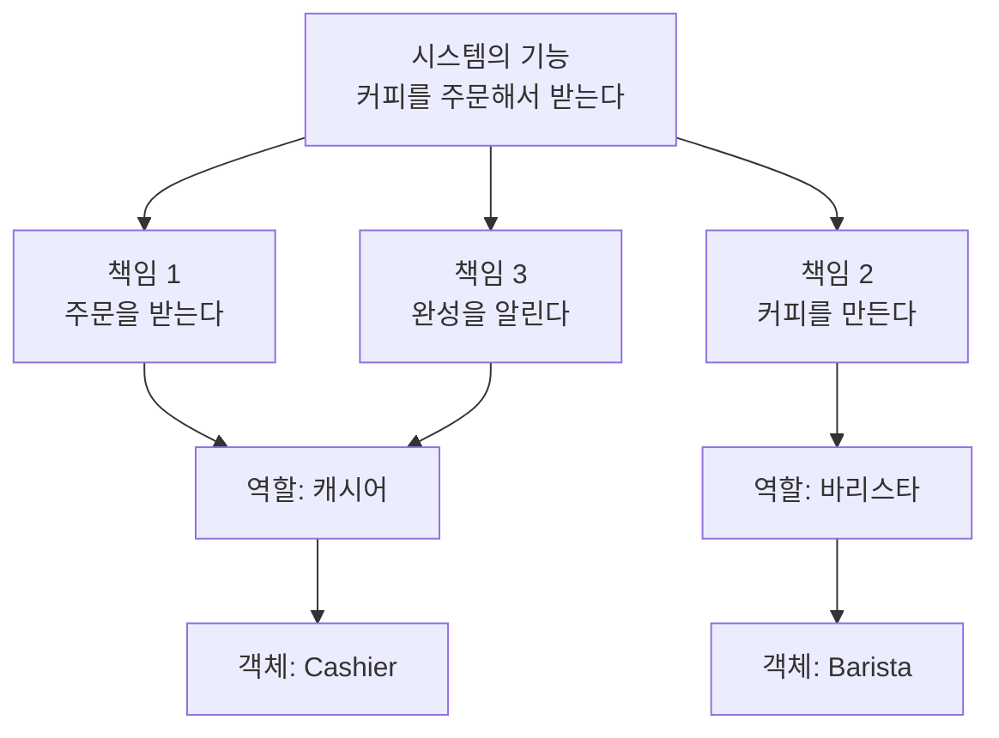

### 1.2.1 기능을 구현하기 위해 협력하는 객체들 (29쪽)

#### 해설

**요지** 커피 주문의 설명에서 몇 개의 단어만 바꾸면, 그대로 객체지향의 설명이 됨.

**① 실세계 개념과 객체지향 개념의 대응**

| 커피 주문의 설명 | 객체지향의 설명 |
| --- | --- |
| 사람 | 객체 |
| 에이전트의 요청 | 메시지 |
| 에이전트가 요청을 처리하는 방법 | 메서드 |

- 이 대응이 쉽게 성립하기 때문에, 많은 사람이 객체지향을 '실세계의 모방'이라는 은유로 설명함.

**② 이 절의 목표**

- 커피 주문에서 본 역할, 책임, 협력을 객체지향의 문맥으로 옮김.
- 객체지향의 근본 개념이 사람들이 타인과 협력하는 과정과 유사하다는 점을 보여 주는 것이 저자의 의도임.

#### 보충

**① '에이전트'라는 용어**

- 에이전트(agent)는 스스로 판단하고 행동하는 주체를 뜻함.
- 저자가 '사람' 대신 '에이전트'라는 말을 쓰는 것은, 대응의 핵심이 사람이라는 실체가 아니라 **요청을 자율적으로 처리하는 주체**라는 성질에 있음을 드러냄.

**② 메시지와 메서드의 구분**

- **메시지**: 송신자가 보내는 요청. 무엇을 해 달라는지만 담는다.
- **메서드**: 메시지를 받은 객체가 실제로 요청을 처리하는 방법, 즉 구현임.

```java
barista.makeCoffee(menu);                      // 메시지: 송신자의 요청

class LatteArtBarista implements Barista {
    public Coffee makeCoffee(Menu menu) {      // 메서드: 수신자의 처리 방법
        ...
    }
}
```

- 같은 메시지라도 받는 객체에 따라 다른 메서드가 실행됨. 이것이 1.1.3에서 본 다형성임.
- 흔히 '메서드를 호출한다'고 말하지만, 객체지향의 관점에서 더 정확한 표현은 '메시지를 전송한다'임. 어떤 메서드가 실행될지는 송신자가 아니라 수신자가 결정하기 때문임. 이 차이는 5장에서 상세히 다룸.

**③ 대응이 매끄러울수록 경계할 점**

- 저자는 단어만 바꾸면 설명이 옮겨진다고 할 만큼 두 세계의 대응이 잘 맞는다고 말함.
- 그러나 '들어가며'에서 본 것처럼 이는 개념을 이해하기 위한 비유임.
- 대응이 매끄러울수록 실제 설계에서도 현실을 그대로 복제하려는 유혹이 커지므로, 두 관점을 구분해서 받아들여야 함.

#### 정리

- 사람 → 객체, 요청 → 메시지, 처리 방법 → 메서드로 바꾸면 커피 주문의 설명은 객체지향의 설명이 됨.
- 메시지는 '무엇'을, 메서드는 '어떻게'를 담는다.

### 1.2.2 역할과 책임을 수행하며 협력하는 객체들 (29\~30쪽)

#### 해설

**요지** 시스템의 기능은 책임으로 분할되어 적절한 역할을 가진 객체에 할당되고, 객체 간 요청과 응답의 연쇄로 구현됨.

**① 사람의 협력: 목표의 분할**

- 저자는 아리스토텔레스의 '인간은 사회적 동물이다'로 시작함. 로빈슨 크루소의 삶이 특별한 것은 타인과의 협력이 없기 때문임.
- 협력의 핵심은 특정한 책임을 수행하는 역할들 사이의 연쇄적인 요청과 응답으로 목표를 달성하는 것임.
- 목표는 다음과 같이 달성됨.
  1. 목표가 더 작은 책임으로 분할됨.
  2. 각 책임을 수행할 수 있는 역할을 가진 사람이 수행함.
  3. 수행 도중 필요하면 다른 사람에게 도움을 요청함.

**② 객체의 협력: 기능의 분할**

- 워드 커닝햄과 켄트 벡의 말처럼 '어떤 객체도 섬이 아니다'. 객체는 자신의 책임을 다하는 동시에 시스템의 더 큰 목적을 위해 다른 객체와 협력함.
- 사람과 객체의 차이
  - 사람: 공동의 목표를 달성하기 위해 협력함.
  - 객체: 애플리케이션의 기능을 구현하기 위해 협력함.
- 기능은 더 작은 책임으로 분할되고, 책임은 적절한 역할을 수행하는 객체가 맡음.
- 결론적으로 시스템은 역할과 책임을 수행하는 객체로 분할되고, 기능은 객체 간 요청과 응답의 흐름으로 구성된 협력으로 구현됨.

**③ 책임이 설계의 품질을 결정함**

- 객체지향 설계는 적절한 객체에게 적절한 책임을 할당하는 데서 시작됨.
- 책임은 설계의 품질을 결정하는 가장 중요한 요소임.
- 책임이 불분명한 객체는 애플리케이션의 미래도 불분명하게 만듦.

**④ 역할: 객체의 페르소나**

- 역할은 협력에 참여하는 객체의 페르소나이며, **관련성 높은 책임의 집합**임.
- 객체의 역할도 사람의 역할과 같은 네 가지 특징을 갖는다(1.1.3 참조).
  1. 여러 객체가 동일한 역할을 수행할 수 있음.
  2. 역할은 대체 가능성을 의미함.
  3. 각 객체는 책임을 수행하는 방법을 자율적으로 선택함.
  4. 하나의 객체가 동시에 여러 역할을 수행할 수 있음.

#### 보충

**① '어떤 객체도 섬이 아니다'와 CRC(Class-Responsibility-Collaborator) 카드**

- 이 문장은 벡과 커닝햄이 1989년 OOPSLA에서 발표한 논문에 나옴. 존 던의 '어떤 사람도 섬이 아니다'를 변형한 표현임.
- 같은 논문에서 두 사람은 객체지향적 사고를 가르치는 도구로 CRC(Class-Responsibility-Collaborator, 클래스-책임-협력자) 카드를 제안했음.
  - CRC: 클래스(Class), 책임(Responsibility), 협력자(Collaborator)
  - 색인 카드 한 장에 객체 하나를 적고, 왼쪽에 책임, 오른쪽에 그 책임을 위해 협력할 상대를 적음.

커피 주문의 캐시어를 CRC 카드로 작성하면 다음과 같음.

| Cashier — 책임 | 협력자 |
| --- | --- |
| 주문을 받는다 | Customer |
| 주문을 전달함 | Barista |
| 준비 완료를 알림 | Customer |

- 카드에 책임이 너무 많아 다 적을 수 없다면, 그 객체의 책임을 나눠야 한다는 신호임.
- 코드를 쓰기 전에 책임과 협력을 먼저 설계하는 이 방식은 4장의 책임-주도 설계로 이어짐.

**② 책임을 누구에게 할당할 것인가: 정보 전문가**

'적절한 객체에게 적절한 책임'을 고르는 대표적인 기준은, **책임을 수행하는 데 필요한 정보를 가장 많이 가진 객체에게 맡기는 것**임. 이를 정보 전문가(Information Expert) 패턴이라 함.

예를 들어 '주문 금액 계산'이라는 책임을 생각해 보자.

| 후보 | 판단 |
| --- | --- |
| 손님 | 메뉴의 가격을 알지 못함. 부적합 |
| 캐시어 | 계산은 할 수 있지만, 가격 정보를 다른 곳에서 꺼내 와야 함 |
| 주문(Order) | 주문 항목과 각 항목의 가격을 가지고 있음. 적합 |

```java
class Order {
    private final List<OrderItem> items;

    Money totalPrice() {                       // 정보를 가진 객체가 직접 계산한다
        return items.stream()
                    .map(OrderItem::price)
                    .reduce(Money.ZERO, Money::plus);
    }
}
```

- 주문은 실세계에서 스스로 금액을 계산하지 않음. 그러나 소프트웨어에서는 정보를 가진 객체에게 책임을 주는 편이 더 적절하다('들어가며' 보충 ② 참조).
- 정보 전문가는 크레이그 라만이 정리한 책임 할당 원칙인 GRASP의 하나임.

**③ 책임이 불분명한 객체의 징후**

- 이름만 보고는 이 객체가 무엇을 하는지 말할 수 없음.
- 같은 일이 여러 객체에 나뉘어 있거나, 한 객체가 서로 관련 없는 일을 함.
- 새 기능을 추가할 때 '어디에 넣어야 하는가'를 매번 고민해야 함.

저자가 '책임이 불분명한 객체는 애플리케이션의 미래도 불분명하게 만든다'고 한 것은 이러한 객체가 변경의 위치를 예측할 수 없게 만들기 때문임.

**④ 페르소나라는 비유**

- 페르소나(persona)는 고대 그리스 연극에서 배우가 쓰던 가면에서 유래한 말로, 사회적 역할에 따라 드러내는 얼굴을 뜻함.
- 객체는 협력마다 다른 가면을 씀. 코드에서 그 가면은 인터페이스임.
- 협력 상대는 가면만 보고, 그 뒤의 객체가 무엇인지는 알지 못함. 이 때문에 대체 가능성과 다형성이 성립함.

#### 정리

- 시스템의 기능은 책임으로 분할되고, 책임은 적절한 역할을 수행하는 객체가 맡음.
- 기능은 객체 간 요청과 응답의 연쇄, 즉 협력으로 구현됨.
- 객체지향 설계는 적절한 객체에게 적절한 책임을 할당하는 데서 시작됨.
- 역할은 관련성 높은 책임의 집합이며, 사람의 역할과 같은 네 가지 특징을 가짐.

**논의해 보기**

Q. '책임을 먼저 정하고 객체를 나중에 정한다'는 순서를 실제 프로젝트에서 지키기 어려운 이유는 무엇일까?

**생각 거리:** 대개 화면이나 테이블이 먼저 주어지기 때문임. 그럴 때도 '이 기능을 끝내려면 누가 무엇을 해야 하나'를 먼저 적어 보면, 테이블 구조에 끌려가지 않는 객체를 찾을 수 있음. CRC(Class-Responsibility-Collaborator, 클래스-책임-협력자) 카드가 이 연습을 돕는 도구다.

---

## 1.3 협력 속에 사는 객체

> **이 절의 맥락** 1.2가 '여럿이 함께 일하는 방식'을 다뤘다면, 1.3은 그 안의 객체 하나가 갖춰야 할 성질을 다룸. 협력에 참여하면서도 남의 지시에 끌려다니지 않는 것, 즉 협력성과 자율성의 균형이 이 절의 주제이며, 2장의 상태와 행동 논의로 이어짐.

### 1.3.1 상태와 행동을 함께 지닌 자율적인 객체

#### 해설

**요지** 객체는 협력적이면서 동시에 자율적이어야 하며, 자율성은 상태와 행동을 함께 가질 때 생김.

**① 객체가 갖춰야 할 두 가지 덕목**

1. **충분히 협력적이어야 함.**
   - 혼자 모든 일을 처리하지 않음.
   - 다른 객체에 도움을 요청하고, 다른 객체의 요청에는 성실히 응답함.
2. **충분히 자율적이어야 함.**
   - 요청에 어떻게 응답할지는 스스로 판단하고 결정함.

두 덕목은 서로 당기는 힘이므로, 설계자는 그 사이에서 균형을 잡아야 함.

**② 상태와 행동을 함께 지닌 실체**

- 객체는 흔히 상태(state)와 행동(behavior)을 함께 지닌 실체로 정의됨.
- 객체가 스스로 판단하려면, 판단에 필요한 정보(상태)와 그 정보를 다루는 행동을 함께 가지고 있어야 함.

**③ 자율성은 내부와 외부의 구분에서 나옴**

- 다른 객체는 이 객체가 **무엇**을 하는지는 알 수 있음.
- 그러나 **어떻게** 하는지는 알 수 없음.
- 이 경계가 분명할수록 객체는 자율적임.

#### 보충

**① 균형이 무너진 두 가지 모습**

| 치우친 방향 | 나타나는 모습 | 문제 |
| --- | --- | --- |
| 협력만 과도함 | 받은 요청을 그대로 다른 객체에 넘기기만 함 | 스스로 책임지는 일이 없어 존재 이유가 흐려짐. 흔히 '미들맨(Middle Man)'이라 부름 |
| 자율만 과도함 | 다른 객체에 도움을 청하지 않고 모든 일을 혼자 함 | 갓 오브젝트가 된다(1.1.1 보충 ⑤) |

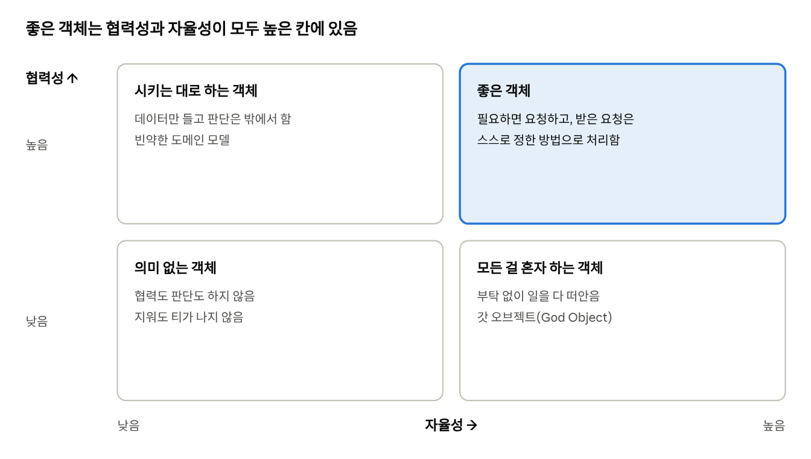

두 축은 서로 당기는 힘임. 협력만 강조하면 객체가 수동적이 되고, 자율만 강조하면 고립됨. 상태와 행동을 함께 가지고 메시지로만 소통하게 하면 오른쪽 위 칸으로 옮겨 감. 칸 이름은 이 학습서의 보충 해석임.

**② 상태와 행동을 분리했을 때와 함께 두었을 때**

```java
// 상태와 행동이 분리된 구조
class CoffeeMachineData {
    int beans;
    int water;
}

class CoffeeMachineService {
    Coffee brew(CoffeeMachineData machine) {
        if (machine.beans < 18) throw new IllegalStateException("원두 부족");
        machine.beans -= 18;
        machine.water -= 200;
        return new Coffee();
    }
}

// 상태와 행동을 함께 가진 구조
class CoffeeMachine {
    private int beans;
    private int water;

    Coffee brew() {
        if (beans < 18) throw new IllegalStateException("원두 부족");
        beans -= 18;
        water -= 200;
        return new Coffee();
    }
}
```

- 첫 번째 구조에서는 누구나 `machine.beans = -5`처럼 상태를 바꿀 수 있고, 원두에 관한 규칙이 여러 서비스에 흩어지기 쉬움.
- 두 번째 구조에서는 상태를 바꾸는 유일한 경로가 객체의 행동이므로, 규칙이 객체 안에서 지켜짐.

**③ 스터디 논점: React 컴포넌트는 객체인가**

11번가 개발자들의 이 책 스터디에서 나온 질문임.

- 찬성 쪽 의견: 컴포넌트는 props를 받아 결과를 스스로 결정하고 어디서든 재사용할 수 있으므로, 책이 말하는 자율성을 가짐.
- 반대 쪽 의견: 객체라고 부르기에는 단위가 너무 큼.
- 스터디의 결론: 무엇을 객체라고 딱 정의하는 것보다, 책임과 자율성의 관점에서 바라보는 것이 더 중요함.

이 학습서의 기준으로 판단하면, 내부 상태와 그 상태를 바꾸는 행동을 함께 가진 컴포넌트는 객체에 가깝고, 상태 없이 입력을 출력으로 바꾸기만 하는 컴포넌트는 함수에 가깝다. 상태, 행동, 식별자라는 객체의 세 요소는 2장에서 자세히 다룸.

#### 정리

- 객체는 협력적이면서 자율적이어야 하고, 두 덕목 사이의 균형이 중요함.
- 자율성은 상태와 행동을 함께 가지고, 내부와 외부를 분명히 구분할 때 생김.

### 1.3.2 협력과 메시지

#### 해설

**요지** 객체가 다른 객체와 소통하는 유일한 수단은 메시지임.

**① 단 하나의 소통 수단**

- 사람은 말, 글, 몸짓 등 다양한 수단으로 소통함.
- 객체는 메시지(message)라는 한 가지 수단으로만 소통함.

**② 송신자와 수신자**

| 용어 | 의미 |
| --- | --- |
| 송신자(sender) | 메시지를 보내는 객체 |
| 수신자(receiver) | 메시지를 받는 객체 |

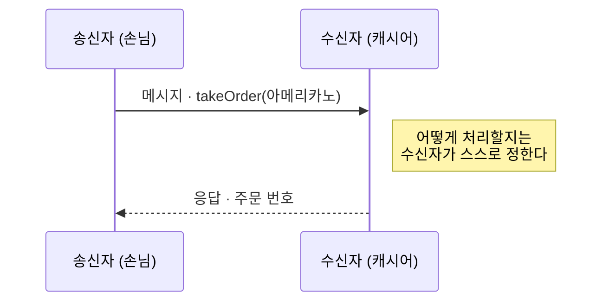

객체 사이의 협력은 결국 송신자와 수신자가 메시지를 주고받는 과정임.

#### 보충

**① 메시지 구문 읽기**

```java
cashier.takeOrder(menu);
```

| 부분 | 이름 |
| --- | --- |
| `cashier` | 수신자 |
| `takeOrder` | 메시지 이름 |
| `menu` | 인자 |

송신자는 이 코드를 실행하는 쪽, 즉 손님 객체임. 메시지의 구성 요소는 5장에서 다시 다룸.

**② 메시지 외의 경로로 소통하면**

```java
barista.beans = 0;            // 상태에 직접 접근한다: 메시지가 아니다
barista.makeCoffee(menu);     // 메시지를 보냄
```

- 첫 줄처럼 다른 객체의 상태를 직접 바꾸면, 그 객체는 스스로 판단할 기회를 잃는다.
- 객체의 자율성은 '메시지로만 소통한다'는 규칙이 지켜질 때 유지됨.

**③ 앨런 케이와 메시징**

- '객체지향'이라는 용어를 만든 앨런 케이는 훗날, 이 개념의 핵심이 객체나 클래스가 아니라 **메시징**이었다고 밝혔다(1998년 Squeak 메일링 리스트).
- 그가 설계한 Smalltalk에서는 `3 + 4`조차 객체 `3`에게 `+ 4`라는 메시지를 보내는 것으로 해석함.
- 이 생각은 1.4의 '클래스가 아니라 객체를 지향하라'와 5장의 '메시지를 따르라'로 이어짐.

#### 정리

- 객체는 메시지라는 단 하나의 수단으로만 소통함.
- 협력은 송신자와 수신자가 메시지를 주고받는 과정임.

### 1.3.3 메서드와 자율성

#### 해설

**요지** 메시지와 메서드를 분리하면 객체의 자율성이 높아지며, 이는 캡슐화와 깊이 연결됨.

**① 메서드**

- 수신자가 메시지를 처리하는 방법을 메서드(method)라 함.
- 메서드는 대개 클래스 안에 정의된 함수나 프로시저로 구현됨.

**② 메시지와 메서드의 분리**

- 송신자는 메시지를 보낼 뿐이고, 어떤 메서드로 처리할지는 수신자가 결정함.
- 이 분리 덕분에 수신자는 처리 방법을 자유롭게 선택하거나 바꿀 수 있음.
- 따라서 메시지와 메서드의 분리는 객체의 자율성을 높이며, 캡슐화(encapsulation)라는 개념과 깊이 연관됨.

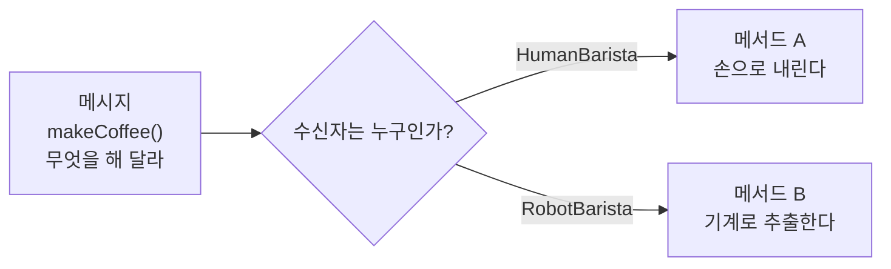

같은 메시지라도 받는 객체에 따라 실행되는 메서드가 달라짐. 송신자는 메시지만 알고 메서드는 모르기 때문에, 수신자를 바꿔 끼워도 송신자의 코드는 그대로다.

#### 보충

**① 실행 시점에 메서드가 정해진다: 동적 바인딩**

```java
Barista barista = isWeekend ? new LatteArtBarista() : new AromaBarista();
barista.makeCoffee(menu);   // 어떤 메서드가 실행될지는 실행 시점에 결정됨
```

- 코드를 작성하는 시점에는 어떤 `makeCoffee`가 실행될지 알 수 없음.
- 메시지와 메서드가 분리되어 있기 때문에 가능한 일이며, 이를 동적 바인딩(dynamic binding)이라 함.
- 다형성(1.1.3)은 이 구조 위에서 동작함.

**② 캡슐화의 두 가지 의미**

| 구분 | 감추는 것 | 예 |
| --- | --- | --- |
| 상태의 캡슐화 | 객체가 가진 데이터 | `private int beans` |
| 구현의 캡슐화 | 메시지를 처리하는 방법 | `makeCoffee`의 내부 절차 |

흔히 캡슐화를 '필드를 private으로 만드는 것'으로만 이해하지만, 메시지와 메서드의 분리처럼 **처리 방법을 감추는 것**도 캡슐화임. 5장에서 이 두 측면을 다시 다룸.

#### 정리

- 메서드는 수신자가 메시지를 처리하는 방법임.
- 메시지와 메서드의 분리는 객체의 자율성을 높이고, 캡슐화로 이어짐.

**논의해 보기**

Q1. getter로 상태를 꺼내 밖에서 판단하는 코드와, 메시지를 보내 객체가 판단하게 하는 코드는 무엇이 다를까?

**생각 거리:** 앞쪽은 판단 규칙이 호출하는 쪽에 퍼지고, 뒤쪽은 객체 안에 모임. 흔히 'Tell, Don't Ask(묻지 말고 시켜라)'라고 부르는 원칙임.

Q2. 자율성이 지나치면 어떤 문제가 생길까?

**생각 거리:** 모든 일을 혼자 하려는 객체는 협력할 이유가 사라지고 거대한 덩어리가 됨. 저자가 '협력적이면서 자율적'이라고 두 조건을 함께 건 이유임.

---

## 1.4 객체지향의 본질

> **이 절의 맥락** 1장 전체를 한 문장으로 묶는 결론부다. 앞의 절들에서 쌓은 역할, 책임, 협력, 메시지, 자율성을 모아 '객체지향에서 가장 중요한 것은 무엇인가'에 답함. 저자의 답은 클래스가 아니라 객체, 그리고 객체 사이의 협력임.

### 1.4.1 객체를 지향하라

#### 해설

**요지** 객체지향의 핵심은 클래스가 아니라, 적절한 책임을 수행하는 역할 사이의 유연하고 견고한 협력 관계임.

**① 1장을 종합한 객체지향의 개념**

저자는 1장의 내용을 다음과 같이 종합함.

1. 객체지향은 시스템을 상호작용하는 **자율적인 객체들의 공동체**로 보고, 객체 단위로 시스템을 분할하는 방법임.
2. 자율적인 객체란 **상태와 행위**를 함께 지니며 스스로를 책임지는 객체임.
3. 객체는 시스템의 행위를 구현하기 위해 다른 객체와 **협력**함.
   - 각 객체는 협력 안에서 **역할**을 수행함.
   - 역할은 관련된 **책임**의 집합임.
4. 객체는 **메시지**를 보내 협력하고, 메시지를 받은 객체는 처리에 적합한** 메서드**를 자율적으로 선택함.

**② 클래스 중심 사고에 대한 비판**

- 앨런 케이 같은 선구자들의 의도와 달리, 많은 사람이 객체지향을 '클래스를 지향하는 것'으로 받아들였음.
- 그러나 클래스는 객체지향을 구현하는 수단일 뿐 핵심이 아님.
  - 근거: 자바스크립트처럼 프로토타입 기반의 객체지향 언어에는 본래 클래스가 없고 객체만 있음.
- 중요한 것은 클래스 사이의 정적인 관계가 아니라, 메시지를 주고받는 객체 사이의 **동적인 관계**임.

**③ 객체를 지향하라**

- 설계는 클래스가 아니라 객체에서 출발해야 함.
- 먼저 객체가 협력 안에서 어떤 역할과 책임을 맡을지 정하고, 클래스와 메서드의 구조는 그 다음에 결정함.

#### 보충

**① 클래스 없이도 객체지향이 성립한다: 프로토타입**

```javascript
const barista = {
  makeCoffee(menu) {
    return `${menu} 완성`;
  },
};

const latteArtist = Object.create(barista);   // barista를 원형으로 삼는 객체
latteArtist.makeCoffee = function (menu) {
  return `${menu} 완성, 라테 아트 추가`;
};

barista.makeCoffee("라테");      // "라테 완성"
latteArtist.makeCoffee("라테");  // "라테 완성, 라테 아트 추가"
```

- 클래스 선언 없이도 객체, 메시지, 다형성이 모두 성립함.
- 자바스크립트의 `class` 문법(ES2015)은 프로토타입 위에 얹은 문법일 뿐, 동작 원리는 바뀌지 않았음.

**② 클래스 중심 설계와 객체 중심 설계**

| 비교 항목 | 클래스 중심 | 객체 중심 |
| --- | --- | --- |
| 출발점 | 어떤 클래스와 필드가 필요한가 | 어떤 협력과 메시지가 필요한가 |
| 핵심 질문 | 무엇을 상속받을까 | 이 메시지를 누가 받아야 할까 |
| 흔한 결과 | 데이터 중심 설계, 상속의 남용 | 책임 중심 설계, 작고 교체 가능한 역할 |

**③ 상속에 대한 흔한 오해**

- 클래스 중심으로 사고하면 코드 재사용을 위해 상속을 쓰는 경향이 생김.
- 그러나 코드 재사용만을 위한 상속은 부모와 자식 클래스를 강하게 결합시켜, 부모의 변경이 자식 전체로 번짐.
- 그래서 디자인 패턴의 고전인 GoF는 '상속보다 합성(composition)을 선호하라'고 권함.
- 상속과 타입 계층은 3장에서 다시 다룸.

**④ 이후 장과의 연결**

| 1장의 개념 | 이어지는 장 |
| --- | --- |
| 상태, 행동, 식별자 | 2장 이상한 나라의 객체 |
| 클래스와 타입 | 3장 타입과 추상화 |
| 역할, 책임, 협력 | 4장 역할, 책임, 협력 |
| 메시지와 메서드, 캡슐화 | 5장 책임과 메시지 |
| 코드로 옮기기 | 7장 함께 모으기 |

#### 정리

- 객체지향은 시스템을 자율적인 객체들의 협력 공동체로 바라보는 관점임.
- 클래스는 구현 수단일 뿐이며, 핵심은 객체 사이의 동적인 협력 관계임.
- 설계는 역할과 책임에서 출발하고, 클래스 구조는 그 결과로 정해짐.

**논의해 보기**

Q. 클래스 다이어그램부터 그리는 습관을 '객체를 지향하라'는 관점으로 바꾸려면 무엇부터 해야 할까?

**생각 거리:** 클래스 대신 협력 장면(시퀀스 다이어그램)을 먼저 그려 보는 것임. 누가 누구에게 어떤 메시지를 보내는지가 정해지면, 클래스는 그 협력을 코드로 옮기는 수단으로 자연스럽게 따라 나옴.

---

## 1장 정리

### 핵심 요약

- '실세계의 모방'은 철학적 배경을 설명하는 데는 적합하지만, 실무적인 분석과 설계를 설명하기에는 적합하지 않다.
- 객체지향의 목표는 실세계의 모방이 아니라 새로운 세계의 창조임.
- 역할, 책임, 협력은 일상 속에 이미 존재하며, 객체지향은 이를 소프트웨어에 적용한 것임.
- 협력은 요청과 응답의 연쇄이며, 응답은 요청과 반대 방향으로 전달됨.
- 역할은 책임을 내포하며, 이로부터 대체 가능성, 자율성, 다형성이 도출됨.
- 시스템의 기능은 책임으로 분할되어 적절한 역할을 가진 객체에 할당됨.
- 객체는 협력적이면서 자율적이어야 하며, 자율성은 상태와 행동을 함께 가질 때 생김.
- 객체는 메시지로만 소통하고, 메시지와 메서드의 분리가 자율성과 캡슐화를 낳는다.
- 객체지향의 핵심은 클래스가 아니라 객체 사이의 동적인 협력 관계임.

### 인사이트

- 설계의 출발점은 '실세계에 무엇이 있는가'가 아니라 '이 기능을 위해 누가 어떤 책임을 지는가'임.
- 협력 참여자가 서로 알지 않아도 되는 것이 많을수록 결합도가 낮아짐.
- 요청은 '무엇'만 표현해야 함. 그래야 자율성과 다형성이 성립함.
- 대체 가능성은 메서드 이름이 아니라 계약을 지킬 때 성립함.

### 더 살펴보기 · 최근 논쟁과 트렌드

1장의 주장이 실무와 최근 흐름에서 어떻게 다시 나타나는지 정리함. 정답이 하나로 정해지지 않은 질문은 '쟁점', 최근 설계 현장에서 다시 주목받는 주제는 '트렌드'로 나눔.

> **읽는 법** 각 항목은 '배경 → 쟁점 → 예시 → 이 책과의 연결' 순서로 구성함. 처음 보는 용어는 '배경'에서 먼저 풀어 설명하므로, 표보다 배경부터 읽기를 권함.

**① 쟁점: 현실을 닮게 만드는 것은 틀린 걸까?**

**배경**

- 1장은 '객체지향은 현실의 모방'이라는 통념을 반박함
- 그런데 실무에서 널리 쓰이는 **도메인 주도 설계(DDD)**는 오히려 '현실 업무를 코드에 충실히 담으라'고 함
  - 도메인(domain): 소프트웨어가 다루는 업무 영역. 예: 쇼핑몰의 주문·결제·배송
  - 유비쿼터스 언어(ubiquitous language): 기획자와 개발자가 같은 단어를 쓰고, 그 단어를 코드에도 그대로 쓰자는 원칙
- 그래서 처음 공부하는 사람은 '현실을 닮아야 하는가, 닮지 말아야 하는가'에서 혼란을 느끼기 쉬움

**구조로 보면**

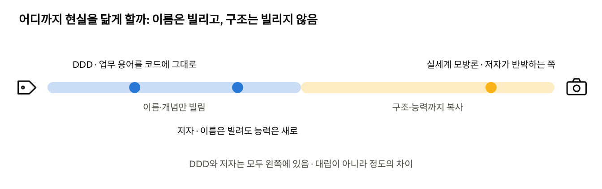

| 입장 | 근거 |
| --- | --- |
| 닮아야 함 | 도메인 주도 설계(Domain-Driven Design, DDD)는 업무 용어를 코드에 그대로 담으라고 함(유비쿼터스 언어) |
| 닮을 필요 없음 | 저자는 현실의 구조를 복사하면 설계가 막힌다고 봄 |
| 정리 | 이름과 개념은 현실에서 빌리고, 책임은 협력에서 정함. 두 입장은 '어디를 닮게 하느냐'의 차이임 |

**예시로 보면**

```java
// 업무에서 쓰는 말: "주문을 취소한다"
// → 이름은 현실에서 빌림 (DDD와 저자 모두 동의)
class Order {
    void cancel() {
        // → 하지만 능력은 현실과 다름
        //   종이 주문서는 스스로 취소하지 못하지만,
        //   소프트웨어의 Order는 취소 가능 여부를 스스로 판단함
    }
}
```

**이 책과의 연결**

- 두 입장은 생각보다 가까움. DDD가 닮으라는 것은 '단어와 개념'이고, 저자가 반대하는 것은 '현실의 구조와 능력까지 복사하는 것'임
- 2장의 '은유'가 바로 이 절충안임: 이름은 빌리고, 능력은 새로 부여함

**② 쟁점: 함수나 React 컴포넌트도 객체인가?**

**배경**

- 최근 웹 프론트엔드는 클래스보다 함수를 많이 씀. 대표적인 것이 **React 컴포넌트**임
  - React: 화면을 만드는 자바스크립트 라이브러리
  - 컴포넌트: 버튼·입력창처럼 화면의 한 조각을 만드는 함수
- 그래서 '클래스가 없는데도 객체지향인가'라는 질문이 자주 나옴. 1.4의 '클래스가 아니라 객체를 지향하라'와 직접 연결되는 질문임

**예시로 보면**

```jsx
// ① 상태와 행동을 함께 가진 컴포넌트 → 객체에 가까움
function Counter() {
  const [count, setCount] = useState(0);        // 상태: 지금까지 누른 횟수
  return (
    <button onClick={() => setCount(count + 1)}> {/* 행동: 누르면 상태가 바뀜 */}
      {count}
    </button>
  );
}

// ② 상태 없이 입력으로 결과만 내는 순수 함수 → '행동' 자체에 가까움
function add(a, b) {
  return a + b;
}
```

**구조로 보면**

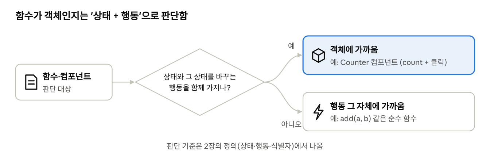

- 그렇다는 쪽: 입력을 받아 결과를 스스로 정하고, 재사용됨
- 아니라는 쪽: 상태가 없거나, 객체라 부르기엔 너무 큼
- 판단 기준: 상태와 그 상태를 바꾸는 행동을 함께 가지면 객체에 가까움. 순수 함수는 '행동' 자체에 가까움 (2장에서 다시 다룸)
- 11번가 개발자 스터디의 결론: 객체를 딱 정의하기보다 책임과 자율성의 관점으로 보자는 쪽으로 의견이 모임

**③ 트렌드: 멀티 에이전트 AI에서 다시 만나는 역할·책임·협력**

**배경**

- **AI 에이전트**: 사람이 준 목표를 이루려고 스스로 계획을 세우고, 도구를 쓰고, 결과를 돌려주는 AI 프로그램
- **멀티 에이전트 시스템**: 에이전트 여럿이 일을 나눠 맡아 함께 하나의 목표를 이루는 구조
- **오케스트레이터(orchestrator)**: 에이전트들에게 일을 나눠 주고 결과를 모으는 조율자. 커피 주문의 캐시어와 비슷한 자리임
- 2025\~2026년 들어 실무에 빠르게 퍼지면서, '에이전트에게 역할을 어떻게 나눌까'가 설계의 핵심 질문이 됨

**예시로 보면** · '시장 조사 보고서 작성'을 에이전트 세 개에게 맡기는 경우

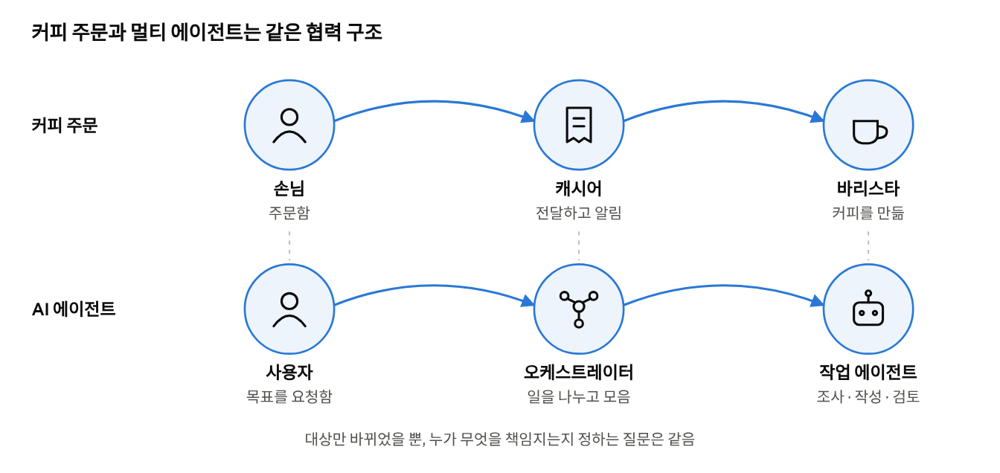

- 각 에이전트의 목적·할 수 있는 일·경계를 적는 것 = 책임 정의
- 에이전트끼리 결과를 넘기는 것 = 메시지를 통한 협력
- 작성 에이전트를 다른 모델로 바꿔도 흐름이 그대로면 = 대체 가능성

여러 AI 에이전트가 함께 일하는 시스템을 설계할 때, 1장과 똑같은 질문이 나옴. 누가 무엇을 책임지는가, 어디까지가 그 역할의 경계인가, 서로 어떻게 메시지를 주고받는가.

| 이 책의 개념 | 멀티 에이전트 시스템에서 |
| --- | --- |
| 역할 | 에이전트마다 목적, 할 수 있는 일, 경계를 정의함 |
| 책임의 분할 | 큰 작업을 계획·실행·검토 같은 전문 역할로 나눔 |
| 메시지와 협력 | 에이전트끼리 결과를 주고받고, 오케스트레이터가 흐름을 조율함 |
| 갓 오브젝트 | 모든 일을 떠안은 단일 에이전트의 한계 |

- 실무 가이드들의 공통점: 역할이 불분명하면 에이전트가 일을 중복하거나, 서로 충돌하거나, 빈틈을 남김
- 반대 조언도 함께 나옴: 작업이 좁고 책임이 밀접하면 단일 에이전트가 나음. 1.3의 '협력과 자율의 균형'과 같은 결론임
- 역할마다 목적·능력·경계·성공 기준을 적으라는 조언은 CRC 카드(1.2.2 보충)와 같은 발상임

**이 책과의 연결**

- 대상이 객체에서 AI 에이전트로 바뀌었을 뿐, 필요한 질문은 1장과 같음: 누가 무엇을 책임지고, 어떻게 요청하고 응답하는가
- 그래서 역할·책임·협력은 특정 언어의 문법이 아니라, 여럿이 일하는 시스템을 설계하는 일반적인 사고법임

**에이전트 경계를 정하는 기준** · 업계 보고로 확인한 내용

**배경**

- 1장대로라면 '역할(책임) 단위로 에이전트를 나눈다'가 자연스러움
- 그런데 실제로 멀티 에이전트를 운영한 회사들의 보고는, 역할을 '직무'(기획자·구현자·테스터·검토자)로 이해하면 오히려 실패한다고 함

**구조로 보면**

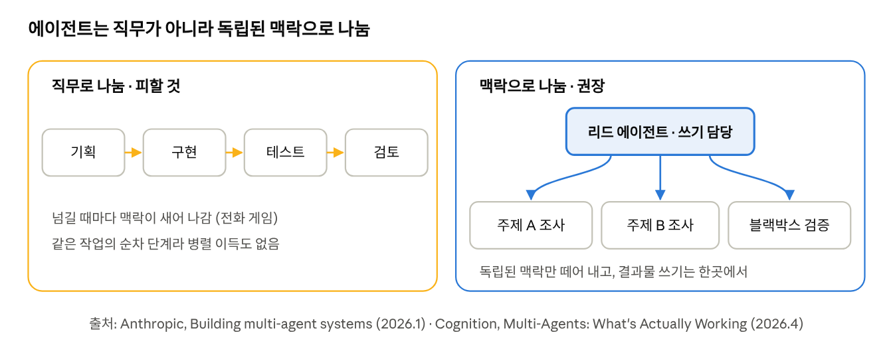

**확인된 기준 다섯 가지**

| 기준 | 내용 | 출처 |
| --- | --- | --- |
| ① 단일 에이전트에서 시작 | 멀티 에이전트를 몇 달 동안 만들었는데, 단일 에이전트의 프롬프트를 개선하니 같은 결과가 나온 사례가 많음. 복잡도는 근거가 있을 때만 더함 | Anthropic (2026.1), OpenAI 실무 가이드 |
| ② 나눠서 이득인 세 경우 | 맥락 보호(크고 불필요한 중간 결과를 격리), 병렬화(독립된 갈래를 동시에 · 이득은 속도보다 철저함), 전문화(도구가 20개 이상이거나 무관한 도메인·충돌하는 행동 모드를 오갈 때) | Anthropic (2026.1) |
| ③ 직무가 아니라 맥락으로 나눔 | 기획→구현→테스트→검토처럼 나누면 넘길 때마다 정보가 새는 '전화 게임'이 됨. 좋은 경계: 독립적인 조사 경로, 인터페이스가 깔끔한 구성 요소, 블랙박스 검증자. 나쁜 경계: 같은 작업의 순차 단계, 강하게 얽힌 부분, 공유 상태가 필요한 일 | Anthropic (2026.1) |
| ④ 쓰기는 한곳에서 | 여러 에이전트가 동시에 결과물을 고치면 서로 모르는 결정이 충돌함. 추가 에이전트는 검토·조언 같은 '지능'을 보태고, 쓰기는 한 줄기로 유지함. 코드 리뷰는 작성자의 맥락을 모르는 검토자가 더 잘함 | Cognition (2026.4) |
| ⑤ 비용을 계산에 넣음 | 멀티 에이전트는 같은 작업에 토큰을 보통 3\~10배 씀. Anthropic의 리서치 시스템은 채팅의 약 15배를 썼고, 그만큼 가치 있는 작업에만 맞음 | Anthropic (2026.1, 2025.6) |

- 위임할 때는 목표, 결과 형식, 쓸 도구와 자료, 작업의 경계를 분명히 적어야 중복과 빈틈이 생기지 않음 (Anthropic, 2025.6)
- 도구 개수 같은 기준선은 모델이 좋아지면서 바뀔 수 있음 (Anthropic, 2026.1)

**이 책과의 연결**

| 업계 기준 | 1\~2장의 개념 |
| --- | --- |
| 맥락으로 나눔 (기능을 맡은 에이전트가 그 테스트도 맡음) | 정보 전문가 · 책임을 수행하는 데 필요한 정보를 가진 쪽에 맡김 |
| 위임 메시지의 네 요소 | 메시지와 계약 (1.1.2 보충 ⑥) |
| 순차 단계로 쪼개지 않기 | 미들맨 · 협력과 자율의 균형 (1.3) |
| 블랙박스 검증자 | 캡슐화 · 안을 몰라도 결과로 판단함 |
| 단일 에이전트에서 시작 | 실용주의 · YAGNI |

- 주의: 책에서 말하는 역할은 사람의 '직무'가 아니라 협력에 필요한 책임의 묶음임. 그리고 책임은 그 책임에 필요한 정보를 가진 쪽에 둔다는 것이 핵심임. 업계의 '맥락으로 나눈다'는 조언은 이 원칙과 오히려 잘 맞음
- 앞의 그림처럼 조사→작성→검토를 순서대로 나눌 까닭은 검토가 독립된 관점(블랙박스 검증)일 때뿐임. 조사는 주제별로 병렬로 나누고, 작성은 한 에이전트가 맡는 쪽이 권장됨

**참고**

- [Anthropic, "Building multi-agent systems: When and how to use them" (2026.1)](https://www.claude.com/blog/building-multi-agent-systems-when-and-how-to-use-them)
- [Anthropic, "How we built our multi-agent research system" (2025.6)](https://www.anthropic.com/engineering/multi-agent-research-system)
- [Cognition, "Multi-Agents: What's Actually Working" (2026.4)](https://cognition.com/blog/multi-agents-working)
- [OpenAI, "A practical guide to building agents" 요약 (Maginative)](https://www.maginative.com/article/how-to-build-ai-agents-a-detailed-practical-guide-from-openai/)

**④ 실무 연결: 멀티모듈, 역할과 책임을 모듈 단위로**

**배경**

- **멀티모듈(multi-module)**: 하나의 프로젝트를 따로 빌드할 수 있는 여러 모듈로 나누어 관리하는 구조
  - 모듈: 독립적으로 빌드할 수 있는 코드 묶음
  - 주로 Gradle·Maven을 쓰는 Java·Kotlin(Spring) 프로젝트에서 많이 씀
- 1장이 객체 단위로 책임을 나눴다면, 멀티모듈은 그보다 큰 '코드 묶음' 단위로 책임을 나누는 방법임

**구조로 보면**

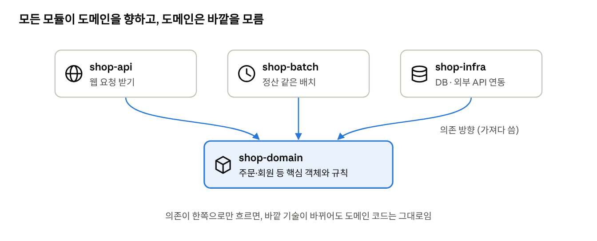

**예시로 보면** · 쇼핑몰 프로젝트를 네 모듈로 나눌 때

```groovy
// settings.gradle: 프로젝트에 어떤 모듈이 있는지 선언
include 'shop-domain', 'shop-infra', 'shop-api', 'shop-batch'

// shop-api/build.gradle: api 모듈이 가져다 쓰는 모듈
dependencies {
    implementation project(':shop-domain')
    implementation project(':shop-infra')
}

// shop-domain/build.gradle: 도메인은 다른 모듈을 가져오지 않음
dependencies { }
```

**왜 나누나**

| 이유 | 설명 |
| --- | --- |
| 변경 범위 제한 | 결제 API를 바꿔도 shop-infra만 고침 |
| 재사용 | API 서버와 배치 서버가 같은 도메인 코드를 함께 씀 |
| 의존 방향 강제 | 도메인이 DB나 웹 기술을 가져다 쓰면 컴파일 단계에서 막힘 |
| 빌드·배포 분리 | 필요한 모듈만 빌드하고 배포할 수 있음 |

**이 책과의 연결**

| 1장의 개념 (객체 단위) | 멀티모듈에서 (모듈 단위) |
| --- | --- |
| 역할과 책임 | 모듈마다 맡은 책임이 있음 (domain = 규칙, infra = 외부 연결) |
| 메시지로만 소통 | 공개된 인터페이스로만 다른 모듈을 씀 |
| 캡슐화 | 모듈 안의 구현은 밖에서 보이지 않음 |
| 자율성 | 다른 모듈을 몰라도 혼자 빌드·테스트할 수 있음 |

- 주의할 점: 모듈을 너무 잘게 쪼개면 모듈 사이의 협력 비용이 커짐. 1.3의 '협력과 자율의 균형'과 같은 이야기임
- 도메인이 바깥을 모르게 하는 의존 방향은 이 책 후반의 의존성 논의와 이어짐

**도메인별로 나누나, 계층별로 나누나**

- 모듈을 나누는 기준은 크게 두 가지임
- **계층별(layer)**: 기술적 역할로 자름. 웹 요청 처리(api), 업무 규칙(domain), 저장(infra)로 나눔. 위 예시가 이 방식임
- **도메인별(domain)**: 업무 영역으로 자름. 주문(order), 회원(member), 상품(product)처럼 나누고, 각 모듈 안에 그 업무의 api·규칙·저장이 함께 들어감

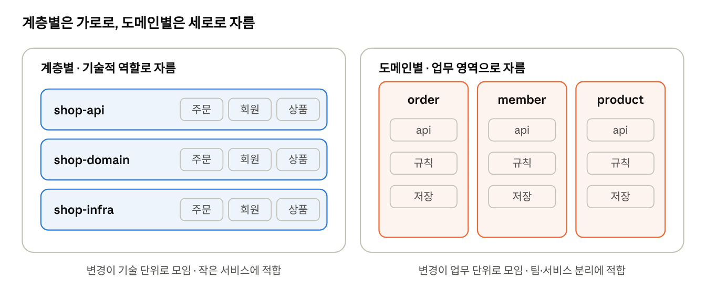

| 기준 | 계층별 | 도메인별 |
| --- | --- | --- |
| 자르는 방향 | 가로 (기술) | 세로 (업무) |
| '주문 취소' 기능을 고칠 때 | api·domain·infra 세 모듈을 모두 건드림 | order 모듈 하나만 고침 |
| 장점 | 구조가 단순하고 처음 시작하기 쉬움 | 업무 변경이 한 모듈에 모임 · 팀별로 나눠 맡기 쉬움 |
| 단점 | 규모가 커지면 한 계층 모듈이 비대해짐 | 경계를 잘못 잡으면 모듈끼리 깊게 얽힘 |
| 어울리는 경우 | 작은 서비스, 초기 단계 | 업무 영역과 팀이 많은 서비스, 나중에 마이크로서비스(MicroServices Architecture, MSA)로 나눌 계획이 있는 경우 |

- 실무에서는 두 방식을 섞기도 함: 먼저 도메인별로 나누고, 각 도메인 안을 다시 계층으로 나눔
- 이 책과의 연결: 도메인별 분할은 '함께 바뀌는 책임끼리 한곳에 모은다'는 생각에 더 가까움. 1장에서 협력에 필요한 책임을 한 역할에 묶는 것과 같은 방향임

> **스터디 메모** 멀티모듈을 설명해 준 분의 내용과 팀 사례를 여기에 덧붙임.

**참고**

- 11번가 개발자 스터디 회의록 · [github.com/11st-corp/oop](https://github.com/11st-corp/oop)
- Fulcrum Digital, "Multi-Agent Systems" (2026.7)
- Owl-Listener, "agent-role-design" (2026)
- System Design Nuggets (2026.4)

### 실습

장을 학습하며 추가함.

### 다이어그램

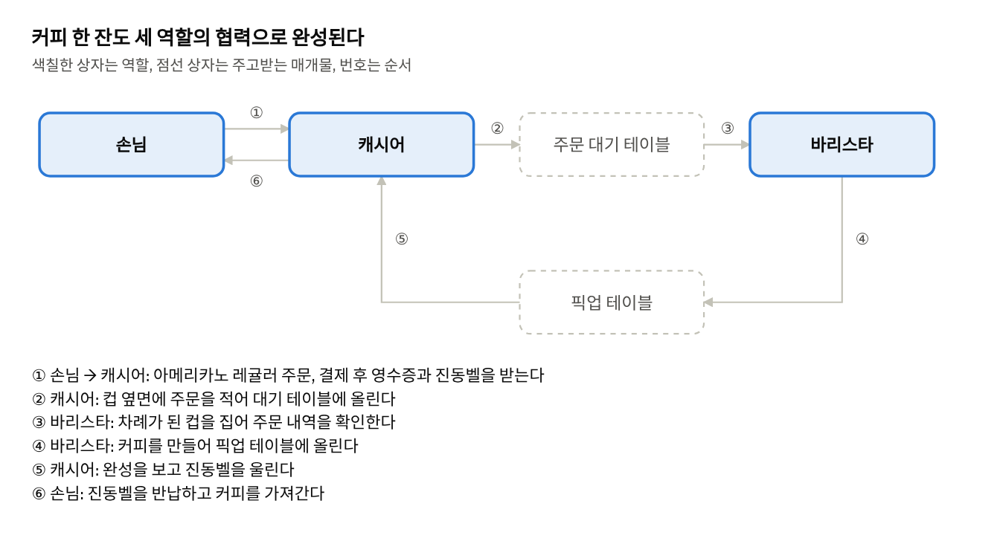

손님과 바리스타는 직접 소통하지 않음. 캐시어가 양자를 매개하며, 두 테이블은 각각 주문과 완성된 커피를 전달하는 매개물 역할을 함.

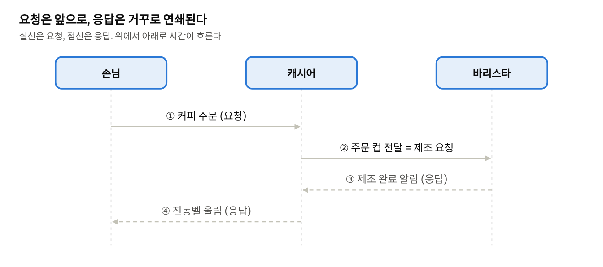

요청은 손님에서 바리스타 방향으로 전파되고, 응답은 그 역순으로 전달됨. 이는 메서드 호출이 콜 스택에 쌓였다가 반환을 통해 해소되는 구조와 동일함.

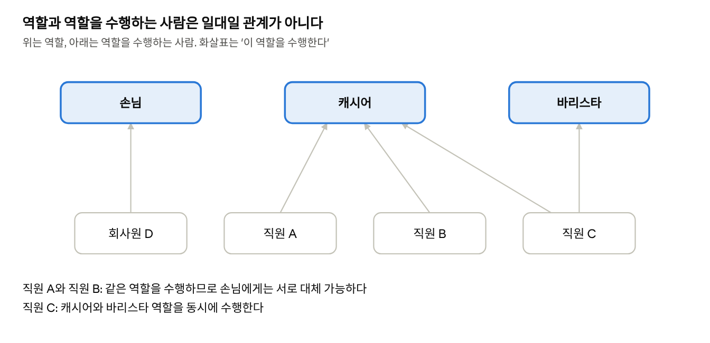

역할과 그 역할을 수행하는 사람은 일대일로 대응하지 않음. 여러 사람이 하나의 역할을 수행할 수 있으므로 서로 대체 가능하며, 한 사람이 여러 역할을 동시에 수행할 수도 있음.

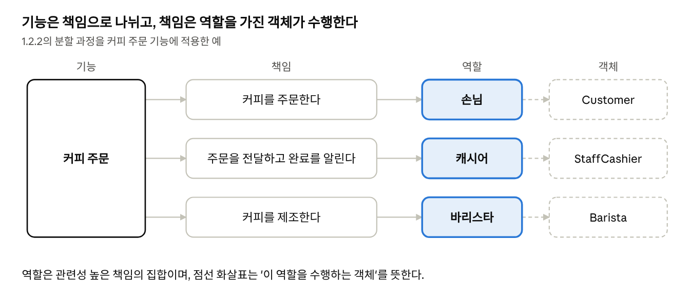

커피 주문이라는 기능은 세 개의 책임으로 나뉘고, 각 책임은 역할에 할당되며, 역할은 구체적인 객체가 수행함.

**1장 개념 포함 관계도**

1장의 용어들은 서로 따로 노는 것이 아니라 바깥에서 안쪽으로 포함되는 구조를 이룸. 협력이 가장 큰 틀이고, 그 안에서 객체가 역할을 맡으며, 역할은 책임의 묶음임. 책임은 메시지로 요청되고 메서드로 수행됨.

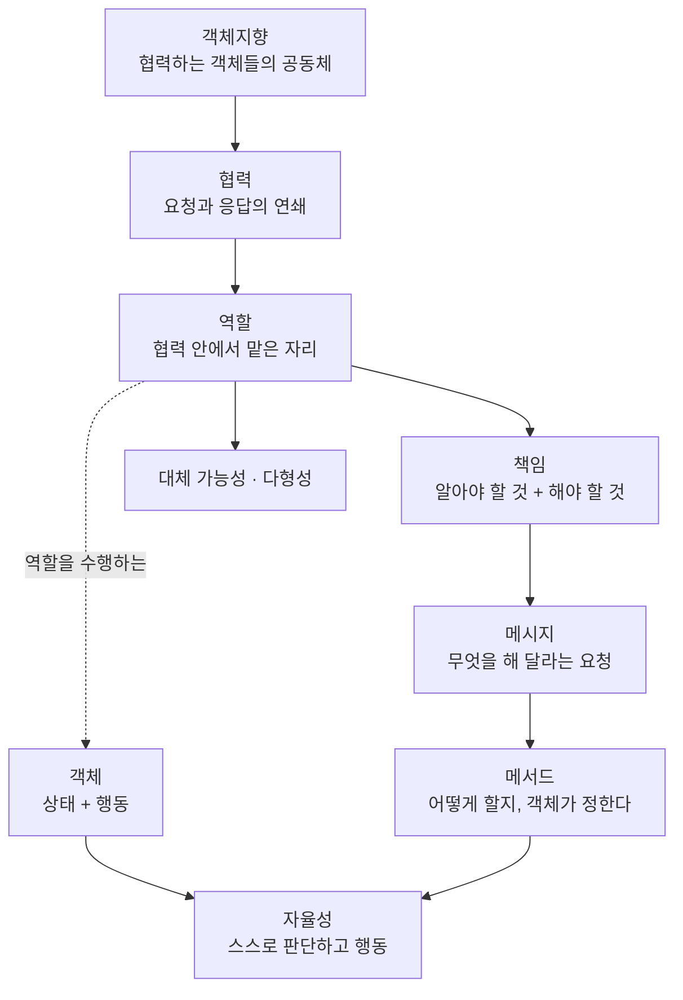

### 확인 질문

각 질문 아래의 답은 모범 답안임. 먼저 스스로 답해 본 뒤 비교함.

1. **현재 다루는 코드에서 실세계에 대응하는 사물이 없는 객체를 하나 고르고, 그 책임을 한 문장으로 서술하시오.**
   - 답: 예컨대 `RetryPolicy`는 실패한 요청을 몇 번, 어떤 간격으로 다시 시도할지 판단함. 현실에 짝이 없어도 책임이 분명하면 좋은 객체임. 판단 기준은 이름이 현실과 닮았는가가 아니라 책임을 한 문장으로 말할 수 있는가임.
2. **실세계 비유가 효과적으로 설명하는 세 가지 대응 관계는 무엇인가?**
   - 답: 스스로 판단하는 생명체 → 자율성과 캡슐화, 약속과 계약으로 협력하는 사람들 → 메시지와 협력, 사물에서 출발해 구현까지 이어지는 과정 → 연결완전성.
3. **캐시어가 없어지고 손님이 바리스타에게 직접 주문하면 협력 구조는 어떻게 달라지는가?**
   - 답: 손님이 적을 때는 단계가 줄어 빨라질 수 있음. 그러나 바리스타가 주문 접수, 결제, 호출까지 떠안아 병목이 되고, 손님은 바리스타의 사정을 더 많이 알아야 함. 즉 결합도가 높아지고 한쪽의 변화가 다른 쪽으로 번짐.
4. **`cashier.takeOrder()`의 반환을 기다리는 방식과 진동벨 방식은 손님에게 어떤 차이가 있는가?**
   - 답: 반환을 기다리면(동기) 커피가 나올 때까지 손님은 다른 일을 할 수 없음. 진동벨(비동기)은 기다리는 동안 다른 일을 할 수 있음. 대신 알림이 오지 않는 실패 상황에 대비해야 함.
5. **다형성을 자신의 말로 정의하고, 커피 전문점이 아닌 예를 하나 드시오.**
   - 답: 같은 메시지를 받아도 받는 객체마다 다른 방식으로 응답하는 능력임. 예: `pay()` 메시지를 받은 카드, 계좌이체, 포인트 결제 객체가 각자 다른 절차로 결제함. 보내는 쪽은 결제 수단의 종류를 몰라도 됨.
6. **진동벨을 울리지 않는 무인 주문기는 캐시어를 대체할 수 있는가?**
   - 답: 없음. 같은 메서드 이름을 가졌더라도 손님이 기대하는 책임, 즉 완성을 알리는 약속을 지키지 않기 때문임. 대체 가능성은 형식이 아니라 계약을 지킬 때 성립한다(리스코프 치환 원칙).
7. **‘주문 금액 계산’ 책임은 손님, 캐시어, 주문 중 누가 맡아야 하는가?**
   - 답: 주문. 주문 항목과 각 항목의 가격이라는 필요한 정보를 가장 많이 가진 객체이기 때문이다(정보 전문가 패턴).

