# Week 2 · 2장 이상한 나라의 객체

> **객체지향의 사실과 오해 · 2장 학습 기록**
> 각 목은 해설 → 보충 → 정리 순서로 구성했음. '해설'은 원서의 핵심을 개념 중심으로 정리한 것이고, '보충'은 실무 관점과 최근 흐름을 덧붙인 설명임.
> 📎 단어는 전역 단어장 [`단어장.md`](단어장.md)에 모음.

## 2장 Summary · 한눈에 보기

> **핵심 메시지** 객체는 상태·행동·식별자를 가진 존재이며, 설계는 상태가 아니라 행동에서 출발해야 함.

1. **객체는 셀 수 있고 구분되는 단위임** — 실무 객체 대부분은 주문·계좌 같은 개념적 객체임 (2.1)
2. **상태와 행동은 서로를 결정함** — 행동이 상태를 바꾸고, 상태가 다음 행동의 결과를 정함 (2.2, 2.3)
3. **식별자가 객체와 값을 가름** — 엔티티는 동일성, 값 객체는 동등성으로 비교함 (2.3.3)
4. **객체는 버튼만 보이는 기계임** — 명령과 쿼리로만 다루고 상태는 감춤 (2.4)
5. **설계는 행동에서 출발함** — 상태부터 정하면 캡슐화가 깨짐 (2.5)
6. **현실과의 관계는 모방이 아니라 은유임** — 이름을 빌려 표현적 차이를 줄이고 이상한 나라를 창조함 (2.6)

**핵심 용어** 상태 · 행동 · 식별자 · 프로퍼티 · 명령 · 쿼리 · 엔티티 · 값 객체 · 의인화 · 은유

**바로 가기** 이 장의 **인사이트**와 **더 살펴보기 · 최근 논쟁과 트렌드**는 맨 끝 '2장 정리'에 있음

**트렌드 종합** 1\~2장이 요즘 실무에서 어떻게 쓰이는지는 탭 맨 끝 **지금의 객체지향: 네 가지 흐름**에 있음

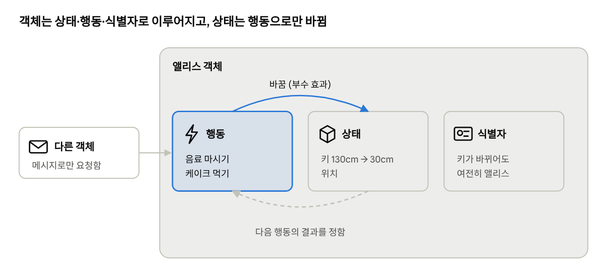

2장 전체를 한 장에 담은 그림임. 다른 객체는 메시지로 행동만 요청할 수 있고, 상태는 그 행동을 통해서만 바뀜.

---

## 들어가며

> **이 절의 맥락** 1장이 객체들이 함께 일하는 방식을 다뤘다면, 2장은 그 객체 하나의 내부를 들여다봄. 이 장을 읽고 나면 '객체란 무엇인가'라는 질문에 상태, 행동, 식별자라는 세 단어로 답할 수 있음.

#### 📖 해설

> [!TIP]
> **요지** 객체지향은 지식과 행동을 객체 안에 담아 복잡성을 다루는 방법이며, 객체를 발견하는 일은 곧 지식과 행동을 구조화하는 일임.

- 2장은 레베카 워프스브록의 말로 시작함. 객체를 발견하고 창조하는 것은 지식과 행동을 구조화하는 문제라는 것임.
- 객체지향 패러다임은 지식을 추상화하고, 추상화한 지식을 객체 안에 캡슐화함으로써 실세계 문제의 복잡성을 관리함.
- 2장은 '객체란 무엇인가'를 상태, 행동, 식별자라는 세 가지 요소로 풀어 설명함.

#### ➕ 보충

**① 레베카 워프스브록**

- 책임 주도 설계(Responsibility-Driven Design)를 정립한 설계자로, 이 책 4장과 5장의 사상적 기반을 제공함.
- 대표 저서는 『Object Design: Roles, Responsibilities, and Collaborations』(2002)임. 이 책의 부제 '역할, 책임, 협력'과 같은 단어 구성임.

#### 📌 정리

- 객체는 지식(상태)과 행동을 함께 담는 단위임.
- 2장은 객체를 상태, 행동, 식별자의 관점에서 설명함.

**논의해 보기**

Q. '지식과 행동을 함께 담는다'는 객체는 데이터베이스 테이블과 무엇이 다를까?

**생각 거리:** 테이블은 지식(데이터)만 담고, 그 데이터로 무엇을 할지는 밖에 있음. 객체는 그 지식을 가지고 할 일까지 함께 가짐. 이 차이가 2.5의 '행동이 상태를 결정한다'로 이어짐.

---

## 2.1 객체지향과 인지 능력

> **이 절의 맥락** 객체를 정의하기 전에 저자는 사람이 세상을 어떻게 인식하는지부터 물음. 소프트웨어 객체도 사람이 '하나의 무엇'으로 인식할 수 있어야 다룰 수 있기 때문임.

#### 📖 해설

> [!TIP]
> **요지** 객체지향은 인간이 세상을 객체 단위로 인지한다는 사실에서 출발하지만, 그 목적은 현실의 모방이 아니라 새로운 세계의 창조임.

**① 인간은 세상을 객체로 인지함**

- 사람은 주변 세계를 개별적인 객체로 나누어 인식함.
- 저자는 객체를 '인간이 분명하게 인지하고 구별할 수 있는, 물리적 또는 개념적 경계를 지닌 어떤 것'으로 설명함.

**② 유사성의 한계**

- 객체지향은 소프트웨어의 세계 역시 인지 가능한 객체들로 이루어져 있다는 믿음에서 출발함.
- 그러나 현실과의 유사성은 거기까지임. 실행 중인 애플리케이션의 내부는 겉보기와 달리 현실과 매우 이질적임.

**③ 목적은 모방이 아니라 창조**

- 소프트웨어 객체는 현실의 객체와 전혀 다른 모습을 보이는 것이 일반적임.
- 예를 들어 현실의 전등은 스스로 켜지지 않지만, 소프트웨어의 전등은 스스로 전원을 켬.

**④ 객체의 조건과 스펙트럼**

저자는 객체를 다음 네 조건을 갖춘 것으로 설명함.

| 조건 | 의미 |
| --- | --- |
| 셀 수 있음 | 하나, 둘 개수를 헤아릴 수 있음 |
| 구분됨 | 다른 사물과의 경계가 분명함 |
| 생성 시점이 있음 | 언제 생겨났는지 말할 수 있음 |
| 하나의 단위임 | 독립된 덩어리로 인식됨 |

- 이런 조건을 갖춘 것들이 모여 **객체의 스펙트럼**을 이룸.
  - 한쪽 끝: 물리적 경계를 가진 구체적 사물. 사과, 자동차, 커피잔
  - 다른 쪽 끝: 개념적 경계를 가진 추상적 사물. 주문, 계좌, 시간표
- 사람의 인지 능력은 물리적 한계를 넘어, 손으로 만질 수 없는 것까지 경계를 그어 객체로 인식함.
- 세상을 작은 객체로 나누는 것은 세상의 복잡성을 이겨 내려는 인간의 방법임.

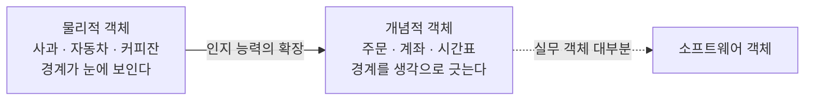

#### ➕ 보충

**① 물리적 경계와 개념적 경계**

| 경계의 종류 | 예 |
| --- | --- |
| 물리적 경계 | 커피잔, 진동벨, 커피 머신 |
| 개념적 경계 | 주문, 예약, 할인 정책, 결제, 일정 |

실무에서 다루는 객체의 대부분은 손으로 만질 수 없는 **개념적 객체**임. 이 점만 보아도 '현실 사물을 본뜬다'는 설명이 왜 부족한지 알 수 있음.

#### 📌 정리

- 객체지향은 인간의 인지 방식에서 출발하지만, 현실을 복제하는 것이 목적은 아님.
- 소프트웨어 객체는 현실의 객체보다 능동적이며, 개념적인 경우가 많음.

**논의해 보기**

Q1. 지금 쓰는 서비스에서 개념적 객체를 세 개 찾아보자. 그중 현실에 짝이 있는 것은 몇 개인가?

**생각 거리:** 대부분이 개념적 객체라면, '현실을 모방한다'는 설명이 왜 설계에 도움이 안 되는지 직접 확인한 셈임.

Q2. 숫자 1,000은 객체가 아니라는데, Money 클래스는 객체일까?

**생각 거리:** 숫자는 재료지만, '금액'이라는 개념과 규칙(음수 금지, 통화 단위)을 담으면 의미를 가진 값 객체가 됨. 2.3.3에서 다시 다룸.

---

## 2.2 객체, 그리고 이상한 나라

> **이 절의 맥락** 추상적인 정의 대신 앨리스라는 구체적인 인물을 먼저 보여 줌. 앨리스에게서 관찰한 세 가지 특징은 다음 절에서 상태, 행동, 식별자라는 용어로 정리됨.

### 2.2.1 이상한 나라의 앨리스

#### 📖 해설

> [!TIP]
> **요지** 저자는 『이상한 나라의 앨리스』에서 키가 계속 바뀌는 앨리스를 통해 객체의 특성을 설명함.

- 앨리스는 토끼를 쫓아 이상한 나라에 들어가고, 아주 작은 문을 통과하려 함.
- 앨리스의 키는 행동에 따라 바뀜.
  - 음료를 마시거나 부채질을 하면 작아짐.
  - 케이크를 먹으면 커짐.
- 문을 통과할 수 있는지는 그 시점의 키에 달려 있음.

#### 📌 정리

- 앨리스의 이야기는 '상태가 변하는 존재'를 설명하기 위한 사례임.

### 2.2.2 앨리스 객체

#### 📖 해설

> [!TIP]
> **요지** 앨리스의 행동에서 객체의 핵심 특성을 읽어 낼 수 있음.

1. **앨리스는 상태를 가지며, 상태는 변경 가능함.**
   - 키라는 상태가 계속 바뀜.
2. **상태를 바꾸는 것은 앨리스 자신의 행동임.**
   - 행동의 결과는 상태에 의존하며, 상태를 이용해 서술할 수 있음.
   - 행동의 순서가 결과에 영향을 미침. 케이크를 먼저 먹느냐, 음료를 먼저 마시느냐에 따라 문을 통과할 수 있는지가 달라짐.
3. **앨리스는 어떤 상태에 있더라도 유일하게 식별됨.**
   - 키가 달라져도 앨리스는 여전히 앨리스임.

**상태와 행동의 순환 관계**

- 행동이 상태를 바꿈. 음료를 마시면 키가 줄어듦.
- 상태가 행동의 결과를 정함. 지금 키가 문보다 작아야 문을 지날 수 있음.
- 따라서 행동의 성공 여부는 이전에 어떤 행동이 있었는지에 달려 있음. 이 관찰이 2.3에서 상태라는 개념이 필요한 이유로 이어짐.

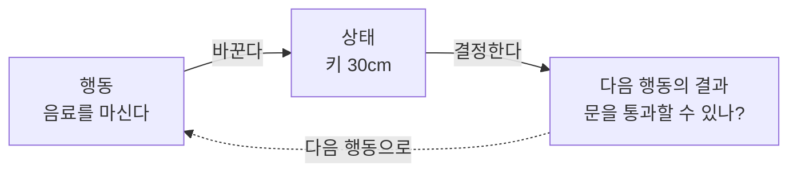

참고로 『이상한 나라의 앨리스』의 작가 루이스 캐럴의 본명은 찰스 루트위지 도지슨(Charles Lutwidge Dodgson)으로, 옥스퍼드의 수학자였음.

#### ➕ 보충

**① 앨리스를 코드로 표현하기**

```java
class Alice {
    private int height = 130;                     // 상태

    void drinkBeverage() { height -= 100; }       // 상태를 바꾸는 행동
    void eatCake()       { height += 100; }

    boolean canPassThrough(Door door) {           // 행동의 결과가 상태에 의존한다
        return height <= door.height();
    }
}

Alice alice = new Alice();
alice.eatCake();
alice.drinkBeverage();
alice.canPassThrough(door);   // 순서를 바꾸면 중간 상태가 달라짐
```

- `alice`라는 객체는 키가 몇 번 바뀌어도 같은 객체임.
- 이 코드에서 상태, 행동, 식별자라는 세 요소를 모두 확인할 수 있음. 2.3에서 각각을 자세히 다룸.

#### 📌 정리

- 객체는 상태를 가지고, 그 상태는 자신의 행동으로 바뀜.
- 행동의 결과는 상태와 행동의 순서에 따라 달라짐.
- 상태가 바뀌어도 객체는 유일하게 식별됨.

**논의해 보기**

Q. '행동의 순서가 결과를 바꾼다'는 것을 버그로 겪어 본 적이 있는가?

**생각 거리:** 초기화 전에 호출하기, 결제 전에 배송하기가 대표적임. 객체가 상태를 보고 지금 그 행동이 가능한지 스스로 확인하게 만들면 이런 버그를 막을 수 있음.

---

## 2.3 객체, 그리고 소프트웨어 나라

하나의 개별적인 실체로 식별할 수 있는 것이라면 물리적인 것이든 개념적인 것이든 객체가 될 수 있음. 저자는 객체를 **상태, 행동, 식별자**를 지닌 실체로 보는 것이 가장 효과적이라고 말함.

> **이 절의 맥락** 2장의 중심이 되는 절임. 2.2에서 앨리스에게서 관찰한 특징을 소프트웨어 용어로 옮기고, 각 요소가 왜 필요한지 하나씩 설명함. 아래 그림은 이 절에서 나오는 용어들이 서로 어떻게 포함되는지 보여 줌.

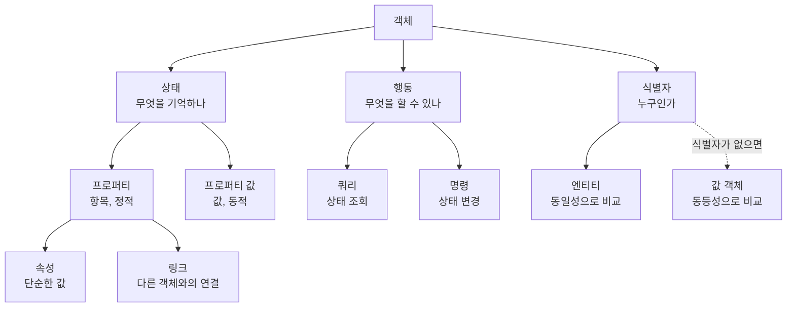

### 2.3.1 상태

#### 📖 해설

> [!TIP]
> **요지** 상태는 과거 행동의 결과를 요약하여, 현재만 보고도 행동의 결과를 예측할 수 있게 해 줌.

**① 왜 상태가 필요한가**

- 어떤 행동의 결과는 과거에 어떤 행동이 있었는지에 의존함.
  - 자판기는 돈을 넣은 뒤에야 음료를 고를 수 있음.
  - 항공권을 발권한 뒤에야 비행기에 탈 수 있음.
- 과거의 모든 행동 이력을 따져 결과를 판단하는 것은 번거롭고 이해하기 어려움.
- 그래서 사람은 **상태**라는 개념을 고안했음. 앨리스의 경우 '현재 키'와 '문의 높이'만 알면 통과 여부를 예측할 수 있음.

**② 상태와 프로퍼티**

- 세상의 모든 것이 객체는 아님. 숫자, 문자열, 날짜, 참과 거짓 같은 **단순한 값**은 객체의 상태를 표현하는 데 쓰임.
- 객체의 상태는 단순한 값과 다른 객체의 조합으로 표현됨.

| 용어 | 의미 | 앨리스의 예 |
| --- | --- | --- |
| 프로퍼티(property) | 상태를 구성하는 모든 특징. 종류는 잘 바뀌지 않으므로 정적임 | '키', '위치' |
| 프로퍼티 값 | 특정 시점의 프로퍼티의 값. 시간에 따라 바뀌므로 동적임 | 130cm → 30cm |
| 속성(attribute) | 프로퍼티 중 단순한 값 | 키 |
| 링크(link) | 프로퍼티 중 다른 객체와의 의미 있는 연결 | 앨리스가 들고 있는 음료 |

- 프로퍼티 = 속성 + 링크
- 링크가 있어야 객체는 다른 객체에 요청을 보낼 수 있음.

**③ 상태의 정의**

- 상태는 특정 시점에 객체가 가진 정보의 집합이며, 객체의 구조적 특징을 나타냄.
- 상태는 정적인 프로퍼티와 동적인 프로퍼티 값으로 구성됨.

**④ 상태는 객체 자신만 다룸**

객체는 자율적인 존재이므로, 다른 객체가 이 객체의 상태에 직접 접근하거나 상태를 바꿀 수 없음.

#### ➕ 보충

**① 코드에서 속성과 링크 구분하기**

```java
class Alice {
    private Length height;        // 속성: 단순한 값
    private Location position;    // 속성: 단순한 값
    private Beverage beverage;    // 링크: 다른 객체와의 연결

    void drink() {
        beverage.drunk();         // 링크를 통해 음료 객체에 메시지를 보낸다
        height = height.shrink();
    }
}
```

**② 자판기로 본 상태의 효용**

```java
class VendingMachine {
    private int balance;                       // 지금까지의 투입 이력을 요약한 상태

    void insert(int coin) { balance += coin; }

    Drink select(Drink drink) {
        if (balance < drink.price()) throw new IllegalStateException("금액이 부족합니다");
        balance -= drink.price();
        return drink;
    }
}
```

- `balance`가 없다면, 음료를 고를 때마다 지금까지 넣은 동전을 모두 다시 세어야 함.
- 상태는 과거 행동의 결과를 한 값으로 압축해, 현재 시점의 판단을 단순하게 만듦.

#### 📌 정리

- 상태는 과거 행동의 결과를 요약한 정보임.
- 상태는 프로퍼티와 프로퍼티 값으로 구성되며, 프로퍼티는 속성과 링크로 나뉨.
- 객체의 상태는 그 객체만 다룰 수 있음.

### 2.3.2 행동

#### 📖 해설

> [!TIP]
> **요지** 상태는 행동을 통해서만 바뀌고, 상태를 행동 뒤로 감추면 객체는 자율적이 됨.

**① 상태와 행동의 관계**

- 객체의 상태는 저절로 바뀌지 않음. 상태를 바꾸는 것은 객체 자신의 행동뿐임.
- 행동의 결과로 상태가 바뀌는 것을 **부수 효과(side effect)**라 함.
- 상태와 행동은 다음 두 가지로 연결됨.
  1. 행동은 상태에 영향을 받음.
  2. 행동은 상태를 변경함.

**② 협력과 행동**

객체는 협력에 참여하기 위해 행동하며, 행동의 결과는 두 가지로 나타남.

- 자기 자신의 상태를 바꿈.
- 협력하는 다른 객체에게 메시지를 보냄.

예를 들어 앨리스가 음료를 마시면, 앨리스의 키가 줄어들고(자신의 상태 변경), 음료에게 '마셔졌다'는 메시지를 보내 음료의 양도 줄어든다(다른 객체에 대한 메시지 전송).

**③ 행동의 정의**

- 행동은 외부의 요청, 즉 수신한 메시지에 응답하기 위해 동작하고 반응하는 활동임.
- 객체는 행동으로 협력에 참여하므로, 행동은 외부에 드러나 있어야 함.

**④ 상태 캡슐화**

- 메시지를 보내는 쪽은 받는 쪽의 상태가 어떻게 바뀌는지 알지 못함. 상태가 바뀐다는 사실조차 모를 수 있음.
- 송신자는 자신의 요구를 메시지로 전달할 뿐임.
- 메시지를 해석하고 상태를 바꿀지 결정하는 것은 전적으로 수신자의 판단임.
- 상태를 잘 정의된 행동 뒤로 감추면 객체의 자율성이 높아지고, 협력은 단순하고 유연해짐.

#### ➕ 보충

**① 송신자가 모르는 상태 변경을 코드로 보기**

```java
class Alice {
    private Length height;

    void drink(Beverage beverage) {
        beverage.drunk(quantity);   // 음료에 메시지를 보낸다
        height = height.shrink();   // 자신의 상태를 바꾼다
    }
}

class Beverage {
    private int amount;

    void drunk(int quantity) {
        amount -= quantity;         // 앨리스는 음료의 양이 줄어드는지 알지 못한다
    }
}
```

**② 부수 효과에 대한 두 패러다임의 태도**

| 패러다임 | 부수 효과에 대한 태도 |
| --- | --- |
| 함수형 프로그래밍 | 가능한 한 피함. 같은 입력에는 언제나 같은 출력을 내는 순수 함수를 지향함 |
| 객체지향 프로그래밍 | 상태 변경을 인정하되, 그 범위를 객체 내부로 가두고 행동을 통해서만 일어나게 함 |

같은 스터디에서 '상태가 없는 함수도 객체인가'라는 질문이 나왔고, 보는 관점에 따라 다르다는 데 의견이 모였음. 이 책의 기준으로 보면 상태와 식별자가 없는 순수 함수는 객체보다 '행동' 자체에 가깝다.

#### 📌 정리

- 상태는 행동을 통해서만 바뀌며, 이를 부수 효과라 함.
- 행동의 결과는 자신의 상태 변경과 다른 객체에 대한 메시지 전송으로 나타남.
- 상태를 행동 뒤로 캡슐화하면 객체는 자율적이 되고 협력은 단순해짐.

### 2.3.3 식별자

#### 📖 해설

> [!TIP]
> **요지** 객체는 상태가 바뀌어도 식별자로 구별되며, 이것이 값과 객체의 가장 큰 차이임.

**① 식별자**

식별자는 어떤 객체를 다른 객체와 구별하는 데 쓰는 프로퍼티임.

**② 값과 객체의 차이**

| 구분 | 값(value) | 객체(object) |
| --- | --- | --- |
| 상태 | 변하지 않는다(불변) | 시간에 따라 변한다(가변) |
| 식별자 | 없음 | 있음 |
| 같은지 비교하는 방법 | 상태가 같으면 같다: 동등성(equality) | 상태가 달라도 식별자가 같으면 같다: 동일성(identity) |
| 예 | 숫자 5, 1,000원, 2026년 11월 2일 | 앨리스, 회원, 주문 |

엔티티로 만들지 값 객체로 만들지 헷갈릴 때는 아래 질문 하나로 판단할 수 있음.

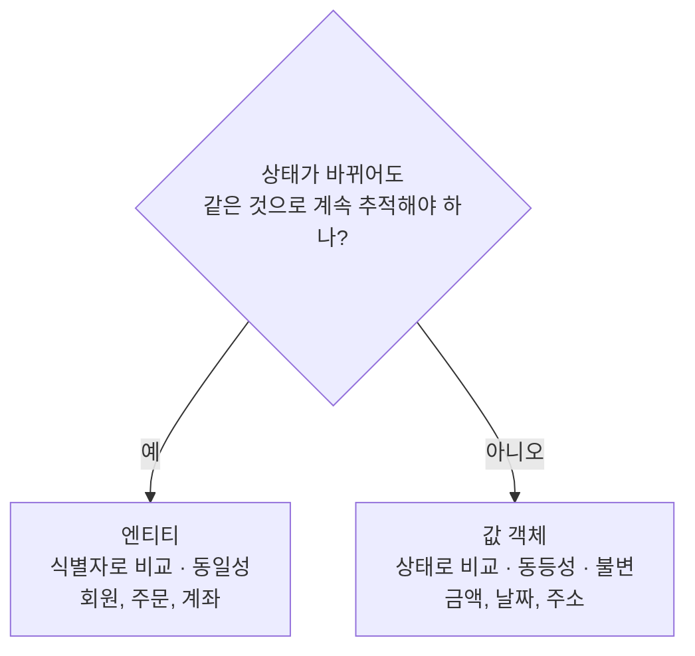

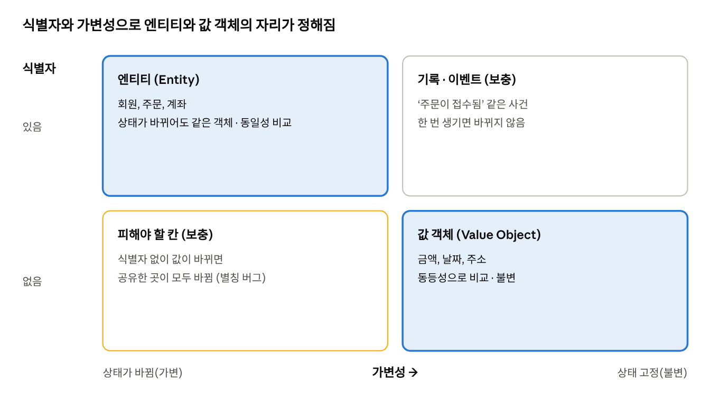

책이 다루는 것은 엔티티와 값 객체 두 칸임. 나머지 두 칸은 실무를 위한 보충임. 식별자가 없는데 상태가 바뀌는 왼쪽 아래 칸이 왜 위험한지, 값 객체를 왜 불변으로 만들어야 하는지 보여 줌.

**③ 용어의 혼란**

- 대부분의 객체지향 언어에서는 값과 객체를 모두 클래스로 구현하기 때문에, 둘을 혼동하기 쉬움.
- 그래서 둘을 구분하는 용어를 따로 쓰기도 함.
  - 식별자를 가진 전통적인 객체: 참조 객체(reference object) 또는 엔티티(entity)
  - 식별자가 없는 값: 값 객체(value object)

**④ 2.3의 종합**

- 객체는 상태를 가지며, 상태는 변경 가능함.
- 상태를 바꾸는 것은 객체의 행동임.
  - 행동의 결과는 상태에 의존하며, 상태로 서술할 수 있음.
  - 행동의 순서가 결과에 영향을 줌.
- 객체는 어떤 상태에 있더라도 유일하게 식별됨.

#### ➕ 보충

**① 코드로 본 동등성과 동일성**

```java
// 값 객체: 상태가 같으면 같은 것으로 본다
record Money(long amount) { }

new Money(1000).equals(new Money(1000));   // true: 동등하다

// 엔티티: 식별자가 같으면 같은 것으로 본다
class Member {
    private final Long id;       // 식별자
    private String nickname;     // 바뀔 수 있는 상태

    @Override
    public boolean equals(Object o) {
        return o instanceof Member other && id.equals(other.id);
    }
}
```

회원이 닉네임을 바꿔도 `id`가 같으면 같은 회원임. 반대로 1,000원은 어느 지갑에 있든 같은 1,000원임.

**② 값 객체를 불변으로 만드는 이유**

- 값은 여러 곳에서 공유되기 쉬움. 값이 바뀔 수 있으면, 한 곳의 변경이 공유하던 다른 곳까지 몰래 바뀌게 만듦.
- 대표적인 예가 Java의 `java.util.Date`임. 이 클래스는 가변이라 공유 시 버그가 잦았고, Java 8에서 도입된 `java.time`의 날짜 클래스들은 모두 불변으로 설계되었음.
- 그래서 값 객체는 불변으로 만들고, 바꾸고 싶으면 새 값을 만들어 돌려주는 방식을 씀. 예: `money.plus(other)`는 기존 값을 바꾸지 않고 새 `Money`를 반환함.

#### 📌 정리

- 식별자는 객체를 서로 구별하는 프로퍼티임.
- 값은 불변이고 동등성으로 비교하며, 객체는 가변이고 동일성으로 비교함.
- 식별자를 가진 객체를 엔티티, 식별자가 없는 값을 값 객체라 부르기도 함.

**논의해 보기**

Q1. 상태를 public 필드로 열어 두면 무슨 일이 생길까?

**생각 거리:** 누구나 규칙을 거치지 않고 상태를 바꿀 수 있음. 잔액이 음수가 되는 식의 잘못된 상태가 생겨도 어디서 바뀌었는지 찾기 어려움.

Q2. 엔티티의 equals를 모든 필드로 비교하면 어떻게 될까?

**생각 거리:** 닉네임만 바꿔도 다른 회원으로 판단됨. 엔티티는 식별자로, 값 객체는 상태로 비교해야 하는 이유임.

---

## 2.4 기계로서의 객체

> **이 절의 맥락** 2.3에서 나눠 본 상태, 행동, 식별자를 한 장의 그림으로 묶는 은유임. 밖에서 보이는 것과 보이지 않는 것을 나눠 보면, 캡슐화가 무엇을 지키는지 분명해짐.

#### 📖 해설

> [!TIP]
> **요지** 객체를 기계에 비유하면, 외부는 버튼으로만 객체를 다룰 수 있다는 캡슐화의 의미를 직관적으로 이해할 수 있음.

**① 쿼리와 명령**

| 용어 | 의미 |
| --- | --- |
| 쿼리(query) | 객체의 상태를 조회하는 작업 |
| 명령(command) | 객체의 상태를 변경하는 작업 |

**② 기계 은유**

- 기계의 부품은 단단한 외피 안에 감춰져 있어, 분해하지 않는 한 내부를 볼 수 없음.
- 사람은 기계 바깥에 붙은 버튼으로만 기계와 상호작용함.
  - 사각형 버튼: 상태를 바꾸는 명령
  - 둥근 버튼: 상태를 조회하는 쿼리
- 명령과 쿼리는 모두 객체가 **외부에 제공하는 행동**임.

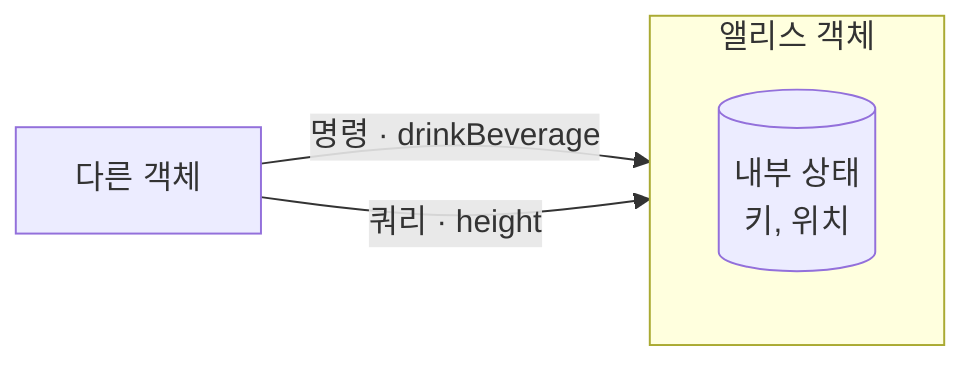

다른 객체는 명령과 쿼리라는 버튼만 누를 수 있고, 안쪽의 상태에는 직접 손댈 수 없음.

**③ 은유가 강조하는 것**

- 버튼 이외의 방법으로는 기계를 사용할 수 없음. 이것이 캡슐화임.
- 여러 기계를 선(링크)으로 연결하면, 기계들이 서로 버튼을 눌러 메시지를 주고받는 협력의 모습도 표현할 수 있음.

#### ➕ 보충

**① 명령-쿼리 분리 원칙(Command-Query Separation, CQS)**

버트런드 마이어는 메서드가 명령이거나 쿼리 중 하나여야 하며, 둘을 동시에 해서는 안 된다는 원칙을 제시했음. 이를 명령-쿼리 분리(Command-Query Separation)라 함.

```java
// 바람직하지 않은 예: 상태를 바꾸면서 값도 돌려준다
int withdrawAndGetBalance(int amount) { ... }

// 바람직한 예: 명령과 쿼리를 나눈다
void withdraw(int amount) { ... }   // 명령
int balance() { ... }              // 쿼리
```

- 쿼리는 몇 번을 호출해도 상태를 바꾸지 않으므로, 안심하고 부를 수 있음.
- 명령과 쿼리가 섞이면 '조회했을 뿐인데 값이 바뀌는' 버그가 생기기 쉬움.
- 다만 `stack.pop()`처럼 꺼내면서 값을 돌려주는 관례적 예외도 있음.
- 이 원칙을 아키텍처 수준으로 확장한 것이 CQRS(Command Query Responsibility Segregation)임.

#### 📌 정리

- 쿼리는 상태를 조회하고, 명령은 상태를 변경함.
- 외부는 객체가 제공하는 행동으로만 객체를 다룰 수 있음.

**논의해 보기**

Q. Stack.pop()이나 Iterator.next()는 명령일까, 쿼리일까?

> **용어 풀이** `Stack.pop()`: 스택(접시 쌓기처럼 마지막에 넣은 것을 먼저 꺼내는 자료구조)에서 맨 위 값을 꺼내 돌려주면서, 그 값을 스택에서 지움. `Iterator.next()`: 목록을 하나씩 훑는 반복자가 지금 위치의 값을 돌려주면서, 위치를 다음 칸으로 옮김. 둘 다 값을 '알려 주는' 쿼리이면서 동시에 상태를 '바꾸는' 명령이라 CQS의 대표적인 예외로 자주 언급됨.

**생각 거리:** 둘 다임. 값을 꺼내면서 상태도 바꿈. 널리 쓰이는 관례적 예외지만, 직접 설계할 때는 나누는 쪽을 기본으로 삼는 것이 안전함.

---

## 2.5 행동이 상태를 결정한다

> **이 절의 맥락** 앞 절들이 객체의 구조를 설명했다면, 이 절은 그 구조를 설계할 때 어디서부터 시작할지를 말함. 2장에서 실무에 가장 가까운 절이며, 4장과 5장의 책임 주도 설계로 이어짐.

#### 📖 해설

> [!TIP]
> **요지** 객체를 설계할 때는 상태가 아니라 행동에서 출발해야 함.

**① 초보자가 빠지기 쉬운 함정**

객체에 필요한 상태를 먼저 정하고, 그 상태에 맞춰 행동을 붙이는 방식임.

**② 상태를 먼저 정할 때의 세 가지 문제**

1. **캡슐화가 저해됨.**
   - 상태가 먼저 정해지면, 그 상태가 공용 인터페이스에 노출될 가능성이 높아짐.
2. **객체가 고립된 섬이 됨.**
   - 상태를 먼저 생각하면 협력이라는 문맥에서 멀어져, 협력에 맞지 않는 객체가 만들어짐.
3. **재사용성이 떨어짐.**
   - 상태에 맞춘 객체는 다양한 협력에 참여하기 어려움.

**③ 행동에서 출발하기**

- 먼저 협력 안에서 객체가 수행할 행동을 정함.
- 그다음, 그 행동에 필요한 상태를 정함.
- 저자는 이를 한 문장으로 정리함. 행동이 상태를 결정함**.**

두 설계 순서를 나란히 놓으면 차이가 분명함.

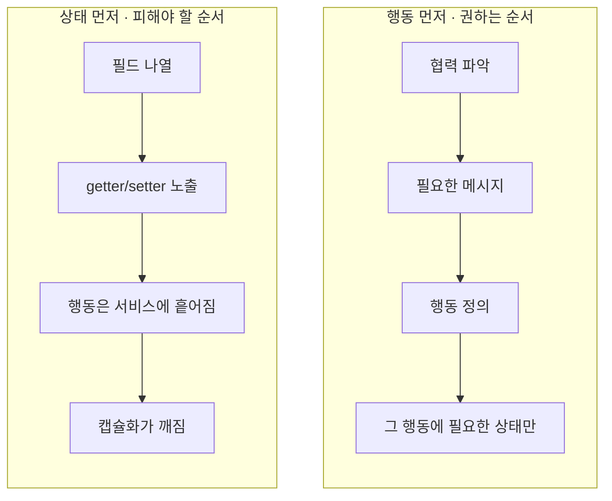

#### ➕ 보충

**① 두 설계 순서를 코드로 비교하기**

<table>
<tr><th>구분</th><th>상태 먼저 (피해야 할 순서)</th><th>행동 먼저 (권하는 순서)</th></tr>
<tr><td><b>설계 순서</b></td><td>필드 나열 → getter/setter → 행동은 나중에 서비스에</td><td>협력 파악 → 필요한 메시지 → 행동 → 그 행동에 필요한 상태</td></tr>
<tr><td><b>코드</b></td><td><pre lang="java">class Coffee {
    private String name;
    private int price;
    private String size;
    private int temperature;
    private LocalDateTime createdAt;
    // getter, setter …
    // 행동은 나중에 서비스에서
}</pre></td><td><pre lang="java">class Coffee {
    private final Menu menu; // price()에 필요
    private Size size;       // upsize()에 필요

    Money price() {
        return menu.priceOf(size);
    }
    void upsize() { size = size.next(); }
}</pre></td></tr>
<tr><td><b>결과</b></td><td>쓰이지 않을 필드까지 생기고, getter로 상태가 모두 밖에 드러남</td><td>행동에 필요한 상태만 있고, 밖에는 행동만 드러남</td></tr>
</table>

**② 데이터베이스부터 설계하는 습관과의 관계**

- 실무에서는 테이블 설계(Entity-Relationship Diagram, ERD)를 먼저 하고, 테이블을 그대로 엔티티 클래스로 옮기는 경우가 많음.
- 이는 상태를 먼저 정하는 설계의 전형적인 형태이며, 결과적으로 '들어가며' 보충 ③의 빈약한 도메인 모델로 이어지기 쉬움.
- 저자의 후속작 『오브젝트』는 이를 '데이터 중심 설계'라 부르며, 책임 중심 설계와 자세히 비교함.

**③ 행동을 먼저 정하는 실무 기법**

- 테스트 주도 개발(Test-Driven Development, TDD)에서는 객체가 어떻게 동작해야 하는지를 테스트로 먼저 씀. 자연스럽게 행동이 상태보다 먼저 정해짐.
- CRC(Class-Responsibility-Collaborator, 클래스-책임-협력자) 카드(1.2.2 보충 ①) 역시 필드가 아니라 책임과 협력자를 적음.

#### 📌 정리

- 상태를 먼저 정하면 캡슐화, 협력성, 재사용성이 모두 나빠짐.
- 협력 안에서의 행동을 먼저 정하고, 상태는 그 행동에 맞춰 결정함.

**논의해 보기**

Q. 팀에서 ERD부터 그리는 관행은 버려야 할까?

**생각 거리:** 저장 구조 설계는 여전히 필요함. 다만 저장 구조와 객체 구조를 같은 것으로 보지 않는 것이 핵심임. 객체는 협력에서 출발해 설계하고, 저장은 그 결과를 어떻게 보관할지의 문제로 따로 다룸.

---

## 2.6 은유와 객체

> **이 절의 맥락** 1장에서 시작한 '현실 모방' 논의를 마무리하는 절임. 현실과 소프트웨어 객체의 관계를 어떤 말로 설명해야 정확한지에 대해 저자가 최종 답을 내놓음.

### 2.6.1 두 번째 도시전설

#### 📖 해설

> [!TIP]
> **요지** '객체지향은 현실 세계의 모방'이라는 통념은 저자가 반박하는 두 번째 오해임.

- 첫 번째 오해는 1장에서 다룬 '클래스가 객체지향의 중심'이라는 생각임.
- 모방과 추상화라는 개념만으로는 현실의 객체와 소프트웨어 객체의 관계를 제대로 설명할 수 없음.
- 소프트웨어 객체는 현실 객체를 단순화한 것이 아니라, 현실에는 없는 특성을 가짐.

#### 📌 정리

- 현실의 모방이나 단순한 추상화로는 소프트웨어 객체를 설명할 수 없음.

### 2.6.2 의인화

#### 📖 해설

> [!TIP]
> **요지** 현실에서 수동적인 대상도 소프트웨어 객체가 되면 능동적으로 변함.

- 현실 객체와 소프트웨어 객체의 가장 큰 차이는 **능동성**임.
- 현실에서는 스스로 아무것도 하지 못하는 대상도, 소프트웨어 안에서는 스스로 판단하고 행동함.
- 이처럼 사물에 사람처럼 판단하고 행동하는 능력을 부여하는 것을 **의인화(anthropomorphism)**라 함.

#### ➕ 보충

**① 의인화는 책임 할당의 도구임**

| 현실의 대상 | 현실에서는 | 소프트웨어에서는 |
| --- | --- | --- |
| 계좌 | 은행원이 출금함 | `account.withdraw()` |
| 주문서 | 사람이 합계를 계산함 | `order.totalPrice()` |
| 쿠폰 | 점원이 유효기간을 확인함 | `coupon.isExpired(today)` |

- 의인화는 1.2.2 보충 ②의 정보 전문가 패턴과 같은 방향을 가리킴. 정보를 가진 대상에게 그 정보에 관한 판단을 맡김.
- 현실에서 누가 그 일을 하는지를 그대로 따르면, 모든 판단이 '사람' 역할의 서비스 객체에 몰리게 됨.

#### 📌 정리

- 소프트웨어 객체는 현실의 대상보다 능동적이며, 이를 의인화라 함.

### 2.6.3 은유

#### 📖 해설

> [!TIP]
> **요지** 현실과 소프트웨어 객체의 관계를 가장 정확히 설명하는 말은 모방이나 추상화가 아니라 은유임.

**① 전통적인 조언의 한계**

- 객체지향 분석과 설계에서는 오랫동안 '현실 세계의 객체를 자세히 관찰하고, 그중 소프트웨어에 필요한 속성만 추려내라'고 조언해 왔음.
- 저자는 이 조언이 실제로는 도움이 되지 않는다고 봄.

**② 그렇다고 현실과 무관한 것은 아님**

- 두 세계는 모방이나 추상화가 아닌 다른 방식으로 연결되어 있음. 그것이 **은유(metaphor)**임.
- 은유는 한 대상의 이름과 의미를 다른 대상에 빌려 쓰는 것임.

**③ 은유의 효과**

- 현실 객체의 이름을 소프트웨어 객체의 이름으로 쓰면 표현적 차이가 줄어듦.
- 그 결과 소프트웨어의 구조를 예측하기 쉬워지고, 이해하기 쉽고 유지보수하기 쉬운 소프트웨어가 됨.

**④ 모방에서 은유까지: 네 단어로 정리하기**

| 단어 | 현실과 소프트웨어의 관계 | 저자의 평가 |
| --- | --- | --- |
| 모방 | 현실을 그대로 복사함 | 틀린 설명 |
| 추상화 | 현실에서 필요한 속성만 추림 | 부족한 설명 |
| 의인화 | 현실에서 수동적인 사물이 스스로 판단하고 행동함 | 소프트웨어 객체의 실제 모습 |
| 은유 | 현실의 이름과 의미만 빌림 | 관계를 가장 정확히 설명하는 말 |

- 은유가 줄여 주는 것은 **표현적 차이**임. 사람이 머릿속에 그리는 개념과 코드 사이의 거리를 말하며,** 의미적 차이(semantic gap)**라고도 부름.
- 이 개념은 6장 '객체 지도'에서 도메인 모델과 함께 본격적으로 다룸.

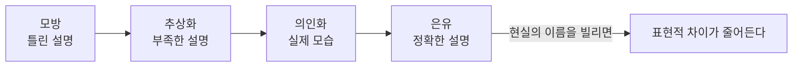

#### ➕ 보충

**① 은유로 이름 짓기**

| 빌려 온 이름 | 소프트웨어에서 하는 일 | 현실과 다른 점 |
| --- | --- | --- |
| 장바구니(Cart) | 구매할 상품을 담고 합계를 계산함 | 스스로 합계를 계산함 |
| 지갑(Wallet) | 잔액을 관리하고 결제 가능 여부를 판단함 | 스스로 결제를 거절함 |
| 방화벽(Firewall) | 네트워크 침입을 막음 | 막는 대상이 화재가 아님 |

- 이름을 들으면 대략적인 역할을 바로 짐작할 수 있음. 이것이 은유가 줄여 주는 표현적 차이임.
- 반대로 은유가 오해를 낳는 이름도 있음. 예컨대 `Manager`는 현실의 '관리자'처럼 무엇이든 다 하는 객체로 부풀기 쉬움.

#### 📌 정리

- 현실과 소프트웨어 객체는 은유의 관계에 있음.
- 현실의 이름을 빌리면 표현적 차이가 줄어 이해와 유지보수가 쉬워짐.

### 2.6.4 이상한 나라를 창조하라

#### 📖 해설

> [!TIP]
> **요지** 설계자의 목적은 현실을 모방하는 것이 아니라, 요구사항을 만족하는 이상한 나라를 창조하는 것임.

- 소프트웨어 객체가 현실을 닮아야 한다는 제약은 없음.
- 현실은 이름과 의미를 빌려 주는 은유의 원천일 뿐임.
- 앨리스의 이상한 나라처럼, 소프트웨어 세계에서는 사물도 스스로 말하고 판단함.

#### 📌 정리

- 설계의 목적은 현실의 복제가 아니라 새로운 세계의 창조임.
- 현실은 이름을 빌려 주는 은유의 원천으로만 활용함.

**논의해 보기**

Q. 코드에 있는 Manager, Helper 같은 이름을 은유가 분명한 이름으로 바꿔 보자.

**생각 거리:** OrderManager가 실제로 하는 일이 할인 계산이라면 DiscountPolicy가 더 정확함. 이름이 책임을 말하면 표현적 차이가 줄고, 무엇이든 담는 객체로 부푸는 것도 막을 수 있음.

---

## 2장 정리

### 핵심 요약

- 객체지향은 인간이 세상을 객체로 인지하는 방식에서 출발하지만, 목적은 현실의 모방이 아니라 새로운 세계의 창조임.
- 객체는 상태, 행동, 식별자를 지닌 실체임.
- 상태는 과거 행동의 결과를 요약하며, 프로퍼티(속성과 링크)와 프로퍼티 값으로 구성됨.
- 상태는 행동을 통해서만 바뀌며, 상태를 행동 뒤로 캡슐화하면 객체가 자율적이 됨.
- 값은 불변이고 동등성으로, 객체는 가변이고 동일성으로 비교함.
- 객체는 명령과 쿼리라는 버튼으로만 다루는 기계에 비유할 수 있음.
- 설계는 상태가 아니라 행동에서 출발해야 함. 행동이 상태를 결정함.
- 현실과 소프트웨어 객체는 모방이 아니라 은유의 관계이며, 소프트웨어 객체는 의인화된 능동적 존재임.

### 용어 비교

| 짝 | 왼쪽 | 오른쪽 |
| --- | --- | --- |
| 물리적 객체 / 개념적 객체 | 경계가 눈에 보임. 사과, 자동차 | 경계를 생각으로 그음. 주문, 계좌 |
| 단순한 값 / 객체 | 숫자, 문자열, 날짜. 다른 객체의 특성을 표현하는 재료 | 상태, 행동, 식별자를 가진 실체 |
| 프로퍼티 / 프로퍼티 값 | 키라는 항목. 정적 | 130cm라는 값. 동적 |
| 속성 / 링크 | 단순한 값 | 다른 객체와의 의미 있는 연결 |
| 쿼리 / 명령 | 상태를 조회함 | 상태를 변경함 |
| 값 / 객체 | 불변 상태, 식별자 없음 | 가변 상태, 식별자 있음 |
| 동등성 / 동일성 | 상태가 같으면 같음 | 식별자가 같으면 같음 |
| 값 객체 / 엔티티 | 금액, 날짜 | 회원, 주문. 참조 객체라고도 함 |
| 상태 먼저 / 행동 먼저 | 데이터 중심 설계. 캡슐화가 깨짐 | 책임 주도 설계. 협력에 맞는 객체가 나옴 |
| 모방, 추상화 / 의인화, 은유 | 현실이 원본이라고 봄 | 이름만 빌리고 능력은 새로 부여함 |

### 인사이트

- 상태는 '무엇을 기억할가'가 아니라 '어떤 행동을 하려면 무엇이 필요한가'에서 정해져야 함.
- 값 객체는 불변으로, 엔티티는 식별자로 다루는 것이 버그를 줄이는 기본 원칙임.
- 메서드는 명령이거나 쿼리 중 하나여야 한다(Command-Query Separation, CQS).
- 좋은 이름은 은유를 통해 표현적 차이를 줄이고, 나쁜 이름은 책임을 흐림.

### 더 살펴보기 · 최근 논쟁과 트렌드

2장의 '행동이 상태를 결정한다'와 '값과 객체의 구분'이 실무에서 부딪히는 지점과, 최근 언어 설계 흐름을 정리함.

> **읽는 법** 각 항목은 '배경 → 쟁점 → 예시 → 이 책과의 연결' 순서로 구성함. 처음 보는 용어는 '배경'에서 먼저 풀어 설명함.

**① 쟁점: getter/setter뿐인 객체는 잘못인가?**

**배경**

- **getter/setter**: 객체의 필드 값을 꺼내는 메서드(get)와 바꾸는 메서드(set). 예: `getBalance()`, `setBalance()`
- 실무 코드에는 필드와 getter/setter만 있고, 판단은 모두 바깥의 '서비스' 클래스가 하는 구조가 매우 흔함
- 2.5의 관점으로 보면 이는 상태만 남고 행동을 잃은 객체임

**예시로 보면**

```java
// 빈약한 모델: 규칙(잔액이 충분한가)이 바깥에 있음
if (account.getBalance() >= amount) {
    account.setBalance(account.getBalance() - amount);
}
// → 같은 규칙을 여러 서비스가 복사해 쓰고, 하나만 빼먹어도 잔액이 음수가 됨

// 풍부한 모델: 규칙이 데이터를 가진 객체 안에 있음
account.withdraw(amount);   // 잔액 확인은 Account가 스스로 함
```

**구조로 보면**

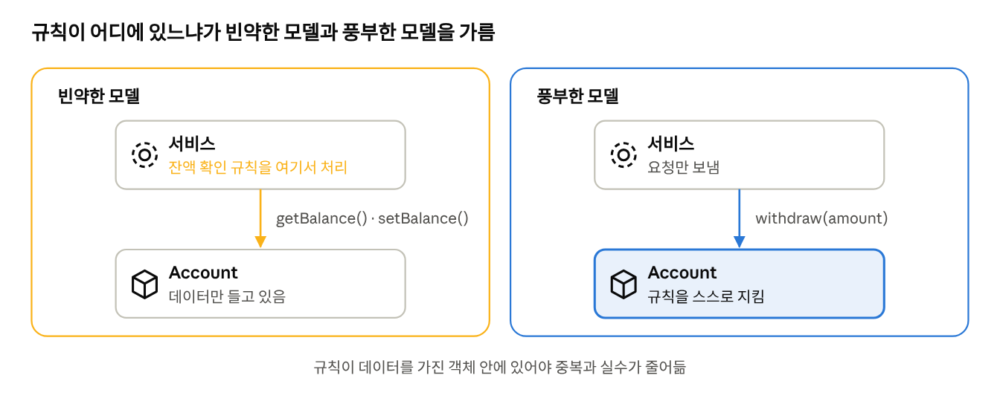

| 관점 | 내용 |
| --- | --- |
| 문제 | 마틴 파울러는 이를 '빈약한 도메인 모델(Anemic Domain Model)'이라는 안티패턴으로 부름. 규칙이 서비스 클래스에 흩어짐 |
| 괜찮을 때도 | 규칙이 거의 없는 단순 조회·저장 화면이라면 지나친 설계가 될 수 있음 |
| 기준 | 판단 규칙이 있다면 그 데이터를 가진 객체 안으로 옮김 (2.5 '행동에서 출발') |

**② 쟁점: 코드 재사용에는 상속이 정답인가?**

**배경**

- **상속(inheritance)**: 부모 클래스의 코드를 자식 클래스가 물려받는 것 (`extends`)
- **합성(composition)**: 다른 객체를 필드로 가지고, 필요한 일을 그 객체에게 맡기는 것
- **GoF(Gang of Four)**: 1994년 『Design Patterns』를 쓴 네 명의 저자를 부르는 별칭
- 입문서에서 상속을 '코드 재사용 수단'으로 배우다 보니, 실무에서 가장 자주 부딪히는 주제가 됨

**예시로 보면** · Java의 실제 사례

```java
// 상속: Java의 Stack은 Vector를 상속함
// → Vector의 add(index, item)까지 드러나서, 스택 중간에 값을 끼워 넣을 수 있음
Stack<Integer> stack = new Stack<>();
stack.push(1);
stack.add(0, 99);   // 스택의 규칙을 깨는 호출이 허용됨

// 합성: 필요한 기능만 밖에 드러냄
class SafeStack<T> {
    private final List<T> items = new ArrayList<>();   // 내부에만 둠
    void push(T item) { items.add(item); }
    T pop() { return items.remove(items.size() - 1); }
}
```

- 상속을 쓰면 부모의 모든 기능이 자식의 공개 행동이 됨 → 캡슐화가 약해짐
- 합성을 쓰면 꼭 필요한 행동만 골라 드러낼 수 있음 → 2.4의 '버튼만 보이는 기계'와 같은 원리

**구조로 보면**

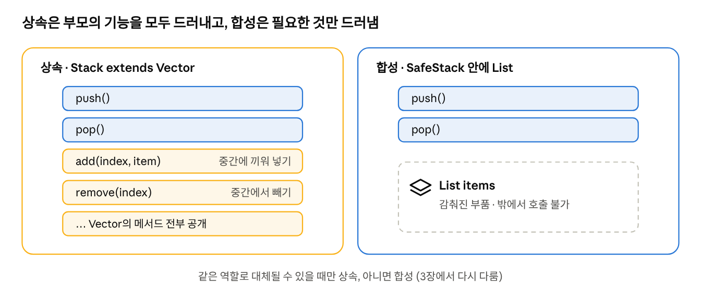

- 조심할 점: 재사용만을 위한 상속은 부모의 변경이 자식 전체로 번짐
- 대안: 디자인 패턴의 고전 GoF(Gang of Four)는 '상속보다 합성'을 권함
- 기준: 같은 역할로 대체될 수 있을 때만 상속, 아니면 합성. 3장에서 다시 다룸
- 두 쟁점의 공통 뿌리: 데이터만 든 객체는 행동을 잃은 객체이고, 재사용을 위한 상속은 협력이 아니라 클래스 구조에서 출발한 설계임

**③ 트렌드: 데이터 지향 프로그래밍(Data-Oriented Programming)**

**배경**

- **데이터 지향 프로그래밍(DOP)**: 데이터는 불변의 단순한 값으로 두고, 그 데이터를 처리하는 로직은 따로 두는 방식
- Java 언어 설계를 이끄는 **브라이언 고츠(Brian Goetz)**가 2022년 글에서 원칙을 정리하며 알려짐
- 최근 Java에 추가된 기능들이 이 방식을 받쳐 줌
  - **record** (Java 16): 불변 데이터 클래스를 한 줄로 선언. `equals`(동등성 비교)를 자동으로 만듦
  - **sealed 타입** (Java 17): 어떤 하위 타입만 허용할지 미리 정해 둠
  - **패턴 매칭** (Java 21): 데이터의 모양에 따라 처리를 나눔

**예시로 보면**

```java
// record: 2장의 '값 객체'를 언어가 직접 지원하는 셈임
record Money(long amount, String currency) { }

new Money(1000, "KRW").equals(new Money(1000, "KRW"));   // true → 동등성

// sealed + 패턴 매칭: 연산(넓이 계산)이 데이터 밖에 있음
sealed interface Shape permits Circle, Square { }
record Circle(double r) implements Shape { }
record Square(double side) implements Shape { }

double area(Shape s) {
    return switch (s) {
        case Circle c -> Math.PI * c.r() * c.r();
        case Square q -> q.side() * q.side();
    };
}
```

- 객체지향이었다면 `area()`를 각 도형 안에 두고 다형성으로 호출했을 것임. DOP는 반대로 데이터와 연산을 나눔
- 도형 종류는 거의 안 늘고 연산이 자주 늘어난다면 DOP가, 종류가 자주 늘어난다면 객체지향이 유리함

**구조로 보면**

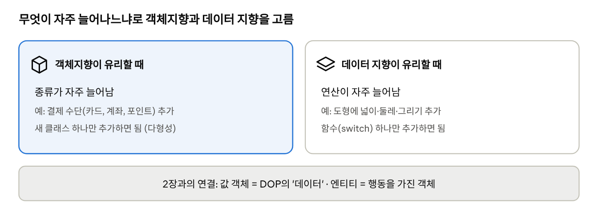

반대말처럼 들리지만, 실제로는 '무엇을 객체로, 무엇을 데이터로 둘 것인가'를 더 분명히 하자는 흐름임.

| 브라이언 고츠의 원칙 (2022) | 2장과의 연결 |
| --- | --- |
| 데이터는 불변이고 투명하게 | 값 객체의 불변성 · 동등성 |
| 데이터를, 데이터 전부를, 데이터만 모델링 | 식별자 없는 값은 상태 그 자체가 의미 |
| 잘못된 상태는 아예 표현할 수 없게 | 상태를 행동 뒤에 감추는 캡슐화와 목적이 같음 |
| 연산은 데이터와 분리 | 여기서 객체지향과 길이 갈림. 엔티티는 여전히 행동을 가진 객체로 남음 |

- Java의 record(Java 16), sealed 타입, 패턴 매칭이 이 흐름을 받침
- 2026년 OpenJDK Amber 프로젝트는 record를 넘어선 'carrier class'를 탐색 중임
- 쓰는 곳이 다름: 객체지향은 경계와 규칙을 지키는 곳에, 데이터 지향은 입력을 변환하는 작은 하위 시스템에 강함

**이 책과의 연결**

- DOP가 말하는 '데이터'는 2.3.3의 **값 객체**와 거의 같음: 식별자 없음, 불변, 동등성으로 비교
- 반면 상태가 바뀌며 추적되어야 하는 **엔티티**(회원, 계좌)는 여전히 행동을 가진 객체로 두는 편이 나음
- 결론: 둘 중 하나를 고르는 것이 아니라, '무엇을 객체로, 무엇을 데이터로 둘지' 구분하는 눈을 기르는 것이 핵심임

**참고**

- Martin Fowler, ["AnemicDomainModel"](https://martinfowler.com/bliki/AnemicDomainModel.html) (2003)
- Gamma 외, 『Design Patterns』 (1994)
- InfoQ, "Java Explores Carrier Classes" (2026.2)
- Nicolai Parlog, 『Data-Oriented Programming in Java』 v1.1 · JEP(JDK Enhancement Proposal) 359

### 실습

**과제: 자판기 객체 설계하기**

1. 동전을 넣고, 음료를 고르고, 잔돈을 돌려받는 협력에서 자판기가 받아야 할 메시지를 먼저 적음.
2. 각 메시지를 명령과 쿼리로 분류함.
3. 그 메시지를 처리하는 데 필요한 상태만 골라 적음.
4. 자판기, 음료, 동전 중 무엇이 엔티티이고 무엇이 값 객체인지 구분함.

풀이는 답을 작성한 뒤 추가함.

### 다이어그램

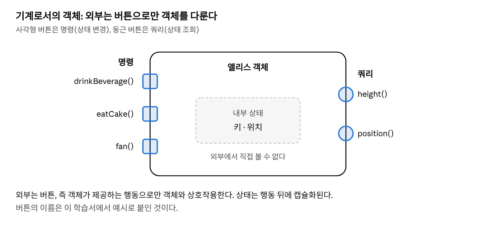

앨리스 객체를 기계로 표현한 그림임. 외부는 명령과 쿼리 버튼으로만 객체를 다루며, 내부 상태는 보이지 않음.

### 확인 질문

각 질문 아래의 답은 모범 답안임. 먼저 스스로 답해 본 뒤 비교함.

1. **상태가 없다면 자판기는 음료를 고를 때마다 무엇을 해야 하는가? 상태가 해결하는 문제는?**
   - 답: 지금까지 넣은 동전을 처음부터 다시 따져야 함. 상태는 과거 행동의 이력을 현재 값 하나(잔액)로 요약해, 지금 시점만 보고 판단할 수 있게 해 줌.
2. **속성과 링크의 차이를 설명하고, 각각의 예를 드시오.**
   - 답: 속성은 객체를 이루는 단순한 값이고, 링크는 다른 객체와의 의미 있는 연결임. 예: 회원의 닉네임은 속성, 주문이 참조하는 회원 객체는 링크. 링크가 있어야 그 객체에 메시지를 보낼 수 있음.
3. **회원과 금액 중 어느 것이 엔티티이고 어느 것이 값 객체인가?**
   - 답: 회원은 엔티티임. 닉네임이 바뀌어도 식별자가 같으면 같은 회원으로 본다(동일성). 금액은 값 객체임. 1,000원은 어디에 있든 같은 1,000원이며(동등성), 바뀌지 않아야 한다(불변).
4. **`withdrawAndGetBalance()` 같은 메서드는 왜 문제인가?**
   - 답: 상태 변경(명령)과 조회(쿼리)가 섞여 있음. 잔액만 확인하고 싶어도 출금이 일어나므로, 조회를 안심하고 쓸 수 없고 테스트와 재사용도 어려워짐. `withdraw()`와 `balance()`로 나눈다(명령-쿼리 분리).
5. **‘행동이 상태를 결정한다’를 따르면 상태부터 정하는 설계와 무엇이 달라지는가?**
   - 답: 상태부터 정하면 필드를 나열하고 getter/setter로 노출한 뒤 행동이 서비스로 흩어짐. 행동부터 정하면 협력에 필요한 메시지를 먼저 찾고, 그 행동에 필요한 상태만 객체 안에 둠. 그 결과 캡슐화가 지켜지고, 쓰이지 않는 필드가 없으며, 다른 협력에도 다시 쓰기 쉬움.

---

## 지금의 객체지향: 네 가지 흐름

> **이 절의 맥락** 1\~2장은 객체지향의 본질을 다룸. 이 절은 그 본질이 요즘 실무에서 어떻게 쓰이고, 어디서 보완되고 있는지 네 가지 흐름으로 정리함. 각 흐름은 '배경 → 구조 → 예시 → 이 책과의 연결' 순서로 읽음.

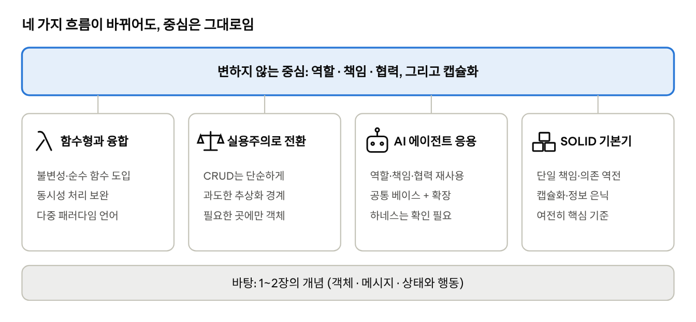

### ① 함수형 프로그래밍과의 융합

**배경**

- **함수형 프로그래밍(Functional Programming, FP)**: 상태를 바꾸지 않는 함수를 조합해 프로그램을 만드는 방식
  - 순수 함수: 같은 입력에는 항상 같은 출력을 내고, 바깥 상태를 바꾸지 않는 함수
  - 불변성: 한 번 만든 값은 바꾸지 않고, 바꾸고 싶으면 새 값을 만듦
- 요즘은 'FP냐 OOP냐'가 아니라, 객체지향 구조 안에 FP의 장점을 섞어 쓰는 것이 표준임
- **다중 패러다임 언어**: Java(8부터 람다·스트림), Kotlin, C++(11부터 람다) 등 주요 객체지향 언어가 함수형 요소를 기본으로 지원함

**예시로 보면** · 같은 일을 두 방식으로

```java
// 명령형: 바깥 리스트(total)를 계속 바꿈
List<Money> paid = new ArrayList<>();
for (Order o : orders) {
    if (o.isPaid()) paid.add(o.amount());
}

// 함수형 스타일: 원본을 바꾸지 않고 새 결과를 만듦
List<Money> paid = orders.stream()
    .filter(Order::isPaid)
    .map(Order::amount)
    .toList();          // 불변 리스트
```

**동시성 이야기**

| 구분 | 공유하는 가변 상태 | 불변 값 |
| --- | --- | --- |
| 여러 스레드가 동시에 읽고 쓸 때 | 값이 얽힘(경쟁 상태). 락 같은 보호 장치가 필요함 | 바뀌지 않으므로 그냥 나눠 써도 안전함 |
| 버그를 찾기 | 어느 스레드가 언제 바꾸는지 추적하기 어려움 | 만든 곳만 보면 됨 |

**이 책과의 연결**

- 2.3.3의 **값 객체는 불변**이어야 한다는 조언이 곧 FP의 불변성임
- 2.4의 **쿼리**(상태를 바꾸지 않는 조회)는 순수 함수에 가까움
- 2.3.2의 상태 캡슐화: 객체지향은 상태 변경을 없애지 않고 객체 안에 가둠. 두 방식은 '변경을 통제한다'는 같은 목표를 다른 길로 이룸

### ② '객체지향 만능론'에서 실용주의로

**배경**

- 한때는 모든 코드를 클래스·인터페이스·상속 계층으로 만드는 것이 좋은 설계로 여겨짐
- 지금은 '문제에 맞는 만큼만' 객체지향을 쓰자는 쪽으로 인식이 바뀜
- **CRUD**: Create(생성)·Read(조회)·Update(수정)·Delete(삭제). 데이터를 저장하고 꺼내는 것이 주된 기능
- 규칙이 거의 없는 CRUD라면 절차형(트랜잭션 스크립트) 설계가 더 읽기 쉽고 고치기 쉬울 수 있음
  - 트랜잭션 스크립트(Transaction Script): 요청 하나를 처음부터 끝까지 한 함수에서 처리하는 방식. 마틴 파울러가 도메인 모델과 대비해 정리한 용어

**어느 쪽을 고를까**

| 상황 | 어울리는 방식 |
| --- | --- |
| 규칙이 거의 없고 저장·조회가 대부분 | 절차형 · 단순한 서비스 함수 |
| 규칙이 많고 자주 바뀜 (할인, 환불, 정산) | 객체지향 · 책임을 가진 도메인 객체 |
| 구현체가 하나뿐인 인터페이스, 깊은 상속 | 대개 과도한 추상화 · 필요해질 때 만들기 |

- 흔히 YAGNI(You Aren't Gonna Need It, 지금 필요 없는 것은 만들지 말라) 원칙으로 설명함

**이 책과의 연결**

- 저자가 말하는 것은 '클래스를 많이 만들어라'가 아니라 '협력에 맞는 책임을 찾아라'임. 협력할 규칙이 없는 곳에 억지로 객체를 만들 필요는 없음
- 2장 '더 살펴보기' ①(빈약한 모델이 괜찮을 때도)과 1.3의 '협력과 자율의 균형'과 같은 결론임

### ③ AI 에이전트와 시스템 구조

**배경**

- 여러 AI 에이전트에게 역할을 나누는 설계는 1장 탭 '1장 정리 → 더 살펴보기 ③'에 자세히 있음
- 여기서는 추가로 거론되는 **계층적 에이전트 하네스**를 다룸
  - 하네스(harness): 에이전트를 실행하는 틀. 모델 호출, 도구 사용, 반복 루프 같은 공통 코드를 담음
  - 공통 베이스를 두고, 에이전트별로 필요한 부분만 상속·오버라이드로 바꾸는 구조

**예시로 보면** · 이해를 돕기 위한 간단한 스케치

```java
abstract class BaseAgent {
    final Result run(Task task) {   // 공통 흐름은 베이스가 가짐
        Plan plan = plan(task);
        Draft draft = act(plan);       // 에이전트마다 다른 부분
        return review(draft);
    }
    abstract Draft act(Plan plan);
}

class ResearchAgent extends BaseAgent {
    Draft act(Plan plan) { /* 자료 수집 */ }
}
```

- 이 형태는 디자인 패턴의 **템플릿 메서드 패턴**과 같음: 순서는 부모가 정하고, 단계의 내용만 자식이 채움

**이 책과의 연결**

- 여기서 상속이 어울리는 이유: 모든 에이전트가 같은 역할(BaseAgent)로 대체될 수 있기 때문임. 2장 '더 살펴보기' ②의 기준(대체 가능할 때만 상속)과 맞음
- 반대로 도구(검색, 파일 읽기)를 에이전트에 붙이는 일은 합성이 더 자연스러움

> **확인 필요** 계층적 에이전트 하네스 항목은 출처가 영상 한 편이고 내용을 아직 직접 확인하지 못했음. 위 코드는 개념 이해를 돕는 스케치이며, 실제 사례는 영상을 보고 덧붙일 것.

### ④ 여전히 유효한 기본기: SOLID

**배경**

- **SOLID**: 로버트 C. 마틴이 정리한 객체지향 설계 원칙 다섯 개의 앞글자
- 언어와 도구가 바뀌어도, 대규모 시스템에서 결합도를 낮추고 확장성을 높이는 기준으로 여전히 쓰임

| 원칙 | 한 줄 뜻 | 1\~2장과의 연결 |
| --- | --- | --- |
| 단일 책임 원칙 (Single Responsibility Principle, SRP) | 클래스가 바뀌는 이유는 하나여야 함 | 1.2 책임 · 책임을 알맞게 나눔 |
| 개방-폐쇄 원칙 (Open-Closed Principle, OCP) | 기능 추가에는 열려 있고, 기존 코드 수정에는 닫혀 있어야 함 | 1.1.3 다형성 · 새 바리스타를 추가해도 손님 코드는 그대로 |
| 리스코프 치환 원칙 (Liskov Substitution Principle, LSP) | 자식은 부모를 대신해도 문제가 없어야 함 | 1.1.3 대체 가능성 |
| 인터페이스 분리 원칙 (Interface Segregation Principle, ISP) | 쓰지 않는 메서드에 의존하지 않게 작게 나눔 | 역할 · 협력에 필요한 책임만 묶음 |
| 의존 역전 원칙 (Dependency Inversion Principle, DIP) | 구체적인 구현이 아니라 추상(역할)에 의존함 | 메시지만 알고 메서드는 모름 · 멀티모듈의 의존 방향 |

**예시로 보면** · 의존 역전

```java
// 역할(추상)
interface PaymentGateway { void pay(Money amount); }

// 주문 서비스는 역할만 앎. 어느 결제사인지는 모름
class OrderService {
    private final PaymentGateway gateway;
    OrderService(PaymentGateway gateway) { this.gateway = gateway; }
    void checkout(Order order) { gateway.pay(order.amount()); }
}

// 결제사를 바꿔도 OrderService는 그대로
class TossPayGateway implements PaymentGateway { ... }
```

**이 책과의 연결**

- SOLID는 새로운 이론이라기보다, 1장의 역할·책임·협력을 코드 규칙으로 바꿔 적은 것에 가까움
- **캡슐화와 정보 은닉**은 2.3.2(상태 캡슐화)와 2.4(버튼만 보이는 기계)에서 이미 다룸. 모듈과 서비스 단위에서도 같은 원리로 쓰임

### 정리: 변하는 것과 변하지 않는 것

| 변하는 것 | 변하지 않는 것 |
| --- | --- |
| 함수형 요소를 섞어 씀 | 변경을 통제하려는 목표 (캡슐화, 불변) |
| 필요한 곳에만 객체를 만듬 | 책임을 알맞은 곳에 두는 일 |
| 객체 대신 AI 에이전트가 협력함 | 역할·책임·협력으로 생각하는 법 |
| 언어와 프레임워크 | SOLID 같은 설계 기준 |

**참고**

- [출처 1 · cwkcw.tistory.com](https://cwkcw.tistory.com/m/892) · [출처 2 · moxie2ks.tistory.com](https://moxie2ks.tistory.com/106) — 함수형과의 융합
- [Quora · OOP 복잡도 논의](https://www.quora.com/Do-all-developers-agree-that-trends-like-OOP-are-essential-for-reducing-complexity-or-are-there-situations-where-they-might-not-be-necessary) — 다중 패러다임, 실용주의
- [siyoon210.tistory.com](https://siyoon210.tistory.com/188) · [wikidocs.net](https://wikidocs.net/274945) — 실용주의
- [YouTube · 에이전트 하네스](https://www.youtube.com/watch?v=Z9AH7MJ0MoE&t=111) — 확인 필요
- [YouTube · SOLID](https://www.youtube.com/watch?v=4O6k9GN8FPo&t=32) · [mangkyu.tistory.com](https://mangkyu.tistory.com/194) — SOLID
- [YouTube · 캡슐화](https://www.youtube.com/watch?v=swKbOZ0GycM&t=102) · [LinkedIn · OOP still relevant](https://kr.linkedin.com/pulse/oop-still-relevant-why-remains-timeless-foundation-modern-sharma-kmiuc?tl=ko) — 캡슐화와 정보 은닉
