# Week 3 · 3장 타입과 추상화

> 『객체지향의 사실과 오해』 3장 (p.72~105) 학습 기록

**이북으로 보기** 같은 내용을 절마다 한 쪽씩 넘겨 읽는 이북으로도 만들었음. [이북 열기](https://raw.githack.com/cloud-club/10th-oop-facts-misconceptions/main/%EC%9D%B4%EC%A0%95%EC%9D%B8/ebook/week3/index.html)를 누르면 열림. 이북 파일은 [`ebook/week3/`](ebook/week3/)에 있음. 같은 이북을 [claude.ai 아티팩트](https://claude.ai/artifact/99EDZsim2KckgwHrfe3ikb)로도 볼 수 있음.

각 절은 요지, 본문, 보충(실제 사례와 코드), 한 줄 정리, 논의해 보기 순서로 되어 있음. 요지만 이어 읽어도 장 전체의 흐름이 잡히도록 썼음.

## 3장 Summary · 한눈에 보기

> **3장에서 꼭 기억할 한 문장** 객체를 분류하는 기준은 **타입**이고, 타입을 나누는 기준은 객체가 수행하는 **행동**임. 객체지향에서 중요한 것은 동적으로 변하는 객체의 상태와, 그 상태를 변경하는 행동임.

3장은 하나의 질문에서 출발함. **사람은 셀 수 없이 많은 객체를 어떻게 머릿속에 정리하는가?** 책은 이 질문에 다섯 단계로 답하고, 각 단계는 앞 단계의 답이 다음 질문을 만드는 순서로 이어짐.

먼저 사람은 목적에 필요한 것만 남기고 나머지를 지우는 **추상화**로 복잡함을 이겨 냄(3.1). 그렇다면 객체지향에서는 무엇을 남기고 지우는가?

객체지향에서 추상화는 공통점을 가진 객체를 하나의 **개념**으로 묶는 방식으로 일어남. 개념은 이름(심볼), 들어갈 자격(내연), 들어간 객체들의 집합(외연)으로 설명할 수 있음(3.2). 그렇다면 코드에서 그 '자격'은 무엇으로 정하는가?

프로그래밍에서는 개념을 **타입**이라고 부르며, 객체의 타입은 데이터가 아니라 **행동**으로 정해짐. 행동이 같으면 데이터가 달라도 같은 타입이고, 여기서 다형성과 캡슐화가 나옴(3.3). 그렇다면 타입과 타입 사이에는 어떤 관계가 있는가?

타입끼리는 일반적인 것과 특수한 것의 **계층**을 이룸. 서브타입이 되려면 슈퍼타입이 약속한 행동을 모두 해낼 수 있어야 함(3.4). 마지막으로, 이 틀은 시간에 따라 계속 바뀌는 객체와 어떤 관계인가?

타입은 계속 바뀌는 객체의 상태에서 시간을 지우고 틀만 남긴 **정적 모델**임. 클래스는 그 틀을 코드로 옮기는 여러 도구 중 하나일 뿐임(3.5).

### 이 장에서 배울 것

- [ ] 추상화가 무엇이고, 일반화와 생략이라는 두 차원이 무엇인지 설명할 수 있다
- [ ] 개념을 심볼, 내연, 외연의 세 관점으로 나누어 설명할 수 있다
- [ ] 객체의 타입이 데이터가 아니라 행동으로 정해지는 이유를 말할 수 있다
- [ ] 슈퍼타입과 서브타입의 관계를 행위적 호환성으로 판단할 수 있다
- [ ] 동적 모델과 정적 모델, 타입과 클래스의 차이를 구분할 수 있다

다 읽은 뒤 설명할 수 있게 된 항목에 체크함. 항목별 답은 '3장 정리'의 결론에 있음.

**핵심 용어** 추상화 · 일반화 · 생략 · 개념 · 심볼 · 내연 · 외연 · 분류 · 인스턴스 · 타입 · 슈퍼타입 · 서브타입 · 행위적 호환성 · 정적 모델 · 동적 모델 · 클래스

**읽는 법** 실제 사례는 각 절의 보충에 있음. 지하철 노선도는 3.1, 교통카드와 Go의 `io.Reader`는 3.3.4, Java의 `List`와 `Stack`은 3.4에서 다룸. 책 밖의 요즘 논쟁과 실습은 맨 끝에 모아 둠.

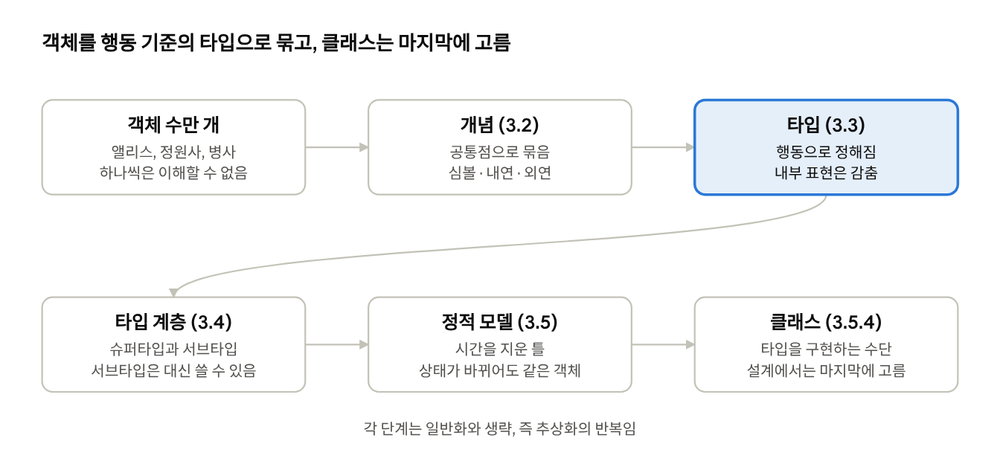

3장 전체를 한 장에 담은 그림임. 흩어진 객체를 개념으로 묶고, 그 개념을 행동 기준의 타입으로 정한 뒤, 타입을 계층과 정적 모델로 정리하고, 마지막에 클래스로 구현하는 흐름임.

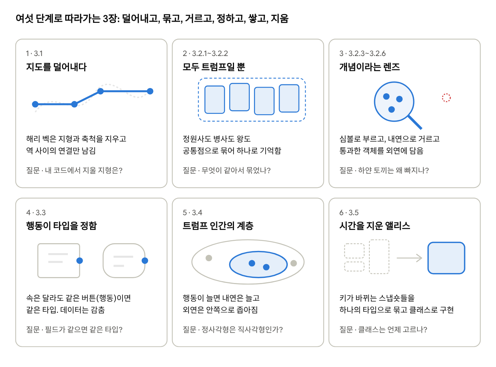

같은 흐름을 여섯 단계로 나눈 스토리보드임. 각 칸 아래의 질문을 먼저 읽고 본문으로 들어가면 무엇을 찾아야 할지 분명해짐.

---

## 들어가며

> **이 절의 맥락** 1장과 2장은 객체 하나와 객체들의 협력을 다뤘음. 3장은 셀 수 없이 많은 객체를 머릿속에서 어떻게 정리하는지를 다룸.

**요지** 객체지향은 많은 객체를 개념과 타입으로 묶어 단순하게 다루는 방법이고, 3장은 무엇을 기준으로 묶는지를 설명함.

3장은 '컴퓨터를 다루는 일은 결국 추상화를 만들고, 조작하고, 추론하는 일'이라는 인용으로 시작함. 좋은 프로그램을 쓰려면 먼저 **추상화를 정확하게 다룰 줄 알아야 한다**는 것이 이 장의 출발점임.

왜 추상화가 필요한지는 2장까지의 내용을 이어 보면 드러남. 우리는 객체가 상태, 행동, 식별자를 가진 존재이고, 설계는 행동에서 출발해야 한다는 것을 보았음.

문제는 객체의 수임. 회원 한 명, 주문 한 건, 결제 한 번이 모두 객체이므로 실제 시스템에는 이런 객체가 수천, 수만 개 있음. 객체를 하나하나 따로 이해하는 방식으로는 시스템을 설계할 수도, 읽을 수도 없음.

그래서 3장은 '사람은 이렇게 많은 객체를 어떻게 한꺼번에 이해하는가'를 묻고, 공통점으로 묶어 **개념**을 만들고 그 개념을 **타입**으로 다룬다고 답함. 이야기는 추상화에서 개념, 타입, 타입 계층, 정적 모델을 거쳐 클래스로 이어짐.

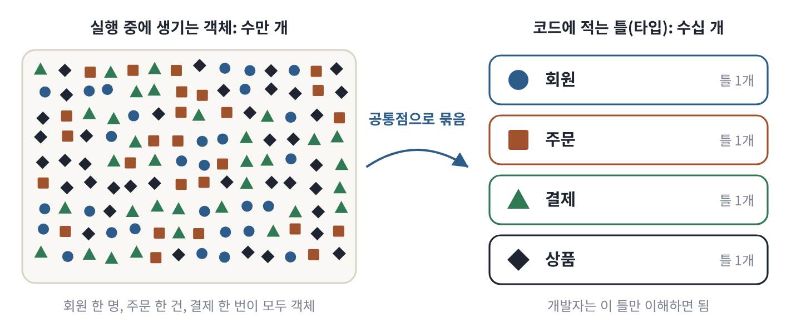

*객체는 수만 개, 틀은 수십 개. 같은 모양의 점들이 하나의 틀로 묶임*

**논의해 보기**

Q. 클래스는 수십 개뿐인데, 실행 중에는 왜 객체가 수만 개까지 늘어날 수 있나?

> **답** 클래스(타입)는 틀이고, 객체는 그 틀로 찍어 낸 하나하나이기 때문임.
>
> 회원 클래스는 코드에 하나뿐이지만, 실행 중에는 가입한 사람 수만큼 회원 객체가 생김. 주문 클래스도 하나지만 주문이 들어올 때마다 주문 객체가 새로 생김. 클래스 수는 코드를 쓴 개발자가 정하고, 객체 수는 시스템을 쓰는 사람들이 정하는 셈임.
>
> 이 차이가 3장이 말하는 추상화의 효과임. 개발자는 객체 수만 개를 하나씩 이해할 필요 없이 틀 수십 개만 이해하면 됨. 그래서 이 장의 나머지는 그 틀을 '무엇을 기준으로' 만들어야 하는지를 다룸.

---

## 3.1 추상화를 통한 복잡성 극복

> **이 절의 맥락** 타입을 설명하기 전에 저자는 '추상화'라는 말부터 정리함. 지하철 노선도 한 장으로 설명하는데, 이 예가 3장 전체의 기준이 됨.

**요지** 추상화는 목적에 필요 없는 세부를 지우고 공통점만 남겨, 복잡한 대상을 이해할 수 있을 만큼 단순하게 만드는 일임.

**문제: 정확한 지도가 오히려 쓰기 어려웠음** 1933년 이전의 런던 지하철 노선도는 실제 지형과 거리를 충실하게 그렸음. 정확하기는 했지만 지상의 지리와 실제 거리처럼 이동에 필요 없는 정보가 함께 그려져 있었음.

그래서 승객이 정말 알고 싶은 '어느 역이 어느 역과 이어지는가'를 찾기 어려웠음. 정확함이 곧 쓰기 좋음은 아니었던 것임.

**해결: 목적에 필요한 것만 남김** 전기 회로도를 그리던 제도사 해리 벡(Harry Beck)은 승객의 목적부터 다시 봄. 승객에게 필요한 것은 거리가 아니라 연결이고, 환승도 '여기서 다른 열차로 갈아탄다'는 사실만 알면 충분했음.

그래서 그는 회로도처럼 역과 역의 연결만 남기고 지형과 실제 거리는 과감히 지웠음. 새 노선도는 덜 정확했지만 훨씬 쓰기 쉬웠고, 이후 세계 여러 도시 노선도의 본보기가 됨.

**정의: 추상화** 책은 이 과정을 **추상화**(abstraction)라고 부름. 현실은 복잡하고 예측하기 어려우므로, 사람은 현실을 이해할 수 있는 크기로 나누고 단순하게 만들어 받아들임.

추상화는 현실에서 출발하되 필요 없는 부분을 덜어 내면서 대상의 본질을 드러내는 일이고, 그 목적은 복잡함을 이겨 내는 것임.

여기서 가장 중요한 점은 무엇을 남기고 무엇을 지울지를 **목적이 정한다**는 것임. 해리 벡이 거리를 지울 수 있었던 것은 '승객의 이동'이라는 목적이 분명했기 때문임. 목적이 없으면 무엇이 필요 없는 정보인지 판단할 수 없음.

**추상화의 두 차원** 노선도에는 추상화의 두 가지 방식이 함께 들어 있음.

첫째는 **일반화**임. 크기와 모양이 제각각인 역을 모두 같은 동그라미로 그린 것은, 역마다 다른 점은 버리고 '역'이라는 공통점만 남긴 것임.

둘째는 **생략**임. 실제 거리와 굽은 선로를 지운 것은, 중요한 것(연결)을 드러내려고 세부를 없앤 것임.

두 방식 모두 복잡한 대상을 사람이 다룰 수 있는 크기로 줄이려는 것임. 이 두 차원은 3장 내내 다시 나옴. 3.2에서는 객체를 개념으로 묶을 때, 3.4에서는 타입 계층을 만들 때, 3.5에서는 시간을 다룰 때 같은 두 차원이 반복됨.

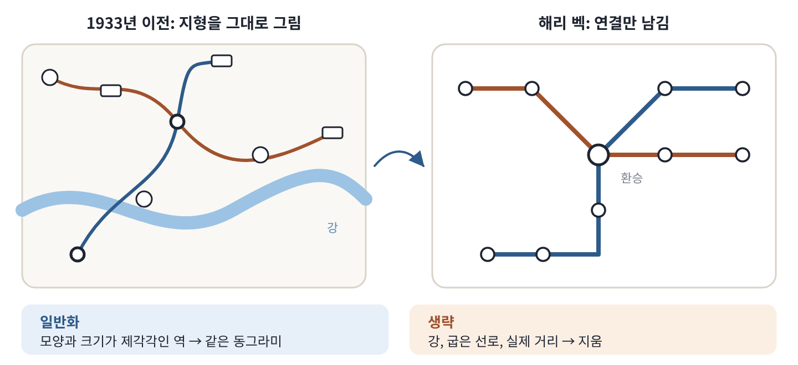

*같은 노선을 두 번 그린 그림. 오른쪽은 일반화(같은 동그라미)와 생략(지형 삭제)으로 연결만 남겼음*

#### 보충

**실제 사례 ① 너무 많이 지워도 실패함: 뉴욕 지하철 노선도** 1972년 디자이너 마시모 비넬리(Massimo Vignelli)는 뉴욕 지하철 노선도를 해리 벡 방식으로 다시 그리면서 지상의 지리를 거의 다 지웠음. 승객들은 '너무 추상적'이라고 비판했음. 지도 한 장으로는 역에서 나와 어디로 가야 하는지 알 수 없었기 때문임. 결국 이 지도는 1979년 지리를 살린 지도로 바뀜.

그런데 2025년 4월 뉴욕 교통국(MTA, Metropolitan Transportation Authority)은 약 50년 만의 개편에서 다시 비넬리 방식의 다이어그램을 택함. 이번에는 지상의 자세한 지리를 스마트폰 앱과 웹 지도가 맡게 되었기 때문임.

같은 그림이 1972년에는 실패하고 2025년에는 선택된 셈임. 바뀐 것은 그림이 아니라 목적과 환경이었음.

**실제 사례 ② 지울 것과 다시 살릴 것: 서울 지하철 노선도** 서울시는 2023년 12월, 40년 만에 새 노선도 디자인을 확정함. 기존 노선도는 선의 각도가 제각각이라 위치를 알기 어렵고, 환승역이 잘 구분되지 않으며, 공항·강·바다 같은 지리 정보를 알기 어렵다는 지적을 받았음.

새 노선도는 선을 수평, 수직, 45도로만 긋는 8선형으로 정리해 더 많이 지웠지만, 한강과 공항과 바다는 오히려 다시 그려 넣음. 서울시는 이로써 역 찾기 시간이 최대 약 55% 줄어들 것으로 발표함.

서울 승객에게는 '여기가 한강 남쪽인가 북쪽인가'도 필요한 정보였던 것임. 생략은 많이 지우는 일이 아니라, 목적에 필요 없는 것만 지우는 일이라는 점을 잘 보여 줌.

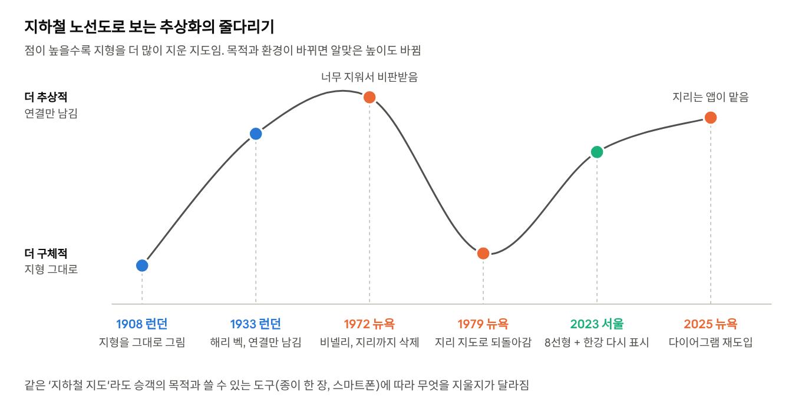

위 그림은 해리 벡, 뉴욕, 서울의 사례를 한 줄로 이은 것임. 점이 높을수록 지형을 많이 지운 지도이고, 오르내린 흔적은 어디까지 지울지를 두고 고민한 과정임.

**코드 속의 노선도** 코드에서는 인터페이스가 노선도 역할을 함. 아래 코드에서 볼 것은 하나임. **쓰는 쪽은 안쪽 구조를 모른 채 같은 방법으로 목록을 쓴다**는 점임.

먼저 알아 둘 것이 있음. Java의 `List`는 '순서 있는 목록'이 할 수 있는 행동(넣기, 꺼내기, 개수 세기)만 적어 둔 약속이고, `ArrayList`와 `LinkedList`는 그 약속을 실제로 지키는 두 가지 구현임. `ArrayList`는 안쪽에 배열을 쓰고, `LinkedList`는 서로 이어진 노드를 씀.

```java
List<String> names = new ArrayList<>();   // ① 안쪽은 배열
names.add("앨리스");                       // ② 넣기
names.get(0);                              // ③ 0번째 꺼내기

List<String> others = new LinkedList<>(); // ④ 안쪽은 이어진 노드
others.add("하트 잭");                     // ⑤ 쓰는 법은 ②와 똑같음
```

코드를 순서대로 읽으면 다음과 같음.

1. ①에서 변수의 타입은 `List`이고, 실제로 만든 것은 `ArrayList`임. 왼쪽은 '무엇으로 쓸 것인가', 오른쪽은 '무엇으로 만들 것인가'임.
2. ②와 ③에서 쓰는 쪽은 `add`와 `get`만 부름. 안에 배열이 있다는 사실은 코드 어디에도 나오지 않음.
3. ④에서는 안쪽 구조가 전혀 다른 `LinkedList`를 만들었음.
4. 그런데 ⑤의 쓰는 법은 ②와 똑같음. 쓰는 쪽에서 보면 두 목록은 구별되지 않음.

해리 벡이 지형을 지우고 연결만 남겼듯이, `List`는 안쪽 구조를 지우고 행동만 남긴 것임.

**출처** [NY1 (2025-04-02)](https://ny1.com/nyc/all-boroughs/transit/2025/04/02/mta-unveils-first--major--subway-map-redesign-in-nearly-50-years) · [IIT Institute of Design](https://id.iit.edu/story/full-circle-vignellis-1972-nyc-subway-map-vision-returns-in-2025/) · [서울시 미디어허브](https://mediahub.seoul.go.kr/archives/2009879) · [디자인 컴퍼스](https://designcompass.org/2025/04/18/seoul-metro-map-detail/)

**한 줄 정리** 추상화는 목적에 맞게 덜어 내는 일이며, 너무 적게 지워도 너무 많이 지워도 실패함.

**논의해 보기**

Q. 해리 벡의 노선도는 걸어서 길을 찾는 사람에게도 좋은 지도인가?

> **답** 아님. 걷는 사람에게는 오히려 헷갈리는 지도임.
>
> 걸어가는 사람에게 필요한 것은 실제 거리와 방향인데, 노선도는 바로 그 정보를 지웠음. 노선도에서 바로 옆에 붙은 두 역이 실제로는 한참 떨어져 있을 수도 있고, 반대로 멀어 보이는 두 역이 걸어서 몇 분 거리일 수도 있음.
>
> 즉 대상이 같아도 목적이 다르면 좋은 추상화가 달라짐. '좋은 추상화인가'라는 질문에는 항상 '누구의 어떤 목적에 좋은가'가 함께 붙어야 함.
>
> 코드도 같음. '회원'을 결제 쪽에서 볼 때는 결제 수단과 등급이 중요하고, 배송 쪽에서 볼 때는 주소와 연락처가 중요함. 모든 정보를 한 클래스에 담으면 어느 쪽에도 딱 맞지 않는, 1933년 이전의 지도 같은 모델이 됨.

---

## 3.2 객체지향과 추상화

> **이 절의 맥락** 3.1의 두 차원을 객체에 적용하는 절임. 앨리스가 만난 트럼프 무리를 예로, 객체를 묶는 그릇인 '개념'과 개념을 정의하는 세 가지 관점을 설명함.

### 3.2.1 모두 트럼프일 뿐

**요지** 앨리스는 등장인물을 하나씩 기억하지 않고 '트럼프'라는 하나의 묶음으로 봄. 이것이 객체를 추상화하는 기본 방식임.

앨리스는 하트 여왕의 정원에서 정원사, 병사, 신하, 왕자와 공주, 하객으로 온 왕과 왕비들, 하트 잭, 하트 왕과 하트 여왕을 만남. 생김새도 맡은 일도 저마다 다름.

그런데 앨리스가 보기에는 모두 몸이 납작하고, 네모난 몸의 귀퉁이에 손발이 달린 '트럼프일 뿐'임. 반대로 하얀 토끼처럼 이 공통점이 없는 등장인물은 트럼프에 들어가지 않음.

여기서 알 수 있는 것은 사람이 객체를 하나씩 기억하기보다 **공통점으로 묶어서** 기억한다는 점임. 그렇다면 이렇게 묶을 때 머릿속에서는 무슨 일이 일어나는가? 다음 소절이 그 과정을 설명함.

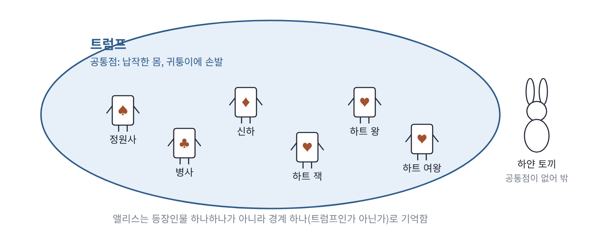

*공통점으로 그은 경계 하나가 수많은 등장인물을 안과 밖으로 나눔*

### 3.2.2 그룹으로 나누어 단순화하기

**요지** 공통점을 기준으로 객체를 그룹으로 나누면, 수많은 객체를 몇 개의 묶음으로 단순하게 다룰 수 있음.

앨리스가 트럼프를 묶은 방식에는 3.1의 두 차원이 모두 들어 있음.

정원사인지 병사인지 같은 차이는 버리고 '카드 모양 몸'이라는 공통점만 남긴 것은 **일반화**임. 카드의 숫자나 무늬처럼 '트럼프인가'를 판단하는 데 필요 없는 세부를 무시한 것은 **생략**임.

그 결과 수십 명의 등장인물이 '트럼프'와 '트럼프가 아닌 것' 두 묶음으로 간단히 정리됨. 기억해야 할 대상이 수십 개에서 두 개로 줄어든 것임. 이렇게 묶음을 만드는 데 쓰는 틀에 책은 '개념'이라는 이름을 붙임.

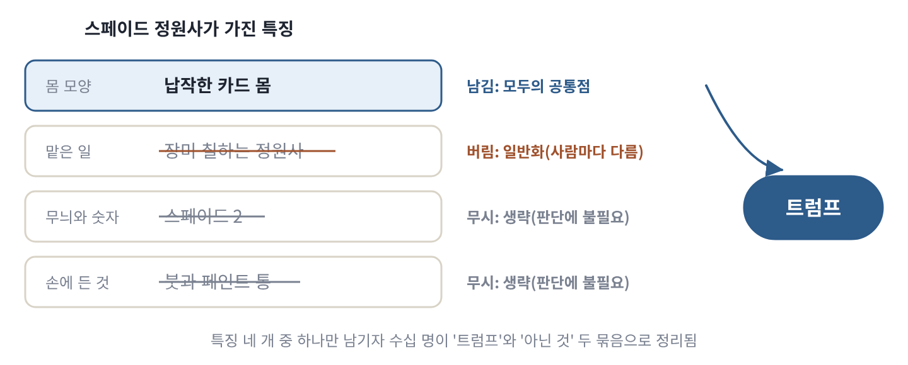

*한 등장인물의 특징을 거르는 과정. 공통점만 남기고(일반화), 판단에 필요 없는 세부는 보지 않음(생략)*

### 3.2.3 개념

**요지** 공통점을 바탕으로 객체를 묶는 그릇을 개념이라 하고, 개념에 속하는 객체를 그 개념의 인스턴스라고 함.

**개념**(concept)은 여러 객체에 두루 적용할 수 있는 생각의 틀이며, '트럼프', '주문'처럼 이름이 붙음.

객체에 개념을 적용해 어느 묶음에 넣을지 정하는 일을 **분류**(classification)라고 하고, 어떤 개념에 속하게 된 개별 객체를 그 개념의 **인스턴스**(instance)라고 함. 스페이드 정원사는 '트럼프'의 인스턴스이고, 하얀 토끼는 그렇지 않음.

개념은 공통점으로 객체를 걸러 내는 체이자, 객체를 바라보는 안경 같은 것임. 개념 하나만 있으면 수많은 객체를 한꺼번에 다룰 수 있음.

그래서 책은 **객체**를 '특정한 개념을 적용할 수 있는 구체적인 사물'이라고 정의함. 코드에서 `new`로 만든 객체를 인스턴스라고 부르는 것도 같은 뜻임. 어떤 개념의 한 사례라는 뜻이기 때문임.

그렇다면 개념은 정확히 무엇으로 이루어져 있는가? 책은 개념을 세 가지 관점으로 나누어 봄.

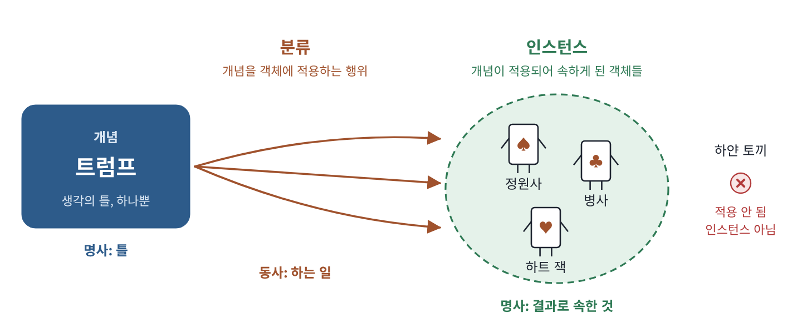

*개념은 틀(명사), 분류는 틀을 적용하는 행위(동사), 인스턴스는 그 결과로 개념에 속한 객체(명사)*

### 3.2.4 개념의 세 가지 관점

**요지** 개념은 이름(심볼), 의미(내연), 그 개념에 속하는 객체의 집합(외연)이라는 세 관점으로 정의할 수 있음.

책 그림 3.6(트럼프 개념의 심볼, 내연, 외연)을 함께 보면 좋음. 동그라미 안의 등장인물이 외연, 오른쪽 설명이 내연, 아래 '트럼프' 이름표가 심볼임.

| 관점 | 뜻 | 트럼프 예 |
| --- | --- | --- |
| 심볼(symbol) | 개념을 가리키는 이름 | '트럼프' |
| 내연(intension) | 개념의 완전한 정의. 어떤 객체가 이 개념에 속하는지 판단하는 기준 | 납작 엎드릴 수 있고, 뒤집어질 수 있으며, 걸을 때마다 몸이 종이처럼 좌우로 펄럭임 |
| 외연(extension) | 개념에 속하는 모든 객체의 집합 | 정원사, 병사, 신하, 왕자와 공주, 하객으로 온 왕과 왕비들, 하트 잭, 하트 왕과 하트 여왕 |

내연은 '들어갈 자격', 외연은 '들어간 명단'으로 기억하면 쉬움.

두 관점은 역할이 다름. 내연만 정해져 있으면 처음 보는 객체도 그 개념에 속하는지 판단할 수 있음. 외연은 집합이므로, 3.4에서 타입끼리의 포함 관계를 그릴 때 다시 쓰임.

책 그림에서 하나 눈여겨볼 점이 있음. 내연이 '납작한 몸' 같은 생김새가 아니라 '엎드린다, 뒤집힌다, 펄럭인다' 같은 **행동**으로 적혀 있음. 개념을 행동으로 정의하는 이 관점이 3.3의 '타입은 행동으로 정해진다'는 결론으로 이어짐.

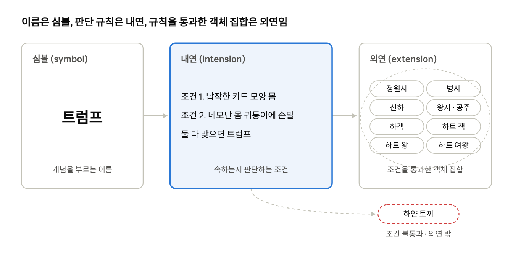

#### 보충

**코드로 옮긴 세 관점** 세 관점은 코드에도 그대로 나타남. 아래 코드에서는 주석에 적힌 '심볼, 내연, 외연'이 각각 코드의 어느 부분에 해당하는지를 보면 됨.

`interface`는 '이 타입이라면 이런 행동을 할 수 있어야 한다'는 목록만 적어 두는 Java 문법임. 행동을 실제로 어떻게 하는지는 적지 않음.

```java
interface Trump {        // ① 심볼: 'Trump'라는 이름
    void lieFlat();      // ② 내연: 납작 엎드릴 수 있어야 함
    void flip();         // ③ 내연: 뒤집어질 수 있어야 함
}

List<Trump> everyTrumpInGarden = garden.trumps();   // ④ 외연: 실행 중 정원에 있는 트럼프 전부
```

1. ①의 `Trump`라는 이름이 심볼임. 다른 코드는 이 이름으로 개념을 가리킴.
2. ②와 ③의 행동 목록이 내연임. 어떤 객체든 이 두 행동을 할 수 있으면 `Trump` 타입에 들어갈 자격이 있음.
3. ④는 외연임. 외연은 코드를 쓸 때가 아니라 프로그램이 실행될 때 정해짐. 정원에 트럼프가 몇 명 있는지는 실행해 봐야 알 수 있기 때문임.

정리하면, 개발자가 코드에 직접 적는 것은 심볼과 내연이고, 외연은 실행 중에 그 내연을 만족하는 객체들로 채워짐.

**한 줄 정리** 개념 = 심볼(이름) + 내연(판단 기준) + 외연(속하는 객체의 집합)

### 3.2.5 객체를 분류하기 위한 틀

**요지** 분류란 객체에 특정한 개념을 적용하는 작업이며, 어떤 객체를 어떤 개념으로 분류하느냐가 객체지향의 품질을 결정함.

세 관점을 알고 나면 분류를 정확하게 말할 수 있음. 어떤 객체를 트럼프로 분류한다는 것은 그 객체를 트럼프의 외연에 넣는 일이고, 넣을지 말지는 내연으로 판단함. 이렇게 개념은 객체를 정리하는 틀, 즉 분류 체계를 줌.

책은 여기서 강하게 말함. **분류가 객체지향의 품질을 결정한다.**

이유는 변경과 이해 두 가지 면에서 설명할 수 있음. 잘 분류된 시스템에서는 변경이 한 묶음 안에서 끝남. 또 '트럼프'로 분류됐다는 사실만으로 그 객체가 무엇을 할 수 있는지 짐작할 수 있음.

반대로 잘못 분류된 시스템에서는 작은 변경에도 여러 곳을 함께 고쳐야 하고, 이름만 보고는 객체가 무엇을 하는지 알 수 없음.

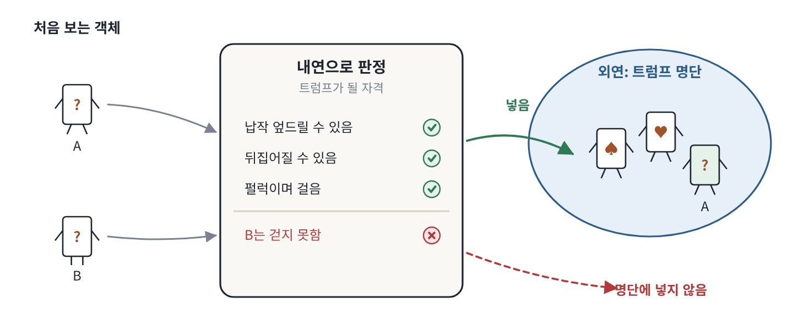

*분류는 내연(자격 목록)으로 판정해 외연(명단)에 넣거나 빼는 일임*

#### 보충

**분류가 무너진 코드** 다음은 이름은 '회원'인데 성격이 다른 객체가 한 클래스에 섞인 예임. 코드 자체는 짧지만, 이 클래스를 쓰는 쪽에서 무슨 일이 생기는지를 함께 보아야 문제가 보임.

```java
class Member {
    String type;  // ① "USER", "ADMIN", "PARTNER", "BOT" 중 하나
}

// ② 이 클래스를 쓰는 곳마다 생기는 코드
if (member.type.equals("USER"))         { /* 주문 처리 */ }
else if (member.type.equals("ADMIN"))   { /* 상품 관리 */ }
else if (member.type.equals("BOT"))     { /* 자동 수집 차단 */ }
```

1. ①에서 `Member`는 네 종류의 객체를 `type`이라는 문자열 하나로 구분함. 이름은 하나지만 실제로는 하는 일이 다른 네 묶음이 섞여 있음.
2. 그래서 `Member`를 받은 코드는 이 객체에게 무엇을 부탁할 수 있는지 알 수 없음. 결국 ②처럼 `type`을 먼저 확인하는 `if`문을 써야 함.
3. 이런 `if`문은 `Member`를 쓰는 곳마다 반복해서 생김. 새 종류(예: "PARTNER"의 새 기능)가 생기면 그 `if`문을 전부 찾아 고쳐야 함.

`type`을 확인하는 `if`문이 곳곳에 생기기 시작하면 분류가 실패했다는 신호임. 행동이 다른 묶음은 다른 타입으로 나누는 것이 답이고, 3.4의 타입 계층이 그 도구임.

### 3.2.6 분류는 추상화를 위한 도구다

**요지** 개념을 이용한 분류에는 추상화의 두 차원인 일반화와 생략이 모두 들어 있음.

3.2를 마무리하며 책은 분류와 추상화를 다시 연결함.

분류할 때 우리는 구체적인 사물들의 공통점은 남기고 차이점은 버려 하나의 개념으로 묶음. 이것이 첫째 차원인 일반화임. 동시에 무늬, 숫자, 맡은 일처럼 판단에 필요 없는 세부는 보지 않음. 이것이 둘째 차원인 생략임.

그래서 개념은 객체의 복잡함을 이겨 내기 위한 추상화 도구임. 다음 절에서 객체지향은 이 개념을 **타입**이라는 이름으로 더 정밀하게 다룸.

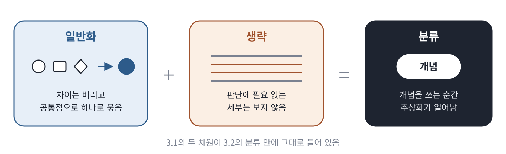

*분류는 일반화와 생략을 합친 것임*

**한 줄 정리** 분류 = 일반화 + 생략. 개념을 쓰는 순간 추상화가 일어남.

**논의해 보기**

Q. '트럼프'의 내연을 '납작 엎드릴 수 있음'에서 '여왕의 명령을 따름'으로 바꾸면 외연은 어떻게 되나?

> **답** 외연이 바뀜. 같은 등장인물들인데 명단이 달라짐.
>
> 새 기준에서는 트럼프가 아닌 하얀 토끼도 여왕의 명령을 따르므로 명단에 들어옴. 반대로 명령을 따르지 않는 트럼프가 있다면 명단에서 빠짐. 등장인물은 그대로인데, 기준(내연)을 바꾸자 명단(외연)이 바뀐 것임.
>
> 이 실험에서 알 수 있는 것은 '무엇을 기준으로 분류할지'가 분류의 결과 전체를 정한다는 점임. 기준이 흔들리면 같은 객체가 오늘은 이 묶음, 내일은 저 묶음에 들어가게 됨.
>
> 그래서 객체지향에서 가장 중요한 질문은 '분류의 기준을 무엇으로 삼을 것인가'이고, 책은 3.3에서 그 기준이 '행동'이라고 답함.

---

## 3.3 타입

> **이 절의 맥락** 3.2의 '개념'을 프로그래밍 언어의 '타입'과 연결하는 절임. 데이터 타입이 왜 생겼는지부터 살펴보고, 그 이유를 객체에 옮겨 '객체의 타입은 데이터가 아니라 행동으로 정해진다'는 결론에 도달함. 3장에서 가장 중요한 절임.

### 3.3.1 타입은 개념이다

**요지** 타입은 3.2의 개념과 같은 말이며, 공통점을 기준으로 객체를 묶는 틀임.

타입(type)은 수학과 논리학에서 가져온 말로, 일상에서 쓰는 '종류'나 '유형'과 뜻이 같음.

그러므로 3.2에서 개념에 대해 한 이야기가 타입에도 그대로 적용됨. 타입에도 심볼, 내연, 외연이 있고, 어떤 객체에 타입을 적용할 수 있으면 그 객체를 그 타입의 인스턴스라고 부르며, 인스턴스는 그 타입의 외연에 들어감.

객체지향에서 타입은 결국 개념을 부르는 다른 이름인 셈임. 그런데 프로그래밍에서 '타입'이라는 말은 원래 데이터를 나누는 데 먼저 쓰였음. 그래서 책은 객체의 타입을 말하기 전에 데이터 타입이 왜 생겼는지부터 살펴봄.

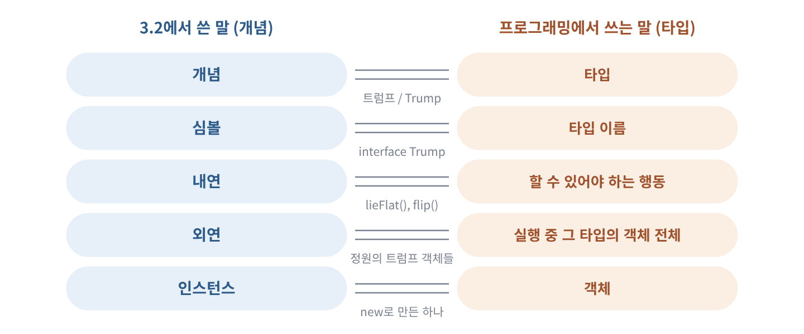

*같은 것을 부르는 두 이름. 3.2의 개념 용어가 3.3의 타입 용어와 하나씩 짝을 이룸*

### 3.3.2 데이터 타입

**요지** 데이터 타입은 데이터를 어떻게 쓸 수 있는지(연산)로 정해지고, 그 데이터가 메모리에 어떻게 저장되는지는 밖에서 보이지 않음.

**왜 생겼나** 메모리 안의 데이터는 모두 0과 1의 나열임. 같은 비트 묶음이 숫자일 수도 있고 문자일 수도 있음.

그래서 타입이 없으면 숫자에 문자 연산을 하는 것 같은 실수를 막을 수 없음. 프로그래밍 언어는 이 문제를 해결하려고 데이터를 종류별로 나누는 **타입 시스템**을 도입함.

**데이터 타입이 알려 주는 두 가지** 첫째, 타입은 **쓰는 방법**으로 정해짐. 정수는 더하고 뺄 수 있고 문자열은 이어 붙일 수 있듯이, 어떤 연산을 할 수 있는지가 그 데이터의 타입을 정함.

둘째, 데이터의 **내부 표현은 감춰짐**. 정수가 메모리에 몇 바이트로 어떻게 저장되는지 몰라도 우리는 정수를 더할 수 있음.

이 두 가지는 다음 소절에서 객체로 그대로 옮겨짐. 그러니 '쓰는 방법이 타입을 정한다'와 '안쪽은 감춰진다'를 기억해 둘 필요가 있음.

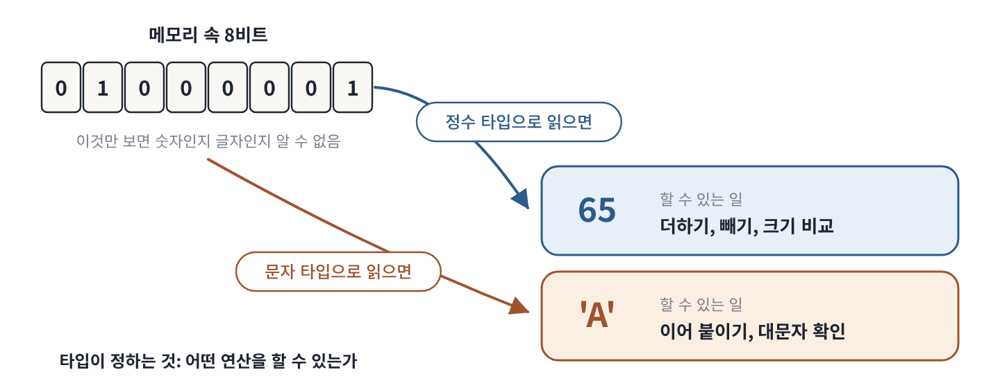

*같은 비트라도 타입에 따라 할 수 있는 연산이 달라짐. 타입은 쓰는 방법으로 정해짐*

#### 보충

**내부 표현을 바꿔도 아무도 몰랐던 사례: Java의 String** 두 번째 사실(내부 표현은 감춰짐)이 실제로 얼마나 큰 힘인지 보여 주는 사례임.

Java 9에서 `String`의 저장 방식이 바뀌었음. 예전에는 글자 하나에 늘 2바이트를 썼는데, 영문처럼 단순한 글자로만 된 문자열은 글자당 1바이트만 쓰도록 바뀐 것임([JEP 254](https://openjdk.org/jeps/254), JEP는 JDK Enhancement Proposal, 즉 자바 개선 제안서임).

메모리를 크게 아끼는 변경이었지만, 이 제안서는 스스로를 '공개 인터페이스는 바뀌지 않는 구현 변경'이라고 밝혔음. 실제로 `length()`나 `substring()`을 쓰던 전 세계의 코드는 한 줄도 고치지 않았음.

타입이 쓰는 방법으로 정해져 있고 내부 표현은 감춰져 있었기 때문에 가능했던 일임.

### 3.3.3 객체와 타입

**요지** 데이터 타입의 두 사실은 객체에도 그대로 적용됨. 객체의 타입은 그 객체가 하는 행동으로 정해지고, 객체의 내부는 감춰짐.

**질문: 객체는 데이터인가?** 객체는 행동에 따라 바뀔 수 있는 상태를 가짐. 상태는 결국 값이므로, 객체를 '데이터 묶음'으로 보고 싶어짐.

책의 답은 **아니다**임. 상태는 행동의 결과로 생긴 변화를 쉽게 표현하려고 도입한 추상적인 개념일 뿐임. 2장의 '행동이 상태를 결정한다'와 같은 이야기임.

따라서 행동을 잘 해낼 수만 있다면 내부 상태를 어떤 방식으로 표현하든 상관없음. 중요한 것은 상태 그 자체가 아니라 상태를 만들어 내는 행동임.

**데이터 타입에서 객체로 옮기기** 이 주장은 3.3.2의 두 사실을 객체에 옮겨 보면 자연스럽게 나옴.

데이터 타입에서 '할 수 있는 연산'이 타입을 정했듯이, 객체에서는 객체가 하는 **행동**이 타입을 정함. 데이터 타입의 메모리 표현이 감춰졌듯이, 객체의 **내부 상태와 구현**도 감춰짐.

즉 '연산 → 행동', '메모리 표현 → 내부 상태'로 바꾸어 읽으면 데이터 타입의 원리가 그대로 객체의 원리가 됨.

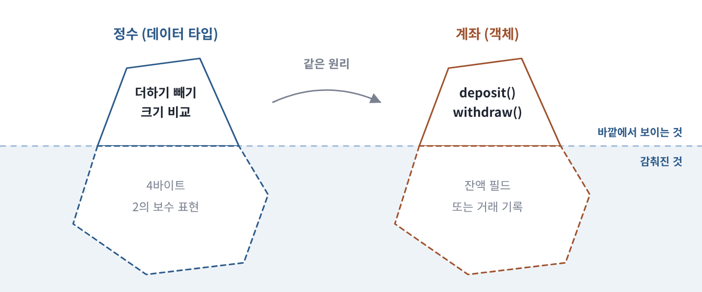

*연산이 데이터 타입을 정하듯 행동이 객체의 타입을 정함. 메모리 표현이 감춰지듯 객체의 내부 상태도 감춰짐*

**논의해 보기**

Q. 은행 계좌 객체의 '잔액'은 데이터인가, 행동의 결과인가?

> **답** 행동의 결과임. 잔액은 입금과 출금이라는 행동이 쌓여서 생긴 값임.
>
> 이것을 받아들이면 설계가 달라짐. 잔액이 행동의 결과라면, 바깥에서 잔액 값을 직접 바꾸게 해서는 안 됨. `account.balance = 0`처럼 값을 직접 넣으면 '왜 0이 되었는가'에 해당하는 행동이 사라지기 때문임. 그래서 잔액은 `deposit()`(입금), `withdraw()`(출금) 같은 행동으로만 바뀌게 해야 함.
>
> 또 행동만 지켜지면 잔액을 어떻게 저장하는지는 자유로움. 필드 하나에 숫자로 저장해도 되고, 거래 기록을 모아 두었다가 필요할 때 계산해도 됨. 바깥에서는 두 방식의 차이를 알 수 없음.
>
> 이것이 '객체는 데이터가 아니다'의 정확한 뜻임. 데이터가 없다는 말이 아니라, 데이터는 행동 뒤에 숨은 구현이라는 말임.

### 3.3.4 행동이 우선이다

**요지** 객체의 타입을 정하는 것은 객체의 행동뿐이며, 이 원칙에서 다형성과 캡슐화가 나옴.

**주장** 객체의 타입을 정하는 것은 행동뿐임. 그래서 같은 타입에 속한 객체라도 행동만 같다면 안에 가진 데이터는 서로 달라도 됨. 반대로 데이터가 똑같아도 행동이 다르면 다른 타입임.

책의 표현을 빌리면, **같은 책임을 수행하는 객체들은 같은 타입에 속함**. 객체를 타입으로 나눌 때는 이 기준 하나만 쓰면 됨.

**이유: 쓰는 쪽에는 행동만 보임** 왜 데이터가 달라도 되는지는 객체를 **쓰는 쪽**에서 보면 분명해짐.

쓰는 쪽은 객체에게 '이것을 해 달라'고 요청할 뿐, 안에 무엇이 들어 있는지는 보지 않음. 보이는 것이 행동뿐이므로 행동이 같으면 같은 것으로 다룰 수 있음. 데이터는 각 객체가 자기 행동을 해내는 데 필요한 만큼, 자기에게 맞는 모양으로 갖고 있으면 됨.

**예: 지하철 개찰구와 교통카드** 개찰구는 카드에게 '요금을 내 달라'는 한 가지만 요청함.

실물 카드는 칩 속 잔액에서 요금을 빼고, 휴대폰 교통카드는 앱 속 잔액에서 빼고, 후불 신용카드는 카드사에 청구를 남김. 가진 데이터도 안에서 하는 일도 모두 다름. 그래도 개찰구 입장에서는 셋 다 같은 '교통카드' 타입임.

그래서 스마트워치 같은 새 결제 수단이 나와도 '대면 요금이 결제된다'는 행동만 지키면 개찰구를 고칠 필요가 없음.

만약 개찰구가 카드 속 잔액을 직접 꺼내 계산했다면 어땠을까? 새 카드가 나올 때마다 개찰구를 고쳐야 했을 것임. 데이터를 기준으로 묶으면 생기는 문제가 바로 이것임.

**같은 구조의 다른 예** 이 구조는 일상과 코드 곳곳에 있음.

주문은 결제 수단에게 '이 금액을 결제해 달라'고만 요청하고, 카드 결제는 카드 번호를, 포인트 결제는 남은 포인트를 씀. Java의 `List`를 받는 메서드는 `add`, `get`, `size`만 부르고, 안쪽이 배열인지 이어진 노드인지는 신경 쓰지 않음. Go 언어의 `io.Copy` 함수는 '바이트를 읽어 넘겨 달라'고만 요청하고, 상대가 파일이든 메모리 속 문자열이든 압축 파일이든 상관하지 않음.

**반대의 경우: 데이터가 같아도 다른 타입** `UserDto`와 `User` 엔티티가 둘 다 `id`, `name`, `email` 필드를 가졌다고 해 보자. DTO(Data Transfer Object, 데이터 전달 객체)인 `UserDto`는 화면과 서버 사이에서 데이터를 옮기기만 함. 반면 `User`는 '비밀번호 변경'이나 '탈퇴'처럼 규칙이 있는 행동을 함.

필드가 같아도 하는 일이 다르므로 두 객체는 다른 타입임. 필드가 같다는 이유로 둘을 합치면, 데이터만 옮기면 되는 곳에 규칙이 끼어들거나 규칙이 필요한 곳에서 규칙이 빠지게 됨.

**결과: 다형성과 캡슐화** 행동을 기준으로 타입을 나누면 두 가지가 자연스럽게 따라옴.

같은 요청에 객체마다 자기 방식으로 응답할 수 있게 되는데, 이것이 **다형성**(polymorphism)임. 바깥에는 행동만 보여 주고 데이터는 그 뒤에 감출 수 있게 되는데, 이것이 **캡슐화**(encapsulation)임.

개찰구가 어떤 카드든 받을 수 있는 것은 다형성 덕분이고, 카드사가 잔액 저장 방식을 바꿔도 개찰구가 모르는 것은 캡슐화 덕분임.

**설계 순서의 변화** 이 원칙은 설계 순서도 바꿈. 객체를 설계할 때는 '어떤 데이터를 가질까'보다 '어떤 책임(행동)을 맡을까'를 먼저 정해야 함. 이 방식을 **책임 주도 설계**(RDD, Responsibility-Driven Design)라고 함.

데이터를 먼저 정하는 데이터 주도 설계는 내부 표현이 먼저 정해지고 바깥에 드러나기 쉬움. 그래서 내부를 바꿀 때마다 쓰는 쪽도 함께 바뀌는, 유연하지 못한 설계가 되기 쉬움. AI 에이전트가 시스템을 쓰는 요즘 이 선택이 어떻게 달라지는지는 맨 끝 '지금의 타입과 추상화' ⑥에서 다룸.

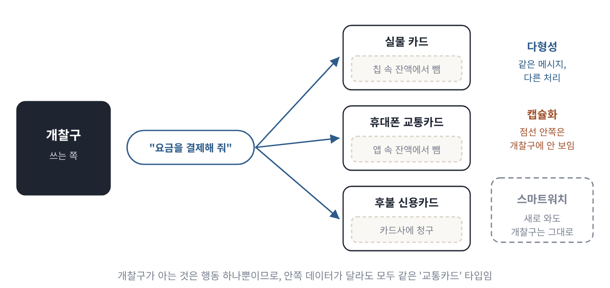

*쓰는 쪽은 메시지 하나만 보냄. 받는 쪽마다 안쪽 데이터와 처리는 다르지만 같은 타입으로 다뤄짐*

#### 보충

**코드로 보기: 결제 수단** 아래 코드에서 볼 것은 **데이터가 전혀 다른 두 클래스가 같은 행동 하나로 같은 타입이 된다**는 점임. 코드는 세 덩어리로 나뉨. 약속(인터페이스), 약속을 지키는 두 구현(클래스), 그리고 그것을 쓰는 쪽(주문)임.

```java
// ① 약속: 이 행동을 할 수 있으면 Payment 타입
interface Payment {
    Money pay(Money amount);
}

// ② 구현 1: 카드 번호를 가지고 결제함
class CardPayment implements Payment {
    private CardNumber card;
    public Money pay(Money amount) { /* 카드사에 승인 요청 */ }
}

// ③ 구현 2: 포인트 잔액을 가지고 결제함
class PointPayment implements Payment {
    private Points balance;
    public Money pay(Money amount) { /* 포인트에서 차감 */ }
}

// ④ 쓰는 쪽: Payment라는 것만 앎
class Order {
    void checkout(Payment payment) {
        payment.pay(totalPrice());
    }
}
```

1. ①의 `interface Payment`는 '결제 수단이라면 `pay`를 할 수 있어야 한다'는 약속만 적음. 어떻게 결제하는지는 적지 않음.
2. ②와 ③의 `implements Payment`는 '이 클래스가 그 약속을 지킨다'는 선언임. 두 클래스가 가진 데이터(`card`, `balance`)는 완전히 다르지만, 둘 다 `pay`를 할 수 있으므로 같은 `Payment` 타입임.
3. ④의 `Order`는 매개변수 타입이 `Payment`임. 그래서 카드가 들어오는지 포인트가 들어오는지 모르고, 알 필요도 없음. `pay`를 부르면 각 객체가 자기 방식으로 결제함(다형성).
4. 나중에 '상품권 결제'가 생기면 `GiftCardPayment implements Payment`를 하나 더 만들면 됨. `Order` 코드는 한 줄도 바뀌지 않음.

**실제 사례: Go의 `io.Reader`** Go 언어의 표준 라이브러리에 있는 `io.Reader`는 '행동이 타입을 정한다'를 가장 순수하게 보여 주는 예임.

`io.Reader`는 메서드가 `Read` 하나뿐인 인터페이스임. 파일, 키보드 입력, 네트워크, 메모리 속 문자열, 압축 파일처럼 데이터가 전혀 다른 객체들이 이 행동 하나로 같은 타입이 됨.

Java와 다른 점이 하나 있음. Go에는 `implements` 선언이 없음. `Read` 메서드만 갖고 있으면 선언하지 않아도 자동으로 `io.Reader` 타입이 됨. 이런 방식을 구조적 타이핑(structural typing)이라고 하고, 파이썬도 PEP 544(Python Enhancement Proposal 544)의 `Protocol`로 같은 일을 할 수 있음.

```go
// ① 약속: Read 하나만 할 수 있으면 Reader
type Reader interface {
    Read(p []byte) (n int, err error)
}

var r io.Reader                 // ② Reader 타입의 변수
r = os.Stdin                    // ③ 키보드 입력을 넣음
r = strings.NewReader("안녕")   // ④ 메모리 속 문자열로 바꿔 넣음
io.Copy(os.Stdout, r)           // ⑤ 무엇이 들어 있든 같은 방식으로 화면에 복사함
```

1. ①은 '바이트를 읽어 `p`에 채워 주고, 몇 바이트를 읽었는지 알려 준다'는 행동 하나를 약속함.
2. ②에서 `r`은 `Reader`라는 것만 정해진 변수임.
3. ③과 ④에서 키보드 입력과 문자열이라는, 안쪽이 전혀 다른 두 객체를 차례로 넣음. 둘 다 `Read`를 할 수 있으므로 둘 다 들어갈 수 있음.
4. ⑤의 `io.Copy`는 `r`에게 `Read`만 반복해서 요청함. 상대가 무엇인지는 전혀 묻지 않음.

'타입을 나누는 기준은 행동'이라는 3장의 문장을 언어 차원에서 받아들인 예임.

**출처** [programming.guide, Go: The io.Reader interface](https://programming.guide/go/io-reader-interface-explained.html) · [PEP 544](https://peps.python.org/pep-0544/)

**한 줄 정리** 타입은 행동의 묶음이고 데이터는 타입을 정하지 않음. 행동을 우선하면 다형성과 캡슐화가 따라오고, 설계는 책임 주도 설계로 이어짐.

**논의해 보기**

Q. 지하철 개찰구가 새로 나온 '스마트워치 교통카드'를 받으려면 개찰구의 무엇을 고쳐야 하나?

> **답** 고칠 것이 없어야 함. 이것이 행동을 기준으로 타입을 나눈 효과임.
>
> 개찰구가 카드에게 요청하는 것은 '요금을 결제해 달라'는 행동 하나뿐임. 스마트워치가 이 행동만 지키면, 개찰구 입장에서 스마트워치는 실물 카드나 휴대폰 교통카드와 같은 '교통카드' 타입임. 그래서 개찰구는 스마트워치가 무엇인지 몰라도 받을 수 있음.
>
> 반대로 고칠 곳이 생긴다면 그것은 신호임. 개찰구가 카드의 행동이 아니라 데이터에 기대고 있었다는 뜻이기 때문임. 예를 들어 개찰구가 '칩 안의 잔액 위치'를 직접 읽었다면, 칩이 없는 스마트워치를 받으려고 개찰구 코드를 고쳐야 함.
>
> 코드로 옮기면, 새 구현을 추가할 때 기존 코드를 고쳐야 한다면 그 코드가 타입(행동)이 아니라 구현(데이터)에 의존하고 있다는 뜻임.

---

## 3.4 타입의 계층

> **이 절의 맥락** 3.3에서 타입을 정하는 기준이 행동이라는 것을 보았음. 그렇다면 타입과 타입 사이에는 어떤 관계가 있는가? 이 절은 '더 일반적인 타입'과 '더 특수한 타입'의 관계를 내연과 외연으로 설명하고, 슈퍼타입과 서브타입을 행동으로 판단하는 법을 정리함. 4장의 역할과 대체 가능성으로 바로 이어짐.

### 3.4.1 트럼프 계층

**요지** 앨리스가 만난 트럼프는 걸어 다니는 트럼프, 즉 트럼프 인간임. 트럼프 인간은 트럼프의 일종이므로 트럼프보다 더 특수한 타입임.

보통의 트럼프는 납작 엎드리고 뒤집어질 수만 있음. 앨리스가 만난 트럼프는 여기에 더해 걸어 다니고, 걸을 때마다 몸이 종이처럼 좌우로 펄럭임.

그래서 책은 두 개념을 나눔. **트럼프**는 납작 엎드릴 수 있고 뒤집어질 수 있는 것이고, **트럼프 인간**은 거기에 펄럭이며 걷는 행동까지 하는 것임.

트럼프 인간은 트럼프가 하는 일을 모두 하고, 걷는 일을 더 함. 따라서 모든 트럼프 인간은 트럼프이지만, 모든 트럼프가 트럼프 인간인 것은 아님.

책 그림 3.8(트럼프 인간 타입에 속하는 객체는 동시에 트럼프 타입에도 속함)을 함께 보면 좋음. 바깥 원(트럼프)이 안쪽 원(트럼프 인간)을 감싸고, 안쪽으로 들어갈수록 행동 설명은 길어짐.

한 가지 헷갈릴 수 있는 점이 있음. 3.2.4의 그림 3.6에서는 '걸을 때 펄럭인다'까지 트럼프의 내연에 들어 있었음. 그때는 정원의 등장인물만 보았기 때문임. 여기서는 걷지 못하는 보통 트럼프까지 함께 보므로, 그 행동을 떼어 내 트럼프 인간이라는 더 좁은 개념에 준 것임. 무엇을 함께 보느냐에 따라 개념의 경계가 다시 그어진다는 점에서, 이것도 3.1의 '목적이 추상화를 정한다'의 한 예임.

### 3.4.2 일반화/특수화 관계

**요지** 더 일반적인 타입과 더 특수한 타입 사이의 관계를 일반화/특수화 관계라고 하며, 이 관계도 행동을 기준으로 정함.

**하나의 관계, 두 방향** '트럼프는 트럼프 인간을 일반화한 것'과 '트럼프 인간은 트럼프를 특수화한 것'은 같은 관계를 양쪽에서 본 말임. 그래서 일반화와 특수화는 항상 동시에 일어남.

**판단 기준은 역시 행동** 이 관계를 판단하는 기준도 3.3과 같이 행동임. 일반적인 타입은 행동이 적고 특수한 타입은 행동이 많음.

이때 조건이 하나 있음. 특수한 타입은 일반적인 타입의 행동을 **모두 똑같이** 할 수 있어야 하고, 그 위에 자기만의 행동을 더해야 함. 일부만 할 수 있거나, 같은 이름의 행동을 다르게 해 버리면 특수화가 아님.

**내연과 외연은 반대로 움직임** 내연과 외연으로 보면 흥미로운 점이 보임.

트럼프의 내연은 '엎드리기, 뒤집히기' 두 가지이고, 트럼프 인간의 내연은 여기에 '펄럭이며 걷기'가 더해져 더 많음. 반면 외연은 반대임. 조건이 많아질수록 그 조건을 통과하는 객체는 줄어들기 때문임. 그래서 트럼프 인간의 외연은 트럼프 외연의 **부분집합**이 됨.

'행동이 많으니 더 큰 타입'이라고 착각하기 쉬움. 입학 조건이 까다로워질수록 합격자 수가 줄어드는 것을 떠올리면 헷갈리지 않음.

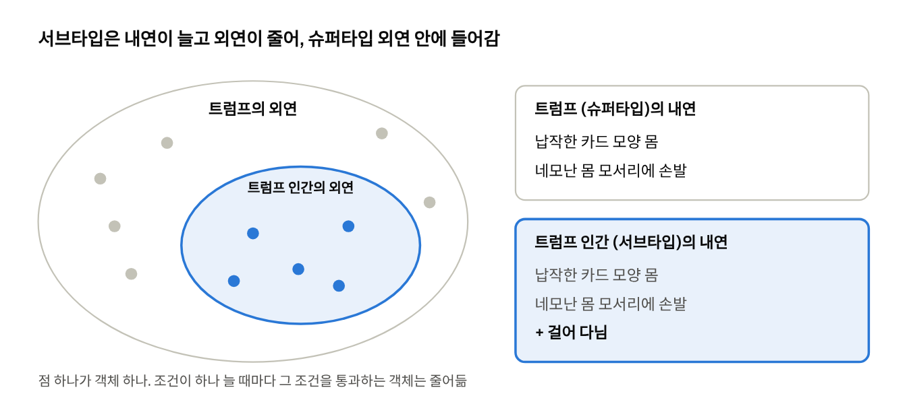

### 3.4.3 슈퍼타입과 서브타입

**요지** 일반적인 타입을 슈퍼타입, 특수한 타입을 서브타입이라고 하며, 서브타입은 슈퍼타입 대신 쓸 수 있어야 함.

**이름 붙이기** 더 일반적인 타입(트럼프)을 **슈퍼타입**(supertype), 더 특수한 타입(트럼프 인간)을 **서브타입**(subtype)이라고 부름.

**서브타입의 조건** 어떤 타입이 서브타입이 되려면 슈퍼타입과 행동이 호환되어야 함. 그러면 슈퍼타입을 기대하는 곳에 서브타입 객체를 대신 넣어도 문제없이 동작함. 이것을 **대체 가능성**이라고 하며, 1장에서 본 역할 이야기와 같은 원리임.

책은 이를 **행위적 호환성**(behavioral compatibility)이라고 부름. 두 타입의 관계를 생김새나 데이터가 아니라 행동으로 정한다는 뜻임.

**판단하는 질문 하나** 판단은 간단함. '트럼프를 불렀는데 트럼프 인간이 와도 문제가 없는가?'를 물어보면 됨.

트럼프 인간은 엎드리기와 뒤집히기를 똑같이 하므로 문제가 없음. 반대로 트럼프 인간을 불렀는데 보통 트럼프가 오면, 걷지 못해서 문제가 생김. 그래서 대체는 서브타입이 슈퍼타입을 대신하는 한 방향으로만 성립함.

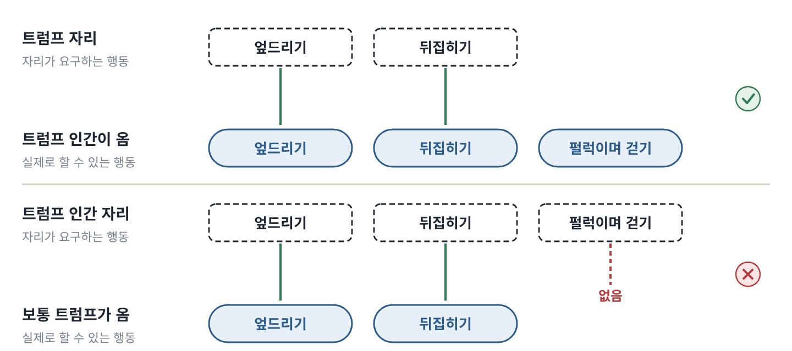

*자리가 요구하는 행동을 모두 해낼 수 있으면 대신 들어갈 수 있음(위). 하나라도 빠지면 대체가 깨짐(아래)*

#### 보충

**리스코프 치환 원칙** 책의 행위적 호환성에는 널리 알려진 이름이 있음.

바버라 리스코프(Barbara Liskov)와 지넷 윙(Jeannette Wing)은 1994년 논문 「A Behavioral Notion of Subtyping」에서 서브타입을 바로 이 '행동' 기준으로 정의했음([논문 PDF](https://www.cs.columbia.edu/~wing/publications/LiskovWing94.pdf)). 슈퍼타입으로 객체를 다루는 쪽이 기대하는 것을 서브타입도 그대로 지켜야 한다는 것이 핵심임.

이 생각은 객체지향 설계 원칙 다섯 개를 묶은 SOLID의 L, 즉 **리스코프 치환 원칙**(LSP, Liskov Substitution Principle)으로 널리 알려짐. 쉽게 말해 '부모 타입을 쓰는 코드에 자식 타입 객체를 넣어도 프로그램이 올바르게 동작해야 한다'는 규칙이고, 책의 행위적 호환성을 설계 원칙으로 적은 것임.

**행동이 호환되지 않는 예: 정사각형과 직사각형** 수학에서 정사각형은 직사각형의 일종임. 그렇다면 코드에서도 `Square`를 `Rectangle`의 서브타입으로 만들어도 될까? 아래 코드가 그 답을 보여 줌.

먼저 상황을 정리함. 직사각형 클래스는 '너비와 높이를 따로 바꿀 수 있다'는 행동을 약속함. 정사각형은 너비와 높이가 늘 같아야 하므로, 한쪽을 바꾸면 다른 쪽도 같이 바꿔 버림.

```java
// ① 직사각형: 너비와 높이를 따로 바꿀 수 있음
class Rectangle {
    protected int width, height;
    void setWidth(int w)  { this.width = w; }
    void setHeight(int h) { this.height = h; }
    int area() { return width * height; }
}

// ② 정사각형: 한쪽을 바꾸면 다른 쪽도 같이 바뀜
class Square extends Rectangle {
    void setWidth(int w)  { this.width = w; this.height = w; }
    void setHeight(int h) { this.width = h; this.height = h; }
}

// ③ 직사각형을 받아 늘리는 함수
void stretch(Rectangle r) {
    r.setWidth(5);
    r.setHeight(4);
    // 직사각형이라면 넓이는 5 × 4 = 20이어야 함
}
```

이제 `stretch`에 두 객체를 차례로 넣어 봄.

1. `Rectangle`을 넣으면 너비가 5가 되고, 높이가 4가 됨. 넓이는 20이고 기대한 대로임.
2. `Square`를 넣으면 `setWidth(5)`에서 너비와 높이가 모두 5가 됨.
3. 이어서 `setHeight(4)`에서 너비와 높이가 모두 4로 다시 바뀜.
4. 넓이는 16이 됨. `stretch`를 쓴 사람은 20을 기대했으므로 프로그램이 틀린 답을 냄.

`Square`는 `extends Rectangle`로 문법상 직사각형 자리에 들어갈 수 있지만, 직사각형이 약속한 행동('너비와 높이를 따로 바꿀 수 있음')을 지키지 못함. 행동이 호환되지 않으므로 객체지향에서는 서브타입이 아님. 수학의 분류와 객체지향의 분류가 다를 수 있다는 대표적인 예임.

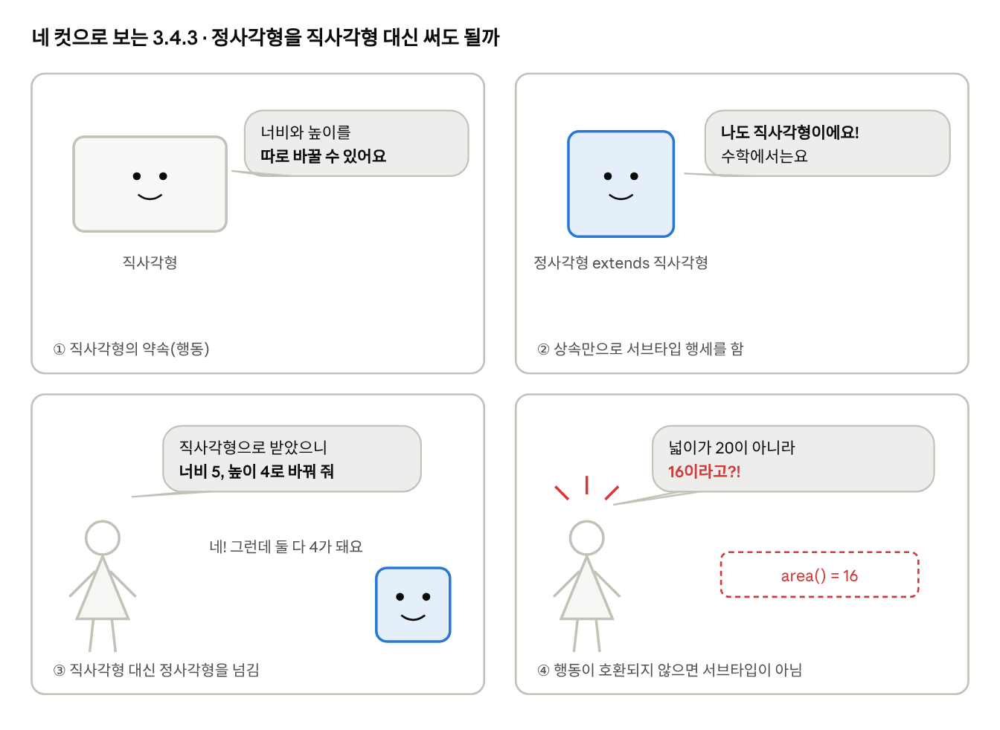

**실제 사례: 수정할 수 없는 Java의 `List`** 사각형 문제는 실제 표준 라이브러리에도 있음.

Java의 `List.of(...)`는 '수정할 수 없는 목록'을 만들어 주는 메서드임. 만들어진 목록은 `List` 타입이지만, 안의 내용을 바꿀 수는 없음.

```java
List<String> names = List.of("앨리스", "하트 잭");  // ① 수정할 수 없는 목록을 만듦
names.get(0);                                       // ② 읽기는 문제없음
names.add("체셔 고양이");                           // ③ 컴파일은 되지만, 실행하면 예외 발생
```

1. ①의 `names`는 타입이 `List`이므로, 컴파일러는 `List`의 모든 행동(`add` 포함)을 쓸 수 있다고 봄.
2. ②의 읽기는 정상적으로 동작함.
3. ③의 `add`는 컴파일러가 막지 않음. 하지만 실행하는 순간 `UnsupportedOperationException`(지원하지 않는 연산이라는 예외)이 발생함.

문제는 `List`를 매개변수로 받는 쪽임. 그쪽은 실행해 보기 전까지 받은 목록이 `add`를 할 수 있는지 알 수 없음. 다만 Java 문서는 `add`를 '선택적 연산(optional operation)'이라고 미리 적어 두었으므로, 약속을 어긴 것은 아니라는 반론도 있음([Java SE 17 API, List](https://docs.oracle.com/en/java/javase/17/docs/api/java.base/java/util/List.html)). 약속을 얼마나 느슨하게 적었느냐에 따라 호환성 판단이 달라지는 셈임.

**한 줄 정리** 서브타입은 슈퍼타입 대신 쓸 수 있어야 하고, 그 판단은 현실의 분류가 아니라 행동의 호환성으로 함.

### 3.4.4 일반화는 추상화를 위한 도구다

**요지** 타입 계층을 만드는 일반화에도 추상화의 두 차원이 모두 들어 있음.

3.2.6에서 분류가 추상화의 도구였듯이, 타입 계층을 만드는 일반화도 추상화의 도구임. 여기에도 두 차원이 모두 들어 있음.

트럼프 인간들을 '트럼프'로 묶을 때는 정원사인지 병사인지 같은 차이를 무시하고 공통점만 봄. 이것이 **일반화**임. 또 트럼프 인간을 트럼프로 다룰 때는 걸어 다니는 능력은 감추고 트럼프로서의 행동만 봄. 이것이 **생략**임.

그래서 슈퍼타입으로 객체를 다루면 서브타입마다 다른 세부를 신경 쓰지 않아도 됨. 일반화는 3.2의 분류와 함께 객체지향의 두 가지 핵심 추상화 도구가 됨.

**타입 계층과 상속은 다름** 여기서 하나 구분해 둘 것이 있음.

타입 계층(서브타이핑)의 목적은 슈퍼타입 대신 서브타입을 쓰는 **대체 가능성**임. 클래스 상속의 목적은 부모의 구현을 물려받는 **코드 재사용**임.

Java의 `extends`는 이 둘을 한꺼번에 함. 그래서 코드 재사용만을 위해 상속하면, 행동이 호환되지 않는 계층이 생기기 쉬움. 타입 계층은 인터페이스 구현(`implements`)만으로도 충분히 만들 수 있음.

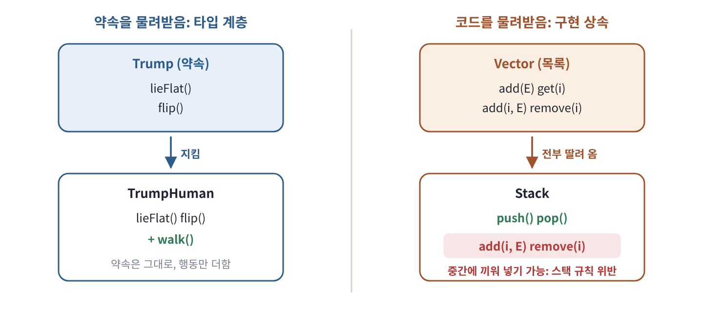

*타입 계층은 약속을 물려받고 행동을 더함. 구현 상속은 원치 않는 행동까지 함께 물려받을 수 있음*

#### 보충

**실제 사례: 코드 재사용을 위한 상속, Java의 `Stack`** 재사용을 위한 상속이 어떻게 타입을 망가뜨리는지 보여 주는 실제 사례임.

스택(stack)은 '마지막에 넣은 것을 먼저 꺼낸다'는 약속을 가진 자료 구조임. 접시를 쌓듯이 위에만 넣고 위에서만 꺼냄. Java 초기 버전의 `Stack`은 코드를 다시 쓰지 않으려고 `Vector`(배열 같은 목록)를 상속했음.

```java
Stack<String> stack = new Stack<>();
stack.push("A");                         // ① 위에 A를 쌓음
stack.push("B");                         // ② 위에 B를 쌓음
stack.add(0, "끼어들기");                // ③ 맨 아래에 끼워 넣기. Vector에서 물려받은 메서드

Deque<String> better = new ArrayDeque<>(); // ④ 공식 문서가 권하는 대안
```

1. ①과 ②는 스택답게 위에 쌓는 행동임.
2. ③의 `add(0, ...)`는 `Vector`에서 물려받은 메서드라서 `Stack`에서도 쓸 수 있음. 그런데 이것은 맨 아래에 끼워 넣는 행동이라 '위에만 넣는다'는 스택의 약속을 깸.
3. 즉 `Stack`은 `Vector`의 코드를 재사용하는 대가로, 스택이 해서는 안 되는 행동까지 물려받은 것임.
4. 그래서 지금 Java 공식 문서는 `Stack` 대신 ④의 `Deque`(양쪽 끝에서만 넣고 빼는 자료 구조)를 쓰라고 권함([Java SE 17 API, Stack](https://docs.oracle.com/en/java/javase/17/docs/api/java.base/java/util/Stack.html)).

**한 줄 정리** 분류와 일반화는 모두 추상화의 도구임. 타입 계층은 행동의 호환성, 상속은 구현 재사용이므로 둘을 구분해야 함.

**논의해 보기**

Q. Java의 `Stack`은 `Vector`를 상속함. 그럼 '스택은 벡터의 일종'이라고 볼 수 있나?

> **답** 볼 수 없음. 문법상의 상속 관계와 타입 관계가 어긋난 예임.
>
> 문법만 보면 `Stack`은 `Vector`를 상속했으므로 `Vector` 자리에 넣을 수 있음. 하지만 3.4.3의 질문으로 판단해 보면 다름. '벡터를 기대하는 곳에 스택이 와도 되는가'보다 더 큰 문제는, 스택이 벡터의 행동을 물려받으면서 스택 자신의 약속('마지막에 넣은 것을 먼저 꺼낸다')이 깨진다는 점임.
>
> 스택이 해야 하는 행동(위에 쌓고 위에서 꺼내기)과 벡터가 하는 행동(아무 위치에 넣고 빼기)은 서로 다름. 그러니 `Stack`이 `Vector`를 상속한 것은 타입 계층을 제대로 나눈 것이 아니라, 코드를 다시 쓰기 싫어서 빌려 쓴 것임.
>
> 이처럼 '상속했다'와 '서브타입이다'는 다른 말임. Java가 지금 `Deque`를 권하는 것도 이 실수를 인정한 것으로 볼 수 있음.

---

## 3.5 정적 모델

> **이 절의 맥락** 지금까지는 '많은 객체를 어떻게 묶는가'를 보았음. 그런데 객체 하나도 시간이 지나면서 상태가 계속 바뀜. 그런데도 우리는 '앨리스'를 하나의 존재로 다룸. 이 절은 타입이 바로 그 '시간'을 추상화하는 도구라고 설명하고, 마지막으로 클래스가 어디에 속하는지 정리함.

### 3.5.1 타입의 목적

**요지** 타입은 시간에 따라 계속 바뀌는 객체의 상태를, 시간과 상관없는 하나의 모습으로 다루게 해 줌.

**질문: 계속 바뀌는 앨리스는 왜 같은 앨리스인가** 앨리스의 키는 케이크를 먹고 음료를 마실 때마다 바뀜. 시점마다 앨리스의 상태는 다름.

그런데도 우리는 앨리스를 하나의 객체로 생각함. 특정 시점의 키가 아니라 '앨리스는 키가 있고, 그 키는 마시거나 먹으면 바뀐다'는 틀로 이해하기 때문임.

**답: 그 틀이 타입임** 타입은 시간에 따라 바뀌는 객체를, 시간과 상관없는 고정된 모습으로 표현함. 키가 몇 번 바뀌어도 '키가 있고, 행동에 따라 바뀐다'는 틀은 그대로이므로 같은 앨리스로 다룰 수 있음.

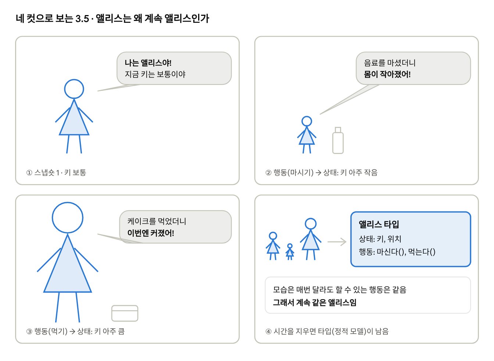

만화에서 보듯 행동(마시기, 먹기)이 상태(키)를 바꾸고, 바뀐 모습들을 하나로 묶는 것이 타입임. 객체지향에서 중요한 것은 이렇게 동적으로 변하는 객체의 상태와, 그 상태를 바꾸는 행동임.

### 3.5.2 그래서 결국 타입은 추상화다

**요지** 타입은 특정 시점의 구체적인 상태를 지우고 시간과 상관없는 틀만 남긴다는 점에서, 시간을 추상화한 것임.

3.5.1을 3.1의 언어로 다시 말하면 다음과 같음. '지금 앨리스의 키는 아주 작다' 같은 특정 시점의 값은 지우고, '키라는 상태가 있고 행동에 따라 바뀐다'는 틀만 남기는 것은 추상화의 두 차원을 시간에 적용한 것임.

시점마다 다른 앨리스의 모습을 하나의 앨리스 타입으로 묶는 것은 **일반화**임. 그때그때의 구체적인 값을 지우는 것은 **생략**임.

그러니 타입은 두 겹의 추상화임. 여러 객체를 묶는 추상화(3.2~3.4)이면서, 한 객체의 시간을 지우는 추상화이기도 함.

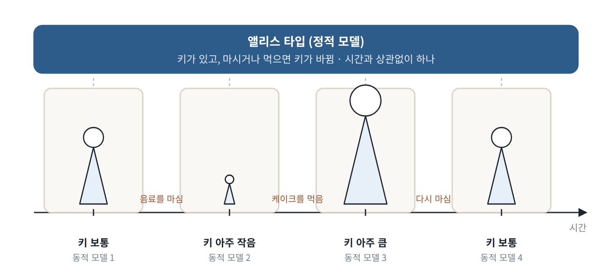

*아래의 사진(동적 모델)은 시점마다 다르지만, 위의 틀(정적 모델)은 시간 내내 하나임*

### 3.5.3 동적 모델과 정적 모델

**요지** 객체를 바라보는 방법에는 특정 시점의 상태를 찍은 동적 모델과, 시간과 상관없는 타입을 그린 정적 모델 두 가지가 있음.

시간을 지우기 전과 지운 뒤를 각각 그림으로 그리면 두 가지 모델이 나옴.

| 구분 | 동적 모델 | 정적 모델 |
| --- | --- | --- |
| 무엇을 보나 | 특정 시점에 객체가 가진 구체적인 상태 | 객체가 가질 수 있는 상태와 행동의 틀 |
| 다른 이름 | 스냅숏(snapshot) | 타입 모델 |
| UML로 그리면 | 객체 다이어그램 | 클래스 다이어그램 |
| 앨리스 예 | 음료를 마신 직후에는 키가 아주 작음 | 키와 위치를 갖고, 마시고 먹을 수 있음 |

UML(Unified Modeling Language, 통합 모델링 언어)은 소프트웨어 설계를 그림으로 그리는 표준 표기법임.

객체지향 애플리케이션을 설계할 때는 두 모델을 모두 고려해야 함. 동적 모델로는 객체들이 실행 중에 어떻게 협력하고 상태를 바꾸는지를 봄. 정적 모델로는 그 객체들이 어떤 타입에 속하고 타입끼리 어떤 관계인지를 봄.

실무로 옮기면, 디버거의 변수 창이나 로그에 찍힌 객체 상태는 동적 모델이고, 클래스 다이어그램이나 인터페이스 정의는 정적 모델임. 버그를 찾을 때는 그 시점에 무엇이 들어 있었는지(동적 모델)를 보고, 구조를 바꿀 때는 어떤 타입이 어떤 관계인지(정적 모델)를 봄.

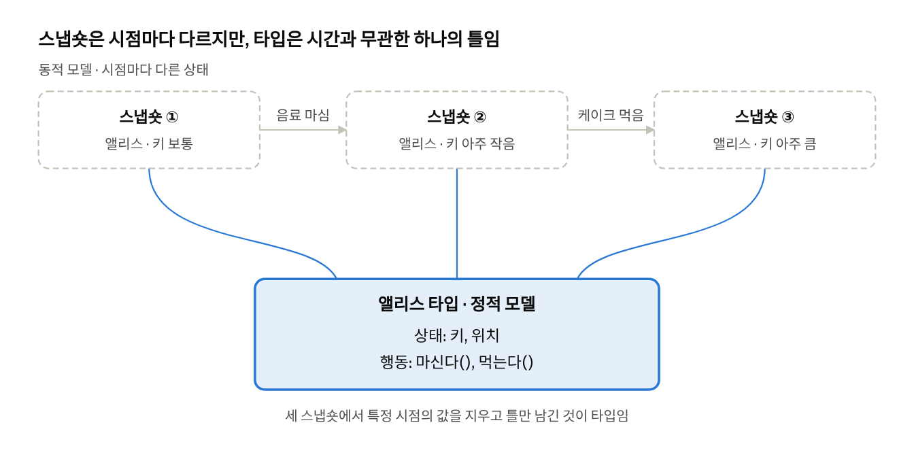

### 3.5.4 클래스

**요지** 클래스는 정적 모델(타입)을 코드로 옮기는 수단 중 하나일 뿐이며, 타입과 클래스는 같은 것이 아님.

**흔한 착각** 정적 모델을 코드로 옮길 때 대부분의 객체지향 언어는 클래스를 씀. 그래서 타입과 클래스를 같은 것으로 착각하기 쉬움.

**구분** 하지만 **타입은 개념**이고 **클래스는 그 개념을 구현하는 도구**임. 둘이 같지 않다는 증거는 세 가지가 있음.

첫째, 클래스 없이 타입을 만드는 언어가 있음. JavaScript는 원래 클래스 없이 프로토타입으로 객체를 만들었음. 둘째, 하나의 타입을 여러 클래스가 구현할 수 있음. 3.3.4의 `Payment`를 `CardPayment`와 `PointPayment`가 함께 구현한 것이 그 예임. 셋째, 반대로 클래스 하나가 여러 인터페이스를 구현해 여러 타입에 동시에 속할 수도 있음.

**더 헷갈리는 이유** 클래스는 타입을 구현하는 일 말고도 **코드를 재사용하는 일**(상속)에 쓰임. `Square extends Rectangle`은 코드를 재사용한 클래스 관계이지만, 3.4.3에서 본 것처럼 타입 관계(서브타입)는 아님. 클래스와 타입을 같은 것으로 보면 바로 이런 오해가 생김.

**저자의 결론** 객체지향의 핵심은 클래스가 아니라 **객체**임. 설계할 때는 클래스부터 떠올리지 말고, 객체를 어떤 타입으로 분류할지, 그 타입이 어떤 행동을 할지를 먼저 생각해야 함. 클래스는 그 결정을 코드로 옮기는 마지막 단계에서 고르는 도구임.

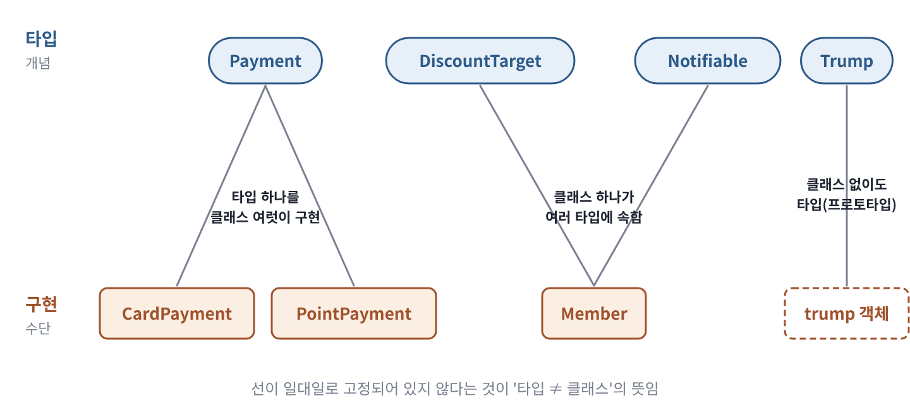

*타입과 구현 수단은 일대일이 아님. 하나의 타입에 여러 클래스, 하나의 클래스에 여러 타입이 이어짐*

> **3장에서 꼭 기억할 한 문장** 객체를 분류하는 기준은 **타입**이고, 타입을 나누는 기준은 객체가 수행하는 **행동**임.

#### 보충

**클래스 없이 만든 타입: JavaScript 프로토타입** 아래 코드에서 볼 것은 **`class`라는 단어가 한 번도 나오지 않는데도 '트럼프'라는 타입이 만들어진다**는 점임.

먼저 알아 둘 문법이 하나 있음. JavaScript의 `Object.create(원형)`은 '원형 객체를 본떠 새 객체를 만든다'는 뜻임. 새 객체는 원형이 할 수 있는 행동을 그대로 할 수 있음.

```javascript
// ① 원형: 트럼프가 할 수 있는 행동을 가진 객체 하나
const trump = {
  lieFlat() { return "납작 엎드림"; },
  flip()    { return "뒤집힘"; }
};

// ② trump를 본떠 정원사 객체를 만듦
const gardener = Object.create(trump);

// ③ 정원사에게만 있는 행동을 더함
gardener.paintRoses = function () { return "장미를 칠함"; };

gardener.lieFlat();     // ④ 원형에게서 온 트럼프로서의 행동
gardener.paintRoses();  // ⑤ 자기만의 정원사로서의 행동
```

1. ①의 `trump`는 클래스가 아니라 평범한 객체 하나임. 이 객체가 '트럼프라면 할 수 있는 행동'을 들고 있음.
2. ②에서 `gardener`는 `trump`를 원형으로 삼아 만들어짐. 그래서 따로 적지 않아도 엎드리기와 뒤집히기를 할 수 있음.
3. ③에서 정원사만의 행동을 더함. 3.4의 '서브타입은 슈퍼타입의 행동에 자기 행동을 더한다'와 같은 모양임.
4. ④와 ⑤에서 보듯 `gardener`는 트럼프로서도, 정원사로서도 행동함.

같은 행동을 하는 객체의 묶음, 즉 타입은 클래스 없이도 만들어짐. 참고로 지금의 JavaScript `class` 문법도 내부적으로는 이 프로토타입 위에서 동작함.

**한 줄 정리** 타입은 개념이고 클래스는 구현 수단임. 객체지향의 중심은 객체와 타입임.

**논의해 보기**

Q1. 앨리스가 음료를 마셔 키가 작아졌음. 바뀐 것은 동적 모델인가, 정적 모델인가?

> **답** 동적 모델만 바뀜. 정적 모델은 그대로임.
>
> 동적 모델은 특정 시점의 스냅숏이므로, 음료를 마시기 전의 사진(키가 보통)과 마신 뒤의 사진(키가 아주 작음)이 달라짐. 반면 정적 모델인 앨리스 타입은 '키가 있고, 마시거나 먹으면 키가 바뀐다'는 틀이므로, 마시기 전과 후에 달라진 것이 없음.
>
> 바로 이 차이 덕분에 키가 몇 번을 바뀌어도 같은 앨리스로 다룰 수 있음. 바뀌는 것은 사진이고, 틀은 그대로이기 때문임.
>
> 만약 정적 모델이 바뀌는 일이 생긴다면, 예를 들어 앨리스가 갑자기 '날 수 있게' 되었다면, 그것은 상태 변화가 아니라 타입 자체의 변화임. 코드로 치면 값을 바꾸는 것이 아니라 클래스나 인터페이스를 고쳐야 하는 일임.

Q2. `Square extends Rectangle`처럼 클래스로는 상속 관계인데, 타입으로는 서브타입이 아닐 수 있는 이유는?

> **답** `extends`는 코드를 물려받게 해 줄 뿐, 행동이 호환되는지는 보장하지 않기 때문임.
>
> 클래스는 두 가지 일에 쓰임. 하나는 타입을 구현하는 일이고, 다른 하나는 코드를 재사용하는 일임. `extends`를 쓰면 두 가지가 한꺼번에 일어나므로, 컴파일러는 '`Square`를 `Rectangle` 자리에 넣어도 된다'고 허락함.
>
> 하지만 컴파일러가 확인하는 것은 메서드의 이름과 모양뿐임. `setWidth`를 불렀을 때 높이까지 바뀌는지는 확인하지 않음. 그래서 문법상 들어갈 수 있어도, 직사각형이 약속한 행동을 지키지 못할 수 있음.
>
> 따라서 클래스 관계와 타입 관계는 따로 확인해야 함. 서브타입인지는 '직사각형 대신 써도 약속한 행동을 다 하는가'로 판단함.

---

## 3장 정리

### 한 문단으로 다시 읽기

사람은 수많은 객체를 하나씩 이해하지 못하므로, 목적에 필요한 것만 남기고 지우는 추상화로 복잡함을 이겨 냄.

객체지향에서 추상화는 공통점을 가진 객체를 개념으로 묶는 일이고, 이 개념을 코드에서는 타입이라고 부름. 타입을 정하는 기준은 데이터가 아니라 행동이어서, 행동이 같으면 데이터가 달라도 같은 타입이고 여기서 다형성과 캡슐화가 나옴.

타입은 일반화와 특수화로 계층을 이루며, 서브타입은 슈퍼타입의 행동을 모두 해낼 수 있어야 그 자리를 대신할 수 있음. 끝으로 타입은 계속 바뀌는 상태에서 시간을 지운 정적 모델이고, 클래스는 그 모델을 코드로 옮기는 여러 도구 중 하나임.

### 인사이트

**모델을 그리기 전에 '누구의 무슨 질문에 답하는가'부터 정해야 함.** 해리 벡의 노선도가 훌륭한 이유는 정확해서가 아니라, 승객의 질문 하나에 정확하게 답했기 때문임. 1972년 뉴욕은 같은 방식으로 실패했는데, 지도 한 장이 답해야 할 질문이 더 많았기 때문임.

코드의 모델도 마찬가지임. '회원'을 결제에서 볼 때와 배송에서 볼 때 남겨야 할 것이 다름. 모든 필드를 담은 하나의 거대한 회원 클래스는 정확하지만, 아무의 질문에도 잘 답하지 못하는 지형 지도와 같음.

**필드를 비교하지 말고 '무엇을 부탁할 수 있는가'를 비교해야 함.** 두 클래스의 필드가 비슷하면 합치고 싶어지고, 필드가 다르면 전혀 다른 것으로 보고 싶어짐. 3장은 그 반대로 생각하라고 말함.

교통카드들은 데이터가 다 달라도 같은 타입이고, `UserDto`와 `User`는 필드가 같아도 다른 타입임. 설계 리뷰에서 '이 두 객체에게 같은 일을 부탁할 수 있는가'를 물으면 합칠지 나눌지가 빨리 정해짐.

**'A는 B의 일종이다'라는 말에 속지 말아야 함.** 정사각형은 직사각형의 일종이고 스택도 어찌 보면 목록의 일종이지만, 둘 다 코드에서는 서브타입이 되지 못함.

현실의 분류는 생김새나 정의로 나누지만, 코드의 계층은 '대신 써도 약속한 행동을 다 하는가'로 나눔. `extends`를 쓰기 전에 이 질문을 한 번 더 던지는 습관만으로도 많은 버그를 막을 수 있음.

**상태는 행동의 그림자임.** 잔액은 입금과 출금의 결과이고, 앨리스의 키는 마시고 먹은 결과임. 그래서 상태를 바깥에서 직접 바꾸게 하면 언제든 행동과 어긋남.

상태는 행동을 통해서만 바뀌게 두고, 타입은 그 행동들의 묶음으로 설계하는 것이 3장이 제안하는 방향임.

**클래스는 마지막에 고름.** 클래스 다이어그램부터 그리면 자연스럽게 필드(데이터)부터 적게 됨.

1장에서 3장까지의 순서를 따르면 다름. 협력을 먼저 보고, 그 협력에서 각자가 맡을 책임(행동)을 정하고, 같은 책임을 타입으로 묶고, 타입 사이의 계층을 정한 뒤, 마지막에 그것을 어떤 클래스로 구현할지 고름.

### 다이어그램

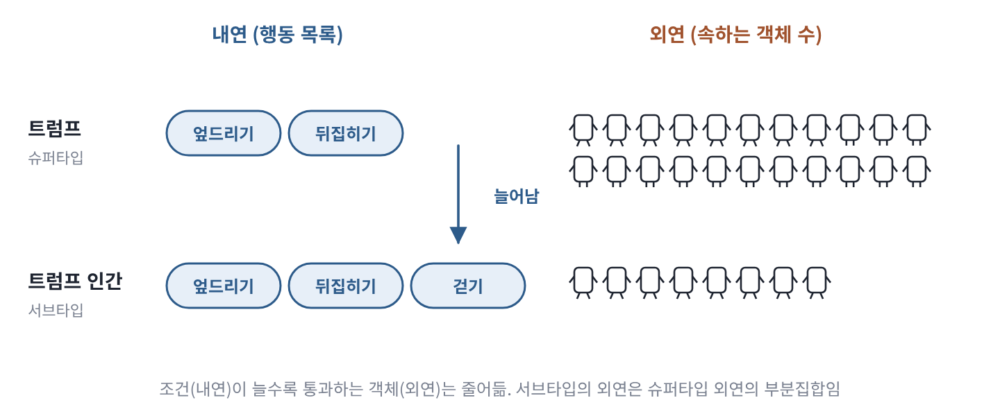

*내연과 외연은 반대로 움직임. 행동이 하나 늘면 그 행동을 하는 객체만 남음*

### 확인 질문

먼저 스스로 답해 본 뒤 답을 펼쳐 비교함.

Q1. 추상화의 두 차원은 무엇인가?

> **답** 일반화와 생략임.
>
> 일반화는 여러 대상의 공통점은 남기고 차이점은 버려 하나로 묶는 일임. 노선도에서 모양이 제각각인 역을 같은 동그라미로 그린 것, 앨리스가 정원사와 병사를 모두 '트럼프'로 본 것이 일반화임.
>
> 생략은 중요한 것을 드러내려고 필요 없는 세부를 지우는 일임. 노선도에서 실제 거리를 지운 것, 트럼프를 판단할 때 카드 무늬를 보지 않은 것이 생략임.
>
> 두 차원은 3장 내내 반복됨. 개념으로 묶을 때(3.2), 타입 계층을 만들 때(3.4), 시간을 지울 때(3.5) 모두 이 두 가지가 함께 일어남.

Q2. 개념의 세 가지 관점을 '트럼프'로 설명하라.

> **답** 심볼은 이름, 내연은 판단 기준, 외연은 그 기준을 통과한 객체 전체임.
>
> 심볼은 '트럼프'라는 이름임. 내연은 '납작 엎드릴 수 있고, 뒤집어질 수 있으며, 걸을 때 몸이 종이처럼 펄럭인다'는 판단 기준임. 외연은 정원사, 병사, 하트 잭처럼 그 기준을 만족하는 등장인물 전체임.
>
> 셋의 관계를 기억하는 요령은 '이름표, 입학 조건, 합격자 명단'임. 입학 조건(내연)이 정해지면 합격자 명단(외연)이 정해지고, 이름표(심볼)는 그 둘을 함께 부르는 말임.
>
> 덧붙여, 책의 내연이 생김새가 아니라 행동으로 적혀 있다는 점이 3.3의 결론으로 이어진다는 것까지 말할 수 있으면 좋음.

Q3. 객체의 타입을 결정하는 것은 무엇이고, 그 원칙에서 무엇이 나오는가?

> **답** 객체의 행동이 타입을 결정하고, 그 원칙에서 다형성과 캡슐화가 나옴.
>
> 이유는 쓰는 쪽에서 보이는 것이 행동뿐이기 때문임. 쓰는 쪽은 객체에게 일을 부탁할 뿐, 안에 무엇이 있는지는 보지 않음. 그러니 같은 행동을 하면 데이터가 달라도 같은 타입으로 다룰 수 있음.
>
> 같은 타입이면 같은 요청을 보낼 수 있고, 객체마다 자기 방식으로 응답함. 이것이 다형성임. 또 바깥은 행동만 보므로 안쪽 데이터는 감춰도 되고, 바꿔도 바깥이 모름. 이것이 캡슐화임.
>
> 교통카드로 말하면, 개찰구가 어떤 카드든 받는 것이 다형성이고, 카드사가 잔액 저장 방식을 바꿔도 개찰구가 모르는 것이 캡슐화임.

Q4. 서브타입의 내연과 외연은 슈퍼타입과 비교해 어떻게 다른가?

> **답** 내연(행동)은 더 많고, 외연(속하는 객체)은 더 적음. 서브타입의 외연은 슈퍼타입 외연의 부분집합임.
>
> 서브타입은 슈퍼타입의 행동을 모두 하고 자기 행동을 더하므로 내연이 늘어남. 트럼프 인간은 엎드리기, 뒤집히기에 펄럭이며 걷기가 더해짐.
>
> 그런데 조건이 늘어나면 그 조건을 모두 통과하는 객체는 줄어듦. 걷지 못하는 보통 트럼프는 트럼프 인간의 명단에서 빠지므로, 트럼프 인간의 외연은 트럼프 외연 안쪽에 들어가는 작은 원이 됨.
>
> '행동이 많은 쪽이 더 큰 타입'이라는 착각을 피하려면 입학 조건과 합격자 수를 떠올리면 됨.

Q5. 정사각형 클래스가 직사각형 클래스를 상속하면 왜 문제가 되는가?

> **답** 정사각형이 직사각형의 약속(너비와 높이를 따로 바꿀 수 있음)을 지킬 수 없기 때문임.
>
> 직사각형을 쓰는 코드는 너비를 5, 높이를 4로 바꾸면 넓이가 20이 될 것이라고 기대함. 그런데 정사각형은 너비를 바꾸면 높이도 같이 바꾸므로, 마지막에 높이를 4로 바꾸는 순간 너비도 4가 되어 넓이가 16이 됨.
>
> 컴파일러는 이 문제를 잡지 못함. `extends` 덕분에 문법상으로는 직사각형 자리에 들어갈 수 있기 때문임. 그래서 프로그램은 오류 없이 틀린 답을 냄.
>
> 행동이 호환되지 않으므로 서브타입이 아니고, 수학의 '정사각형은 직사각형이다'가 코드에서는 성립하지 않는 것임.

Q6. 타입과 클래스는 어떻게 다른가?

> **답** 타입은 개념이고, 클래스는 그 개념을 코드로 구현하는 수단 중 하나임.
>
> 타입은 '같은 행동을 하는 객체들의 묶음'이라는 생각의 틀임. 클래스는 그 틀을 Java 같은 언어로 적어 실제 객체를 만들 수 있게 하는 문법 도구임.
>
> 둘이 다르다는 증거는 세 가지임. 하나의 타입(`Payment`)을 여러 클래스가 구현할 수 있고, 클래스 하나가 여러 타입에 속할 수 있으며, JavaScript 프로토타입처럼 클래스 없이도 타입을 만들 수 있음.
>
> 게다가 클래스는 코드 재사용에도 쓰여서, 클래스 관계와 타입 관계가 어긋날 수 있음(`Square extends Rectangle`). 그래서 설계는 타입에서 시작하고, 클래스는 마지막에 고름.

### 결론

맨 앞의 '이 장에서 배울 것' 다섯 줄에 한 줄씩 답하면 다음과 같음.

| 이 장에서 배울 것 | 한 줄 답 | 다시 볼 곳 |
| --- | --- | --- |
| ① 추상화와 그 두 차원 | 목적에 필요한 것만 남기는 일. 공통점으로 묶는 **일반화**, 필요 없는 것을 지우는 **생략** | 3.1 |
| ② 개념의 세 관점 | **심볼**은 이름, **내연**은 들어갈 자격(엎드리기, 뒤집히기, 펄럭이며 걷기), **외연**은 들어간 명단 | 3.2.4 |
| ③ 타입이 행동으로 정해지는 이유 | 쓰는 쪽에 보이는 것은 행동뿐이라서. 그래서 **다형성**과 **캡슐화**가 가능함 | 3.3.4 |
| ④ 슈퍼타입과 서브타입 판단 | '슈퍼타입 대신 써도 약속한 행동을 다 하는가?' 예면 서브타입(**행위적 호환성**) | 3.4.3 |
| ⑤ 동적·정적 모델, 타입·클래스 | 동적 모델은 순간의 사진, 정적 모델은 시간을 지운 틀. **클래스**는 그 틀을 코드로 옮기는 도구 중 하나 | 3.5 |

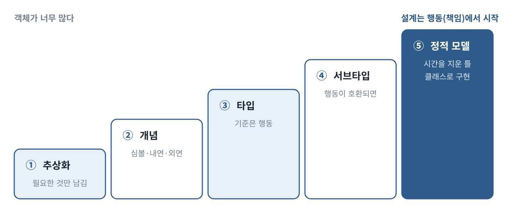

*다섯 가지 목표는 앞 단계 위에 다음 단계가 올라가는 계단 구조임*

> 객체를 분류하는 기준은 타입이고, 타입을 나누는 기준은 객체가 수행하는 행동임. 그러므로 설계는 '어떤 클래스를 만들까'가 아니라 '이 객체는 무슨 행동(책임)을 하는가'에서 시작함.

객체지향에서 중요한 것은 동적으로 변하는 객체의 상태와 그 상태를 바꾸는 행동이고, 타입은 그 변화를 다루기 쉽게 만드는 틀임. 타입 자체도 추상화이므로, 어디까지 묶고 지울지는 늘 목적이 정함.

다 읽었다면 맨 앞의 '이 장에서 배울 것'으로 돌아가, 위 표를 보지 않고 말할 수 있는 항목에 체크함.

**다음 장으로** 4장 '역할, 책임, 협력'은 이 행동을 객체들 사이의 협력 속에서 어떻게 나누고 맡기는지를 다룸. 3장의 '같은 책임이면 같은 타입'이 4장에서는 '역할'이라는 이름으로 다시 나옴.

---

## 지금의 타입과 추상화: 여섯 가지 논쟁

> **이 절을 읽기 전에** 여기서 '논쟁'은 책이 틀렸다는 뜻이 아님. 책의 주장을 실제 개발에 적용할 때 '어디까지 밀고 갈 것인가'를 두고 개발자들의 의견이 갈리는 지점임. 각 논쟁은 같은 순서로 읽으면 됨. 무엇이 쟁점인지 → 일상의 비유로 풀면 어떤지 → 알아 둘 개념과 이론 → 3장과 어떻게 이어지는지 → 코드 → 질문과 답.

### ① 상태 대신 행동의 기록을 저장한다면: 이벤트 소싱

#### 무엇이 쟁점인가

객체의 상태를 저장할 때 **지금의 값만** 저장할 것인가, 아니면 그 값을 만든 **행동의 기록을 전부** 저장할 것인가의 문제임. 뒤의 방식을 **이벤트 소싱**(Event Sourcing)이라고 부름.

#### 쉽게 풀면

통장을 떠올리면 됨. 메모지에 '잔액 7,000원'만 적어 두는 방식이 있고, '입금 10,000원', '출금 3,000원'처럼 거래 내역을 모두 적어 두는 방식이 있음.

우리가 흔히 만드는 앱은 앞의 방식임. 데이터베이스에 현재 값만 저장하고, 바뀌면 덮어씀. 이벤트 소싱은 뒤의 방식임. 일어난 사건을 차곡차곡 쌓고, 현재 잔액은 필요할 때 사건을 처음부터 더해서 계산함.

거래 내역이 있으면 '왜 7,000원이 됐지?'에 답할 수 있고, 지난달 말 잔액도 다시 계산할 수 있음. 대신 구조가 복잡해지고, 한번 쌓은 사건의 형식을 나중에 바꾸기 어려움. 그래서 모든 데이터에 쓰지는 않음([Verraes, 2019](https://verraes.net/2019/08/eventsourcing-state-from-events-vs-events-as-state/)).

#### 알아 둘 개념과 이론

**이벤트**(event)는 '이미 일어난 사실'임. 그래서 이름도 `입금됨`(`Deposited`), `출금됨`(`Withdrawn`)처럼 과거형으로 짓고, 한번 기록하면 고치거나 지우지 않음. 이벤트를 쌓아 두는 저장소는 뒤에 덧붙이기만 하는(append-only) 방식으로 동작함.

**재생**(replay)은 쌓인 이벤트를 처음부터 차례로 적용해 현재 상태를 다시 만드는 일임. 수학적으로는 '초깃값에서 시작해 이벤트를 하나씩 접어 넣는' 계산이라 함수형 프로그래밍에서는 접기(fold)라고 부름. 이벤트가 수백만 개로 늘어나면 재생이 느려지므로, 중간 결과를 **스냅숏**(snapshot)으로 저장해 두고 그 뒤의 이벤트만 재생함.

**프로젝션**(projection)은 이벤트를 읽어 조회하기 좋은 모양의 표를 따로 만드는 일임. '이번 달 출금 합계'처럼 자주 보는 값을 미리 계산해 둠.

이벤트 소싱은 흔히 **CQRS**(Command Query Responsibility Segregation, 명령과 조회의 책임 분리)와 함께 쓰임. 상태를 바꾸는 명령은 이벤트를 쌓는 쪽으로, 값을 읽는 조회는 프로젝션 쪽으로 길을 나누는 설계임([Fowler, CQRS](https://martinfowler.com/bliki/CQRS.html)).

이 생각 자체는 새롭지 않음. 회계 장부는 수백 년 동안 이 방식으로 운영됨. 회계에서는 틀린 기록을 지우지 않고, 그것을 바로잡는 새 기록을 덧붙임. 마틴 파울러는 2005년 글에서 이 방식을 소프트웨어 설계 패턴으로 정리했음([Fowler, Event Sourcing](https://martinfowler.com/eaaDev/EventSourcing.html)).

#### 3장과의 연결

책은 3.3.3에서 상태를 '행동의 결과를 표현하려고 만든 추상'이라고 봄. 이벤트 소싱은 이 말을 문자 그대로 받아들인 설계임. 상태가 아니라 행동의 기록을 원본으로 삼고, 상태는 그 기록에서 계산해 낸 결과로 취급함.

3.5와도 연결됨. 3.5의 동적 모델(스냅숏)은 '이벤트를 어느 시점까지 더한 결과'로 볼 수 있음. 그리고 어떤 종류의 이벤트가 있을 수 있는지(`Deposited`, `Withdrawn`)는 시간과 상관없는 틀이므로 정적 모델에 해당함.

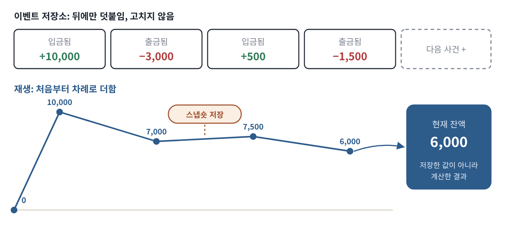

*위는 지우지 않고 쌓는 사건 기록, 아래는 그 기록을 차례로 더해 잔액을 계산하는 과정(재생)임*

#### 코드로 보기

아래 코드에서 볼 것은 **잔액이라는 상태를 어디에도 저장하지 않는다**는 점임. 잔액은 거래 기록에서 그때그때 계산됨.

```java
// ① 일어난 사건 두 종류. 이름이 과거형임
record Deposited(long amount) implements AccountEvent {}
record Withdrawn(long amount) implements AccountEvent {}

// ② 거래 기록 전체를 받아 잔액을 계산함
long balance(List<AccountEvent> history) {
    long balance = 0;                              // ③ 0에서 시작
    for (AccountEvent e : history) {               // ④ 사건을 오래된 순서로 하나씩
        balance = switch (e) {
            case Deposited d -> balance + d.amount();  // ⑤ 입금이면 더함
            case Withdrawn w -> balance - w.amount();  // ⑥ 출금이면 뺌
        };
    }
    return balance;                                // ⑦ 마지막 결과가 지금의 잔액
}
```

1. ①은 사건의 종류를 정의함. `record`는 값만 담는 간단한 클래스를 만드는 Java 문법임.
2. ②의 `balance` 함수는 잔액을 어디서 읽어 오지 않음. 대신 거래 기록 전체(`history`)를 받음.
3. ③에서 0으로 시작해, ④에서 사건을 오래된 순서대로 하나씩 꺼냄.
4. ⑤와 ⑥에서 사건 종류에 따라 더하거나 뺌. `switch`의 `case Deposited d`는 '이 사건이 입금이면 `d`라는 이름으로 꺼내라'는 뜻임.
5. ⑦에서 마지막까지 더한 값이 지금의 잔액임. `history`를 지난달 말까지만 넘기면 지난달 말의 잔액이 나옴.

Q. 쇼핑몰의 '포인트 잔액'은 잔액 값으로 저장하는 게 나을까, 적립·사용 기록으로 저장하는 게 나을까?

> **답** 기록을 원본으로 두는 편이 나음. 다만 잔액도 따로 계산해 두는 것이 실용적임.
>
> 포인트는 '왜 이 금액이죠?'라는 고객 문의가 잦은 데이터임. 적립, 사용, 소멸 이력을 보여 줘야 하고, 잘못 적립된 포인트를 바로잡을 때도 '언제 무엇이 일어났는지'가 필요함. 잔액만 저장하면 이 질문들에 답할 수 없음.
>
> 그렇다고 화면을 열 때마다 기록 수천 건을 처음부터 더하면 느림. 그래서 기록은 원본으로 두고, 잔액은 기록에서 계산해 따로 저장해 둠(프로젝션). 기록과 잔액이 어긋나면 기록을 기준으로 다시 계산하면 됨.
>
> 반대로 닉네임처럼 이력이 중요하지 않은 값은 상태로만 저장해도 충분함. 이벤트 소싱은 '이력 자체가 업무상 의미를 가지는 데이터'에만 쓰는 것이 일반적임.

### ② 분류는 항상 깔끔한가: 프로토타입 이론

#### 무엇이 쟁점인가

3.2의 내연처럼 개념을 '이 조건들을 모두 만족하면 속한다'고 딱 잘라 정의할 수 있는가의 문제임. 책의 방식은 경계가 분명한 분류를 전제하는데, 사람이 실제로 개념을 쓰는 방식은 그렇지 않다는 연구가 있음.

#### 쉽게 풀면

'새'를 조건으로 정의해 보면 '날개가 있고, 날 수 있고, 알을 낳는다' 정도가 될 것임. 그런데 펭귄은 날지 못해도 새임. 조건 하나를 빼면 이번에는 박쥐(날개가 있고 날 수 있음)가 들어올 것 같아 불안해짐.

그런데 사람은 펭귄을 보고 크게 고민하지 않음. 참새 같은 '가장 새다운 새'를 먼저 떠올리고, 그것과 얼마나 닮았는지로 판단하기 때문임. 그래서 펭귄은 '좀 특이한 새', 참새는 '아주 새다운 새'가 됨. 같은 새인데도 소속감에 정도의 차이가 있는 셈임.

#### 알아 둘 개념과 이론

**고전적 범주론**은 아리스토텔레스 이래의 전통적인 관점임. 개념은 필요충분조건(꼭 있어야 하고, 그것만 있으면 충분한 조건들)으로 정의되고, 경계는 분명하며, 속한 구성원은 모두 똑같은 자격을 가짐. 책의 내연이 이 관점에 가까움.

**가족 유사성**(family resemblance)은 철학자 루트비히 비트겐슈타인이 『철학적 탐구』(1953)에서 제시한 생각임. 그는 '게임'을 예로 들었음. 보드게임, 카드 게임, 공놀이, 올림픽 경기에 모두 공통인 조건 하나를 찾을 수 없지만, 가족 얼굴이 서로 조금씩 닮듯이 여러 특징이 겹치고 엇갈리며 하나의 개념을 이룬다는 것임([Family resemblance](https://en.wikipedia.org/wiki/Family_resemblance)).

**프로토타입 이론**(prototype theory)은 1970년대 심리학자 엘리너 로시(Eleanor Rosch)가 실험으로 뒷받침한 이론임. 사람들은 '참새는 새인가'에 '펭귄은 새인가'보다 빨리 답했고, 참새를 펭귄보다 '더 좋은 새의 예'로 평가했음. 이를 **전형성 효과**(typicality effect)라고 하며, 개념의 중심에는 가장 전형적인 예(프로토타입)가 있고 경계로 갈수록 소속이 흐릿해진다는 것이 이 이론의 핵심임([Prototype theory](https://en.wikipedia.org/wiki/Prototype_theory)).

#### 왜 개발자에게 중요한가

코드는 `if`문으로 경계를 딱 잘라야 함. 그런데 '활성 사용자'나 'VIP 고객' 같은 업무 개념은 펭귄처럼 애매한 경우가 계속 나옴. 결제는 했지만 로그인은 안 한 사용자는 활성인가? 이런 질문 때문에 회의마다 정의를 두고 다투게 됨.

게다가 같은 단어를 팀마다 다른 뜻으로 씀. 도메인 주도 설계(DDD, Domain-Driven Design)는 이 문제를 **바운디드 컨텍스트**(bounded context, 한 단어가 한 가지 뜻으로만 쓰이는 경계)로 다룸. 마케팅 영역의 '활성 사용자'와 결제 영역의 '활성 사용자'를 억지로 하나로 합치지 않고, 각 영역 안에서만 분명하게 정의하는 방식임.

#### 3장과의 연결

코드는 결국 경계를 그어야 하므로 책의 내연 방식은 여전히 필요함. 프로토타입 이론이 알려 주는 것은 '경계를 긋지 말라'가 아니라 '경계가 흔들릴 수 있다는 것을 설계에 반영하라'는 점임.

그래서 경계가 자주 바뀌는 개념은 클래스 계층에 못 박지 말고, 바꿀 수 있는 규칙(정책 객체)으로 따로 빼 두는 것이 좋음. 3.2.5의 '분류가 품질을 결정한다'는 말에는, 이런 흐릿한 개념을 코드의 어디에 둘지 고르는 일도 포함됨.

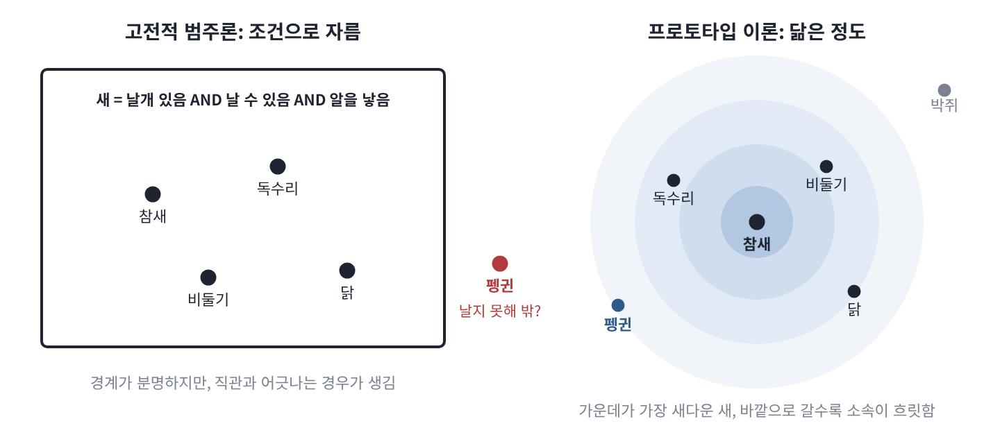

*왼쪽은 조건으로 경계를 자르는 방식, 오른쪽은 전형과 닮은 정도로 판단하는 방식임*

#### 코드로 보기

아래 코드에서 볼 것은 **'활성 사용자'의 기준을 `User` 바깥으로 빼서, 기준을 바꿔 끼울 수 있게 만든다**는 점임.

```java
// ① 기준을 하나의 타입으로 정의함
interface ActiveUserPolicy {
    boolean isActive(User user);
}

// ② 마케팅팀의 기준: 30일 안에 로그인
class LoggedInRecently implements ActiveUserPolicy {
    public boolean isActive(User u) { return u.lastLogin().isAfter(daysAgo(30)); }
}

// ③ 결제팀의 기준: 30일 안에 결제
class PaidRecently implements ActiveUserPolicy {
    public boolean isActive(User u) { return u.lastPayment().isAfter(daysAgo(30)); }
}

// ④ 쓰는 쪽은 어떤 기준인지 모름
long countActive(List<User> users, ActiveUserPolicy policy) {
    return users.stream().filter(policy::isActive).count();
}
```

1. ①은 '사용자를 받아 활성인지 답한다'는 행동 하나만 가진 타입임. 기준 자체가 하나의 타입이 된 것임.
2. ②와 ③은 같은 행동을 서로 다른 기준으로 구현함. 3.3.4의 결제 수단과 같은 구조임.
3. ④의 `countActive`는 기준을 매개변수로 받음. `filter(policy::isActive)`는 '목록에서 기준을 통과한 사용자만 남겨라'라는 뜻임.
4. 기준이 바뀌면 `User`를 고치지 않고 새 정책 클래스를 하나 만들어 넘기면 됨.

Q. '활성 사용자'의 정의를 `User` 클래스 안의 `isActive()`에 고정해 두어도 될까?

> **답** 정의가 자주 바뀌거나 팀마다 다르다면 고정하지 않는 편이 나음.
>
> `User` 안에 `isActive()`를 두면 '활성'의 정의가 `User`의 내연, 즉 `User`라는 타입의 일부가 됨. 그런데 마케팅팀은 '30일 안에 로그인', 결제팀은 '30일 안에 결제'처럼 기준이 다를 수 있음. 이때 한 메서드에 두 기준을 다 넣으면 `if`문이 늘어나고, 한 팀의 요청으로 기준을 바꾸면 다른 팀의 숫자가 몰래 바뀜.
>
> 그래서 이런 개념은 `ActiveUserPolicy` 같은 별도의 정책 객체로 빼는 것이 좋음. 기준이 바뀌면 그 객체만 고치거나 새로 만들어 바꿔 끼우면 되고, `User`는 그대로임.
>
> 반대로 '탈퇴한 회원은 로그인할 수 없다'처럼 거의 바뀌지 않고 누구에게나 같은 규칙이라면 `User` 안에 두어도 됨. 기준이 흔들리는 정도에 따라 놓을 곳을 고르는 것이 핵심임.

### ③ 인터페이스는 무엇을 기준으로 만드나: 역할 인터페이스

#### 무엇이 쟁점인가

인터페이스(타입)를 만들 때 **클래스의 메서드를 통째로** 옮길 것인가, 아니면 그 객체를 **쓰는 쪽이 실제로 필요로 하는 행동만** 모을 것인가의 문제임.

마틴 파울러는 앞의 것을 **헤더 인터페이스**(header interface), 뒤의 것을 **역할 인터페이스**(role interface)라고 부르고 역할 인터페이스를 권함([Header Interface](https://martinfowler.com/bliki/HeaderInterface.html), [Role Interface](https://www.martinfowler.com/bliki/RoleInterface.html)).

#### 쉽게 풀면

한 사람은 카페에서는 손님, 회사에서는 직원, 집에서는 가족임. 카페 점원에게 필요한 것은 그 사람이 주문하고 돈을 내는 행동뿐이고, 회사 업무나 가족 관계는 알 필요가 없음.

헤더 인터페이스는 카페 점원에게 그 사람의 모든 것을 넘겨주는 셈임. 역할 인터페이스는 '손님'이라는 역할만 넘겨주는 셈임. 점원이 알아야 할 것이 적을수록 실수할 일도, 그 사람의 사정이 바뀔 때 영향을 받을 일도 줄어듦.

#### 알아 둘 개념과 이론

**인터페이스 분리 원칙**(ISP, Interface Segregation Principle)은 SOLID의 I에 해당하는 원칙임. 로버트 C. 마틴(Robert C. Martin)이 정리했으며, '클라이언트(쓰는 쪽)는 자신이 쓰지 않는 메서드에 의존하지 않아야 한다'는 내용임. 쓰지도 않는 메서드가 인터페이스에 있으면, 그 메서드가 바뀔 때마다 상관없는 쪽까지 다시 컴파일하고 확인해야 하기 때문임([ISP](https://en.wikipedia.org/wiki/Interface_segregation_principle)).

**역할 찾기**의 뿌리는 레베카 워프스브록(Rebecca Wirfs-Brock)의 책임 주도 설계(RDD)에 있음. RDD는 객체를 '협력 속에서 어떤 역할을 맡고, 그 역할에 어떤 책임이 있는가'로 설계함. 2004년 스티브 프리먼(Steve Freeman) 등은 논문 「Mock Roles, not Objects」에서, 테스트를 쓰면서 '이 객체가 협력자에게 무엇을 부탁하는가'를 먼저 정하면 역할 인터페이스가 자연스럽게 드러난다고 설명함.

Go 언어는 이것을 관례로 삼음. Go의 코드 리뷰 지침은 인터페이스를 구현하는 쪽이 아니라 **쓰는 쪽 패키지에** 정의하라고 권함. 쓰는 쪽이 자기에게 필요한 행동만 골라 타입을 만드는 것이므로, 역할 인터페이스와 같은 생각임.

#### 3장과의 연결

3.3.4의 '같은 책임을 수행하면 같은 타입'을 그대로 따르면 역할 인터페이스가 나옴. 타입을 클래스가 아니라 협력에서 맡는 책임으로 정하기 때문임.

헤더 인터페이스는 반대로 '이 클래스가 가진 것 전부'를 타입으로 삼음. 클래스를 기준으로 타입을 만든 것이므로, 3.5.4의 '타입과 클래스는 다르다'를 놓친 설계라고 볼 수 있음. 이 생각은 4장 '역할, 책임, 협력'으로 바로 이어짐.

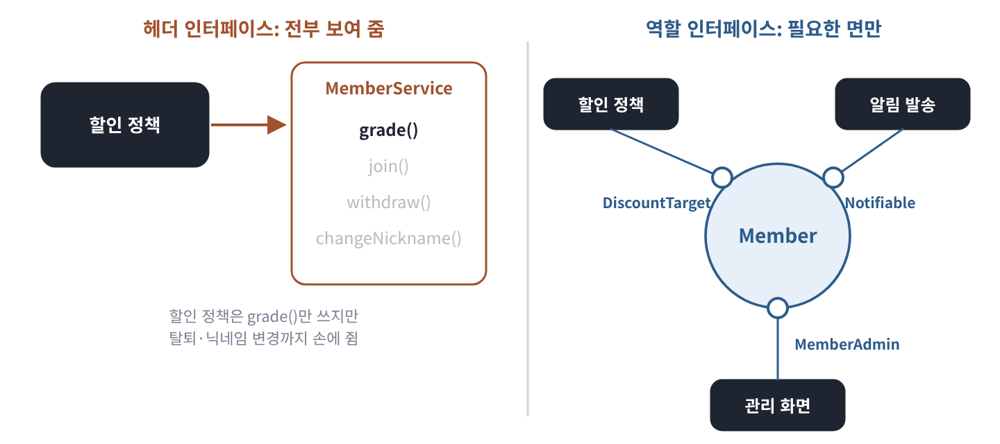

*헤더 인터페이스는 클래스의 모든 메서드를 보여 줌. 역할 인터페이스는 쓰는 쪽마다 필요한 면 하나만 보여 줌*

#### 코드로 보기

아래 코드는 같은 `Member`를 두 방식으로 감싼 것임. 볼 것은 **각 인터페이스를 누가, 무엇을 위해 쓰는가**임.

```java
// ① 헤더 인터페이스: Member 클래스의 메서드를 그대로 베낌
interface MemberService {
    void join(); void withdraw(); Grade grade(); void changeNickname(String n);
}

// ② 역할 인터페이스: 협력마다 필요한 행동만 모음
interface DiscountTarget { Grade grade(); }        // 할인 정책이 보는 회원
interface Notifiable     { void notify(Message m); } // 알림 발송이 보는 회원

// ③ 한 클래스가 두 역할을 모두 맡음
class Member implements DiscountTarget, Notifiable { /* ... */ }

// ④ 할인 정책은 등급만 알면 됨
Money discount(DiscountTarget target, Money price) { /* target.grade()만 씀 */ }
```

1. ①의 `MemberService`는 가입, 탈퇴, 등급, 닉네임 변경이 모두 들어 있음. 할인 정책이 이 타입을 받으면 탈퇴나 닉네임 변경까지 할 수 있게 되는데, 할인 정책에는 필요 없는 능력임.
2. ②는 쓰는 쪽(할인 정책, 알림 발송)을 기준으로 타입을 나눔. 각 타입에는 그쪽이 부탁할 행동만 있음.
3. ③에서 `Member` 클래스 하나가 두 역할을 모두 구현함. 3.5.4의 '클래스 하나가 여러 타입에 속할 수 있다'는 말이 이것임.
4. ④의 `discount`는 `DiscountTarget`만 받음. 그래서 나중에 '비회원 장바구니'에도 등급 할인을 주고 싶으면, 장바구니가 `grade()`만 구현하면 됨. `Member`와 상관없이 할인 정책을 재사용할 수 있음.

Q. 구현 클래스가 하나뿐인 `MemberService` 인터페이스는 필요한가?

> **답** 대부분 필요 없음. 인터페이스를 만든다고 새 타입이 생기는 것은 아니기 때문임.
>
> `MemberService`는 `Member` 클래스를 그대로 베낀 헤더 인터페이스임. 클래스와 인터페이스가 한 쌍으로 붙어 있으므로, 클래스가 바뀌면 인터페이스도 같이 바뀜. 결국 파일만 하나 늘었을 뿐, '행동을 기준으로 묶은 새 타입'은 생기지 않았음.
>
> 인터페이스가 의미를 가지는 순간은 쓰는 쪽이 생길 때임. 다른 구현이 실제로 필요해지거나, 테스트에서 가짜 객체(대역)로 바꿔 끼워야 할 때가 그렇음. 그때 그 협력에서 실제로 쓰는 행동만 모아 역할 인터페이스로 만들면 됨.
>
> 정리하면, 인터페이스는 '클래스가 있으니 만드는 것'이 아니라 '쓰는 쪽이 부탁할 행동이 정해졌을 때 만드는 것'임.

### ④ 타입은 값의 규칙도 담는다: Parse, don't validate

#### 무엇이 쟁점인가

책은 타입을 '할 수 있는 행동'으로 봄. 그런데 함수형 프로그래밍 쪽에서는 타입을 '이 값이 지킨다고 보장되는 규칙'으로도 씀.

알렉시스 킹(Alexis King)의 2019년 글 「Parse, don't validate」(검사만 하지 말고, 해석해서 타입으로 남겨라)가 이 관점을 널리 알렸음([원문](https://lexi-lambda.github.io/blog/2019/11/05/parse-don-t-validate/)). 쟁점은 '타입에 행동만 담을 것인가, 값의 규칙도 담을 것인가'임.

#### 쉽게 풀면

공항 보안 검색을 떠올리면 됨. 한 번 검색대를 통과하면 탑승구마다 다시 검사하지 않음. 검색을 통과한 구역에 들어와 있다는 사실 자체가 검사를 마쳤다는 증명이기 때문임.

코드에서 이메일을 `String`으로 받으면, 쓰는 곳마다 '@가 있나?'를 다시 검사해야 함(validate). 문자열에는 '검사를 마쳤다'는 표시가 남지 않기 때문임. 처음 들어올 때 한 번 검사해서 `Email` 타입으로 바꿔 두면(parse), `Email`을 받는 곳은 이미 검사가 끝난 값이라는 것을 타입이 보장함.

#### 알아 둘 개념과 이론

**검사**(validate)와 **해석**(parse)의 차이는 '결과를 남기느냐'임. 검사는 맞는지 확인하고 참·거짓만 돌려주므로, 확인했다는 정보가 사라짐. 해석은 확인한 결과를 더 정확한 타입으로 바꿔 돌려주므로, 그 정보가 타입에 남음.

**기본형 집착**(primitive obsession)은 마틴 파울러의 『리팩터링』에 나오는 '코드 냄새'(고쳐야 할 신호) 중 하나임. 이메일, 전화번호, 금액처럼 규칙이 있는 개념을 `String`이나 `int` 같은 기본형으로만 다루는 습관을 말함. 규칙이 코드 곳곳에 흩어지고, 이메일 자리에 전화번호를 넣는 실수도 막지 못함.

**값 객체**(value object)는 에릭 에번스(Eric Evans)의 도메인 주도 설계(DDD)에서 나온 개념임. 식별자 없이 값 자체로 의미를 가지는 작은 객체로, 만들어질 때 규칙을 확인하고 이후에는 바뀌지 않음. `Email`, `Money`가 대표적인 예임.

함수형 프로그래밍 쪽에는 '잘못된 상태는 아예 표현할 수 없게 만들라'(make illegal states unrepresentable)는 격언이 있음. 야론 민스키(Yaron Minsky)가 널리 퍼뜨린 말로, 잘못된 값이 만들어질 수 없게 타입을 설계하면 그 값을 검사하는 코드 자체가 필요 없어진다는 뜻임.

#### 3장과의 연결

두 관점은 반대라기보다 3.2.4의 **내연을 어디에 담느냐**의 차이에 가까움. 책의 타입은 내연을 '할 수 있는 행동'으로 담고, `Email` 같은 값 타입은 내연을 '지켜야 할 규칙'으로 담음.

어느 쪽이든 개념에 이름(심볼)과 기준(내연)을 주어 코드에 드러낸다는 점은 같음. 그리고 `Email`도 결국 '형식이 올바른 이메일로서 행동한다'는 약속을 지키는 객체이므로, 넓게 보면 책의 관점 안에 들어옴.

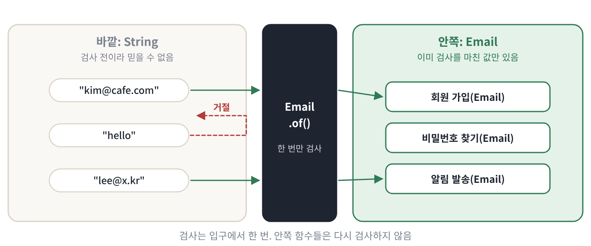

*공항 검색대처럼 입구(Email.of)에서 한 번 검사하면, 안쪽에서는 타입이 검사를 마쳤다는 것을 보장함*

#### 코드로 보기

아래 코드에서 볼 것은 **검사를 한 곳에 모으고, 검사를 통과한 값만 `Email`이 될 수 있게 만든다**는 점임.

```java
// ① 이메일이라는 개념을 하나의 타입으로 만듦
public final class Email {
    private final String value;

    // ② 생성자를 private으로 막아, 바깥에서 마음대로 만들 수 없게 함
    private Email(String value) { this.value = value; }

    // ③ 만드는 길은 이것 하나. 여기서만 규칙을 검사함
    public static Email of(String raw) {
        if (raw == null || !raw.contains("@")) throw new IllegalArgumentException("이메일 형식이 아님");
        return new Email(raw);
    }
}

// ④ 쓰는 쪽은 String이 아니라 Email을 받음. 다시 검사할 필요가 없음
void sendResetLink(Email to) { /* 바로 발송 */ }
```

1. ①의 `Email`은 문자열 하나를 감싼 작은 클래스임. `final`은 값이 한번 정해지면 바뀌지 않는다는 뜻임.
2. ②에서 생성자를 `private`으로 막았으므로, 바깥에서는 `new Email(...)`로 아무 문자열이나 넣어 만들 수 없음.
3. ③의 `Email.of(...)`가 `Email`을 만드는 유일한 입구임. 규칙(여기서는 '@'가 있는지)을 통과한 값만 `Email`이 됨. 이것이 공항의 검색대에 해당함.
4. ④의 `sendResetLink`는 `Email`을 받으므로, 형식이 틀린 이메일이 들어올 가능성이 처음부터 없음. 검사 코드가 사라지고, 매개변수 타입만 봐도 무엇이 들어오는지 알 수 있음.

Q. 회원 가입, 비밀번호 찾기, 알림 발송 세 곳에서 이메일 형식을 매번 검사하고 있다면 어떻게 고칠까?

> **답** `Email` 타입을 만들어 검사를 한 곳에 모으고, 세 곳은 `String` 대신 `Email`을 받게 고침.
>
> 지금 구조의 문제는 같은 규칙이 세 곳에 복사되어 있다는 점임. 규칙이 바뀌면(예: 회사 도메인 이메일만 허용) 세 곳을 모두 찾아 고쳐야 하고, 한 곳을 빠뜨리면 그곳만 다르게 동작함. 네 번째 기능을 만들 때 검사를 잊을 수도 있음.
>
> `Email` 타입을 만들면 검사는 `Email.of(...)` 한 곳에서만 일어남. 세 기능은 `Email`을 받으므로 다시 검사할 필요가 없고, 검사를 잊는 일도 생길 수 없음. 규칙이 바뀌어도 `Email` 한 곳만 고치면 됨.
>
> 3장의 말로 하면, '이메일'이라는 개념에 이름(심볼)과 기준(내연)을 주어 코드에 하나의 타입으로 드러낸 것임.

### ⑤ AI 시대에 타입이 다시 주목받는 이유

#### 무엇이 쟁점인가

AI가 코드를 많이 쓰는 지금, 타입이 더 중요해졌는가, 아니면 타입만으로는 부족한가의 문제임.

GitHub의 Octoverse 2025 보고서에 따르면 2025년 8월 TypeScript가 처음으로 GitHub에서 가장 많이 쓰인 언어가 되었고, 보고서는 그 이유 중 하나로 AI를 꼽음. 같은 보고서는 LLM(Large Language Model, 대규모 언어 모델)이 만든 코드의 컴파일 오류 중 94%가 타입 검사 실패였다는 연구도 인용함([GitHub Octoverse 2025](https://github.blog/news-insights/octoverse/octoverse-a-new-developer-joins-github-every-second-as-ai-leads-typescript-to-1/)).

정리하면, 타입은 AI가 만든 코드의 실수를 많이 잡아 주지만 모든 실수를 잡지는 못함. 쟁점은 그 경계가 어디냐임.

#### 쉽게 풀면

타입은 AI에게 주는 설계도의 치수와 같음. 치수가 적혀 있으면 엉뚱한 부품이 끼워지는 것을 컴파일러가 바로 잡아냄.

하지만 치수가 맞는다고 부품이 제 역할을 하는 것은 아님. 3.4.3의 정사각형은 직사각형과 메서드의 모양(치수)이 같아서 타입 검사를 통과했지만, 넓이를 틀리게 내놓았음.

#### 알아 둘 개념과 이론

**정적 타입**과 **동적 타입**의 차이부터 알아야 함. Java나 TypeScript 같은 정적 타입 언어는 실행 전에 타입을 검사하고, JavaScript나 파이썬 같은 동적 타입 언어는 실행 중에 확인함. AI가 쓴 코드를 실행 전에 걸러 낼 수 있다는 점이 정적 타입이 주목받는 이유임.

그런데 타입 검사가 확인하는 것은 **시그니처**(signature)뿐임. 시그니처는 메서드의 이름, 받는 값의 타입, 돌려주는 값의 타입을 말함. '`setWidth`를 부르면 높이는 그대로여야 한다' 같은 행동의 약속은 시그니처에 적히지 않음.

그 빈칸을 채우려는 이론이 **계약에 의한 설계**(DbC, Design by Contract)임. 버트런드 메이어(Bertrand Meyer)가 Eiffel 언어와 함께 제안했으며, 메서드마다 세 가지 약속을 적음. 부르기 전에 참이어야 하는 **사전 조건**, 실행한 뒤 참이 되는 **사후 조건**, 언제나 참이어야 하는 **불변식**임([Design by contract](https://en.wikipedia.org/wiki/Design_by_contract)).

리스코프 치환 원칙도 이 말로 다시 쓸 수 있음. 서브타입은 사전 조건을 더 까다롭게 만들면 안 되고, 사후 조건을 더 느슨하게 만들면 안 됨. 정사각형은 `setWidth`의 사후 조건('높이는 그대로')을 어겼으므로 서브타입이 될 수 없었던 것임.

이런 약속은 대부분의 언어에서 **테스트**로 확인함. 특히 속성 기반 테스트(property-based testing)는 무작위 입력을 수백 개 만들어 '어떤 직사각형이든 너비 5, 높이 4로 바꾸면 넓이는 20'처럼 늘 성립해야 하는 성질을 확인하는 방식임.

#### 3장과의 연결

언어의 타입 검사는 메서드의 이름과 모양만 확인함. 책이 말하는 타입은 그보다 넓은 '행동의 약속'임. 둘 사이의 빈칸은 계약과 테스트가 채움.

그래서 AI가 코드를 쓰는 시대일수록 사람이 정해야 하는 것은 다시 3장의 질문으로 돌아옴. '어떤 책임을 묶어 하나의 타입으로 볼 것인가', 그리고 '그 타입이 지켜야 할 약속은 무엇인가'임.

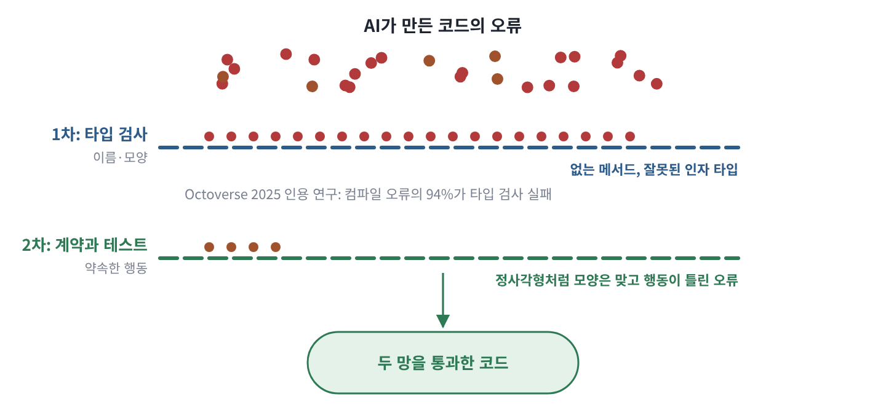

*타입 검사는 모양의 오류를, 계약과 테스트는 행동의 오류를 거름. 둘은 역할이 다른 두 겹의 망임*

#### 코드로 보기

아래 코드는 타입 검사가 놓친 정사각형 문제를 **테스트로 잡는** 방법임. 볼 것은 테스트가 확인하는 것이 '모양'이 아니라 '행동의 약속'이라는 점임.

```java
// ① 직사각형이 지켜야 할 약속을 테스트로 적음
void 너비와_높이는_따로_바뀐다(Rectangle r) {
    r.setWidth(5);
    r.setHeight(4);
    assertEquals(20, r.area());   // ② 약속: 넓이는 5 × 4 = 20
}

// ③ 직사각형과 그 서브타입이라고 주장하는 모든 클래스에 같은 테스트를 돌림
너비와_높이는_따로_바뀐다(new Rectangle());  // 통과
너비와_높이는_따로_바뀐다(new Square());     // 실패: 넓이가 16
```

1. ①의 테스트는 `Rectangle`을 받아, 직사각형이라면 당연히 지켜야 할 행동을 실행함.
2. ②의 `assertEquals(20, ...)`는 '결과가 20이 아니면 실패로 표시하라'는 뜻임. 이 한 줄이 시그니처에 적히지 않는 약속을 코드로 적은 것임.
3. ③에서 같은 테스트를 `Rectangle`과 `Square`에 모두 돌림. 컴파일러는 둘 다 통과시켰지만, 테스트는 `Square`가 약속을 어긴다는 것을 잡아냄.

Q. 타입 검사를 통과한 AI 생성 코드는 믿어도 되나?

> **답** 모양은 믿을 수 있지만, 행동은 따로 확인해야 함.
>
> 타입 검사를 통과했다는 것은 메서드 이름, 받는 값과 돌려주는 값의 타입이 맞는다는 뜻임. 존재하지 않는 메서드를 부르거나, 숫자 자리에 문자열을 넣는 실수는 없다는 보장임. Octoverse가 인용한 연구처럼 AI 코드의 컴파일 오류 대부분이 여기서 잡히므로, 이것만으로도 큰 도움이 됨.
>
> 하지만 정사각형 예제처럼 모양이 맞아도 행동이 약속을 어길 수 있음. 타입 검사는 '`setWidth`가 높이를 건드리면 안 된다'를 모름.
>
> 그래서 행동의 약속은 테스트로 확인해야 함. 실무에서는 AI에게 코드를 맡기기 전에 사람이 약속(테스트)을 먼저 적어 두고, AI가 만든 코드가 그 테스트를 통과하는지 보는 방식이 많이 쓰임. 타입은 1차 그물, 테스트는 2차 그물인 셈임.

### ⑥ AX 시대의 선택: 데이터 먼저인가, 책임 먼저인가

#### 무엇이 쟁점인가

AX(AI Transformation, AI 전환)는 AI가 업무를 자동화하고 지능화하는 변화를 말함. 이제 시스템을 쓰는 쪽에 사람뿐 아니라 **AI 에이전트**(스스로 도구를 호출해 일을 처리하는 AI)가 더해졌음.

에이전트에게 우리 시스템을 열어 줄 때, 데이터를 직접 읽고 고칠 수 있게 할 것인가, '환불 요청' 같은 행동만 호출할 수 있게 할 것인가가 쟁점임. 3.3.4에서 본 데이터 주도 설계와 책임 주도 설계의 선택이 다시 나타난 셈임.

#### 쉽게 풀면

은행 창구를 떠올리면 됨. 손님에게 금고 열쇠를 주고 알아서 돈을 꺼내 가게 하는 은행은 없음. 손님은 창구에 '이체해 주세요'라고 요청하고, 한도와 본인 확인 같은 규칙은 은행이 지킴.

AI 에이전트에게 데이터 수정 권한을 주는 것은 금고 열쇠를 주는 것이고, 행동(도구)만 주는 것은 창구를 열어 주는 것임. 다만 잔고 조회처럼 읽기만 하는 일까지 창구를 거치게 할 필요는 없음. 은행도 통장 정리는 기계에 맡김.

#### 알아 둘 개념과 이론

**명령과 조회의 분리**(CQS, Command-Query Separation)는 버트런드 메이어가 제안한 원칙임. 메서드는 상태를 바꾸는 **명령**이거나 값을 돌려주는 **조회**이거나 둘 중 하나여야 한다는 것임. 이 구분이 에이전트 설계에서 그대로 쓰임. 조회는 데이터로 열어 줘도 상태가 망가지지 않지만, 명령은 규칙을 거쳐야 함.

**묻지 말고 시켜라**(Tell, Don't Ask)는 앤디 헌트(Andy Hunt)와 데이브 토머스(Dave Thomas)가 널리 알린 원칙임. 객체에게 데이터를 물어 와서 바깥에서 판단하지 말고, 객체에게 일을 시키고 판단은 객체가 하게 하라는 뜻임([Fowler, TellDontAsk](https://martinfowler.com/bliki/TellDontAsk.html)). 에이전트가 주문 상태를 읽어 와 '환불해도 되나'를 스스로 판단하게 하는 것이 'Ask', `requestRefund`를 시키는 것이 'Tell'임.

**빈약한 도메인 모델**(Anemic Domain Model)은 마틴 파울러가 2003년에 이름 붙인 안티패턴임. 객체에 데이터(getter, setter)만 있고 행동이 없어서, 업무 규칙이 바깥의 서비스 코드에 흩어진 상태를 말함([Fowler, AnemicDomainModel](https://martinfowler.com/bliki/AnemicDomainModel.html)). 이런 시스템에 에이전트를 붙이면 규칙이 있는 곳이 없어서, 에이전트가 데이터를 직접 고치는 길밖에 없게 됨.

**최소 권한 원칙**(principle of least privilege)은 보안의 오래된 원칙임. 어떤 주체든 일을 하는 데 꼭 필요한 권한만 가져야 한다는 것임. 에이전트는 사람보다 실수 범위를 예측하기 어려우므로 이 원칙이 더 중요해짐.

**최근 공개 자료** AI 연동 표준인 MCP(Model Context Protocol) 명세는 AI에게 주는 것을 읽을 데이터인 '리소스'와 호출해 행동하는 '도구'로 나눔([MCP 명세, 2025-06-18](https://modelcontextprotocol.io/specification/2025-06-18/server)).

Anthropic은 에이전트 도구를 만들 때 `list_events`, `create_event`처럼 데이터 조작을 나열하지 말고, 빈 시간을 찾아 일정을 잡는 `schedule_event`처럼 책임 단위로 만들라고 권함([Anthropic, 2025](https://www.anthropic.com/engineering/writing-tools-for-agents)). Palantir도 데이터는 '명사', 액션은 '동사'로 나누고 상태 변경은 정해진 액션으로만 허용한다고 설명함([Palantir, 2026](https://blog.palantir.com/connecting-agents-to-decisions-277dee8ddb40)).

세 자료 모두 '읽기는 데이터로, 쓰기는 행동으로'라는 같은 방향을 가리킴. 이것은 CQS를 에이전트 설계에 옮긴 것과 같음.

#### 3장과의 연결

3.3.4에서 책은 '어떤 데이터를 가질까'보다 '어떤 책임을 맡을까'를 먼저 정하라고 했음. 쓰는 쪽에 보이는 것이 행동뿐이어야 다형성과 캡슐화가 지켜지기 때문임.

AI 에이전트는 새로 등장한 '쓰는 쪽'임. 사람이 쓰는 쪽일 때 통했던 원칙이 에이전트에게도 똑같이 통함. 에이전트에게 행동만 보여 주면 규칙은 객체 안에서 지켜지고, 데이터를 보여 주면 규칙은 에이전트의 판단에 맡겨짐.

**판단 기준** 그렇다고 모든 것을 행동으로 감쌀 필요는 없음. 기준은 두 가지 질문으로 정리됨.

첫째, AI가 상태를 바꾸는가? 분석, 리포트, 검색처럼 읽기만 한다면 읽기 전용 데이터(리소스)를 주는 '데이터 먼저'로 충분함. 환불, 예약, 승인처럼 상태를 바꾼다면 '책임 먼저'로 감싸야 함.

둘째, 지켜야 할 규칙이 많은가? '환불은 배송 전까지만'처럼 규칙이 많을수록 그 규칙을 지킬 객체가 필요하고, 에이전트에게는 그 객체의 책임 하나당 도구 하나를 줌.

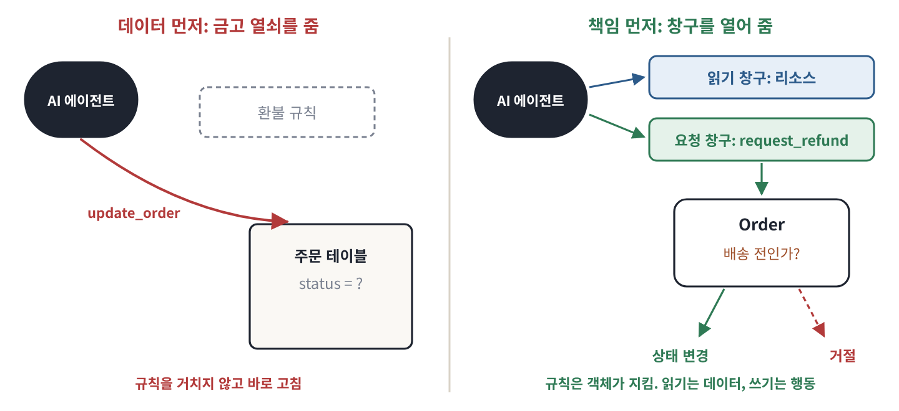

*데이터를 고치는 권한을 주면 규칙을 우회함(왼쪽). 행동을 주면 객체가 규칙을 지킴(오른쪽)*

#### 코드로 보기

아래 코드에서 볼 것은 **환불 규칙이 어디에 있는가**임. 데이터 먼저 방식에는 규칙을 둘 곳이 없고, 책임 먼저 방식에서는 `Order`가 규칙을 지킴.

```java
// ① 데이터 먼저: 에이전트에게 주문의 필드를 마음대로 고치는 도구를 줌
//    tool update_order(orderId, fields)
//    → 배송 완료된 주문을 '환불 요청' 상태로 바꿔도 막을 곳이 없음

// ② 책임 먼저: 에이전트에게 '환불 요청'이라는 행동 하나만 줌
//    tool request_refund(orderId, reason)  →  내부에서 order.requestRefund(reason)를 부름
class Order {
    Refund requestRefund(Reason reason) {
        if (isDelivered())                                      // ③ 규칙 확인
            throw new RefundNotAllowed("배송 완료 주문은 반품 절차로");
        this.status = REFUND_REQUESTED;                         // ④ 규칙을 통과하면 상태 변경
        return Refund.of(this, reason);                         // ⑤ 환불 건을 만들어 돌려줌
    }
}
```

1. ①의 `update_order`는 주문 테이블의 필드를 고치는 도구임. 에이전트가 판단을 잘못하면 배송이 끝난 주문도 환불 상태가 됨. 규칙이 코드 어디에도 없기 때문임.
2. ②의 `request_refund`는 '환불을 요청한다'는 행동 하나만 열어 줌. 에이전트는 주문의 필드를 볼 수도, 고칠 수도 없음.
3. ③에서 `Order`가 스스로 규칙을 확인함. 배송이 끝났으면 예외를 던져 거절함.
4. ④에서 규칙을 통과했을 때만 상태가 바뀜. 상태(`status`)는 행동 뒤에 감춰져 있음. 3.3.4의 캡슐화임.
5. ⑤에서 결과를 돌려주므로 에이전트는 무엇이 일어났는지 알 수 있음.

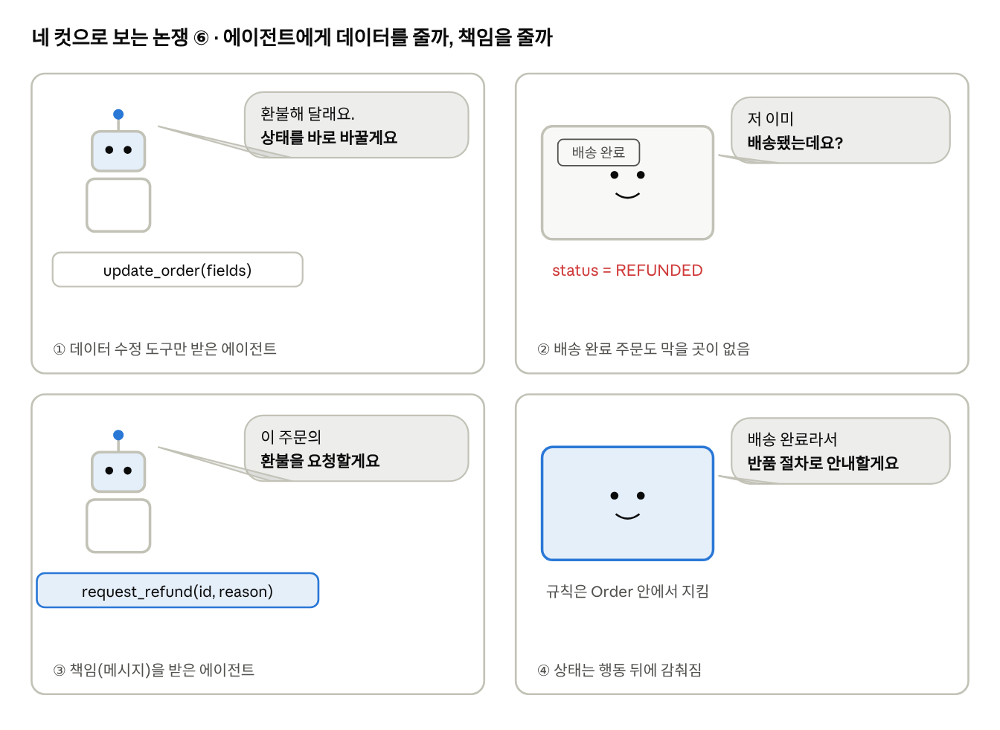

같은 환불 요청이라도, 데이터를 직접 고치는 도구를 주면 규칙을 지킬 곳이 없고, 책임(메시지)을 주면 객체가 규칙을 지킴.

Q. 쇼핑몰에 AI 에이전트를 붙여 '매출 리포트 작성'과 '환불 처리'를 맡긴다면, 각각 무엇을 주어야 하나?

> **답** 매출 리포트에는 읽기 전용 데이터를, 환불 처리에는 `request_refund` 같은 행동 하나를 줌.
>
> 매출 리포트는 데이터를 읽고 계산해 보여 주기만 함. 상태를 바꾸지 않으므로 지켜야 할 업무 규칙이 거의 없음. 이때는 주문과 결제 데이터를 읽기 전용으로 열어 주는 것이 가장 단순하고 유연함(데이터 먼저). 에이전트가 원하는 방식으로 자유롭게 집계할 수 있기 때문임.
>
> 환불은 상태를 바꾸고 '배송 전까지만', '결제 수단으로만 환불' 같은 규칙이 있음. 여기서 주문 테이블 수정 권한을 주면 규칙을 지킬 곳이 사라짐. 그래서 규칙을 가진 `Order`의 행동 하나(`requestRefund`)를 도구로 감싸서 줌(책임 먼저).
>
> 기준을 한 줄로 줄이면 '읽기는 데이터로, 쓰기는 행동으로'임. 이것은 CQS와 최소 권한 원칙을 함께 적용한 결과이고, 3장의 '타입은 행동으로 정한다'를 AI라는 새 사용자에게 그대로 적용한 것임.

---

## 실습

**과제: 우리 서비스의 '회원' 개념 정리하기**

3장의 순서(개념 → 타입 → 계층 → 클래스)를 그대로 따라가는 실습임.

1. 우리 서비스에서 '회원'이라고 부르는 객체를 모두 적음
2. '회원' 개념의 심볼, 내연, 외연을 한 줄씩 적음
3. 각 객체가 할 수 있는 행동을 적고, 행동이 같은 것끼리 묶어 타입을 나눔
4. 타입 사이에 일반화/특수화 관계가 있는지 그리고, 서브타입이 슈퍼타입의 행동을 모두 할 수 있는지 확인함
5. 그 타입들을 지금 코드에서 클래스 몇 개로 구현했는지 비교함

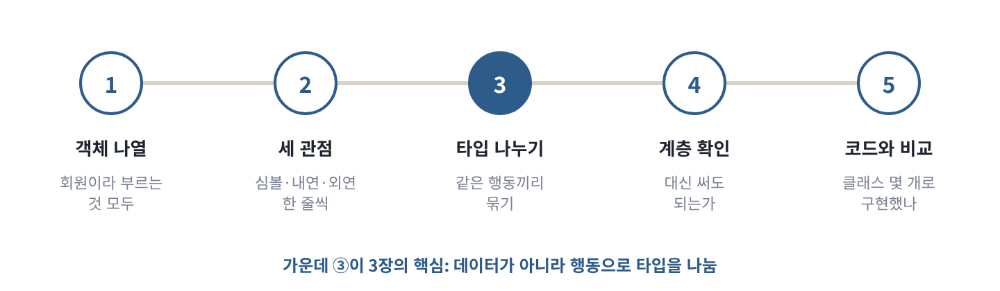

*실습은 3장의 순서(개념 → 타입 → 계층 → 클래스)를 그대로 따라감*

**예시 풀이** 가상의 쇼핑몰에서 '회원'이라고 부르는 것은 일반 회원, VIP 회원, 관리자, 탈퇴 회원 네 가지라고 하자.

먼저 회원의 내연을 '로그인하고 주문할 수 있음'으로 잡음. 그러면 탈퇴 회원은 로그인도 주문도 못 하므로 회원의 외연에서 빠짐. 이름에 '회원'이 붙어 있어도 행동 기준으로는 회원이 아닌 것임.

관리자는 주문이 아니라 상품 관리를 하므로, 하는 일 자체가 달라 아예 다른 타입임. VIP 회원은 회원의 행동(로그인, 주문)을 모두 하고 '추가 할인 받기'를 더 하므로 회원의 서브타입임.

마지막으로 코드를 봄. 만약 지금 코드가 `Member` 클래스 하나에 `type` 필드로 네 가지를 모두 담고 있다면, 이 타입 분류가 코드에 드러나지 않은 상태임. 3.2.5의 '분류가 무너진 코드'에 해당하고, 위에서 나눈 타입대로 인터페이스와 클래스를 다시 나누는 것이 개선 방향임.

---
