# Week 4 · 4장 역할, 책임, 협력

> 『객체지향의 사실과 오해』 4장 학습 기록

**이북으로 보기** 같은 내용을 절마다 한 쪽씩 넘겨 읽는 이북으로도 만들었다. [이북 열기](https://raw.githack.com/cloud-club/10th-oop-facts-misconceptions/main/%EC%9D%B4%EC%A0%95%EC%9D%B8/ebook/week4/index.html)를 누르면 열린다. 이북 파일은 [`ebook/week4/`](ebook/week4/)에 있다. 같은 이북을 [claude.ai 아티팩트](https://claude.ai/artifact/CZkqcxDSk5vAxMDAqBAwof)로도 볼 수 있다.

각 절은 요지, 본문, 보충(실제 사례와 코드), 한 줄 정리, 논의해 보기 순서로 되어 있다. 요지만 이어 읽어도 장 전체의 흐름이 잡히도록 썼다. 용어는 [`단어장.md`](단어장.md)에 모아 둔다.

## 4장 Summary · 한눈에 보기

> **4장에서 꼭 기억할 한 문장** 객체의 모양을 결정하는 것은 데이터나 클래스가 아니라 **협력**이다. 협력에 필요한 **책임**을 먼저 찾고, 책임을 묶은 **역할**을 정한 뒤, 그 역할을 맡을 객체를 고른다.

1장은 역할, 책임, 협력을 커피 주문으로 소개만 했다. 4장은 이 세 단어를 하나씩 정확히 정의하고, 설계에서 어떤 순서로 쓰는지 설명한다. 4장은 하나의 질문에서 출발한다. **객체지향 설계에서 가장 먼저 정해야 하는 것은 무엇인가?** 저자의 답은 다섯 단계로 이어진다.

먼저 **협력**은 요청과 응답의 연쇄다. 혼자 해결할 수 없는 일을 다른 객체에게 부탁하고, 부탁받은 객체가 다시 다른 객체에게 부탁하면서 일이 완성된다(4.1). 그렇다면 부탁을 받은 객체는 무엇을 떠안게 되는가?

부탁을 받은 객체는 그 일에 대한 **책임**을 진다. 책임은 객체가 '하는 것'과 '아는 것'으로 나뉘고, 객체가 바깥에 보여 주는 공용 인터페이스가 된다. 책임은 설계가 진행되면서 구체적인 메시지로 바뀐다(4.2). 그렇다면 비슷한 책임을 가진 객체가 여럿이면 어떻게 다루는가?

책임을 묶어 **역할**로 만든다. 역할은 협력 안에 뚫린 자리와 같아서, 그 책임만 수행할 수 있으면 어떤 객체든 들어갈 수 있다. 덕분에 여러 협력을 하나로 추상화할 수 있고 객체를 바꿔 끼울 수 있다(4.3). 그렇다면 객체의 모양은 언제 정해지는가?

협력이 먼저 정해진 뒤에 정해진다. 데이터나 클래스부터 정하는 것은 흔한 오류이고, 객체의 책임은 협력을 따라 흐른다(4.4). 마지막으로, 이 생각을 실제 설계에 어떻게 적용하는가?

**책임 주도 설계**, **디자인 패턴**, **테스트 주도 개발**이라는 세 가지 기법이 있다. 셋 모두 역할, 책임, 협력을 중심에 둔다(4.5).

### 이 장에서 배울 것

- [ ] 협력을 요청과 응답의 연쇄로 설명하고, 요청이 왜 책임을 만드는지 말할 수 있다
- [ ] 책임을 '하는 것'과 '아는 것'으로 나누고, 책임과 메시지의 차이를 설명할 수 있다
- [ ] 역할이 무엇이고, 역할 덕분에 협력이 단순해지고 객체를 바꿔 끼울 수 있는 이유를 말할 수 있다
- [ ] 데이터나 클래스부터 설계하는 것이 왜 오류인지, 협력이 객체의 모양을 정한다는 말이 무슨 뜻인지 설명할 수 있다
- [ ] 책임 주도 설계, 디자인 패턴, 테스트 주도 개발이 각각 역할, 책임, 협력과 어떻게 이어지는지 말할 수 있다

다 읽은 뒤 설명할 수 있게 된 항목에 체크한다. 항목별 답은 '4장 정리'의 결론에 있다.

**핵심 용어** 협력 · 요청 · 응답 · 책임 · 하는 것 · 아는 것 · 공용 인터페이스 · 메시지 · 역할 · 추상화 · 대체 가능성 · 책임 주도 설계 · 디자인 패턴 · 테스트 주도 개발 · 목 객체

**읽는 법** 4장의 예시는 『이상한 나라의 앨리스』 속 재판이다. 실제 코드는 각 절의 보충에 있다. 재판 협력을 코드로 옮긴 예는 4.1.3, 정보 전문가는 4.2.1, 역할을 인터페이스로 만드는 예는 4.3.3, 컴포지트 패턴은 4.5.2, 목 객체를 쓴 테스트는 4.5.3에서 다룬다. 4장 정리 바로 뒤에 실습이 있고, 그 뒤로 책 밖의 내용을 부록 A~F로 모아 둔다. 부록은 4장의 질문 '누가 무엇을 책임지는가'를 여섯 갈래로 나눈 것이다. 책임 설계 기법(A), 역할의 코드 표현(B), 협력 흐름의 제어(C), 책임 주체의 배분(D), 권한 설계(E), 책임 이행 검증(F).

---

## 들어가며

> **이 절의 맥락** 1장에서 역할, 책임, 협력을 처음 만났고, 2~3장에서는 객체 하나의 안쪽(상태와 행동)과 객체를 묶는 기준(타입)을 보았다. 4장은 다시 객체들 사이로 눈을 돌려, 세 단어를 설계의 도구로 다듬는다.

**요지** 객체의 행동 방식을 결정하는 문맥은 협력이다. 그래서 설계의 품질은 개별 객체가 아니라 객체들이 함께 이루는 협력의 품질로 정해진다.

**사람의 행동은 협력이라는 문맥이 정한다.** 저자는 4장을 사람의 행동 이야기로 엶. 사람이 어떤 상황에서 어떻게 행동하는지는 혼자 떼어 놓고 보면 알 수 없다.

- 같은 사람이라도 회의에서는 발표자로, 식당에서는 손님으로 다르게 행동하기 때문이다.
- 저자는 인간의 행동을 결정하는 문맥이 **타인과의 협력**이라고 말한다.

그래서 협력이라는 문맥을 무시한 채 각 사람의 반응을 따로 예상하고 관찰하는 것은 의미가 없다.

- 어떤 행동이 적절한지는 그 행동이 **협력에 얼마나 알맞은지**에 따라 정해진다.
- 재판에서 증인이 큰 소리로 노래를 부른다면, 노래 실력과 상관없이 그 행동은 틀린 것이다.
- 재판이라는 협력에 맞지 않기 때문이다.

**객체의 세계도 같다.** 협력이라는 문맥이 객체의 행동 방식을 결정한다.

- 저자는 객체지향을 처음 배우는 사람이 가장 많이 하는 실수로, 협력이라는 문맥을 고려하지 않은 채 **객체가 가져야 할 상태와 행동부터 고민하는 것**을 꼽는다.
- 객체 하나만 놓고 '무엇을 가지고 무엇을 할까'를 정하면, 그 객체가 실제로 어떤 협력에 쓰일지와 상관없는 모양이 나오기 쉽다.

**중요한 것은 개별 객체가 아니라 협력이다.** 설계 전체의 품질을 결정하는 것은 객체 하나하나의 품질이 아니라, 여러 객체가 모여 이루는 협력의 품질이다.

- 저자는 객체들 사이의 요청과 응답 속에서 **창발**하는 협력에 초점을 맞춰 애플리케이션을 설계하는 사람이 훌륭한 객체지향 설계자라고 말한다.
- 창발(emergence)은 부분들이 모였을 때 부분 하나에는 없던 성질이 전체에서 새로 생겨나는 것을 뜻한다.
- 판사, 진행자, 증인은 각자 판결을 혼자 내릴 수 없지만, 서로 요청하고 응답하면 '재판'이라는 결과가 생겨나는 것과 같다.

**협력이 먼저, 행동과 상태는 뒤따라 정해진다.** 협력이 자리를 잡으면 그 안에서 각 객체가 해야 할 행동이 저절로 드러나고, 뒤이어 그 행동에 필요한 상태가 정해진다.

- 즉 객체가 어떤 협력에 참여하는지가 필요한 행동을 정하고, 필요한 행동이 객체의 상태를 정한다.
- 저자는 이를 '객체의 모양을 빚는 것은 객체가 참여하는 협력'이라고 표현하고, 훌륭한 객체지향 설계란 **조화를 이루며 적극적으로 상호작용하는 협력적인 객체를 창조하는 것**이라고 정리한다.
- 이 생각은 4.4에서 다시 자세히 다룬다.

**세 단어를 연극에 빗대면** 이해가 쉽다.

- 무대 위에서 배우들이 주고받는 대사와 행동이 **협력**이고, 대본에 적힌 각자의 할 일이 **책임**이며, 그 할 일을 묶은 배역이 **역할**이다.
- 배역은 배우가 바뀌어도 그대로 남는다.
- 같은 연극을 다른 배우가 공연할 수 있는 이유다.
- 4장의 나머지는 이 세 가지를 차례로 정의하고, 설계에서 어떤 순서로 쓰는지를 설명한다.

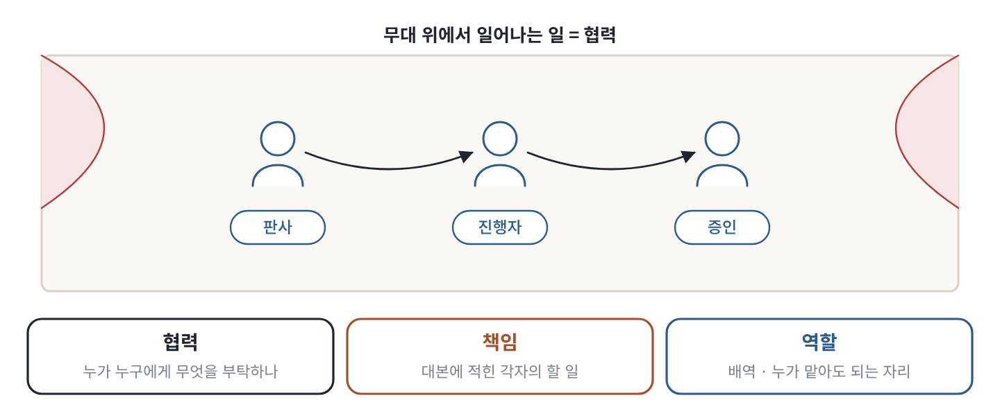

*4장의 세 단어를 연극에 빗대면, 협력은 무대 위의 상호작용, 책임은 대본 속 할 일, 역할은 배역이다*

#### 보충

**1장과 무엇이 다른가** 1장은 커피 주문이라는 익숙한 이야기로 세 단어를 소개하는 데 그쳤다.

- 4장은 각 단어를 정확히 정의한다.
- 책임을 두 종류로 나누고(4.2.1), 책임과 메시지의 관계를 정리하며(4.2.2), 역할이 협력을 어떻게 추상화하는지(4.3.4) 설명한다.
- 또 1장의 '객체를 지향하라'를 '협력이 객체의 모양을 정한다'(4.4)는 설계 순서로 구체화한다.

**이 장의 주장이 실무에서 중요한 이유** 실무에서 클래스는 대개 화면이나 테이블에서 출발한다. 회원 테이블이 있으니 `Member` 클래스를 만들고, 칸마다 필드를 만드는 식이다. 이렇게 만든 클래스는 데이터를 잘 담지만, 어떤 기능에서 무슨 일을 해야 하는지는 정해져 있지 않는다. 그래서 판단 로직이 서비스 클래스에 흩어지기 쉽다(2장 논쟁 ①). 4장은 이 순서를 뒤집어 '협력 → 책임 → 역할 → 객체'로 설계하라고 말한다.

**2장과 어떻게 이어지는가** 2장은 객체 하나 안에서 '행동이 상태를 결정한다'고 했다. 4장은 그 행동이 어디서 오는지 말해 준다. 행동은 협력에서 온다. 두 장을 이으면 **협력 → 행동 → 상태**라는 하나의 순서가 된다.

**한 줄 정리** 객체의 행동은 협력이라는 문맥이 정하고, 설계의 품질은 협력의 품질이다. 협력이 자리 잡으면 행동이, 행동이 정해지면 상태가 뒤따라 정해진다.

**논의해 보기**

Q. 지금 다루는 코드에서 '클래스부터 만든' 흔적과 '협력부터 생각한' 흔적을 하나씩 찾아보자. 무엇이 다른가?

> **답** 클래스부터 만든 코드는 필드와 getter가 먼저 보이고 행동은 바깥에 있으며, 협력부터 생각한 코드는 메서드 이름이 '누가 무엇을 해 주는지'를 말한다.
>
> 클래스부터 만든 흔적은 대개 이런 모습이다.
>
> - `Member`에 `name`, `grade`, `point` 필드와 getter, setter가 있고, '등급에 따라 할인율을 정한다'는 판단은 `OrderService` 안에 `if (member.getGrade() == VIP)`로 들어가 있다.
> - 회원이 어떤 협력에 참여하는지는 클래스만 보아서는 알 수 없다.
>
> 협력부터 생각한 흔적은 `member.discountRate()`처럼 나타난다. 주문 협력에서 '이 회원은 몇 퍼센트 할인을 받는가'라는 요청을 회원이 받는다고 정했기 때문에, 그 판단이 회원 안에 들어간다. 메서드 이름만 보아도 회원이 주문 협력에서 무엇을 책임지는지 알 수 있다.
>
> 두 코드의 차이는 결국 '책임을 언제 정했느냐'이다. 앞쪽은 데이터를 먼저 정하고 책임을 나중에 아무 데나 붙였고, 뒤쪽은 협력에서 책임을 먼저 찾고 그 책임에 맞는 객체를 골랐다. 4.4에서 이 차이를 '흔한 오류'와 '협력을 따라 흐르는 책임'으로 다시 다룬다.

---

## 4.1 협력

> **이 절의 맥락** 세 단어 가운데 협력을 가장 먼저 다룬다. 책임과 역할은 모두 협력 안에서만 의미가 있기 때문이다. 저자는 사람의 협력을 먼저 보여 주고, 앨리스의 재판 이야기로 협력이 어떻게 진행되는지 따라간다.

### 4.1.1 요청하고 응답하며 협력하는 사람들

**요지** 협력은 다른 사람에게 도움을 요청하는 데서 시작되고, 요청은 또 다른 요청을 낳으며, 응답이 거꾸로 돌아오면서 끝난다.

**일상의 협력은 사람들의 네트워크다.** 저자는 일상에서의 협력을 '요청과 응답으로 연결되는 사람들의 네트워크'로 설명한다. 사람들은 서로 요청하고 응답하는 선으로 이어져 있고, 일은 그 선을 따라 흘러간다.

**협력은 요청에서 시작한다.** 협력은 한 사람이 다른 사람에게 도움을 요청할 때 시작된다.

- 사람은 자신에게 맡겨진 일을 처리하다가 스스로 해결하기 어려운 문제에 부딪히면, 그 문제를 해결하는 데 필요한 지식을 알고 있거나 도움을 줄 수 있는 누군가에게 도움을 요청한다.
- 요청을 받은 사람은 일을 처리한 뒤, 요청한 사람에게 필요한 지식이나 서비스를 제공하는 것으로 응답한다.

**요청은 연쇄적으로 이어진다.** 요청을 받은 사람도 혼자 처리할 수 없는 부분이 있으면 또 다른 사람에게 요청한다.

- 큰 요청 하나가 더 작은 요청들로 나뉘어 퍼져 나가는 것이다.
- 그리고 각자가 맡은 일을 끝내면 그 결과가 요청이 왔던 길을 거꾸로 따라 처음 요청한 사람에게 돌아온다.
- 이것이 **응답**이다.

그래서 저자는 협력을 '다수의 요청과 응답으로 구성되며, 전체적으로 협력은 다수의 연쇄적인 요청과 응답의 흐름으로 구성된다'고 정리한다. 1장 1.1.2에서 본 커피 주문의 요청과 응답도 같은 구조였다.

**요청이 책임을 만든다.** 여기서 중요한 점이 하나 있다.

- 누군가에게 요청을 보낸다는 것은 그 사람이 그 일을 해 줄 것이라고 기대한다는 뜻이다.
- 요청을 받은 사람은 그 기대에 응답할 의무, 즉 **책임**을 지게 된다.
- 협력과 책임이 따로 있는 것이 아니라, 협력 속의 요청이 책임을 만들어 내는 것이다.
- 이 생각이 4.2의 출발점이다.

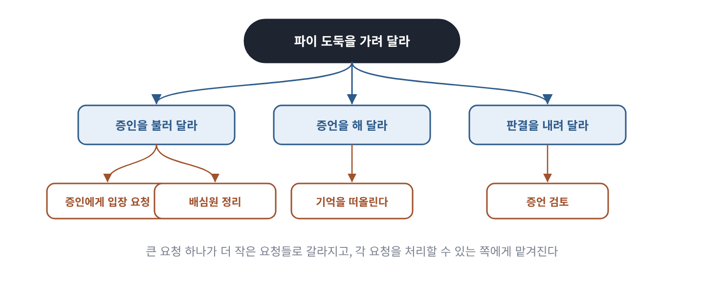

*혼자 해결할 수 없는 요청은 더 작은 요청으로 나뉘어 다른 사람에게 전달된다. 협력은 이 요청과 응답의 연쇄다*

#### 보충

**요청이 나무처럼 갈라지는 모습은 코드에서 호출 트리임** 요청을 받은 객체가 일을 나누어 다른 객체에게 다시 요청하면, 호출 관계는 나무 모양이 된다.

- 이 나무의 각 가지가 하나의 책임이고, 가지 끝으로 갈수록 책임은 더 작고 구체적이다.
- 이 나무를 위에서 아래로 그려 나가는 것이 4.5.1에서 볼 책임 주도 설계의 기본 동작이다.

**요청한 쪽은 '무엇'만 알면 됨** 왕은 하얀 토끼에게 '증인을 불러라'라고 요청할 뿐, 토끼가 어떤 순서로 누구를 부르는지 지시하지 않는다.

- 요청이 결과(무엇)만 말하고 절차(어떻게)를 맡겨야, 받은 쪽이 자기 방식으로 책임을 수행할 수 있다.
- 1장 1.1.2에서 본 내용이고, 5장 '책임과 메시지'에서 다시 다룬다.

**한 줄 정리** 협력 = 연쇄적인 요청과 응답의 흐름. 요청을 받은 쪽은 그 일에 대한 책임을 진다.

### 4.1.2 누가 파이를 훔쳤지?

**요지** 저자는 『이상한 나라의 앨리스』의 재판 장을 예로 들어 협력, 책임, 역할을 설명한다.

『이상한 나라의 앨리스』 끝부분에는 재판이 나온다. 하트 여왕이 만든 파이가 사라졌고, 하트 잭이 그 파이를 훔친 혐의로 재판을 받는다. 이 재판에는 여러 인물이 참여한다.

**왕**은 판사로서 재판을 이끌고 판결을 내린다. **하얀 토끼**는 재판의 진행을 맡아 고발장을 읽고 증인을 부른다. **모자 장수**는 증인으로 불려 나와 증언한다. **하트 잭**은 피고이고, 배심원석에는 동물들이 앉아 있다.

저자가 이 이야기를 고른 이유는 재판이 협력의 모든 요소를 갖추고 있기 때문이다.

- 재판이라는 목표가 있고, 그 목표를 위해 여러 인물이 서로에게 요청하고 응답하며, 각자 맡은 자리(판사, 진행자, 증인)에 따라 할 일이 정해져 있다.
- 그리고 재판마다 판사나 증인을 맡는 인물은 달라질 수 있다.
- 이 마지막 성질이 4.3에서 역할을 설명하는 열쇠가 된다.

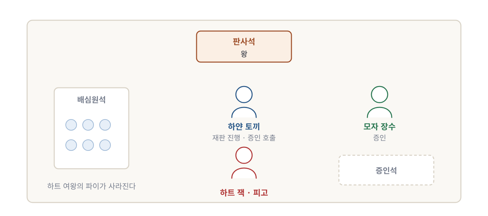

*『이상한 나라의 앨리스』 속 재판에 참여하는 인물들. 각자 법정에서 맡은 자리가 다르다*

**한 줄 정리** 앨리스 속 재판은 목표, 요청과 응답, 각자의 자리가 모두 있는 협력의 예다.

### 4.1.3 재판 속의 협력

**요지** 재판은 왕, 하얀 토끼, 모자 장수가 요청과 응답을 주고받으며 진행되고, 각자 받은 요청이 곧 그의 책임이다.

재판이 진행되는 순서를 따라가 보면 협력이 어떻게 이루어지는지 보인다.

먼저 **왕이 하얀 토끼에게 증인을 부르라고 요청한다.** 재판을 진행하려면 증언이 필요하고, 증인을 부르는 일은 토끼가 맡고 있기 때문이다.

- 요청을 받은 **토끼는 모자 장수에게 증인석에 입장하라고 요청한다.** 토끼 혼자 증언을 만들어 낼 수는 없으니, 다시 증인에게 요청하는 것이다.
- **모자 장수는 입장함으로써 토끼의 요청에 응답한다.**

모자 장수가 입장하면 **왕은 모자 장수에게 증언하라고 요청한다.** **모자 장수는 자신이 알고 있는 것을 증언함으로써 응답한다.** 이렇게 요청과 응답이 차례로 이어지면서 재판이라는 하나의 목표가 이루어진다.

**누가 무엇을 책임지는가** 여기서 각 인물이 무엇을 책임지는지는 그가 **받은 요청**으로 정해진다.

- 토끼는 '증인을 불러라'는 요청을 받았으므로 증인을 부를 책임이 있다.
- 모자 장수는 '입장하라'와 '증언하라'를 받았으므로 입장할 책임과 증언할 책임이 있다.
- 요청을 받지 않은 일은 그의 책임이 아니다.

저자는 이 관찰을 객체에 그대로 옮긴다. 객체도 다른 객체로부터 요청을 받으면 그 요청을 처리할 책임을 진다. 그리고 객체가 처리할 수 있는 요청의 목록이 곧 그 객체의 책임 목록이 된다.

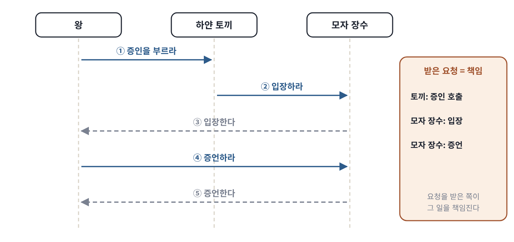

*재판 협력의 순서. 실선은 요청, 점선은 응답이며, 요청을 받은 쪽이 그 일에 대한 책임을 진다*

#### 보충

**재판 협력을 코드로 옮기기** 아래 코드에서 볼 것은 각 클래스가 가진 메서드가 바로 그 객체가 '받는 요청'이라는 점이다.

```java
class King {
    private final WhiteRabbit rabbit;

    void holdTrial() {
        Witness witness = rabbit.callWitness("모자 장수");   // ① 토끼에게 증인을 부르라고 요청
        Testimony testimony = witness.testify();             // ④ 증인에게 증언하라고 요청
        judge(testimony);
    }
}

class WhiteRabbit {
    private final Map<String, Witness> witnesses;            // 증인 명단을 앎

    Witness callWitness(String name) {                       // ② 받은 요청 = 토끼의 책임
        Witness witness = witnesses.get(name);
        witness.enter();                                     // ③ 증인에게 입장하라고 요청
        return witness;
    }
}

class Hatter {
    void enter() { ... }                                     // ③ 받은 요청 = 모자 장수의 책임
    Testimony testify() { ... }                              // ④ 받은 요청 = 모자 장수의 책임
}
```

1. ①에서 왕은 토끼에게 증인을 부르라고 요청한다. 왕은 토끼가 증인을 어떻게 찾는지 모른다.
2. ②의 `callWitness`가 토끼가 받은 요청이고, 그대로 토끼의 책임이 된다.
3. ③에서 토끼는 다시 증인에게 입장하라고 요청한다. 요청이 연쇄되는 지점이다. `enter`는 모자 장수의 책임이 된다.
4. ④에서 왕은 증인에게 직접 증언을 요청하고, 증언(`Testimony`)이 응답으로 돌아온다.

각 클래스의 공개 메서드 목록을 보면 그 객체가 협력에서 무슨 일을 책임지는지 바로 알 수 있다. 반대로 아무도 보내지 않는 메시지를 처리하는 메서드가 있다면, 그 메서드는 어떤 협력에도 쓰이지 않는 책임이라는 뜻이다.

**한 줄 정리** 재판은 요청과 응답의 연쇄로 진행되고, 각 인물이 받은 요청이 곧 그의 책임이다.

**논의해 보기**

Q. 하얀 토끼가 '증인을 부르라'는 요청을 받고, 직접 증언까지 해 버린다면 무엇이 문제일까?

> **답** 토끼가 자기 책임이 아닌 일을 떠맡은 것이고, 그 일에 필요한 지식(증인이 본 것)도 없으므로 협력이 틀린 결과를 낸다.
>
> 증언에 필요한 것은 사건을 직접 보고 들은 기억이다.
>
> - 그 기억은 모자 장수가 가지고 있고, 토끼에게는 없다.
> - 토끼가 증언을 대신하면 모르는 것을 지어내거나, 모자 장수에게 하나하나 물어 받아 적어야 한다.
> - 앞의 경우는 틀린 결과가 나오고, 뒤의 경우는 토끼가 모자 장수의 안쪽 사정을 모두 알아야 한다.
>
> 코드로 말하면 `WhiteRabbit`이 `hatter.getMemory()`로 기억을 꺼내 직접 증언문을 만드는 모습이다. 증언하는 방법이 바뀌면 토끼까지 고쳐야 하고, 증인이 바뀌면 토끼가 새 증인의 안쪽까지 알아야 한다.
>
> 그래서 책임은 그 일을 하는 데 필요한 정보를 가진 쪽에 두어야 한다. 이것을 정보 전문가 원칙이라고 하며 4.2.1 보충에서 다룬다.

---


## 4.2 책임

> **이 절의 맥락** 4.1에서 '요청을 받은 쪽은 그 일에 대한 책임을 진다'고 했다. 4.2는 그 책임이 정확히 무엇인지 정의하고, 책임을 두 종류로 나누며, 책임과 메시지가 어떻게 다른지 설명한다.

**요지** 협력에 참여하는 객체는 목표를 달성하는 데 필요한 책임을 수행하며, 책임은 객체가 바깥에 제공하는 정보와 서비스의 목록, 즉 공용 인터페이스가 된다.

**협력은 책임으로 이루어진다.** 협력에 참여하는 객체들은 목표를 달성하는 데 필요한 **책임**(responsibility)을 수행한다. 4.1.3에서 토끼가 증인을 부르고 모자 장수가 증언한 것처럼, 객체가 다른 객체의 요청에 응답할 수 있는 것은 그 요청을 처리할 책임을 가지고 있기 때문이다.

**책임이 설계 품질을 정한다.** 저자는 '객체지향 설계의 예술은 적절한 객체에게 적절한 책임을 할당하는 데 있다'고 말한다.

- 책임이 알맞게 나뉘면 객체가 작고 이해하기 쉬워지며, 한 곳을 고쳐도 다른 곳이 흔들리지 않는다.
- 반대로 저자는 '책임이 불분명한 객체들은 애플리케이션의 미래 역시 불분명하게 만든다'고 경고한다.
- 무엇을 고칠 때 어디가 바뀔지 예측할 수 없게 되기 때문이다.

이 절은 두 부분으로 나뉜다. 4.2.1은 책임이 무엇으로 이루어지는지를, 4.2.2는 책임을 요청하는 수단인 메시지와 책임이 어떻게 다른지를 다룬다.

### 4.2.1 책임의 분류

**요지** 책임은 객체가 무엇을 알고 있는가(아는 것)와 무엇을 할 수 있는가(하는 것)로 이루어지며, 바깥에서 보면 객체의 공용 인터페이스가 된다.

**책임의 정의** 저자는 책임을 '객체에 의해 정의되는 응집도 있는 행위의 집합으로, 객체가 알아야 하는 정보와 객체가 수행할 수 있는 행위에 대해 개략적으로 서술한 문장'이라고 정의한다. 여기서 눈여겨볼 단어는 세 가지다.

**응집도 있는**은 서로 관련 있는 행위끼리 묶여 있어야 한다는 뜻이다.

- 증인의 책임에 '입장한다'와 '증언한다'가 함께 있는 것은 자연스럽지만, '판결한다'가 섞여 있으면 응집도가 낮다.
- **알아야 하는 정보와 수행할 수 있는 행위**는 책임이 두 측면을 가진다는 뜻이고, 바로 아래에서 '아는 것'과 '하는 것'으로 나눈다.
- **개략적으로 서술한 문장**은 책임이 아직 메서드 이름이나 파라미터가 아니라 '증인을 불러 재판을 진행한다' 같은 문장 수준이라는 뜻이다.
- 이 점이 4.2.2의 '책임과 메시지는 수준이 다르다'로 이어진다.

**아는 것과 하는 것** 그래서 객체의 책임은 **무엇을 알고 있는가**와 **무엇을 할 수 있는가**로 구성된다. 저자는 크레이그 라만의 분류를 빌려 이를 **아는 것**(knowing)과 **하는 것**(doing)으로 나눈다.

**하는 것**은 다시 세 가지다.

- 객체를 만들거나 계산을 하는 것처럼 **스스로 하는 것**, 다른 객체에게 일을 시켜 **다른 객체의 행동을 시작시키는 것**, 여러 객체의 일을 **제어하고 조정하는 것**이다.
- 재판에서 모자 장수가 증언하는 것은 스스로 하는 것이고, 왕이 토끼에게 증인을 부르게 하는 것은 다른 객체의 행동을 시작시키는 것이며, 토끼가 재판 순서를 진행하는 것은 제어하고 조정하는 것이다.

**아는 것**도 세 가지다. 자기 자신에 관한 **개인적인 정보**를 아는 것, 함께 일하는 **관련된 객체**를 아는 것, 자신이 **계산하거나 유도할 수 있는 것**을 아는 것이다. 모자 장수는 자신이 본 것을 알고, 토끼는 증인이 누구인지 알며, 판사는 증언을 모아 판결을 낼 수 있다.

**왜 '아는 것'도 책임인가** 처음에는 '아는 것'이 책임이라는 말이 어색할 수 있다.

- 그러나 협력에서는 '누가 그 정보를 알고 있어야 하는가'가 매우 중요한 결정이다.
- 증인 명단을 토끼가 알기로 정하면, 왕은 명단을 몰라도 되고 토끼에게 부탁만 하면 된다.
- 무엇을 누가 알아야 하는지를 정하는 것이 곧 책임을 나누는 일인 것이다.
- 그리고 2장에서 보았듯 객체는 상태(아는 것)와 행동(하는 것)을 함께 가지므로, 책임도 이 두 측면을 함께 가진다.

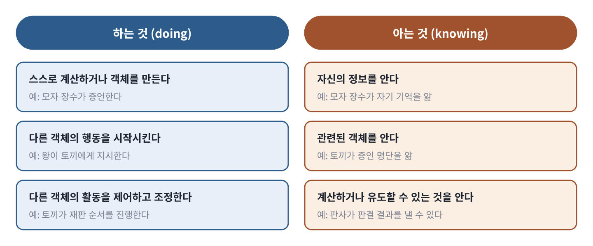

*크레이그 라만은 책임을 하는 것과 아는 것으로 나눈다. 재판 인물들의 책임도 이 두 갈래로 정리된다*

**책임은 공용 인터페이스가 된다.** 객체의 책임을 이야기할 때는 일반적으로 **외부에서 접근 가능한 공용 서비스**의 관점에서 이야기한다. 책임은 객체가 바깥에 제공할 수 있는 정보(아는 것)와 서비스(하는 것)의 목록이고, 그래서 책임은 객체의 **공용 인터페이스**(public interface)를 구성한다.

책임은 객체가 무엇을 해 줄 수 있는지를 말할 뿐, 그 일을 어떻게 하는지는 말하지 않는다.

- 모자 장수가 증언할 책임을 진다고 할 때, 그가 기억을 어떻게 떠올리는지는 책임에 포함되지 않는다.
- 협력 상대는 공용 인터페이스만 알면 되고 안쪽은 몰라도 된다.
- 2장에서 본 캡슐화가 책임의 관점에서 다시 나타나는 것이다.

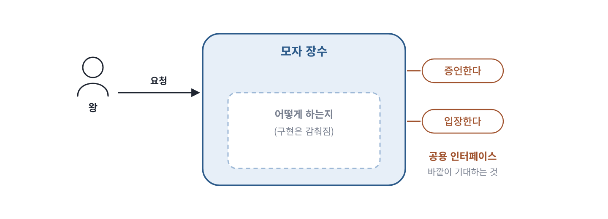

*책임은 객체가 바깥에 약속한 일이고, 그 일을 어떻게 하는지는 감춰진다. 책임의 목록이 곧 공용 인터페이스가 된다*

#### 보충

**아는 것과 하는 것은 함께 다님: 정보 전문가** 책임을 누구에게 맡길지 정하는 대표적인 기준은 **그 책임을 수행하는 데 필요한 정보를 가장 많이 아는 객체에게 맡기는 것**이다.

- 라만은 이를 **정보 전문가**(Information Expert)라고 불렀다.
- '아는 것'을 가진 객체에게 그 정보에 관한 '하는 것'을 맡기라는 뜻이다.

아래 두 코드에서 볼 것은 '증인 명단에서 증인을 찾는' 일을 누가 하느냐다.

```java
// 정보를 가진 쪽이 아닌 객체가 일을 하는 경우
class King {
    void holdTrial(WhiteRabbit rabbit) {
        Map<String, Witness> list = rabbit.getWitnesses();   // ① 토끼의 정보를 꺼내 옴
        Witness w = list.get("모자 장수");                    // ② 왕이 직접 찾음
        w.enter();                                           // ③ 왕이 직접 입장시킴
    }
}

// 정보를 가진 쪽이 일을 하는 경우
class King {
    void holdTrial(WhiteRabbit rabbit) {
        Witness w = rabbit.callWitness("모자 장수");          // ④ 토끼에게 맡김
    }
}
```

1. ①에서 왕은 토끼가 가진 명단을 통째로 꺼내 온다. 이제 왕은 명단이 `Map`으로 되어 있다는 것까지 알아야 한다.
2. ②와 ③에서 왕이 직접 증인을 찾고 입장시킨다. 토끼는 명단만 들고 있는 상자가 된다.
3. ④에서는 명단을 아는 토끼에게 일을 맡긴다. 명단을 어떻게 보관하든, 증인을 어떤 순서로 부르든 왕은 몰라도 된다.

명단의 저장 방식이 바뀌면 앞쪽은 왕까지 고쳐야 하고, 뒤쪽은 토끼만 고치면 된다. 아는 것과 하는 것을 같은 객체에 두는 것이 캡슐화와 낮은 결합도로 이어진다.

**'아는 것'이 꼭 필드일 필요는 없음** 판사가 '판결을 낼 수 있다'는 것은 판결 결과를 필드로 저장하고 있다는 뜻이 아니다.

- 증언을 모아 그때그때 계산할 수 있다는 뜻이다.
- 이처럼 아는 것에는 저장된 값뿐 아니라 계산해서 알 수 있는 것도 포함된다.
- 그래서 아는 것을 책임으로 정할 때는 '어떤 필드를 둘까'가 아니라 '누가 이 질문에 답할 수 있어야 하나'를 먼저 물어야 한다.

**한 줄 정리** 책임 = 하는 것(스스로 함, 시킴, 조정함) + 아는 것(자기 정보, 관련 객체, 계산할 수 있는 것). 아는 객체에게 그에 관한 일도 맡긴다.

### 4.2.2 책임과 메시지

**요지** 책임은 메시지보다 추상적이고 넓은 개념이며, 설계가 진행되면서 메시지로 구체화된다.

**메시지 전송** 객체가 다른 객체에게 주어진 책임을 수행하도록 요청을 보내는 것을 **메시지 전송**(message-send)이라고 한다.

- 메시지를 보내는 객체를 **송신자**(sender), 메시지를 받는 객체를 **수신자**(receiver)라고 부른다.
- 재판에서 왕이 토끼에게 '증인을 불러라'라고 하면, 왕이 송신자이고 토끼가 수신자다.
- 협력은 송신자가 메시지를 보내면서 시작되고, 수신자는 자신의 책임을 수행함으로써 응답한다.
- 그래서 객체가 받을 수 있는 메시지의 목록은 그 객체가 가진 책임과 연결된다.

**주의할 점: 책임과 메시지의 수준은 같지 않는다.** 저자는 책임과 메시지가 일대일로 대응하는 것처럼 오해하지 말라고 강조한다.

- 책임은 '증인을 불러 재판을 진행한다'처럼 객체가 해야 할 일을 넓게 말한다.
- 메시지는 `callWitness(name)`처럼 그 일을 요청하는 구체적인 형식이다.
- 책임 하나가 여러 개의 메시지로 나뉠 수도 있다.
- '증언한다'는 책임이 `enter()`와 `testify()` 두 메시지로 나뉘는 식이다.

**책임을 먼저, 메시지는 나중에** 저자는 설계를 시작할 때는 책임에 집중하라고 말한다.

- 책임은 아직 메서드 이름이나 파라미터를 정하지 않은 상태라서, 이리저리 옮기고 나누고 합치기 쉽다.
- 협력의 모양이 어느 정도 잡히면 그때 책임을 구체적인 메시지로 바꾸고, 마지막으로 그 메시지를 처리할 메서드를 구현한다.
- 추상적인 것에서 구체적인 것으로 내려가는 순서다.

메시지와 그 메시지를 처리하는 메서드의 관계는 5장 '책임과 메시지'에서 자세히 다룬다.

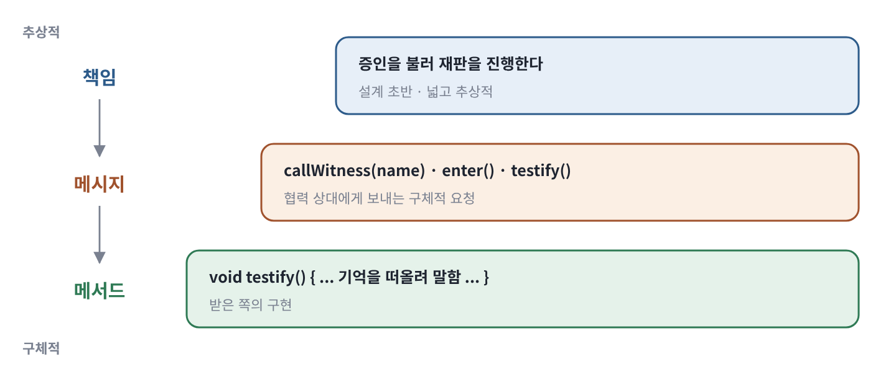

*책임은 가장 넓은 단위이고, 설계가 진행되면 협력 상대에게 보낼 메시지로 구체화되며, 마지막에 메서드로 구현된다*

#### 보충

**책임이 메시지가 되는 과정을 따라가 보기** 아래는 설계가 진행되면서 같은 내용이 어떻게 바뀌는지를 순서대로 적은 것이다.

```text
① 책임 (설계 초반, 문장으로)
   - 토끼: 증인을 불러 재판을 진행한다
   - 증인: 법정에 들어와 증언한다

② 메시지 (협력이 잡힌 뒤, 요청의 형식으로)
   - rabbit.callWitness(name)
   - witness.enter()
   - witness.testify()

③ 메서드 (구현 단계, 받은 쪽의 코드로)
   - Hatter.testify() { 기억을 떠올려 증언문을 만든다 }
   - Cook.testify()   { 후추 이야기만 반복한다 }
```

1. ①에서는 아직 이름도 파라미터도 정하지 않고, 누가 무엇을 하는지만 문장으로 적는다. 이 단계에서는 책임을 다른 객체로 옮기는 비용이 거의 없다.
2. ②에서 책임을 협력 상대에게 보낼 요청의 형식으로 바꾼다. '증언한다'는 책임 하나가 `enter`와 `testify` 두 메시지로 나뉜다.
3. ③에서 메시지를 받은 객체가 저마다의 방식으로 구현한다. 같은 `testify` 메시지라도 모자 장수와 요리사의 메서드는 다르다. 3장에서 본 다형성이다.

**메서드부터 정하면 생기는 일** 처음부터 메서드 이름과 파라미터를 정하면, 그 메서드를 다른 객체로 옮기기가 부담스러워진다.

- 이미 여러 곳에서 부르고 있거나 테스트가 붙어 있기 때문이다.
- 그래서 잘못 놓인 책임이 그대로 굳기 쉽다.
- CRC 카드(1장 1.2.2)가 메서드가 아니라 책임을 문장으로 적게 한 것도 이 때문이다.

**한 줄 정리** 책임은 넓고 추상적이며, 설계가 진행되면서 메시지로, 다시 메서드로 구체화된다. 처음에는 책임에 집중한다.

**논의해 보기**

Q1. '아는 것'을 책임으로 볼 때, getter를 만드는 것과는 무엇이 다를까?

> **답** getter는 '내 필드를 꺼내 가라'는 것이고, 아는 책임은 '내가 알고 있으니 나에게 물어보라, 대신 그 정보로 할 일도 내가 한다'는 것이다.
>
> `rabbit.getWitnesses()`는 토끼가 명단을 가지고 있다는 사실과 그 저장 방식까지 바깥에 드러낸다. 그러면 명단으로 하는 일(증인 찾기, 입장시키기)이 바깥으로 빠져나간다. 토끼는 아는 것만 있고 하는 것은 없는 객체가 된다.
>
> 반면 '토끼는 증인 명단을 안다'를 책임으로 정하면, 그 지식이 필요한 요청(`callWitness`)을 토끼가 받게 된다. 바깥은 토끼가 명단을 가지고 있는지조차 몰라도 되고, 결과(입장한 증인)만 받는다.
>
> 물론 모든 조회가 나쁜 것은 아니다. 판결 결과처럼 바깥이 정말로 알아야 하는 값은 쿼리 메서드로 알려 준다(2장 2.4). 기준은 '그 값을 꺼내 간 쪽이 그 값으로 판단을 하는가'이다. 판단을 한다면 그 판단은 값을 가진 객체로 옮기는 것이 좋다.

Q2. 책임 하나가 메시지 여러 개로 나뉘는 예와, 메시지 하나가 책임 여러 개에 걸치는 예를 각각 떠올려 보자.

> **답** '주문한다'는 책임은 `addItem`, `applyCoupon`, `place` 같은 여러 메시지로 나뉘고, 반대로 `place()` 하나가 '금액 확정'과 '재고 확인' 같은 여러 책임에 걸칠 수도 있다.
>
> 앞의 경우는 자연스러운 구체화다. 넓은 책임을 협력 상대와 주고받을 구체적인 요청으로 쪼갠 것이기 때문이다.
>
> 뒤의 경우는 주의가 필요하다. `place()`가 금액을 확정하고, 재고를 줄이고, 결제까지 요청한다면, 하나의 메시지가 서로 다른 이유로 바뀌는 여러 책임을 품은 것이다. 재고 규칙이 바뀌어도, 결제 방식이 바뀌어도 `place()`를 고쳐야 한다.
>
> 이럴 때는 메시지는 하나로 두되, 그 안에서 각 책임을 알맞은 객체에게 다시 요청하는 것이 좋다. 주문은 금액만 확정하고, 재고 확인은 재고에게, 결제는 결제 객체에게 메시지를 보내는 식이다. 책임은 나누고 협력으로 잇는 것이다.

---

## 4.3 역할

> **이 절의 맥락** 4장에서 가장 중요한 절이다. 4.2에서 정의한 책임을 묶어 역할을 만들고, 역할이 왜 '재사용 가능하고 유연한 설계'의 열쇠인지 재판의 판사와 증인으로 설명한다. 3장의 타입, 2장 논쟁 ⑦의 의존 역전과도 이어진다.

### 4.3.1 책임의 집합이 의미하는 것

**요지** 역할은 객체가 협력 안에서 맡는 책임의 묶음이며, 여러 객체가 같은 역할을 맡을 수 있다.

**역할이란 무엇인가** 어떤 객체가 협력에 참여하면서 수행하는 책임의 집합을 **역할**(role)이라고 한다. 재판에서 모자 장수가 수행한 책임은 '입장한다'와 '증언한다'였다. 이 두 책임을 묶어 부르는 이름이 '증인'이고, 이것이 모자 장수가 재판에서 맡은 역할이다.

**역할은 협력 속의 자리다.** 역할은 특정한 객체가 아니라 협력 안에 뚫린 자리와 같다.

- 이 자리는 '이런 책임을 수행할 수 있는 누군가가 필요하다'는 요구만 담고 있다.
- 그래서 그 책임을 수행할 수 있는 객체라면 누구든 이 자리에 들어갈 수 있다.
- 저자는 역할을 다양한 종류의 객체를 끼울 수 있는 일종의 **슬롯**(slot)이라고 표현한다.

**역할이 중요한 이유** 저자는 역할이 '재사용 가능하고 유연한 객체지향 설계를 낳는 매우 중요한 구성 요소'라고 말한다.

- 협력을 특정 객체가 아니라 역할로 정의해 두면, 같은 협력을 다른 객체들로 다시 쓸 수 있고, 객체를 바꿔 끼워도 협력이 깨지지 않기 때문이다.
- 다음 목들이 이 주장을 재판 예로 하나씩 보여 준다.

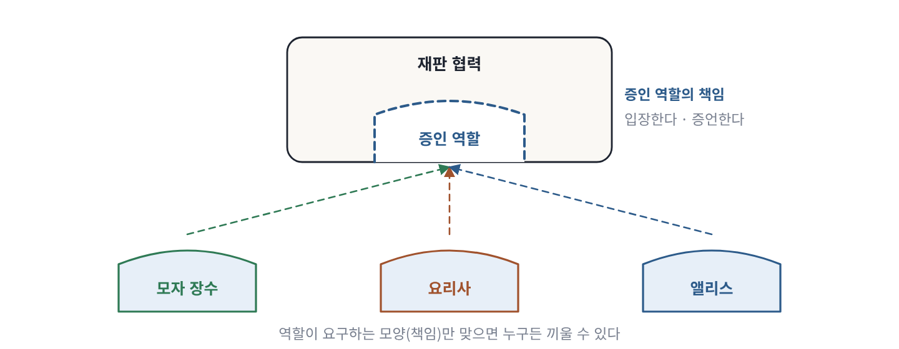

*역할은 협력 안에 뚫린 자리(슬롯)와 같다. 그 자리가 요구하는 책임만 수행할 수 있으면 어떤 객체든 들어갈 수 있다*

**한 줄 정리** 역할 = 협력 안에서 객체가 맡는 책임의 묶음. 그 책임만 수행할 수 있으면 누구든 들어갈 수 있는 자리다.

### 4.3.2 판사와 증인

**요지** 재판마다 판사와 증인을 맡는 인물은 달라도, 판사가 증인에게 증언을 요청하는 협력의 모양은 같다.

『이상한 나라의 앨리스』의 재판에서 증인은 한 명이 아니다. 모자 장수가 증언한 뒤에는 공작부인의 요리사가 불려 나오고, 마지막에는 앨리스까지 증인석에 선다. 판사 자리도 마찬가지로 왕이 아니라 여왕이 맡는 경우를 생각해 볼 수 있다.

여기서 저자가 주목하는 것은 **바뀌는 것과 바뀌지 않는 것**이다. 판사를 맡은 인물과 증인으로 나온 인물은 재판마다 다르다. 그러나 '판사가 증인에게 증언을 요청하고, 증인이 증언으로 응답한다'는 협력의 모양은 매번 똑같다. 판사가 하는 일과 증인이 하는 일, 즉 각 자리의 책임도 그대로다.

사람은 바뀌어도 자리와 책임은 그대로라는 것. 이 바뀌지 않는 부분을 따로 떼어 이름을 붙인 것이 '판사'와 '증인'이라는 역할이다.

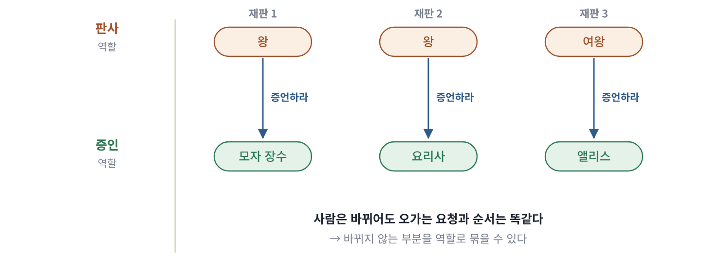

*판사와 증인을 맡은 인물은 재판마다 달라도, 판사가 증인에게 증언을 요청하는 협력의 모양은 같다*

**한 줄 정리** 재판마다 인물은 바뀌지만 판사와 증인 사이의 협력과 책임은 그대로다. 이 바뀌지 않는 부분이 역할이다.

### 4.3.3 역할이 답이다

**요지** 역할을 쓰면 인물마다 협력을 따로 정의하지 않고, 하나의 협력으로 여러 경우를 표현할 수 있다.

**역할이 없다면** 4.3.2의 재판을 인물 단위로만 설명한다고 해 보자. 왕이 모자 장수를 심문하는 협력, 왕이 요리사를 심문하는 협력, 왕이 앨리스를 심문하는 협력을 각각 따로 설명해야 한다.

- 판사가 여왕인 경우까지 더하면 판사 둘과 증인 셋의 조합만큼, 즉 여섯 개의 협력이 생긴다.
- 그런데 여섯 개 모두 내용은 같다.
- 같은 이야기를 이름만 바꿔 여섯 번 반복하는 셈이다.

**역할로 묶으면** '판사가 증인에게 증언을 요청한다'는 협력 하나로 충분하다.

- 판사 자리에는 왕이든 여왕이든, 증인 자리에는 모자 장수든 요리사든 앨리스든 들어갈 수 있다.
- 저자는 이것을 '역할이 답이다'라고 표현한다.
- 역할을 쓰면 **협력이 단순해지고**, 같은 협력을 여러 객체로 **다시 쓸 수 있다**.

**역할의 세 가지 가치** 저자의 정리를 요약하면 역할은 세 가지 이점을 준다.

- 첫째, 유사한 협력을 하나로 추상화해 설계자의 **인지 과부하를 줄인다**(단순성).
- 둘째, 다양한 객체가 같은 협력에 참여할 수 있으므로 협력이 **유연해진다**(유연성).
- 셋째, 한 번 정의한 협력을 여러 객체 조합에 다시 쓸 수 있으므로 **재사용성이 높아진다**(재사용성).
- 그래서 저자는 역할을 객체지향 설계의 단순성, 유연성, 재사용성을 뒷받침하는 핵심 개념이라고 말한다.

**역할은 '대신할 수 있다'는 표식이다.** 저자는 역할을 협력 안에서 **다른 객체로 대체할 수 있음을 나타내는 일종의 표식**이라고 설명한다.

- 협력 그림의 어떤 자리에 '증인'이라는 역할 이름이 붙어 있다는 것은, '이 자리는 증인 역할을 수행할 수 있는 어떤 객체라도 대신할 수 있다'는 뜻이다.
- 역할 이름이 붙지 않고 '모자 장수'라는 특정 인물 이름만 있다면, 그 자리는 모자 장수만 설 수 있는 자리로 읽힌다.

**설계에서도 같다.** 객체지향 설계에서 비슷한 책임을 가진 객체들이 같은 협력에 참여한다면, 그 객체들을 하나하나 다루지 말고 공통의 역할로 묶어 협력을 정의하는 것이 좋다. 코드에서 이 역할은 보통 인터페이스나 추상 클래스로 표현된다.

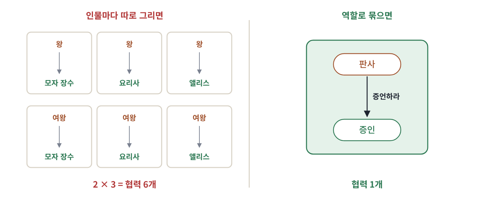

*인물마다 협력을 따로 정의하면 조합 수만큼 늘어나지만, 역할로 묶으면 하나의 협력으로 충분하다*

#### 보충

**역할을 코드로 표현하기** 아래 코드에서 볼 것은 판사가 구체적인 인물 이름(`Hatter`, `Cook`)을 한 번도 쓰지 않는다는 점이다.

```java
interface Witness {                          // ① 증인 역할: 책임만 정의함
    void enter();
    Testimony testify();
}

interface Judge {                            // ① 판사 역할
    Verdict hearCase(Witness witness);
}

class Hatter implements Witness { ... }      // ② 증인 역할을 맡은 객체들
class Cook   implements Witness { ... }
class Alice  implements Witness { ... }

class King implements Judge {                // ③ 판사 역할을 맡은 객체
    public Verdict hearCase(Witness witness) {
        Testimony t = witness.testify();     // ④ 역할에게만 요청함
        return decide(t);
    }
}
```

1. ①의 `Witness`와 `Judge`는 역할이다. 어떤 책임이 필요한지만 적고, 누가 맡을지는 적지 않는다.
2. ②의 세 클래스는 증인 역할을 맡은 객체들인다. 각자 자기 방식으로 `testify`를 구현한다.
3. ③의 `King`은 판사 역할을 맡는다. 여왕도 `Judge`를 구현하면 같은 자리에 들어갈 수 있다.
4. ④에서 판사는 `Witness` 역할에게만 요청한다. 증인이 누구인지 몰라도 되므로, 판사 둘과 증인 셋의 조합이 이 코드 하나로 모두 표현된다.

**역할은 인터페이스만이 아님** Java에서는 인터페이스가 역할을 표현하는 가장 흔한 방법이지만, 추상 클래스로도 표현할 수 있고, 함수형 인터페이스(람다)로도 표현할 수 있다.

- Go나 TypeScript처럼 구조적 타이핑을 쓰는 언어에서는 메서드 모양만 맞으면 따로 선언하지 않아도 같은 역할로 취급된다(3장 3.3.4 보충).
- 중요한 것은 문법이 아니라 '이 협력에 필요한 책임은 무엇인가'를 먼저 정하는 생각이다.

**한 줄 정리** 역할로 협력을 정의하면 인물 조합마다 협력을 따로 만들 필요가 없어, 협력이 단순해지고 다시 쓸 수 있게 된다.

### 4.3.4 협력의 추상화

**요지** 역할의 가장 큰 가치는 하나의 협력 안에 여러 종류의 객체가 참여할 수 있게 해 협력을 추상화한다는 것이다. 역할로 정의한 협력 하나가 여러 개의 구체적인 협력을 대표한다.

**추상화로서의 역할** 3장에서 추상화는 불필요한 세부를 감추고 공통점에 집중하는 것이라고 했다. 역할은 협력을 추상화하는 도구다. '왕이 모자 장수에게 증언을 요청한다'에서 왕과 모자 장수라는 구체적인 인물을 감추고, '판사가 증인에게 증언을 요청한다'는 공통의 모양만 남긴 것이다.

**역할의 정의** 그래서 저자는 역할을 **협력 안에서 구체적인 객체로 대체될 수 있는 추상적인 개념**이라고 정의한다. 이 정의에서 바로 다음 절의 주제가 나온다. 역할이 '대체될 수 있는' 개념이라면, 역할은 본질적으로 **다른 객체에 의해 대체 가능함**을 의미한다는 것이다.

**두 수준의 협력** 그래서 협력은 두 수준으로 볼 수 있다. 위쪽은 역할 수준의 **추상적인 협력**(판사 ↔ 증인)이고, 아래쪽은 객체 수준의 **구체적인 협력**(왕 ↔ 모자 장수, 왕 ↔ 요리사, 여왕 ↔ 앨리스)이다. 추상적인 협력 하나가 여러 개의 구체적인 협력을 대표한다.

**설계자의 부담이 줄어듦.** 설계자는 구체적인 협력을 하나하나 생각하지 않고 추상적인 협력만 설계하면 된다.

- 새로운 증인이 등장해도 추상적인 협력은 바뀌지 않는다.
- 저자는 역할을 이용하면 협력을 추상화해 단순화할 수 있고, 구체적인 객체를 추상적인 역할로 대체해 협력의 양을 줄일 수 있다고 정리한다.

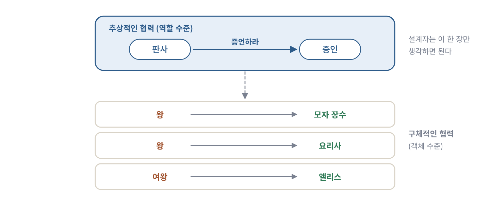

*역할로 정의한 추상적인 협력 하나가 여러 개의 구체적인 협력을 대표한다*

#### 보충

**프레임워크는 추상적인 협력을 미리 만들어 둔 것임** 스프링 같은 프레임워크는 '요청이 들어오면 컨트롤러가 처리하고, 결과를 뷰가 그린다'는 추상적인 협력을 미리 만들어 둔다.

- 개발자는 컨트롤러 역할을 맡을 객체를 끼워 넣기만 하면 된다.
- 수많은 서비스가 같은 프레임워크 위에서 서로 다른 일을 하는 것은, 추상적인 협력은 같고 그 자리를 채운 객체만 다르기 때문이다.

**추상 협력은 테스트에도 이로움** 판사 역할이 `Witness` 역할에만 의존하므로, 테스트에서는 미리 정해진 증언만 돌려주는 가짜 증인을 넣을 수 있다. 진짜 모자 장수를 준비하지 않아도 판사의 판결 로직을 확인할 수 있다. 이 내용은 4.5.3에서 다시 다룬다.

**한 줄 정리** 역할 수준의 추상적인 협력 하나가 여러 구체적인 협력을 대표하므로, 설계자는 추상적인 협력만 설계하면 된다.

### 4.3.5 대체 가능성

**요지** 역할은 대체 가능성을 뜻하며, 객체는 역할이 요구하는 책임 이상을 가질 수 있다.

**대체 가능성** 역할은 협력 안에서 다른 객체로 바뀔 수 있는 자리다. 그래서 역할은 **대체 가능성**(substitutability)을 뜻한다. 증인 역할에는 모자 장수 대신 요리사나 앨리스가 들어갈 수 있고, 판사 역할에는 왕 대신 여왕이 들어갈 수 있다.

**자격은 책임으로 정해진다.** 객체가 어떤 역할을 대신하려면, 그 역할이 요구하는 책임을 모두 수행할 수 있어야 한다.

- 증인 역할을 맡으려면 입장할 수 있고 증언할 수 있어야 한다.
- 증언할 줄 모르는 객체는 증인 자리에 들어갈 수 없다.
- 저자의 말로 정리하면, 역할의 대체 가능성은 **행위 호환성**을 의미하고, 행위 호환성은 **동일한 책임의 수행**을 의미한다.
- 즉 '대신할 수 있다'는 것은 '같은 요청에 같은 책임을 다한다'는 것이다.
- 1장에서 본 리스코프 치환 원칙, 3장에서 본 행위적 호환성이 같은 이야기다.

**객체는 역할보다 더 많은 것을 가질 수 있다.** 반대로 객체가 역할이 요구하는 것보다 더 많은 책임을 가지는 것은 문제가 되지 않는다.

- 앨리스는 증인으로서 입장하고 증언할 수 있을 뿐 아니라, 몸 크기를 바꾸고 문을 통과하고 토끼를 쫓을 수도 있다.
- 그러나 재판 협력은 그 책임들을 보지 않는다.
- 재판에서 앨리스는 오직 증인일 뿐이다.

**역할과 객체의 타입은 일반화와 특수화의 관계다.** 객체가 역할이 암시하는 책임보다 더 많은 책임을 가질 수 있기 때문에, 저자는 대부분의 경우 객체의 타입과 역할 사이에 일반화/특수화 관계가 성립한다고 정리한다(3장의 언어).

- 일반적인 개념을 뜻하는 **역할은 일반화**이고, 좀 더 구체적인 개념을 뜻하는 **객체의 타입은 특수화**이다.
- '증인'이 일반화라면 '증인이면서 모험도 하는 앨리스'는 특수화인 셈이다.

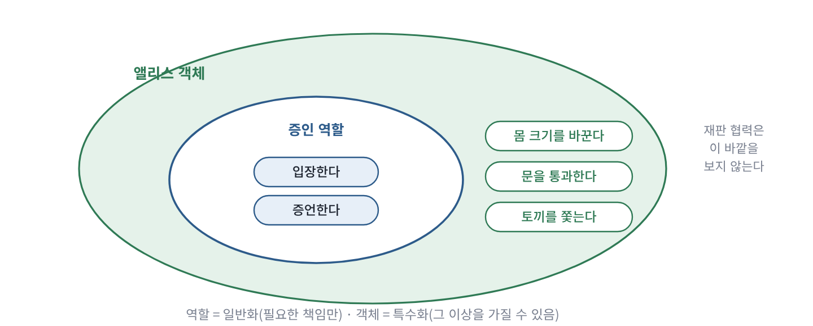

*객체는 역할이 요구하는 책임을 모두 가지면 그 역할을 맡을 수 있다. 그 밖의 책임을 더 가지고 있어도 상관없다*

#### 보충

**한 객체가 여러 역할을 맡는 코드** 아래 코드에서 볼 것은 같은 `alice` 객체가 협력에 따라 다른 역할로만 보인다는 점이다.

```java
class Alice implements Witness, Adventurer {     // ① 두 역할을 함께 맡음
    public void enter() { ... }
    public Testimony testify() { ... }           // 증인의 책임
    public void chaseRabbit() { ... }            // 모험가의 책임
    public void changeSize(int delta) { ... }
}

Alice alice = new Alice();
Verdict v = king.hearCase(alice);                // ② 재판에서는 Witness로만 보임
wonderland.explore(alice);                       // ③ 모험에서는 Adventurer로만 보임
```

1. ①의 `Alice`는 증인 역할과 모험가 역할을 함께 맡는다. 객체 하나가 여러 역할을 맡는 것은 자연스러운 일이다.
2. ②의 `hearCase`는 `Witness` 타입을 받으므로, 판사는 `testify`와 `enter`만 볼 수 있다. 앨리스가 토끼를 쫓을 수 있다는 사실은 판사에게 보이지 않는다.
3. ③의 모험 협력에서는 반대로 증언 능력이 보이지 않는다.

이렇게 협력마다 필요한 책임만 보여 주는 것이 인터페이스 분리 원칙(1장 1.1.3 보충)이고, 객체가 바뀌어도 협력 상대가 영향을 받지 않는 이유다.

**대체할 수 없는 경우** 어떤 증인이 `testify()`를 부르면 언제나 예외를 던진다면, 형식상 `Witness`를 구현했어도 증인 역할을 대신할 수 없다. 판사는 증언이 돌아오리라 기대하고 협력을 설계했기 때문이다. 대체 가능성은 메서드 이름이 아니라 책임을 지킬 때 생긴다.

**한 줄 정리** 역할은 대체 가능성을 뜻한다. 역할의 책임을 모두 수행하면 그 자리에 들어갈 수 있고, 그 이상의 책임을 가져도 된다. 역할은 일반화, 객체의 타입은 특수화다.

**논의해 보기**

Q1. 한 객체가 너무 많은 역할을 맡으면 어떤 문제가 생길까?

> **답** 고쳐야 하는 이유가 역할 수만큼 늘어나고, 한 역할을 위한 변경이 다른 역할을 쓰는 협력까지 흔들 수 있다.
>
> 앨리스가 증인, 모험가, 차 모임 손님, 크로케 선수 역할을 모두 맡는다고 한다.
>
> - 증언 방식을 바꾸려고 `Alice`를 고치면, 모험 협력과 크로케 협력에서 쓰는 코드까지 함께 다시 빌드하고 테스트해야 한다.
> - 또 한 역할에서 쓰는 상태(크기)를 다른 역할의 메서드가 바꾸면, 서로 모르는 협력끼리 얽힌다.
>
> 객체가 여러 역할을 맡는 것 자체는 자연스럽지만, 역할들이 서로 다른 이유로 바뀐다면 객체를 나누는 편이 낫다. 판단 기준은 1장의 단일 책임 원칙과 같다. '이 객체를 고쳐야 하는 이유가 몇 가지인가'를 물어보면 된다.

Q2. 역할과 3장의 타입은 같은 개념일까?

> **답** 거의 같은 자리를 차지한다. 역할은 협력의 관점에서 본 타입이고, 타입은 분류의 관점에서 본 역할이다.
>
> 3장에서 타입은 '같은 행동을 하는 객체들을 묶는 기준'이었다. 4장에서 역할은 '같은 책임을 수행하는 객체들이 들어갈 수 있는 자리'이다. 둘 다 행동(책임)으로 객체를 묶는다는 점에서 같다. 저자도 역할과 객체의 관계를 3장의 일반화와 특수화, 즉 슈퍼타입과 서브타입의 관계로 설명한다.
>
> 차이는 출발점에 있다.
>
> - 타입은 이미 있는 객체들을 보며 '이것들은 같은 종류다'라고 묶을 때 쓰는 말이고, 역할은 협력을 설계하며 '이 자리에는 이런 책임을 가진 누군가가 필요하다'고 정할 때 쓰는 말이다.
> - 그래서 설계할 때는 역할에서 출발하고, 그 역할이 코드에서는 타입(인터페이스)으로 나타난다고 이해하면 된다.

---


## 4.4 객체의 모양을 결정하는 협력

> **이 절의 맥락** 4.1~4.3에서 정의한 세 단어를 설계 순서로 엮는 절이다. 저자는 객체를 설계할 때 흔히 저지르는 오류를 짚고, 객체의 모양은 협력이 정한다는 결론을 내린다. 2장의 '행동이 상태를 결정한다'를 객체들 사이로 넓힌 이야기다.

### 4.4.1 흔한 오류

**요지** 객체를 데이터를 담는 그릇으로 보거나 클래스부터 설계하는 것은 흔한 오류이며, 객체가 존재하는 이유는 협력에 참여하기 위해서다.

**오류 하나: 객체를 데이터 그릇으로 본다.** 많은 사람이 시스템에 필요한 데이터를 저장하기 위해 객체가 존재한다는 **선입견**을 가지고 있다.

- 그래서 설계를 시작하면 '회원 객체에는 이름, 등급, 포인트가 있어야지'처럼 데이터부터 정한다.
- 물론 객체는 데이터를 가지고 있다.
- 그러나 저자는 그것이 객체가 존재하는 이유가 아니라고 말한다.
- 데이터는 객체가 행동하는 데 필요한 재료일 뿐이다.

**오류 둘: 클래스와 상속부터 그린다.** 또 다른 흔한 오류는 클래스 이름과 상속 관계부터 정하는 것이다.

- '판사와 증인은 둘 다 사람이니 `Person`을 부모로 두자'처럼 시작하는 것이다.
- 이렇게 정한 클래스 구조는 어떤 협력에 쓰일지 고려하지 않았기 때문에, 막상 협력을 만들어 보면 맞지 않는 경우가 많다.

**객체가 존재하는 이유는 협력이다.** 저자는 객체가 존재하는 이유가 협력에 참여하기 위해서라고 말한다.

- 객체는 협력에 필요한 행동을 제공하기 위해 존재하고, 데이터는 그 행동을 위해 필요한 만큼만 가진다.
- 그래서 객체의 행동, 즉 책임에 초점을 맞추려면 **협력이라는 실행 문맥 안에서** 책임을 나눠야 한다.

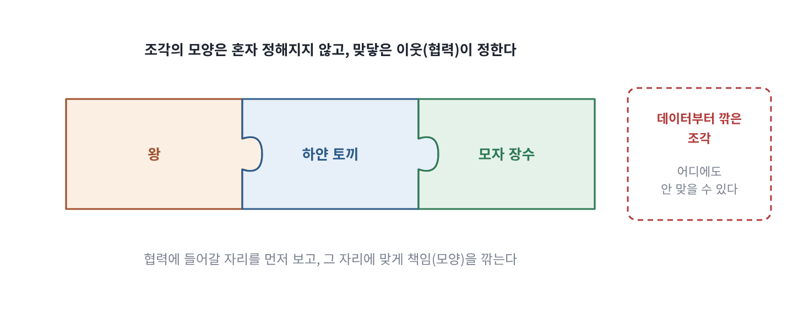

*객체의 모양은 협력이 결정한다. 협력을 보지 않고 데이터나 클래스부터 정하면 어느 협력에도 맞지 않는 객체가 나오기 쉽다*

#### 보충

**데이터부터 정한 객체와 협력부터 정한 객체** 아래 두 코드에서 볼 것은 필드가 '왜 있는지' 설명할 수 있느냐다.

```java
// 데이터부터 정한 경우
class Witness {
    String name;                   // ① 떠오르는 데이터를 모두 나열함
    int age;
    String address;
    List<String> memories;
    // getter, setter …            // ② 협력은 아직 정하지 않음
}

// 재판 협력부터 정한 경우
class Hatter implements Witness {
    private final Memory memory;   // ③ testify()에 필요해서 둠

    public void enter() { ... }    // ④ 받는 요청 1: 입장하라
    public Testimony testify() {   // ④ 받는 요청 2: 증언하라
        return memory.recall("파이");
    }
}
```

1. ①에서 증인에 대해 떠오르는 정보를 모두 필드로 만든다. 나이나 주소가 어떤 협력에 쓰일지는 아직 모른다.
2. ②에서 이 필드들을 getter와 setter로 열어 둔다. 증언을 만드는 판단은 바깥에서 하게 된다.
3. ③의 `memory`는 증언하려면 필요해서 생긴 필드다.
4. ④의 두 메서드는 재판 협력에서 받는 요청 그대로다. 나이나 주소는 이 협력에 필요 없으므로 아예 없다.

**상속부터 그린 클래스가 협력과 맞지 않는 경우** '판사와 증인은 둘 다 사람이니 `Person`을 부모로 둔다'고 정했는데, 나중에 증인으로 '녹음기'나 'CCTV 기록'이 나와야 한다면 이 구조는 맞지 않는다.

- 녹음기는 사람이 아니기 때문이다.
- 그러나 협력에서 출발해 '증인 역할 = 입장하고 증언할 수 있는 것'으로 정했다면, 녹음기도 그 역할을 맡을 수 있다.
- 협력이 요구하는 것은 '사람'이라는 분류가 아니라 '증언'이라는 책임이다.

**한 줄 정리** 객체는 데이터를 담으려고 존재하는 것이 아니라 협력에 참여하려고 존재한다. 데이터와 클래스 구조부터 정하는 것은 흔한 오류다.

### 4.4.2 협력을 따라 흐르는 객체의 책임

**요지** 협력을 먼저 설계하고, 협력에서 나온 책임을 객체에 할당한 뒤, 그 책임에 맞춰 객체의 구조를 정한다.

**설계의 순서** 저자가 권하는 순서는 이러하다.

- 먼저 시스템의 기능을 위해 어떤 **협력**이 필요한지 정한다.
- 협력이 정해지면 그 안에서 각 객체가 받을 요청, 즉 **책임**이 드러난다.
- 비슷한 책임을 묶어 **역할**을 만들고, 그 역할을 맡을 **객체**를 고른다.
- 객체의 데이터와 **클래스**는 이 책임을 수행하는 데 필요한 만큼만 마지막에 정한다.

**책임은 협력을 따라 흐른다.** 이 순서에서 책임은 위에서 아래로, 협력에서 객체로 흘러 내려간다.

- 객체가 먼저 있고 그 객체가 무엇을 할지 고민하는 것이 아니라, 협력이 먼저 있고 그 협력이 객체에게 할 일을 정해 주는 것이다.
- 저자는 이를 '객체의 모양을 빚는 것은 협력'이라고 표현한다.
- 같은 '앨리스'라도 재판 협력에서는 증인의 모양을, 모험 협력에서는 모험가의 모양을 가진다.

**좋은 협력이 좋은 객체를 만든다.** 그래서 객체 하나를 아무리 잘 다듬어도 협력이 나쁘면 좋은 설계가 되지 않는다. 반대로 협력이 잘 짜이면 각 객체의 책임이 분명해지고, 객체는 작고 응집도 높게 나뉜다. 저자는 협력을 먼저 설계하라는 말로 이 절을 마무리하다.

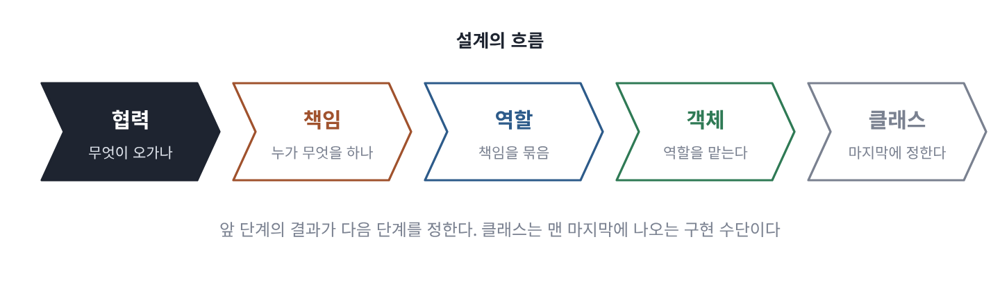

*협력을 먼저 정하면 책임이 나오고, 책임을 묶으면 역할이 되며, 역할을 맡을 객체와 클래스는 그다음에 정해진다*

#### 보충

**2장의 '행동이 상태를 결정한다'와의 관계** 2장은 객체 하나 안에서 '행동을 먼저 정하고, 상태는 그 행동에 맞춰 정한다'고 했다.

- 4장은 그 행동이 어디서 오는지 말해 준다.
- 행동(책임)은 협력에서 온다.
- 그래서 두 장을 이으면 <b>협력 → 행동(책임) → 상태(데이터)</b>라는 한 줄의 순서가 된다.

**실무에서 협력부터 그리는 방법** 기능 하나를 고르고, 화이트보드에 참여자를 가로로 세운 뒤, 누가 누구에게 어떤 요청을 보내는지 화살표로 그리는 것이 가장 쉬운 시작이다(시퀀스 다이어그램).

- 화살표가 다 그려지면 각 참여자가 받은 화살표가 그의 책임 목록이 된다.
- 그 목록을 CRC 카드에 옮기고, 마지막에 필드를 정한다.
- 이 과정에서 테이블에 없던 객체(할인 정책, 재시도 정책 등)가 자연스럽게 나오는 경우가 많다.

**한 줄 정리** 협력 → 책임 → 역할 → 객체 → 클래스 순서로 설계한다. 객체의 모양을 빚는 것은 협력이다.

**논의해 보기**

Q. '협력부터 설계하라'를 따르면, 데이터베이스 테이블은 언제 설계해야 할까?

> **답** 협력과 책임이 어느 정도 정해진 뒤, 그 책임을 수행하는 데 필요한 상태를 어떻게 저장할지 정하는 단계에서 설계하면 된다. 다만 실무에서는 둘을 오가며 함께 다듬는 경우가 많다.
>
> 테이블부터 설계하면 '저장할 데이터'가 객체의 모양을 정하게 된다. 그러면 4.4.1의 오류처럼 객체가 데이터 그릇이 되고, 행동은 서비스로 흩어진다.
>
> 협력부터 설계하면 '이 기능에서 누가 무엇을 판단하는가'가 먼저 정해지고, 그 판단에 필요한 데이터가 드러난다. 테이블은 그 데이터를 오래 보관하는 방법으로 설계한다. 이때 객체와 테이블이 일대일로 맞을 필요는 없다. 할인 정책 객체는 별도 테이블 없이 설정 값에서 만들어질 수도 있다.
>
> 현실적으로는 이미 있는 테이블 위에서 일하는 경우가 많다. 그럴 때도 테이블을 그대로 클래스로 옮기지 말고, 협력에서 필요한 객체를 먼저 정한 뒤 저장소(리포지토리)에서 테이블과 객체를 이어 주는 방식으로 둘을 떼어 놓으면 된다. 2장 2.5의 논의와 같다.

---

## 4.5 객체지향 설계 기법

> **이 절의 맥락** 역할, 책임, 협력으로 설계하는 구체적인 방법 세 가지를 소개한다. 책임 주도 설계는 이 장의 순서를 그대로 따르는 방법이고, 디자인 패턴은 그 결과를 모아 둔 것이며, 테스트 주도 개발은 테스트를 이용해 같은 질문을 먼저 던지게 하는 방법이다.

### 4.5.1 책임-주도 설계

**요지** 책임 주도 설계는 시스템의 책임을 작은 책임으로 나누고, 각 책임을 맡을 객체를 찾아 협력을 만들어 가는 방법이다.

**책임 주도 설계**(Responsibility-Driven Design, RDD)는 레베카 워프스브록이 정리한 설계 방법이다. 협력에 필요한 책임을 찾고, 그 책임을 적절한 객체에게 할당하는 방식으로 설계를 진행한다.

진행 순서는 다섯 단계다.

- ① 시스템이 사용자에게 제공해야 하는 기능, 즉 **시스템 책임**을 파악한다.
- ② 시스템 책임을 **더 작은 책임으로 나눈다**. ③ 나눈 책임을 수행할 수 있는 **적절한 객체나 역할을 찾아 책임을 맡긴다**. ④ 그 객체가 책임을 수행하는 도중 **다른 객체의 도움이 필요하면**, 그 일을 책임질 적절한 객체나 역할을 찾는다.
- ⑤ 찾은 객체나 역할에게 **책임을 맡겨 두 객체가 협력**하게 한다.
- ④와 ⑤는 더 이상 도움이 필요 없을 때까지 반복된다.

**요청이 책임을 만든다는 생각 그대로다.** 이 과정은 4.1의 재판과 같은 모양이다.

- '재판을 열어 판결한다'는 시스템 책임을 판사가 맡고, 판사는 증언이 필요하니 증인을 부를 책임을 토끼에게, 증언할 책임을 증인에게 맡긴다.
- 객체가 먼저 있는 것이 아니라, 책임이 필요해질 때마다 그 책임을 맡을 객체를 찾아 협력에 끌어들이는 것이다.

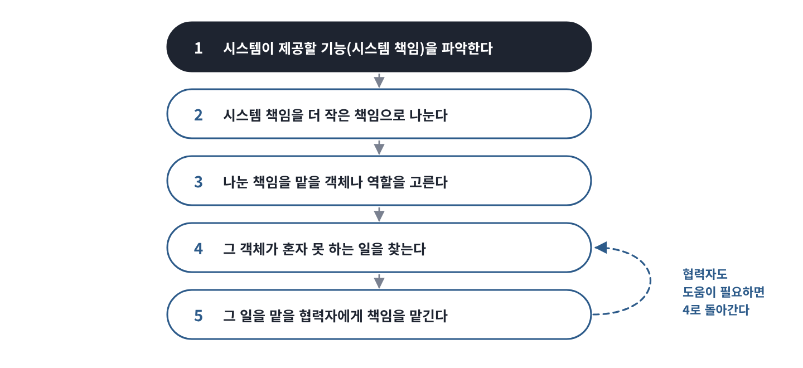

*책임 주도 설계의 흐름. 시스템 책임을 쪼개 객체에 맡기고, 그 객체가 도움이 필요하면 협력자를 찾아 다시 책임을 맡기는 일을 반복한다*

#### 보충

**재판 기능을 RDD로 설계해 보기** 아래는 각 단계에서 무엇을 적는지를 순서대로 보인 것이다.

```text
① 시스템 책임   : 파이 도난 사건을 재판해 판결을 내린다
② 작은 책임으로 : 증인을 부른다 / 증언을 듣는다 / 판결한다
③ 객체에 할당   : 판결한다 → 판사(Judge)
④ 도움이 필요함 : 판사는 판결하려면 증언이 필요함 → 증인을 불러 줄 누군가가 필요
⑤ 협력자에 할당 : 증인을 부른다 → 진행자(Clerk) / 증언한다 → 증인(Witness)
   ④로 돌아감   : 진행자는 증인 명단이 필요함 → 명단은 진행자가 직접 앎(아는 책임)
```

1. ①에서 시스템이 사용자에게 해 주는 일을 한 문장으로 적는다.
2. ②에서 그 문장을 더 작은 동사로 쪼갠다.
3. ③에서 가장 중심이 되는 책임(판결)을 맡을 역할부터 정한다.
4. ④에서 판사가 혼자 할 수 없는 일(증언 확보)을 찾는다.
5. ⑤에서 그 일을 맡을 협력자를 정하고, 협력자에게도 같은 질문을 반복한다. 진행자는 명단을 스스로 알기로 해서 반복이 끝난다.

이 과정이 끝나면 역할 목록(판사, 진행자, 증인)과 각 역할의 책임, 그리고 그들 사이의 협력이 모두 나온다. 클래스는 아직 하나도 정하지 않았다는 점이 중요하다.

**정보 전문가와 함께 씀** ③과 ⑤에서 '적절한 객체'를 고를 때 쓰는 대표적인 기준이 4.2.1 보충의 정보 전문가다. 그 책임에 필요한 정보를 가장 많이 아는 객체에게 맡긴다.

**한 줄 정리** 책임 주도 설계 = 시스템 책임을 쪼개고, 맡을 객체를 찾고, 그 객체가 도움이 필요하면 협력자를 찾는 일을 반복하는 방법.

### 4.5.2 디자인 패턴

**요지** 디자인 패턴은 반복해서 나타나는 설계 문제에 대한 해법을 역할, 책임, 협력의 형태로 정리해 둔 템플릿이다.

**디자인 패턴이란** 디자인 패턴은 전문가들이 반복적으로 사용하는 해결 방법을 정의해 둔 설계 템플릿의 모음이다. 1994년 에릭 감마 등 네 저자(흔히 GoF라고 부름)가 『Design Patterns』에서 23개의 패턴을 정리하며 널리 알려졌다.

**패턴은 역할, 책임, 협력의 템플릿이다.** 저자는 디자인 패턴이 결국 특정한 상황에서 쓸 수 있는 역할, 책임, 협력의 묶음이라고 설명한다. 패턴은 '어떤 역할들이 필요하고, 각 역할은 무슨 책임을 지며, 서로 어떻게 협력하는가'를 정해 둔 것이고, 실제로 그 역할을 맡을 클래스는 쓰는 사람이 정한다.

**예: 컴포지트 패턴** 저자가 드는 예는 **컴포지트**(Composite) 패턴이다.

- 이 패턴에는 세 역할이 있다.
- 공통 인터페이스를 정의하는 **Component**, 더 이상 나뉘지 않는 단일 객체인 **Leaf**, 여러 Component를 묶은 **Composite**이다.
- Leaf와 Composite가 모두 Component 역할을 맡기 때문에, 부르는 쪽은 상대가 하나인지 묶음인지 몰라도 같은 메시지를 보낼 수 있다.

**패턴은 책임 주도 설계의 결과물이다.** 저자는 디자인 패턴이 책임 주도 설계를 반복한 결과로 나온 것이라고 말한다.

- 전문가들이 비슷한 문제를 책임 주도 설계로 풀다 보니 같은 역할, 책임, 협력이 반복해서 나왔고, 그것에 이름을 붙인 것이 패턴이다.
- 그래서 패턴을 알면 처음부터 다시 생각하지 않아도 검증된 협력을 바로 가져다 쓸 수 있다.

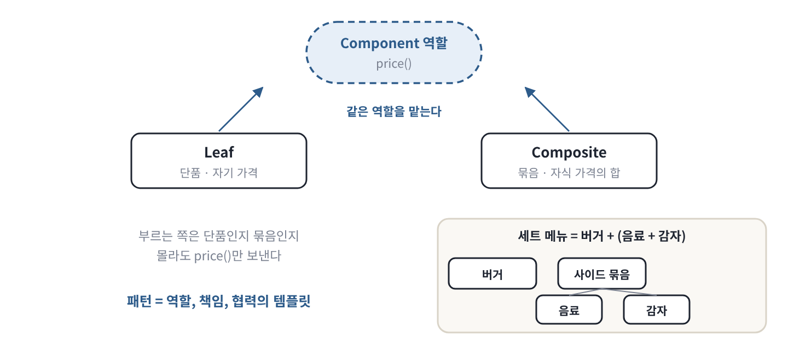

*컴포지트 패턴은 단품과 묶음이 같은 역할을 맡게 해, 부르는 쪽이 둘을 구분하지 않고 같은 메시지를 보내게 하는 역할, 책임, 협력의 템플릿이다*

#### 보충

**컴포지트 패턴을 코드로 보기** 아래 코드에서 볼 것은 `price()`를 부르는 쪽이 단품인지 세트인지 구분하지 않는다는 점이다.

```java
interface MenuItem {                                   // ① Component 역할
    Money price();
}

class Single implements MenuItem {                     // ② Leaf 역할: 단품
    private final Money price;
    public Money price() { return price; }
}

class Combo implements MenuItem {                      // ③ Composite 역할: 묶음
    private final List<MenuItem> items;                //    안에는 단품도 묶음도 들어감
    public Money price() {
        return items.stream()
                    .map(MenuItem::price)              // ④ 자식에게 같은 메시지를 보냄
                    .reduce(Money.ZERO, Money::plus);
    }
}

MenuItem set = new Combo(List.of(burger, new Combo(List.of(cola, fries))));
set.price();                                           // ⑤ 단품이든 묶음이든 똑같이 부름
```

1. ①의 `MenuItem`이 Component 역할이다. '가격을 알려 준다'는 책임 하나만 정의한다.
2. ②의 `Single`은 Leaf 역할로, 자기 가격을 바로 돌려준다.
3. ③의 `Combo`는 Composite 역할로, 안에 다른 `MenuItem`들을 가진다. 그 안에는 또 다른 `Combo`가 들어갈 수도 있다.
4. ④에서 묶음은 자기 자식들에게 똑같이 `price()` 메시지를 보내고 결과를 더한다. 자식이 단품인지 묶음인지 따지지 않는다.
5. ⑤에서 세트 메뉴 안에 사이드 묶음이 들어 있어도, 부르는 쪽은 `price()` 한 번만 보내면 된다.

실무에서는 파일과 폴더(폴더 크기 = 안에 든 파일과 폴더 크기의 합), 화면의 UI 요소 트리, 조직도(부서 인원 = 하위 부서 인원의 합)가 같은 구조다.

**패턴을 쓸 때 주의할 점** 패턴은 협력의 해법이지 목표가 아니다.

- 문제가 없는데 패턴부터 적용하면 4.4.1의 '클래스 구조부터 그리기'와 같은 오류가 된다.
- 먼저 협력을 설계하다가 '이건 컴포지트와 같은 모양이네' 하고 알아보는 것이 자연스러운 순서다.
- 요즘 언어에서 패턴이 어떻게 바뀌었는지는 부록 B-3에서 다룬다.

**한 줄 정리** 디자인 패턴 = 반복되는 문제에 대한 역할, 책임, 협력의 템플릿. 책임 주도 설계를 반복한 결과물이다.

### 4.5.3 테스트-주도 개발

**요지** 테스트 주도 개발은 테스트를 먼저 작성해 객체의 책임과 협력을 먼저 정하게 만드는 설계 기법이다.

**테스트 주도 개발**(Test-Driven Development, TDD)은 켄트 벡이 널리 알린 방법으로, 테스트를 먼저 작성하고 그 테스트를 통과하는 코드를 추가하며 프로그램을 완성해 가는 방식이다. 흔히 '실패하는 테스트 작성 → 통과하는 최소한의 코드 작성 → 다듬기'라는 짧은 반복으로 진행한다.

**목적은 테스트가 아니라 설계다.** 저자는 TDD의 기본 목적이 테스트를 작성하는 것이 아니라고 강조한다.

- 테스트를 먼저 쓰려면 '이 객체는 무슨 메시지를 받고 무엇을 돌려줘야 하는가'를 먼저 정해야 한다.
- 이것이 바로 객체의 책임이다.
- 그래서 TDD는 테스트라는 형식을 빌려 책임과 협력을 먼저 생각하게 만드는 설계 기법이다.

**협력 상대는 목 객체로 대신한다.** 테스트할 객체가 다른 객체와 협력해야 하는데 그 협력자가 아직 없거나 준비하기 어렵다면, 협력자의 역할만 흉내 내는 가짜 객체를 쓴다.

- 이를 **목 객체**(mock object)라고 한다.
- 목 객체를 쓰려면 '이 협력자가 어떤 역할이고 무슨 메시지를 받는가'를 정해야 하므로, 여기서도 역할과 협력이 먼저 드러난다.

**TDD는 쉽지 않는다.** 저자는 TDD가 역할, 책임, 협력과 책임 주도 설계에 대한 이해 없이는 하기 어렵다고 말한다. 테스트를 먼저 쓴다는 형식만 따라 해서는 좋은 설계가 나오지 않고, 무엇을 테스트해야 하는지(객체의 책임)를 알아야 좋은 테스트를 쓸 수 있기 때문이다.

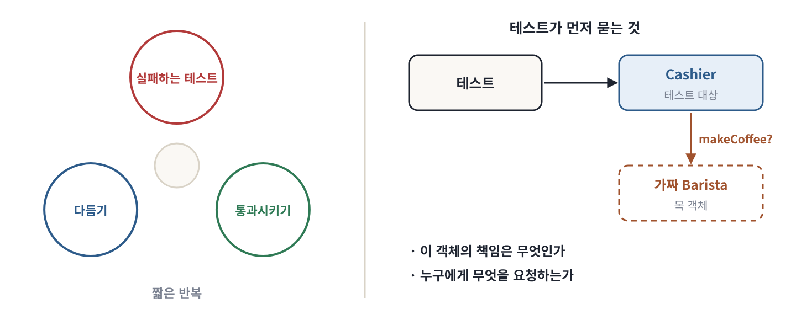

*테스트를 먼저 쓰려면 객체의 책임과 협력 상대를 먼저 정해야 한다. 아직 없는 협력 상대는 목 객체로 대신한다*

#### 보충

**테스트를 먼저 쓰면 무엇이 정해지는가** 아래는 아직 `Judge`와 `Witness`를 구현하기 전에 쓴 테스트다. 볼 것은 이 테스트 하나를 쓰는 동안 어떤 설계 결정이 내려지는지를 묻는다.

```java
@Test
void 증인이_훔쳤다고_증언하면_유죄를_선고한다() {
    Witness witness = mock(Witness.class);                       // ① 증인 역할만 흉내 낸 목 객체
    when(witness.testify()).thenReturn(new Testimony("잭이 훔쳤음")); // ② 증인이 받을 메시지와 응답

    Judge judge = new King();                                    // ③ 테스트 대상: 판사 역할
    Verdict verdict = judge.hearCase(witness);                   // ④ 판사가 받을 메시지

    assertThat(verdict).isEqualTo(Verdict.GUILTY);               // ⑤ 판사의 책임: 판결
    verify(witness).testify();                                   // ⑥ 협력: 판사가 증언을 요청했는가
}
```

1. ①에서 진짜 증인 없이 `Witness` 역할만 흉내 낸 객체를 만든다. 이 줄을 쓰려면 '증인'이라는 역할이 먼저 있어야 한다.
2. ②에서 증인이 `testify()`라는 메시지를 받고 `Testimony`를 돌려준다고 정한다. 증인의 책임이 여기서 정해진다.
3. ③과 ④에서 판사가 `hearCase(witness)`라는 메시지를 받는다고 정한다. 판사의 공용 인터페이스가 정해진다.
4. ⑤에서 판사가 지는 책임(판결)을 확인한다.
5. ⑥에서 판사가 증인에게 실제로 증언을 요청했는지, 즉 협력이 일어났는지를 확인한다.

테스트 하나를 쓰는 동안 역할(판사, 증인), 각 역할의 책임(판결, 증언), 둘 사이의 메시지(`hearCase`, `testify`)가 모두 정해졌다.

- 저자가 'TDD의 목적은 설계'라고 한 이유다.
- 여기서 `mock`, `when`, `verify`는 Java의 대표적인 목 객체 라이브러리인 Mockito의 문법이다.

**목 객체를 너무 많이 쓰면** 목 객체로 모든 협력자를 대신하면, 테스트가 '어떤 메시지를 어떤 순서로 보냈는가'에 묶여 내부 구현을 조금만 바꿔도 테스트가 깨질 수 있다. 그래서 목 객체를 얼마나 쓸지를 두고 의견이 갈린다. 부록 F-1에서 다룬다.

**한 줄 정리** TDD = 테스트를 먼저 써서 책임과 협력을 먼저 정하게 하는 설계 기법. 협력자는 목 객체로 대신한다.

**논의해 보기**

Q. 책임 주도 설계, 디자인 패턴, TDD는 서로 어떤 관계일까?

> **답** 셋 다 '협력 안에서 객체의 역할과 책임을 정한다'는 같은 목표를 가지고, 각자 다른 쪽에서 그 목표를 돕는 도구다.
>
> 책임 주도 설계는 그 목표를 위한 가장 직접적인 사고 순서다. 시스템 책임에서 출발해 작은 책임으로 쪼개고, 맡을 객체를 찾는다.
>
> 디자인 패턴은 책임 주도 설계를 수없이 반복한 결과 중 자주 나오는 모양을 모아 이름을 붙인 것이다. 그래서 설계 도중 '이건 컴포지트 모양이다'를 알아보면, 역할과 책임과 협력을 처음부터 다시 생각하지 않아도 된다. 지름길인 셈이다.
>
> TDD는 같은 질문을 테스트라는 형식으로 먼저 던지게 한다. 테스트를 쓰려면 받는 메시지(책임)와 협력자(역할)를 먼저 정해야 하기 때문이다. 그리고 테스트가 남아 있으므로, 나중에 책임을 옮기거나 패턴을 적용할 때 협력이 깨지지 않았는지 확인해 준다.
>
> 그래서 실제로는 셋을 함께 쓴다. 책임 주도 설계로 협력을 그리고, 익숙한 모양이 보이면 패턴을 빌려 오며, 그 결정을 테스트로 먼저 적고 확인하는 식이다. 저자가 'TDD는 책임 주도 설계에 대한 이해 없이는 어렵다'고 한 것도 같은 맥락이다.

---

## 4장 정리

### 한 문단으로 다시 읽기

협력은 연쇄적인 요청과 응답의 흐름이고, 요청을 받은 객체는 그 일에 대한 책임을 진다. 책임은 객체가 하는 것과 아는 것으로 나뉘고, 객체가 바깥에 약속한 공용 인터페이스가 된다. 책임은 메시지보다 넓은 개념으로, 설계가 진행되면서 메시지와 메서드로 구체화된다.

책임을 묶은 것이 역할이다. 역할은 협력 안의 자리여서 그 책임만 수행하면 어떤 객체든 들어갈 수 있고, 덕분에 여러 구체적인 협력을 하나의 추상적인 협력으로 묶을 수 있다. 객체는 역할이 요구하는 것보다 많은 책임을 가질 수 있으며, 역할은 일반화, 객체의 타입은 특수화다.

객체는 데이터를 담으려고 존재하는 것이 아니라 협력에 참여하려고 존재하므로, 협력을 먼저 설계하고 책임과 역할을 정한 뒤 객체의 구조를 정해야 한다. 책임 주도 설계, 디자인 패턴, 테스트 주도 개발은 모두 이 순서를 돕는 기법이다.

### 인사이트

**메서드 목록은 그 객체가 받는 요청 목록이다.** 클래스의 public 메서드를 읽을 때 '누가 이 메시지를 보내지?'를 물어보면 그 객체가 어떤 협력에 참여하는지 보인다. 아무도 보내지 않는 메시지가 있다면 지워도 되는 책임이고, 너무 많은 곳에서 서로 다른 이유로 보낸다면 책임이 너무 많은 것이다.

**'아는 것'을 정하는 것도 설계다.** 어떤 정보를 누가 알지 정하면, 그 정보로 하는 일도 함께 정해진다. getter를 추가하고 싶을 때가 '이 정보로 하는 일을 이 객체에게 맡길 수 없나'를 물어볼 때다.

**역할은 '바뀔 수 있는 자리'에만 만들면 된다.** 판사와 증인처럼 실제로 여러 객체가 번갈아 들어오는 자리라면 역할로 만들 가치가 크다. 구현이 하나뿐이고 바뀔 계획도 없는 자리에 인터페이스부터 만들 필요는 없다. 부록 B-2에서 다룬다.

**패턴과 TDD는 형식만 따라 하면 효과가 없다.** 둘 다 책임 주도 설계의 생각, 즉 '이 협력에서 누가 무엇을 책임지는가'를 바탕으로 해야 효과가 있다. 패턴 이름부터 고르거나 테스트 커버리지 숫자만 쫓으면 설계는 좋아지지 않는다.

### 다이어그램

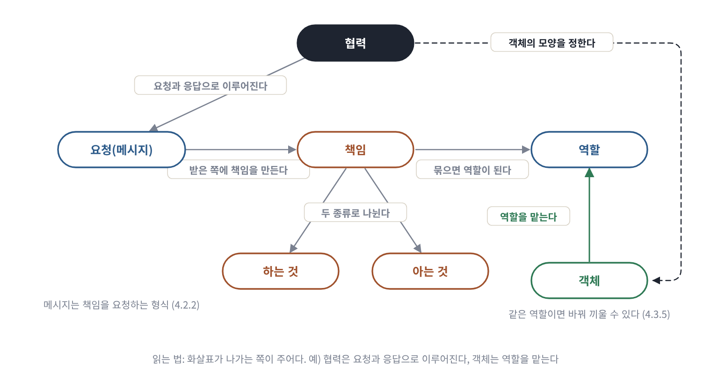

*4장 용어의 관계도. 협력은 요청과 응답으로 이루어지고, 요청은 받은 쪽에 책임을 만들며, 책임을 묶으면 역할이 되고, 객체는 그 역할을 맡는다. 그리고 협력이 객체의 모양을 정한다*

### 확인 질문

먼저 스스로 답해 본 뒤 답을 펼쳐 비교한다.

Q1. 협력과 책임은 어떤 관계인가?

> **답** 협력 속의 요청이 책임을 만든다. 요청을 받은 객체는 그 요청에 응답할 책임을 지기 때문이다.
>
> 재판에서 토끼가 증인을 부를 책임을 지는 것은, 왕이 토끼에게 '증인을 불러라'라고 요청했기 때문이다. 그 요청이 없었다면 토끼에게 그 책임도 없다. 그래서 책임은 객체에 원래부터 있는 것이 아니라 협력 안에서 생긴다.
>
> 이 관계 때문에 설계 순서도 정해진다. 협력을 먼저 그려야 각 객체가 받을 요청이 보이고, 그 요청들이 곧 객체의 책임 목록이 된다(4.1.3, 4.4.2).

Q2. 책임의 두 가지 분류와 각각의 예를 들어 보라.

> **답** 하는 것(doing)과 아는 것(knowing)이다.
>
> 하는 것에는 스스로 계산하거나 객체를 만드는 것(모자 장수가 증언함), 다른 객체의 행동을 시작시키는 것(왕이 토끼에게 증인을 부르게 함), 다른 객체들을 제어하고 조정하는 것(토끼가 재판 순서를 진행함)이 있다.
>
> 아는 것에는 자기 정보를 아는 것(모자 장수가 본 것을 앎), 관련된 객체를 아는 것(토끼가 증인 명단을 앎), 계산하거나 유도할 수 있는 것을 아는 것(판사가 증언으로 판결을 낼 수 있음)이 있다.
>
> 두 분류는 따로 다니지 않는다. 정보 전문가 원칙에 따라, 무언가를 아는 객체에게 그 정보로 하는 일도 맡기는 것이 좋다(4.2.1).

Q3. 책임과 메시지는 어떻게 다른가? 왜 책임부터 정하라고 하는가?

> **답** 책임은 객체가 할 일을 넓게 말하는 추상적인 개념이고, 메시지는 그 일을 요청하는 구체적인 형식이다. 책임 하나가 여러 메시지로 나뉠 수 있다.
>
> '증언한다'는 책임은 `enter()`와 `testify()`라는 두 메시지로 나뉠 수 있다. 메시지는 이름과 파라미터, 반환 타입까지 정해진 것이라 한번 정하면 바꾸기 부담스럽다.
>
> 책임은 아직 그런 세부를 정하지 않은 상태라서 다른 객체로 옮기거나 나누고 합치기 쉽다. 그래서 설계 초반에는 책임으로 협력의 모양을 이리저리 맞춰 보고, 모양이 잡힌 뒤에 메시지로 바꾸는 것이 좋다(4.2.2).

Q4. 역할이 없다면 재판 협력은 어떻게 설명해야 하는가? 역할이 있으면 무엇이 좋아지는가?

> **답** 판사와 증인이 될 수 있는 인물의 조합마다 협력을 따로 설명해야 한다. 역할이 있으면 '판사 ↔ 증인'이라는 하나의 협력으로 모든 조합을 설명할 수 있다.
>
> 판사가 둘(왕, 여왕)이고 증인이 셋(모자 장수, 요리사, 앨리스)이면, 역할 없이는 여섯 개의 협력이 필요하고 내용은 모두 같다. 역할로 묶으면 하나로 충분하다.
>
> 좋아지는 점은 세 가지다. 협력이 단순해진다(협력의 추상화). 같은 협력을 다른 객체들로 다시 쓸 수 있다(재사용). 새 증인이 나와도 협력을 고치지 않고 증인 자리에 끼우기만 하면 됨(대체 가능성)(4.3.3, 4.3.4).

Q5. 앨리스는 몸 크기를 바꾸는 책임까지 가지고 있는데, 증인 역할을 맡을 수 있는가?

> **답** 맡을 수 있다. 객체는 역할이 요구하는 책임을 모두 수행할 수 있으면 그 역할을 맡을 수 있고, 그 이상의 책임을 더 가지고 있어도 상관없다.
>
> 증인 역할이 요구하는 책임은 입장하는 것과 증언하는 것뿐이다. 앨리스는 둘 다 할 수 있으므로 증인 자리에 들어갈 수 있다. 몸 크기를 바꾸는 책임은 재판 협력에서 보이지 않을 뿐, 앨리스가 증인이 되는 데 방해가 되지 않는다.
>
> 저자는 이 관계를 역할은 일반화, 객체는 특수화라고 설명한다. 반대로 증언할 줄 모르는 객체는 다른 능력이 아무리 많아도 증인이 될 수 없다(4.3.5).

Q6. 객체를 데이터 그릇으로 보는 것이 왜 오류인가?

> **답** 객체가 존재하는 이유는 데이터를 저장하는 것이 아니라 협력에 참여하는 것이기 때문이다. 데이터부터 정하면 어떤 협력에도 맞지 않는 객체가 나오고, 행동은 바깥으로 흩어진다.
>
> 증인을 데이터 그릇으로 보면 이름, 나이, 주소, 기억 목록을 필드로 만들게 된다. 그런데 재판 협력에 필요한 것은 증언하는 능력이고, 나이와 주소는 쓰이지 않는다. 반면 증언을 만드는 판단은 바깥(판사나 서비스)으로 나가게 된다.
>
> 협력부터 보면 '증언하라'는 요청을 받는다는 것이 먼저 정해지고, 그 요청에 답하려면 기억이 필요하다는 것이 뒤따라 정해진다. 데이터는 행동의 재료로서 필요한 만큼만 생긴다(4.4.1).

Q7. 책임 주도 설계의 순서를 자기 말로 설명해 보라.

> **답** 시스템이 해 줘야 할 일을 정하고, 그 일을 작은 일로 쪼갠 뒤, 각 일을 맡을 객체를 고르고, 그 객체가 혼자 못 하는 일이 있으면 또 다른 객체를 찾아 맡기는 것을 반복하는 순서다.
>
> 예를 들어 '주문 금액을 계산한다'가 시스템 책임이라면, 이를 '항목 가격을 더한다'와 '할인을 적용한다'로 쪼갠다.
>
> - 항목과 가격을 아는 주문에게 계산을 맡기고, 주문은 할인 규칙을 모르므로 할인 정책이라는 협력자를 찾아 '할인 금액을 알려 달라'는 책임을 맡긴다.
> - 할인 정책이 더 이상 도움을 필요로 하지 않으면 끝난다.
>
> 핵심은 클래스를 먼저 정하지 않는다는 것이다. 책임이 필요해질 때마다 그 책임에 맞는 객체를 찾으므로, 객체는 협력이 필요로 하는 모양대로 만들어진다(4.5.1).

### 결론

맨 앞의 '이 장에서 배울 것' 다섯 줄에 한 줄씩 답하면 다음과 같다.

| 이 장에서 배울 것 | 한 줄 답 | 다시 볼 곳 |
| --- | --- | --- |
| ① 협력과 요청 | 협력은 **연쇄적인 요청과 응답**. 요청을 받은 쪽이 그 일의 책임을 진다 | 4.1 |
| ② 책임의 분류와 메시지 | 책임은 **하는 것 + 아는 것**. 책임은 넓고, 메시지는 그것을 요청하는 구체적인 형식 | 4.2 |
| ③ 역할 | 역할은 **책임의 묶음**이자 협력 속 자리. 협력을 추상화하고 객체를 **바꿔 끼울 수 있게** 한다 | 4.3 |
| ④ 협력이 모양을 정한다 | 객체는 데이터 그릇이 아니다. **협력 → 책임 → 역할 → 객체 → 클래스** 순서로 설계 | 4.4 |
| ⑤ 설계 기법 | **책임 주도 설계**가 기본 순서, **패턴**은 그 결과물, **TDD**는 테스트로 같은 질문을 먼저 던진다 | 4.5 |

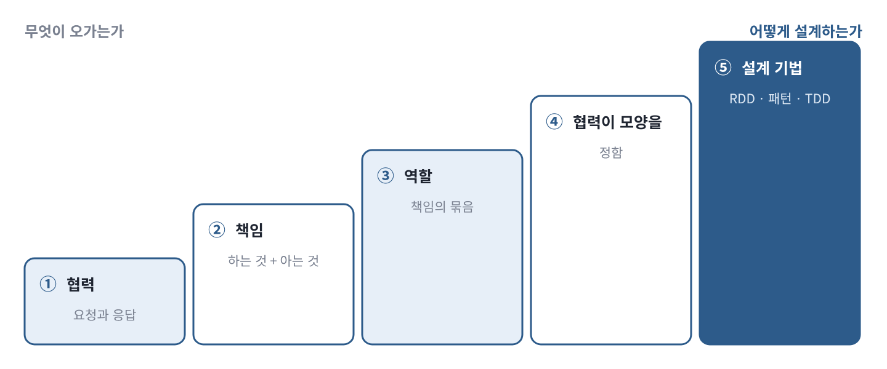

*4장의 다섯 가지 목표는 앞 단계 위에 다음 단계가 올라가는 계단 구조다*

> 객체의 모양은 협력이 결정한다. 그러므로 설계는 '어떤 데이터와 클래스가 필요할까'가 아니라 '이 협력에서 누가 무엇을 책임지는가'에서 시작하고, 책임을 묶은 역할에 맞는 객체를 마지막에 고른다.

다 읽었다면 맨 앞의 '이 장에서 배울 것'으로 돌아가, 위 표를 보지 않고 말할 수 있는 항목에 체크한다.

**다음 장으로** 5장 '책임과 메시지'는 4장에서 '설계가 진행되면 메시지로 구체화된다'고만 했던 부분을 자세히 다룬다. 메시지를 먼저 정하고 그 메시지를 받을 객체를 고르는 방법, 그리고 '어떻게'가 아니라 '무엇'을 요청하는 메시지의 중요성이 이어진다.

---


---

## 실습

**과제: 도서관 대출 기능을 책임 주도 설계로 만들기**

4.5.1의 다섯 단계를 그대로 따라가는 실습이다.

1. '회원이 책을 빌린다'는 기능의 시스템 책임을 한 문장으로 적음
2. 그 책임을 더 작은 책임 서너 개로 쪼갬
3. 각 책임을 '하는 것'인지 '아는 것'인지 표시하고, 그 정보를 가장 잘 아는 객체(정보 전문가)에게 맡김
4. 맡은 객체가 혼자 못 하는 일이 있으면 협력자를 찾아 책임을 맡김
5. 여러 객체가 번갈아 맡을 수 있는 자리가 있다면 역할로 묶고 이름을 붙임

**예시 풀이** 시스템 책임은 '회원이 빌릴 수 있는 상태인지 확인하고, 책이 대출 가능하면 대출을 기록한다'이다.

이를 쪼개면 '회원이 대출 가능한지 판단한다', '책이 대출 가능한지 판단한다', '대출 기한을 정한다', '대출을 기록한다'가 나온다.

각 책임의 주인을 정한다.

- 회원의 대출 가능 여부는 연체 여부와 현재 대출 권수를 아는 **회원**이 판단한다(아는 것 + 하는 것).
- 책의 대출 가능 여부는 자기가 대출 중인지 아는 **책**이 판단한다.
- 대출 기한은 회원 등급에 따라 달라지는데, 이 규칙은 회원도 책도 아니므로 **대출 정책**이라는 새 객체를 둔다.
- 대출 기록은 이 과정을 조정하는 **대출 창구**가 맡는다(조정하는 책임).

협력을 정리하면, 대출 창구가 회원에게 `canBorrow()`를, 책에게 `isAvailable()`을, 대출 정책에게 `dueDateFor(member)`를 요청하고, 셋이 모두 응답하면 대출을 기록한다.

마지막으로 역할을 찾는다. 대출 정책은 일반 회원용, 학생용, 방학 기간용처럼 여러 구현이 번갈아 들어올 수 있는 자리이므로 `LoanPolicy` 역할로 만들 가치가 있다. 반면 대출 창구는 하나뿐이고 바꿀 일이 없으므로 처음에는 클래스 하나로 충분하다(부록 B-2).

이 결과를 CRC 카드로 옮기면 회원, 책, 대출 정책, 대출 창구 네 장이 나온다. 회원 테이블이나 책 테이블에는 없던 '대출 정책'이 협력에서 자연스럽게 나왔다는 점이 이 실습의 핵심이다. 객체의 모양을 협력이 정한 것이다(4.4).


---

## 부록 A. 책임 설계 기법 개관

> **이 부록의 맥락** '누가 무엇을 책임지는가'를 정하는 데 쓰는 이름들(RDD, CRC, GRASP, DDD, BPMN, Event Storming 등)을 한 장의 지도에 놓는다. 어떤 것이 책임을 직접 정하는 기법이고 어떤 것이 앞뒤에서 돕는 주변 기법인지, 상황에 따라 무엇을 먼저 쓰는지 정리한다.

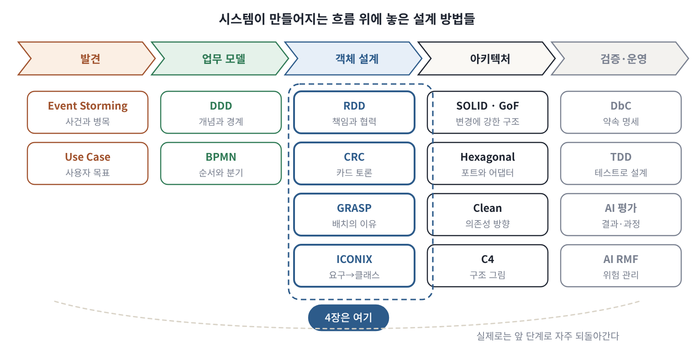

*발견부터 검증과 운영까지, 각 단계에서 주로 쓰는 설계 방법을 한 장에 놓은 지도. 4장의 역할, 책임, 협력은 가운데 객체 설계 단계에 있다*

### A-1 직접 기법과 보조 기법의 구분

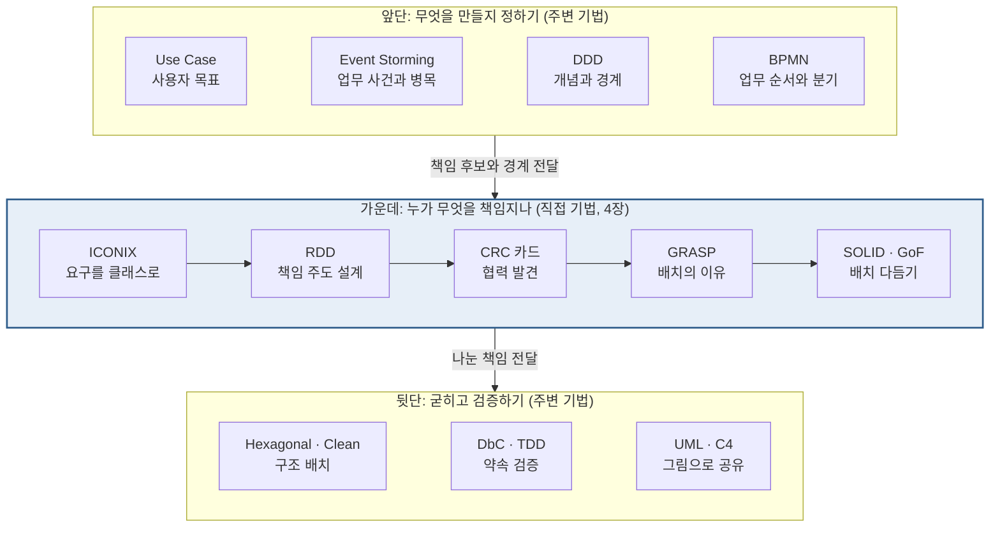

**요지** 설계에 쓰이는 이름들은 '객체의 책임을 직접 정하는가'를 기준으로 직접 기법과 주변 기법으로 나뉜다. 4장은 직접 기법의 중심에 있다.

**모두 같은 종류가 아니다.** RDD, DDD, BPMN, UML, TDD를 한 줄에 놓고 '무엇이 더 좋은가'를 따지면 비교가 성립하지 않는다.

- UML은 그림을 그리는 언어이고, BPMN은 업무 순서를 표현하는 표기법이며, RUP는 프로젝트를 단계로 나누는 프로세스다.
- 어느 것도 '어떤 객체가 무엇을 책임지는가'를 대신 정해 주지 않는다.

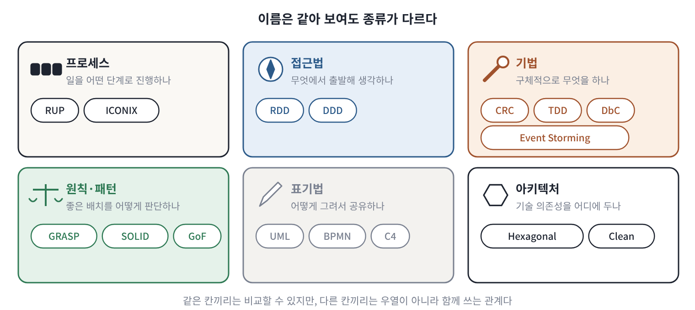

*설계 이름들은 프로세스, 접근법, 기법, 원칙과 패턴, 표기법, 아키텍처라는 서로 다른 종류에 속한다*

**직접 기법** 4장의 질문, 즉 '누가 무엇을 책임지는가'에 답을 내는 기법이다.

- RDD(책임 주도 설계), CRC 카드, GRASP, ICONIX, 그리고 그 결과를 다듬는 SOLID와 GoF 패턴이 여기에 속한다.
- OOSE, OMT, Booch 같은 1990년대 객체지향 방법론은 이들의 원형이다.

**주변 기법** 직접 기법의 앞과 뒤에서 일한다.

- 앞단의 Use Case, Event Storming, DDD, BPMN은 '무엇을 만들어야 하는가'라는 재료를 준다.
- 뒷단의 Hexagonal과 Clean 아키텍처는 나눈 책임을 시스템 구조에 배치하고, DbC와 TDD는 책임이 지켜지는지 검증하며, UML과 C4는 설계를 그림으로 공유한다.
- 모두 객체지향과 함께 쓰이지만 객체지향 전용은 아니다.

| 구분 | 기법 | 답하는 질문 | 4장과의 관계 |
| --- | --- | --- | --- |
| 앞단 (주변) | Use Case, Event Storming, DDD, BPMN | 무엇을 만들고, 업무는 어떻게 흘러가나 | 책임 후보와 경계를 준다 |
| 가운데 (직접) | RDD, CRC, GRASP, ICONIX, SOLID, GoF | 누가 무엇을 책임지나 | 4장 그 자체 |
| 뒷단 (주변) | Hexagonal, Clean, DbC, TDD, UML, C4 | 어떻게 굳히고 검증하고 공유하나 | 역할을 포트·계약·테스트로 고정 |

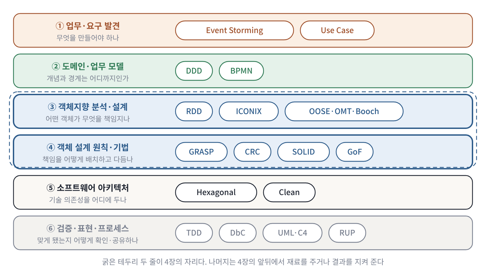

*설계에 쓰이는 이름들은 서로 다른 질문에 답한다. 4장의 역할, 책임, 협력은 가운데 두 범주(객체 분석·설계와 설계 원칙)에 해당한다*

**포지셔닝 맵으로 보기** 같은 이름들을 두 축에 놓아 볼 수 있다.

- 가로축은 '다루는 범위'로, 객체 몇 개에서 여러 팀과 시스템 전체까지다.
- 세로축은 '도입 부담'으로, 쓰기 전에 갖춰야 할 단계와 문서와 참여 인원이 얼마나 많은가다.
- CRC 카드는 카드 몇 장과 30분이면 바로 쓸 수 있어 부담이 작고, RUP는 정해진 단계(도입, 정련, 구축, 전이)마다 문서와 역할을 갖춰야 해서 부담이 크다.
- 직접 기법은 왼쪽 아래(범위 작음, 부담 작음)에 모이고, DDD, BPMN, RUP는 오른쪽 위로 간다.
- 성능 비교가 아니라 성격을 보여 주는 정성적 배치다.

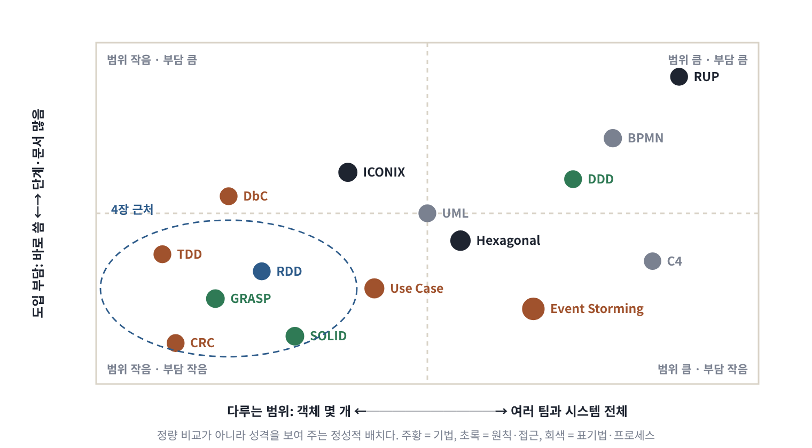

*설계 방법을 다루는 범위와 도입 부담(필요한 단계, 문서, 참여 인원)으로 배치한 포지셔닝 맵. 4장 근처의 기법들은 범위가 작고 바로 쓸 수 있다*

**한 줄 정리** 직접 기법은 책임을 정하고, 주변 기법은 그 앞에서 재료를 주거나 뒤에서 결과를 지킨다.

### A-2 책임 할당 기법: RDD, CRC, GRASP, ICONIX

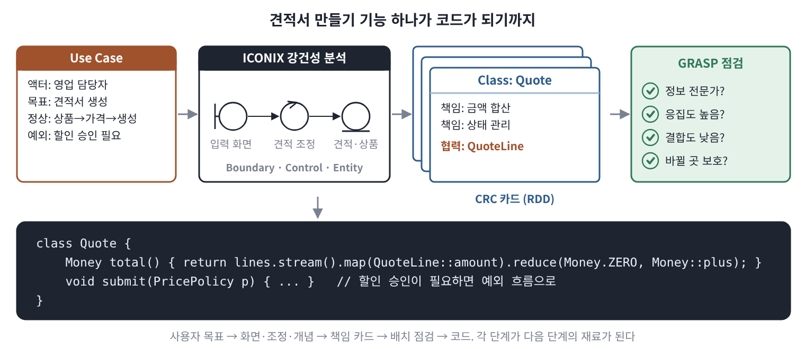

*하나의 기능이 유스케이스, 강건성 분석, CRC 카드, GRASP 점검을 거쳐 코드가 되는 흐름*

**요지** RDD를 실제로 할 때는 CRC로 협력을 발견하고, GRASP로 배치를 검토하고, Use Case와 ICONIX로 요구사항과 연결한다.

**RDD 다시 보기** 4.5.1의 책임 주도 설계는 레베카 워프스브록이 정리한 접근으로, 시스템이 이룰 목표에서 출발해 책임을 나누고 그 책임을 맡을 객체와 협력자를 찾아간다.

- 처음부터 `Member`, `Book`, `Loan` 같은 클래스 목록을 만드는 것이 아니라 '대출을 위해 무슨 일이 필요한가'부터 묻는 것이다(4장 실습).
- 개별 기능의 로직을 설계하거나 한 클래스가 너무 많은 일을 할 때 특히 유용하다.
- 다만 전사 업무의 경계나 여러 시스템 사이의 경계를 RDD만으로 정하기는 어렵다.
- 그 일은 ②의 DDD가 맡는다.

**CRC 카드** CRC(Class-Responsibility-Collaborator)는 객체 후보 하나를 카드 한 장에 적고, 그 객체의 책임과 협력자를 함께 적는 기법이다.

- 4.5.1 보충에서 본 것처럼, 카드를 테이블 위에서 움직이며 요청과 응답을 시뮬레이션하면 코드 없이도 협력을 토론할 수 있다.
- 한 카드에 책임이 너무 많이 쌓이면 나눌 때가 된 것이다.
- 다만 복잡한 승인 상태나 오류 처리, 실제 API 형식까지 표현하기는 어렵다.

**GRASP** GRASP(General Responsibility Assignment Software Patterns)는 크레이그 라만이 정리한 책임 할당 원칙 9가지다.

- RDD가 '누가 무엇을 책임져야 하나'를 묻는다면, GRASP는 '왜 그 객체에게 맡기는 것이 좋은가'에 답하게 해 준다.
- 4장에서 이미 본 것도 많다.
- 정보를 가장 잘 아는 객체에 맡기는 **정보 전문가**(Information Expert)는 4.5.1의 원칙이고, 외부 요청을 받는 조정자를 두는 **컨트롤러**(Controller)는 4.2.1의 '조정하는 책임'이며, 바뀔 부분을 감싸는 **변경 보호**(Protected Variations)는 역할로 대체 가능성을 만드는 일이다.
- 나머지는 생성 책임을 정하는 **생성자**(Creator), 결합을 줄이는 **낮은 결합도**(Low Coupling), 관련 책임을 모으는 **높은 응집도**(High Cohesion), 종류마다 다른 행동을 각 구현에 맡기는 **다형성**(Polymorphism), 현실에 없어도 필요하면 만드는 **순수 가공물**(Pure Fabrication, 예: 저장소 객체), 중간 객체로 직접 의존을 끊는 **간접화**(Indirection)이다.

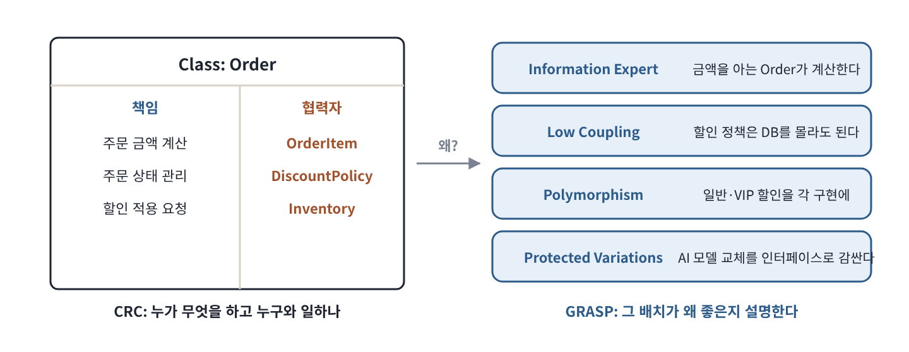

*CRC 카드는 책임과 협력자를 적어 협력을 발견하게 하고, GRASP는 그 책임을 왜 그 객체에게 맡겼는지 설명하는 근거를 준다*

아홉 원칙을 한 장에 모으면 다음과 같다. 오른쪽 위에 번호가 붙은 칸은 4장에서 같은 생각을 이미 만난 곳이다.

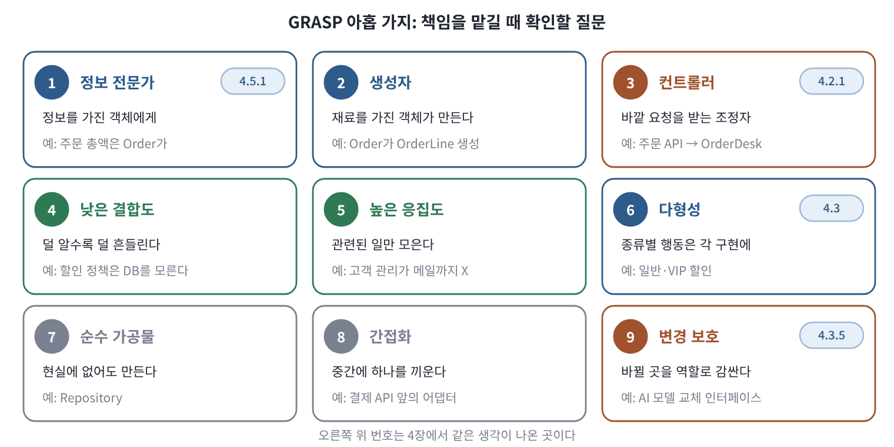

*GRASP의 아홉 원칙과 예시. 정보 전문가, 컨트롤러, 다형성, 변경 보호는 4장에서 이미 다른 이름으로 만났다*

**Use Case와 ICONIX** 유스케이스는 사용자가 시스템으로 이루려는 **하나의 목표**이다.

- '견적서 조회 버튼 클릭'이 아니라 '영업 담당자가 고객에게 제출할 견적서를 만든다'가 유스케이스다.
- 정상 흐름과 예외 흐름, 사전 조건과 완료 조건을 함께 적으므로 요구사항과 테스트를 잇기 좋다.
- 이반 야콥슨의 OOSE(Object-Oriented Software Engineering)에서 나온 생각이다.
- ICONIX는 유스케이스, 도메인 모델, 강건성 분석, 시퀀스 다이어그램을 거쳐 요구사항을 클래스 설계까지 잇는 가벼운 프로세스다.
- 강건성 분석은 요구사항과 코드 사이에 중간 그림을 하나 더 그리는 것으로, 사용자와 맞닿는 접점(Boundary), 흐름을 조정하는 요소(Control), 업무 개념(Entity)을 나눠 시나리오를 따라가 본다.
- 4장 관점에서 보면 '협력의 문맥'을 사용자 목표에서 찾아 주는 도구들인다.

**고전 방법론의 계보** OOSE, OMT(Object Modeling Technique, 제임스 럼보), Booch 방법(그래디 부치)은 1990년대 객체지향 분석과 설계의 대표 방법이었고, 이들의 모델링 개념과 표기법이 UML 형성에 큰 영향을 준다.

- 방법론 자체가 UML로 합쳐졌다는 뜻은 아니다.
- OOAD(Object-Oriented Analysis and Design)는 특정 방법론 이름이 아니라 객체지향 분석과 설계 활동 전체를 부르는 말이다.
- 처음 공부할 때는 RDD, GRASP, Use Case, ICONIX를 먼저 익히고, 나머지는 역사적 배경으로 알아 두면 충분하다.

**한 줄 정리** CRC로 협력을 발견하고, GRASP로 그 배치의 이유를 대고, Use Case와 ICONIX로 사용자 목표와 연결하면 4.5.1의 책임 주도 설계가 실제 작업이 된다.

### A-3 상황별 기법 선택 기준

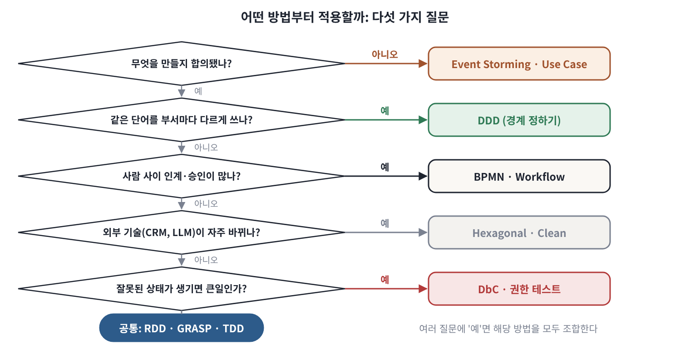

*다섯 가지 질문에 답하며 먼저 적용할 방법을 고르는 흐름. 어느 경우든 책임 할당(RDD, GRASP)과 테스트는 공통으로 필요하다*

**요지** 설계 방법은 개발자의 취향이 아니라 프로젝트의 성격, 즉 복잡성의 종류, 시간, 규제와 AI 자율성에 따라 고른다.

**복잡성에도 종류가 있다.** 업무 규칙이 복잡한지와 협력이 얽혀 있는지는 다른 문제다.

- 규칙이 복잡한 한 영역이라면 RDD, GRASP, DDD가 유용하지만, 규칙은 단순한데 여러 부서가 차례로 승인해야 하는 시스템이라면 BPMN과 Workflow가 더 큰 값을 준다.
- 그래서 '시스템이 크니 무조건 DDD', '업무가 단순하니 객체 설계는 생략' 같은 판단은 위험하다.
- 아래 지도는 성능을 비교한 결과가 아니라, 문제의 성격에 따라 먼저 검토할 기법을 놓아 본 정성적인 그림이다.

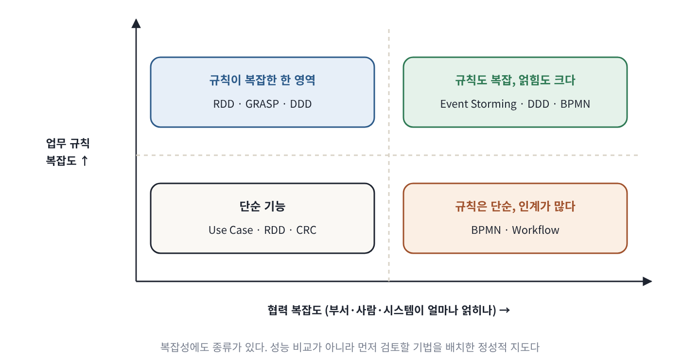

*업무 규칙이 복잡한지, 협력이 얽혀 있는지에 따라 먼저 적용할 방법이 달라진다*

**세 가지 시간** 시간도 함께 봐야 한다.

- 첫째는 **만드는 데 걸리는 시간**이다.
- 짧은 시제품(PoC, Proof of Concept)이라면 Use Case와 RDD로 충분할 수 있고, 장기 구축이라면 DDD와 C4가 필요해진다.
- 둘째는 **업무가 실제로 진행되는 시간**이다.
- 몇 초 안에 끝나는 계산과 며칠에 걸친 승인 절차는 설계의 초점이 다르다.
- 후자는 BPMN과 Workflow, 상태와 이력 관리가 중요하다.
- 셋째는 **바뀌는 주기**이다.
- 규칙이 안정적이면 RDD와 GRASP로, 정책이 자주 바뀌면 DDD와 전략 패턴으로, 기술이 자주 바뀌면 Hexagonal로 대비한다.
- 예를 들어 AI 문서 검수 기능은 2주 만에 시제품을 만들 수 있어도, 그 문서의 효력은 몇 년 동안 유지될 수 있다.
- 개발 기간이 짧다는 것과 업무의 책임이 작다는 것은 같은 말이 아니다.

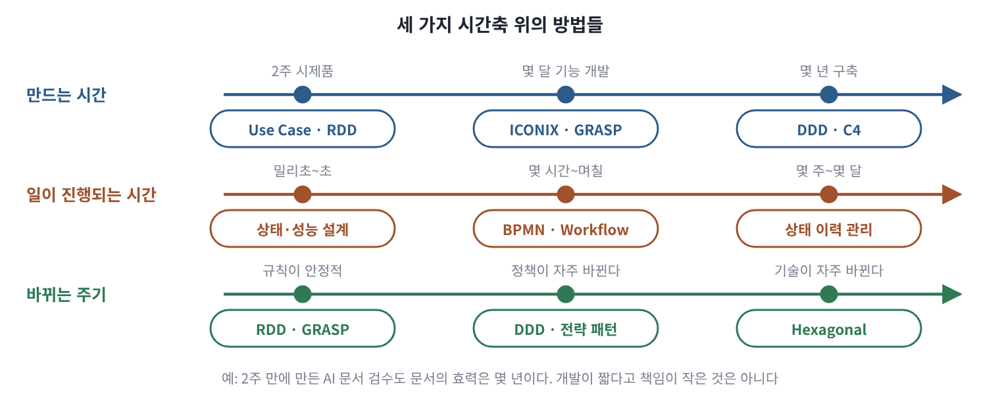

*만드는 시간, 업무가 진행되는 시간, 바뀌는 주기라는 세 시간축마다 알맞은 방법이 다르다*

**사람, 규제, AI가 더하는 조건** 한 사람이 모든 일을 처리한다면 객체의 책임과 결과(RDD, GRASP)가 중심이지만, 부서 사이에 일이 넘어가면 담당자와 대기와 예외(BPMN, Event Storming)가 중요해진다.

- 여러 개발팀이 함께 만든다면 도메인 소유권과 API 계약(DDD, C4, 계약 테스트)이, 감사와 규정 준수가 필요하다면 상태 전이와 승인 증빙(BPMN, DbC)이 필요하다.
- AI가 추천만 한다면 품질과 근거 평가로 충분할 수 있지만, AI가 실제로 업무를 실행한다면 권한, 중단, 복구, 사람의 승인이 필요하다(부록 E-6).
- 이런 위험 관리는 객체 설계만으로는 부족하며, 미국 국립표준기술연구소(NIST)의 AI 위험 관리 프레임워크(AI RMF)처럼 거버넌스, 위험 식별(Map), 측정, 관리의 네 기능으로 다루는 별도의 틀이 있다.

조건별로 어떤 방법에 중점을 둘지를 한 장의 매트릭스로 정리하면 다음과 같다. 색이 진할수록 그 조건에서 핵심이 되는 방법이다. 조건이 여러 개 겹치는 프로젝트라면 해당하는 행을 모두 보고 진한 열을 함께 쓴다.

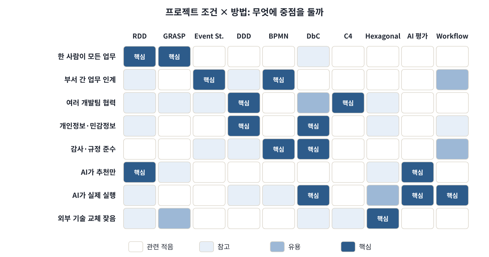

*프로젝트 조건마다 중점을 둘 방법을 색의 진하기로 나타낸 매트릭스. 공식 기준이 아니라 앞의 내용을 정리한 정성적 판단이다*

**한 줄 정리** 복잡성의 종류, 세 가지 시간, 사람과 규제와 AI의 조건을 먼저 보고 방법을 고르며, 하나만 고르는 것이 아니라 조합한다.

### A-4 프로젝트 적용 사례

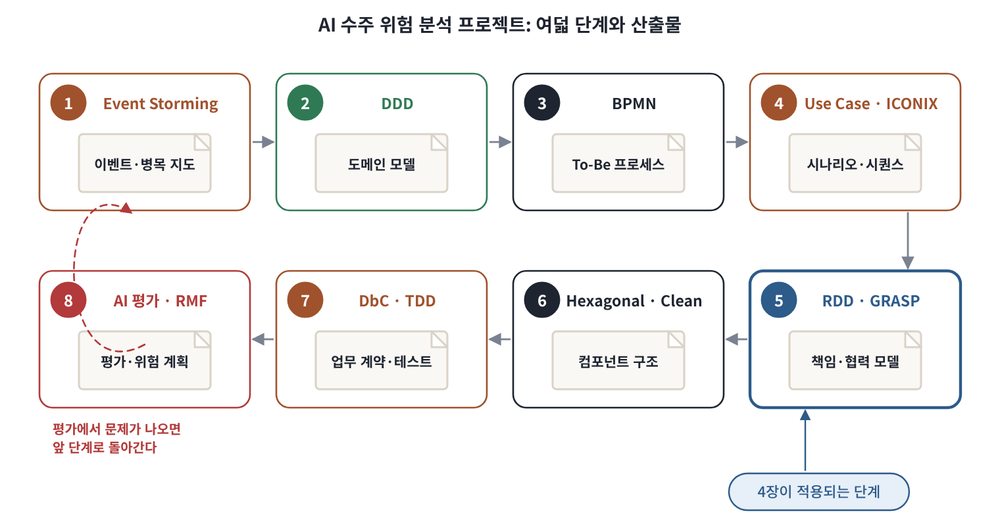

*하나의 AX 프로젝트에서 여덟 가지 방법이 차례로 이어지며 각자 산출물을 남긴다. 4장의 책임 할당은 다섯 번째 단계다*

**요지** 하나의 AX 프로젝트에서도 여러 방법이 차례로 이어지며, 4장의 책임 할당은 그 가운데 다섯 번째 단계에 자리한다.

AI 시스템 설계 쟁점의 종합에서 본 'AI 기반 수주 위험 분석'을 다시 예로 듦. 문제는 고객 회신 지연이나 견적 미제출 같은 위험을 담당자가 늦게 알아차린다는 것이고, 목표는 AI가 위험을 일찍 찾아 대응을 추천하되 공식 수주 확도는 규칙 검증과 승인을 거쳐서만 바뀌게 하는 것이다.

먼저 **Event Storming**으로 실제 수주 과정의 사건과 병목을 찾아 이벤트 지도를 만든다.

- 이어 **DDD**로 영업기회, 견적, 계약의 경계를 정하고, **BPMN**으로 위험 감지부터 승인까지의 흐름을 그린다.
- **Use Case와 ICONIX**로 담당자의 목표와 정상·예외 흐름을 시퀀스로 옮기고, 여기서 **RDD와 GRASP**로 객체와 서비스에 책임을 나눈다.
- 4장이 적용되는 곳이 바로 이 단계다.
- `Opportunity`는 자기 상태를 아니까 관련 규칙을 수행하고(정보 전문가), `RiskAnalyst`는 비정형 문서를 분석하지만 공식 상태의 주인이 되지는 않고, `RiskReviewService`는 흐름을 조정하되 판단 규칙을 모두 품지 않으며(높은 응집도), 자주 바뀌는 `RiskPolicy`는 따로 분리해 둔다(변경 보호).
- 다음으로 **Hexagonal과 Clean**으로 AI, CRM, ERP 의존성을 바깥에 두고, **DbC와 TDD**로 승인과 상태 변경의 약속을 테스트로 고정하며, 마지막으로 **AI 평가와 위험 관리**로 AI의 품질과 권한을 검증한다.

이 순서가 엄격한 직선은 아니다. 도메인 모델을 그리다 새 예외를 발견하면 Event Storming으로 돌아가기도 한다. 그래도 이렇게 이어 보면 설계가 클래스 다이어그램에서 끝나지 않고, 업무 문제에서 도메인, 프로세스, 객체, 아키텍처, 테스트까지 한 줄로 연결된다는 것이 보인다.

**한 줄 정리** 협력은 메시지의 흐름이고, 책임은 각 참여자가 응답할 일이며, 역할은 바꿔 끼울 수 있는 자리라는 4장의 정의는 이 긴 사슬의 한가운데서 그대로 쓰인다.

**같은 문제를 네 방법으로 보면** 위 흐름의 앞 네 단계를 같은 문제에 적용하면 산출물이 이렇게 달라진다.

- 네 방법은 출발하는 질문이 다르다.
- **Event Storming**은 '업무에서 실제로 무슨 일이 일어나는가'에서 출발해, 현업 담당자와 함께 사건(이벤트), 명령, 규칙, 병목을 벽에 붙여 가며 찾아내는 협업 모델링 기법이다.
- **DDD**는 '이 업무의 개념과 규칙은 무엇이고, 그 경계는 어디인가'를 묻고, 도메인 모델과 경계(Bounded Context)를 산출물로 낸다.
- **BPMN**은 '업무가 어떤 순서와 조건으로 흘러가는가'를 표준 기호로 그리는 표기법이고, OMG(Object Management Group)가 관리한다.
- **RDD**는 4장의 방법으로, '누가 무엇을 책임지는가'를 묻고 역할, 책임, 협력을 산출물로 낸다.

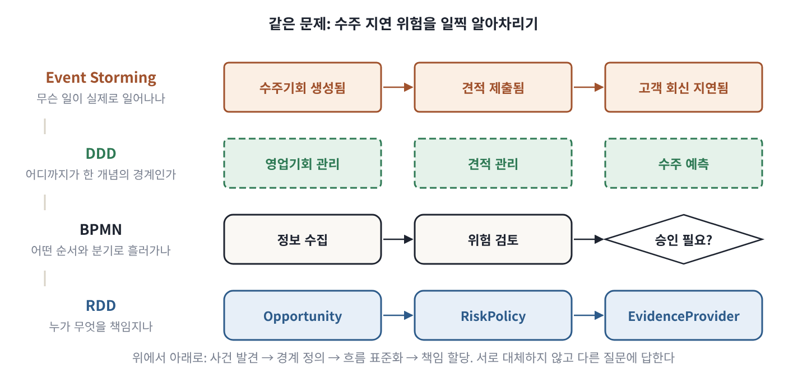

*같은 문제를 네 방법론으로 보면 답하는 질문과 산출물이 다르다. 사건, 경계, 흐름, 책임 순으로 이어서 쓰는 경우가 많다*

### A-5 학습 순서

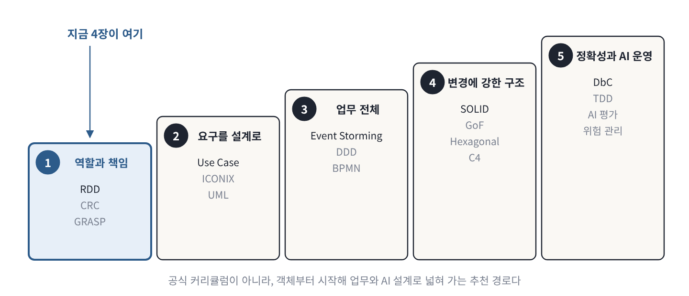

*객체의 역할과 책임에서 출발해 요구사항, 업무 전체, 아키텍처, 검증과 AI 운영으로 넓혀 가는 학습 순서*

**요지** 객체의 역할과 책임에서 시작해 요구사항, 업무 전체, 아키텍처, 검증과 AI 운영으로 넓혀 간다.

한꺼번에 공부하면 오히려 헷갈리므로 다섯 단계로 나누는 것이 좋다.

- 첫째, **역할과 책임**(RDD → CRC → GRASP). 기능 하나를 보고 어떤 객체가 무엇을 해야 하는지 설명할 수 있으면 된다.
- 지금 4장이 이 단계다.
- 둘째, **요구를 설계로**(Use Case → ICONIX → UML). 사용자 요구를 객체 사이의 메시지와 시퀀스 다이어그램으로 표현할 수 있으면 된다.
- 셋째, **업무 전체**(Event Storming → DDD → BPMN). 여러 부서의 개념, 규칙, 프로세스 경계를 정할 수 있으면 된다.
- 넷째, **변경에 강한 구조**(SOLID → GoF → Hexagonal → Clean → C4). 기술 의존성을 줄이고 구조를 다른 사람에게 설명할 수 있으면 된다.
- 다섯째, **정확성과 AI 운영**(DbC → TDD → AI 평가 → AI 위험 관리). 객체와 AI가 약속한 업무 계약을 지키는지 측정하고 안전한 운영 구조를 설계할 수 있으면 된다.
- 공식 커리큘럼이 아니라, 객체지향부터 배우고 업무와 AI 설계로 넓히려는 사람을 위한 추천 경로다.

**한 줄 정리** 4장은 다섯 단계 중 첫 단계이며, 나머지 단계는 모두 '누가 무엇을 책임지는가'라는 같은 질문을 더 넓은 범위에서 다시 묻는 것이다.

### A-6 정리: 설계 시 점검할 여섯 가지 질문

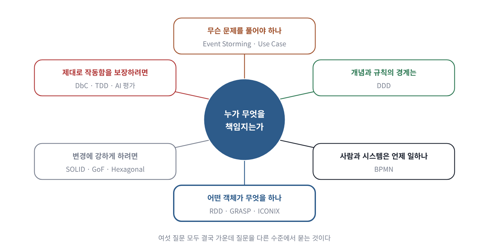

*설계자가 구분해야 할 여섯 질문과 각 질문에 가장 직접 답하는 방법. 가운데에는 4장의 질문이 있다*

설계자가 구분해야 할 질문은 여섯 가지다. 무슨 문제를 풀어야 하는가(Event Storming, Use Case), 업무 개념과 규칙의 경계는 어디인가(DDD), 사람과 시스템이 언제 어떻게 일하는가(BPMN), 어떤 객체가 무엇을 책임지는가(RDD, GRASP, ICONIX), 변경에 강한 소프트웨어를 어떻게 만드는가(SOLID, GoF, Hexagonal, Clean), 설계한 대로 작동하는지 어떻게 보장하는가(DbC, TDD, 통합 테스트, AI 평가). 4장의 '협력 → 책임 → 역할 → 객체'는 이 가운데 넷째 질문의 중심에 있다.

그러나 AX 설계자는 거기서 멈추면 안 된다.

- 객체가 할 일을 잘 나누는 데서 더 나아가, 어떤 업무는 사람이 맡고, 어떤 판단은 규칙 엔진이 하고, 어떤 작업은 AI에게 맡길지까지 설계해야 한다.
- 그래서 객체지향을 공부하는 최종 목표는 클래스를 잘 만드는 것이 아니라, 업무의 복잡성을 이해하고 알맞은 구성 요소에게 책임을 나눠 오래 유지되는 시스템을 만드는 능력이라고 볼 수 있다.

**참고**

- [Rebecca Wirfs-Brock, 『Object Design: Roles, Responsibilities, and Collaborations』](https://wirfs-brock.com/rebecca/books/ObjectDesign/) — RDD, CRC
- [Craig Larman, GRASP 정리 노트](https://www.objectsbydesign.com/books/larman_notes/6-DesignAndImplementationTechniques.html) — GRASP
- [Sparx Systems, ICONIX Process](https://sparxsystems.com/enterprise_architect_user_guide/16.1/modeling_domains/iconix_process.html) · [OMG, Why UML is important](https://www.omg.org/uml/why-uml-is-important.htm) — ICONIX, 고전 방법론과 UML
- [Martin Fowler, "Bounded Context"](https://martinfowler.com/bliki/BoundedContext.html) · [EventStorming](https://www.eventstorming.com/) · [OMG, BPMN](https://www.omg.org/bpmn/) — DDD, Event Storming, BPMN
- [NIST, AI RMF Playbook](https://airc.nist.gov/airmf-resources/playbook/) — AI 위험 관리

---

## 부록 B. 역할의 코드 표현

> **이 부록의 맥락** RDD로 정한 역할을 코드에 어떻게 적는지 다룬다. 인터페이스, 추상 클래스, 상속, 조합 같은 문법의 차이, 인터페이스를 언제 만들지, 패턴과 람다, 계약과 포트까지 '역할을 표현하는 수단'만 모음.

### B-1 인터페이스, 추상 클래스, 상속, 조합 비교

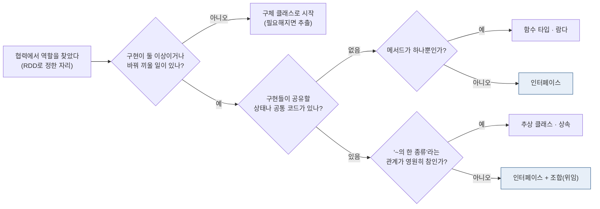

**요지** 역할을 '정하는' 것은 설계 방법(4.5.1의 RDD)의 일이고, 정한 역할을 코드로 '쓰는' 것은 언어 문법의 일이다. 인터페이스, 추상 클래스, 상속, 조합, 함수 타입, 구조적 타이핑은 방법론이 아니라 역할을 표현하는 문법이다.

**방법론과 문법과 원칙은 층이 다르다.** 책임 주도 설계는 '어떤 역할이 필요한가'를 정하는 방법론이다.

- 인터페이스나 추상 클래스는 그 역할을 코드에 적는 문법이다.
- 그 사이에서 '어떤 문법을 고를지' 판단하게 돕는 것이 원칙(리스코프 치환 원칙, 인터페이스 분리 원칙, '상속보다 조합')이고, 자주 쓰이는 조합을 이름 붙여 둔 것이 패턴(전략, 템플릿 메서드, 데코레이터)이다.

**인터페이스** 책임(메서드 목록)만 적고 구현은 전혀 갖지 않는 역할이다. 서로 관련 없는 클래스도 같은 역할을 맡을 수 있고, 한 클래스가 여러 역할을 맡을 수도 있다(4.3.5의 앨리스). 역할을 표현하는 가장 기본 문법이며, 2장 논쟁 ⑦의 의존 역전도 인터페이스로 구현한다.

**추상 클래스** 역할과 함께 공통 상태나 공통 코드를 일부 제공한다. 구현들이 같은 흐름을 따르고 일부 단계만 다를 때 유용하다(템플릿 메서드 패턴). 다만 Java 같은 언어에서는 하나만 상속할 수 있으므로, 한 객체가 여러 역할을 맡기 어려워진다.

**상속(구체 클래스 상속)** 이미 있는 클래스를 물려받아 고치는 방식이다.

- 코드 재사용은 쉽지만 부모의 구현 세부까지 물려받으므로, 부모가 바뀌면 자식이 함께 흔들린다.
- 1장에서 본 리스코프 치환 원칙을 지키는 '~의 한 종류' 관계일 때만 쓰는 것이 안전하다.
- GoF(Gang of Four, 『Design Patterns』(1994)의 네 저자)가 '클래스 상속보다 객체 조합을 선호하라'고 정리한 이유다.

**조합과 위임** 역할을 맡은 다른 객체를 필드로 가지고, 일을 그 객체에게 맡기는 방식이다. 실행 중에 협력 상대를 바꿔 끼울 수 있어 4장의 대체 가능성과 가장 잘 맞다. 전략 패턴과 데코레이터 패턴이 이 방식이다.

**함수 타입과 람다** 책임이 메서드 하나뿐인 역할은 함수로 표현할 수 있다. `Function<Money, Money>`가 할인 정책 역할을 대신하는 식이다(부록 B-3).

**구조적 타이핑** Go나 TypeScript처럼, 따로 선언하지 않아도 메서드 모양만 맞으면 같은 역할로 보는 방식이다(3장 3.3.4 보충). 역할을 정의하는 쪽(사용하는 쪽)이 필요한 책임만 적을 수 있어 인터페이스 분리 원칙과 잘 맞다.

| 문법 | 역할과 함께 주는 것 | 한 객체가 여러 역할 | 바꿔 끼우는 시점 | 잘 맞는 경우 |
| --- | --- | --- | --- | --- |
| 인터페이스 | 책임 목록만 | 가능 | 생성할 때 | 대부분의 역할 |
| 추상 클래스 | 책임 + 공통 코드 | 어려움 (단일 상속) | 생성할 때 | 같은 흐름, 일부 단계만 다르다 |
| 구체 클래스 상속 | 책임 + 구현 전부 | 어려움 | 생성할 때 | 영원히 참인 '~의 한 종류' |
| 조합·위임 | 협력 상대를 필드로 | 가능 | 실행 중에도 | 정책, 전략, 기능 덧붙이기 |
| 함수 타입 | 메서드 하나 | 가능 | 실행 중에도 | 메서드 하나짜리 정책 |
| 구조적 타이핑 | 모양이 맞으면 인정 | 가능 | 생성할 때 | Go, TypeScript 코드 |

#### 보충

**코드로 보기** 아래 코드에서 볼 것은 같은 '증인' 역할을 네 가지 문법으로 쓸 수 있고, 판사 쪽 코드는 문법과 상관없이 같다는 점이다.

```java
// ① 인터페이스: 책임만
interface Witness { Testimony testify(); }

// ② 추상 클래스: 책임 + 공통 흐름
abstract class SwornWitness implements Witness {
    public final Testimony testify() { swear(); return speak(); }   // 공통 흐름
    protected abstract Testimony speak();                          // 다른 부분만
}

// ③ 조합·위임: 증언 방식을 협력 객체에게 맡김
class Witnesses implements Witness {
    private final Witness delegate;                                 // 실행 중 교체 가능
    public Testimony testify() { return delegate.testify(); }
}

// ④ 함수 타입: 메서드 하나짜리 역할
Supplier<Testimony> quickWitness = () -> new Testimony("파이는 내가 봤다");

// 판사는 어떤 문법으로 쓰였는지 모름
Verdict hearCase(Witness w) { return decide(w.testify()); }
```

1. ①은 가장 기본 형태다. 모자 장수, 요리사, 앨리스가 각자 구현한다.
2. ②는 '선서하고 말한다'는 공통 흐름을 고정하고 말하는 부분만 하위 클래스에 맡긴다(템플릿 메서드).
3. ③은 증언을 다른 객체에게 위임하므로 실행 중에 증인을 바꿀 수 있다.
4. ④는 책임이 하나뿐일 때 클래스 없이 함수로 쓰는 방식이다.
5. 판사의 `hearCase`는 네 경우 모두 같다. 문법은 바뀌어도 협력은 바뀌지 않는다는 것이 4장의 요점이다.

**한 줄 정리** 방법론(RDD)이 역할을 정하고, 원칙(LSP, ISP, 상속보다 조합)이 문법 선택을 돕고, 문법(인터페이스, 추상 클래스, 조합, 함수)이 역할을 코드에 적는다. 기본값은 인터페이스와 조합이다.

### B-2 인터페이스 도입 시점

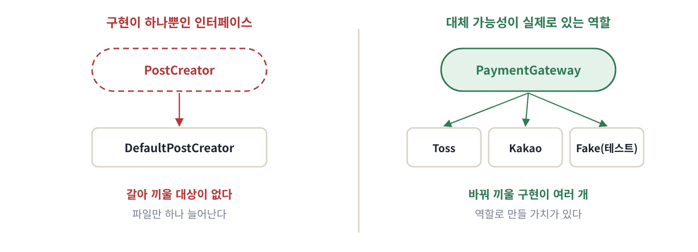

*역할을 인터페이스로 만드는 가치는 실제로 바꿔 끼울 구현이 있을 때 생긴다*

#### 무엇이 쟁점인가

4장은 역할이 재사용과 유연성의 열쇠라고 말한다.

- 이를 코드로 옮기면 흔히 '모든 클래스 앞에 인터페이스를 먼저 둔다'는 습관이 된다.
- `OrderService` 앞에 `IOrderService`를, `MemberRepository` 앞에 `MemberRepositoryInterface`를 만드는 식이다.
- 이것이 역할을 잘 쓰는 것인지, 아니면 쓸모없는 파일만 늘리는 것인지가 쟁점이다.
- 인터페이스에 **무엇을 담을지**는 3장 논쟁 ③(역할 인터페이스)에서 다뤘으므로, 여기서는 **언제 만들지**에 집중한다.

#### 쉽게 풀면

회사의 '직무 기술서'를 떠올리면 된다. 여러 사람이 번갈아 맡는 자리(예: 당직 담당)라면 '이 자리에서 할 일'을 문서로 정해 두는 것이 유용하다. 누가 맡든 그 문서만 보면 되기 때문이다. 그런데 사장 혼자 하는 일까지 직무 기술서를 따로 만들어 두면, 문서만 늘고 아무도 읽지 않는다.

역할도 같다. 여러 객체가 번갈아 들어오는 자리라면 역할로 만들 가치가 크고, 한 객체만 영원히 앉아 있는 자리라면 역할을 따로 만들 이유가 약하다.

#### 알아 둘 개념과 이론

과도한 추상화를 경계하는 원칙으로 **YAGNI**(You Aren't Gonna Need It, 지금 필요 없는 것은 만들지 말라)가 자주 언급된다.

- 익스트림 프로그래밍에서 나온 말로, 아직 오지 않은 변화를 위해 미리 구조를 만들지 말라는 뜻이다.
- 구현이 하나뿐이고 바꿀 계획도 없다면 인터페이스는 필요해질 때 만들어도 늦지 않는다.
- 요즘 IDE는 클래스에서 인터페이스를 뽑아내는 리팩터링(Extract Interface)을 버튼 하나로 해 주기 때문이다.

반대 방향의 근거도 있다.

- 모듈이나 팀의 경계를 넘는 곳, 외부 시스템(결제, 메일, 저장소)과 맞닿는 곳은 처음부터 역할로 떼어 두는 편이 낫다.
- 이런 곳은 테스트에서 가짜로 바꿔 끼워야 하고, 나중에 구현을 바꿀 가능성도 높기 때문이다.
- 2장 논쟁 ⑦에서 본 의존 역전 원칙이 바로 이 경계에 역할을 두라는 원칙이다.

#### 4장과의 연결

4.3.2~4.3.5에서 역할이 빛난 이유는 판사와 증인 자리에 **실제로 여러 인물이 번갈아 들어왔기** 때문이다.

- 바꿔 끼울 대상이 있어야 대체 가능성이 의미를 가진다.
- 그리고 4.2.2에서 본 것처럼 설계 초반에는 책임만 정하고, 메시지와 코드 형식은 나중에 정한다.
- 역할도 마찬가지로, 협력에서 바뀌는 자리가 보였을 때 인터페이스로 굳히면 된다.

#### 코드로 보기

아래 코드에서 볼 것은 인터페이스가 '필요해진 시점'에 생긴다는 점이다.

```java
// 처음: 구현이 하나뿐이면 클래스로 시작함
class LoanDesk {                                    // ① 대출 창구는 하나뿐
    Loan lend(Member m, Book b) { ... }
}

// 나중: 대출 기한 규칙이 여러 개 생기면 그 자리를 역할로 뽑아냄
interface LoanPolicy {                              // ② 번갈아 들어올 자리가 생김
    LocalDate dueDateFor(Member member);
}
class StandardPolicy implements LoanPolicy { ... }  // ③ 일반 회원용
class VacationPolicy implements LoanPolicy { ... }  // ③ 방학 기간용
```

1. ①의 대출 창구는 시스템에 하나뿐이고 바꿔 끼울 일이 없으므로 인터페이스 없이 클래스로 시작한다.
2. ②의 대출 기한 규칙은 회원 종류와 기간에 따라 여러 구현이 번갈아 들어온다. 이때 역할 인터페이스로 뽑아낸다.
3. ③처럼 실제 구현이 둘 이상 생겼기 때문에 인터페이스가 대체 가능성이라는 값을 가진다.

Q. 테스트에서 가짜 객체를 넣으려면 결국 모든 협력자에 인터페이스가 필요하지 않을까?

> **답** 테스트에서 실제로 바꿔 끼워야 하는 협력자라면 그 자체로 '구현이 둘 이상인' 경우이므로 역할로 만들 이유가 된다. 다만 모든 협력자를 그렇게 다룰 필요는 없다.
>
> 결제 API나 외부 메시지 전송처럼 테스트에서 진짜를 부르기 어려운 협력자는 역할 인터페이스로 만들고 가짜 구현을 넣는 것이 좋다. 운영에서는 진짜 결제사, 테스트에서는 가짜 결제사라는 두 구현이 실제로 생기기 때문이다.
>
> 반면 금액 계산처럼 빠르고 부작용이 없는 협력자는 진짜 객체를 그대로 써도 테스트가 잘 돌아간다. 이런 곳까지 인터페이스와 가짜 객체를 만들면 테스트가 구현 세부에 묶여 오히려 깨지기 쉬워진다. 이 판단은 부록 F-1(목 객체 활용 범위)과 이어진다.

### B-3 디자인 패턴의 현재 유효성

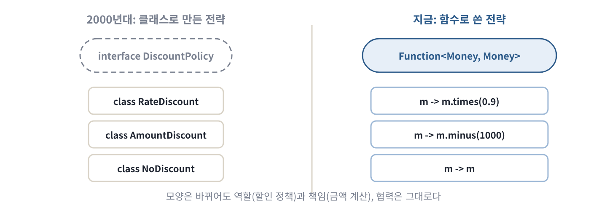

*전략 패턴의 클래스들은 요즘 언어에서 함수 한 줄로 바뀌기도 한다. 그래도 역할과 책임, 협력이라는 뼈대는 그대로다*

#### 무엇이 쟁점인가

4.5.2는 디자인 패턴을 역할, 책임, 협력의 템플릿으로 소개한다. 그런데 GoF의 책이 나온 것은 1994년이고, 그 사이 언어가 많이 바뀌었다. 요즘 언어에서는 람다 한 줄이면 되는 일을 클래스 여러 개로 만드는 패턴도 있다. 그래서 '패턴은 이제 낡은 지식인가'라는 질문이 나온다.

#### 쉽게 풀면

요리책의 '육수 내는 법'을 떠올리면 된다. 예전에는 뼈를 몇 시간 끓이는 과정이 레시피의 큰 부분이었지만, 지금은 육수 팩을 넣으면 된다. 과정은 짧아졌어도 '국에는 육수가 필요하다'는 원리는 그대로다.

패턴도 같다. 언어가 좋아지면서 패턴을 구현하는 코드는 짧아졌지만, 그 패턴이 해결하는 협력의 모양은 여전히 필요하다.

#### 알아 둘 개념과 이론

피터 노빅은 1996년 발표에서 GoF의 23개 패턴 가운데 16개가 Lisp나 Dylan 같은 동적 언어에서는 보이지 않거나 훨씬 단순해진다고 지적했다. 언어가 함수를 값처럼 다룰 수 있으면, 전략(Strategy), 명령(Command) 같은 패턴은 클래스 대신 함수로 표현할 수 있기 때문이다.

실제로 Java 8의 람다, Kotlin과 TypeScript의 고차 함수 덕분에 전략 패턴은 `Function` 하나로, 옵서버 패턴은 이벤트 리스너 등록으로, 반복자 패턴은 언어의 `for-each`와 스트림으로 흡수되었다. 반면 컴포지트, 데코레이터, 어댑터처럼 **객체들의 구조와 협력**을 다루는 패턴은 지금도 그대로 쓰인다.

#### 4장과의 연결

4장의 정의로 보면 패턴의 본질은 코드 모양이 아니라 **역할, 책임, 협력**이다. 전략 패턴을 클래스로 쓰든 람다로 쓰든 '할인 정책'이라는 역할, '금액을 계산한다'는 책임, '주문이 할인 정책에게 계산을 부탁한다'는 협력은 같다. 바뀐 것은 역할을 맡는 객체를 표현하는 문법뿐이다.

그래서 패턴의 이름과 협력 구조를 아는 것은 여전히 유용하다. '여기는 전략으로 갈아 끼우자'라는 한마디로 팀이 같은 설계를 떠올릴 수 있기 때문이다. 패턴은 공통의 어휘다.

#### 코드로 보기

아래 두 코드는 같은 전략 패턴이다. 볼 것은 역할과 협력이 그대로라는 점이다.

```java
// 클래스로 쓴 전략
interface DiscountPolicy { Money apply(Money price); }         // ① 역할
class RateDiscount implements DiscountPolicy {                 // ② 역할을 맡은 객체
    public Money apply(Money price) { return price.times(0.9); }
}
Money total = new RateDiscount().apply(price);                  // ③ 협력

// 함수로 쓴 전략
Function<Money, Money> rateDiscount = p -> p.times(0.9);       // ④ 역할을 맡은 함수
Money total = rateDiscount.apply(price);                        // ⑤ 같은 협력
```

1. ①의 `DiscountPolicy`가 할인 정책 역할이다. ②는 그 역할을 맡은 클래스다.
2. ③에서 주문 쪽은 역할에게 `apply`를 요청한다.
3. ④에서는 클래스 대신 람다가 같은 역할을 맡는다. `Function<Money, Money>`가 역할 인터페이스 노릇을 한다.
4. ⑤의 협력은 ③과 똑같다. 코드가 짧아졌을 뿐 설계는 바뀌지 않았다.

Q. 패턴을 공부할 때 무엇에 집중하면 좋을까?

> **답** 클래스 다이어그램의 모양보다, 그 패턴이 해결하는 문제와 그 안의 역할, 책임, 협력에 집중하는 것이 좋다.
>
> 패턴 책의 클래스 다이어그램을 외우면, 언어가 바뀌거나 상황이 조금만 달라져도 써먹기 어렵다. 반면 '컴포지트는 단품과 묶음을 같은 역할로 다뤄서 부르는 쪽이 구분하지 않게 하는 협력이다'처럼 이해하면, 파일 트리든 조직도든 메뉴판이든 같은 모양을 알아볼 수 있다.
>
> 그리고 패턴을 적용하는 순서도 중요하다. 문제를 먼저 보고, 책임 주도 설계로 협력을 그리다가 '이건 아는 모양이다'라고 알아볼 때 패턴을 적용하는 것이 좋다. 패턴부터 정하고 문제를 끼워 맞추면 4.4.1의 '클래스 구조부터 그리기'와 같은 오류가 된다.

### B-4 계약과 포트를 통한 역할 고정: DbC, 헥사고날, 클린 아키텍처

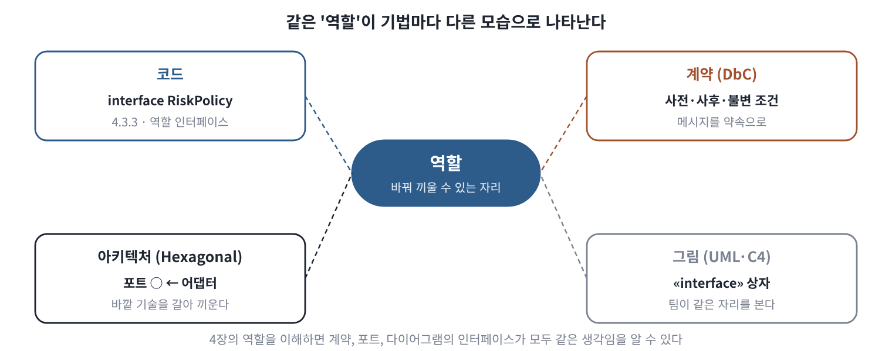

*4장의 역할은 코드에서는 인터페이스, 계약에 의한 설계에서는 약속, Hexagonal에서는 포트, 다이어그램에서는 인터페이스 상자로 나타난다*

**요지** 4장의 역할과 메시지는 계약에 의한 설계에서는 '약속'으로, Hexagonal과 Clean 아키텍처에서는 '포트'로 쓰인다.

**SOLID와 GoF** 1장 1.1.3 보충에서 본 SOLID는 변경에 강한 설계를 판단하는 다섯 원칙이고, 4.5.2와 부록 B-3에서 본 GoF 패턴은 반복되는 협력 문제의 해법 23개다.

- 둘 다 좋은 설계를 판단하고 다듬는 도구이지, 요구사항부터 구현까지 가는 전체 절차는 아니다.
- 패턴을 많이 썼다고 설계 품질이 높아지는 것도 아니고, 해결할 문제가 분명할 때 적용해야 한다.

**계약에 의한 설계** DbC(Design by Contract)는 버트런드 마이어가 Eiffel 언어와 함께 정리한 기법으로, 기능이 실행되기 전에 갖춰야 할 **사전조건**, 실행 후 보장할 **사후조건**, 언제나 지켜야 할 **불변조건**을 명시한다.

- 수주 확도를 바꾸는 기능이라면 '권한 있는 사용자이고 수정 가능한 영업기회가 있어야 한다'가 사전조건, '승인된 값이 저장되고 이력이 남는다'가 사후조건, '확도는 0~100이고 승인 없이 확정되지 않는다'가 불변조건이다.
- 4.2.2에서 책임을 메시지로 구체화했다면, DbC는 그 메시지를 **어기면 안 되는 약속**으로 적는 것이다.
- 부록 D-3에서 '형식이 같아도 계약이 다르면 대체할 수 없다'고 한 그 계약을 쓰는 방법이기도 한다.
- 다만 'AI가 좋은 제안서를 쓴다'처럼 정답이 하나가 아닌 결과는 사전·사후조건만으로 품질을 충분히 평가하기 어렵고, 부록 F-2의 평가가 필요하다.

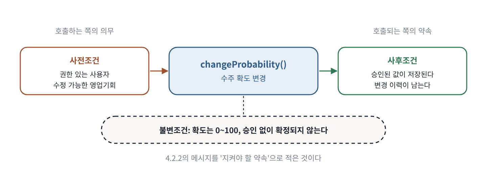

*계약에 의한 설계는 호출하는 쪽의 의무(사전조건), 호출되는 쪽의 약속(사후조건), 언제나 지켜야 할 규칙(불변조건)을 명시한다*

**Hexagonal과 Clean 아키텍처** Hexagonal 아키텍처(포트와 어댑터)는 앨리스터 코번이 제안한 구조로, 핵심 업무 규칙을 가운데 두고 화면, DB, 외부 API, AI 모델 같은 바깥 기술을 **포트**와 **어댑터**로 연결한다.

- 포트는 '이런 일을 해 줄 누군가'라는 자리이고, 어댑터는 그 자리를 실제로 맡은 구현이다.
- 4장 관점에서 보면 포트는 **역할**, 어댑터는 **역할을 맡은 객체**이다.
- 그래서 LLM 공급자를 바꿔도 가운데의 수주 확도 정책은 바뀌지 않는다.
- 로버트 마틴의 Clean 아키텍처는 같은 생각을 '소스 코드의 의존성은 안쪽의 정책을 향해야 한다'는 의존성 규칙으로 설명한다.
- 2장 논쟁 ⑦의 의존 역전 원칙을 시스템 전체로 넓힌 것이고, 둘은 실제로 함께 쓰는 경우가 많다.
- 다만 연결할 외부 기술이 거의 없고 바꿀 일도 없는 작은 프로그램에서는 계층이 과할 수 있다(부록 B-2의 YAGNI).

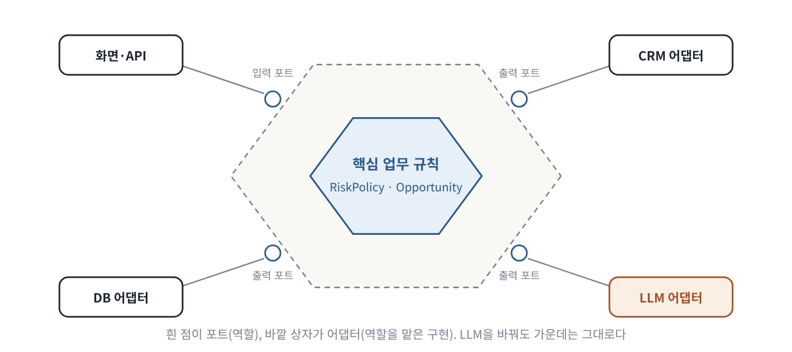

*Hexagonal 아키텍처는 핵심 업무 규칙을 가운데 두고, CRM, DB, AI 모델 같은 바깥 기술을 포트와 어댑터로 연결한다. 포트는 4장의 역할과 같은 자리다*

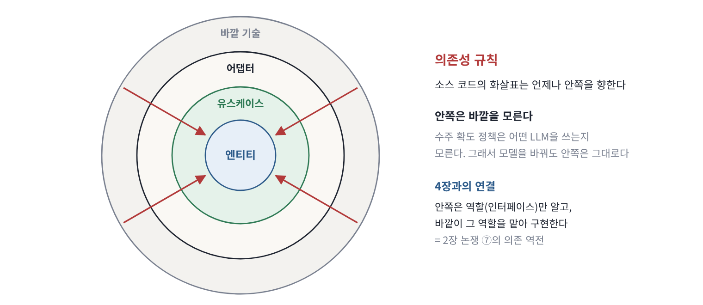

*Clean 아키텍처의 동심원. 안쪽 업무 규칙은 바깥 기술을 모르고, 의존성 화살표는 언제나 안쪽을 향한다*

**UML과 C4** 둘 다 설계를 공유하기 위한 그림이다.

- UML(Unified Modeling Language)은 클래스, 시퀀스, 상태, 유스케이스 다이어그램처럼 객체의 구조와 상호작용을 그리는 표준 언어이고, 4장의 협력은 시퀀스 다이어그램으로 그리기 좋다.
- 사이먼 브라운의 C4 모델은 시스템을 맥락(Context), 컨테이너(Container), 컴포넌트(Component), 코드(Code)의 네 단계로 확대해 보여 주므로 경영진부터 개발자까지 각자 필요한 수준에서 볼 수 있다.
- UML은 '객체가 어떻게 협력하나', C4는 '시스템이 어떤 부분으로 이뤄져 있나'에 답한다.

**한 줄 정리** DbC는 메시지를 약속으로, Hexagonal은 역할을 포트로 바꿔 쓴 것이므로, 4장을 이해하면 이 기법들의 절반은 이미 아는 셈이다.

**참고**

- Kent Beck, 『Extreme Programming Explained』 (YAGNI) · 3장 논쟁 ③ 참고 문헌 — 부록 B-2
- Gamma 외, 『Design Patterns』 (1994) · Peter Norvig, "Design Patterns in Dynamic Languages" (1996) — 부록 B-3
- [Eiffel Software, Design by Contract](https://www.eiffel.com/values/design-by-contract/introduction/) · [Martin Fowler, "Test Driven Development"](https://martinfowler.com/bliki/TestDrivenDevelopment.html) — DbC, TDD
- [Alistair Cockburn, "Hexagonal Architecture"](https://alistair.cockburn.us/hexagonal-architecture) · [Robert C. Martin, "The Clean Architecture"](https://blog.cleancoder.com/uncle-bob/2012/08/13/the-clean-architecture.html) · [Simon Brown, C4 Model](https://c4model.com/) — 아키텍처와 시각화

---

## 부록 C. 협력 흐름의 제어

> **이 부록의 맥락** 4.2.1의 '다른 객체의 활동을 제어하고 조정하는' 책임을 누가 쥐는지 다룬다. 조정자가 지휘하는 방식, 각자 이벤트에 반응하는 방식, 그리고 순서를 AI가 실행 중에 고르는 방식을 비교한다.

### C-1 중앙 지휘와 이벤트 반응: 오케스트레이션과 코레오그래피

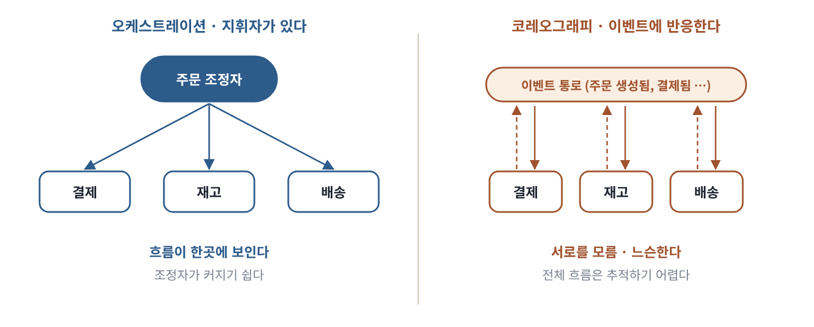

*여러 서비스의 협력을 한 조정자가 지휘할 수도 있고, 각 서비스가 이벤트에 반응해 스스로 움직이게 할 수도 있다*

#### 무엇이 쟁점인가

4장의 재판에서는 판사가 협력을 이끌었다. 판사가 토끼에게 요청하고, 증인에게 요청하고, 판결을 내린다. 이처럼 한 객체가 협력의 흐름을 주도하는 방식이 있는가 하면, 요즘 마이크로서비스에서는 **중심 없이 각자 이벤트에 반응하는 협력**도 많이 쓴다. 어느 쪽이 나은지가 쟁점이다.

#### 쉽게 풀면

오케스트라와 즉흥 재즈 공연을 비교하면 된다.

- 오케스트라에는 지휘자가 있어서 누가 언제 연주할지 지휘자가 정한다.
- 전체 흐름이 한눈에 보이지만, 지휘자가 모든 것을 알아야 한다.
- 재즈 공연에는 지휘자가 없고, 각 연주자가 다른 연주자의 소리를 듣고 반응하며 자기 차례를 정한다.
- 서로를 덜 묶지만, 공연이 어디로 흘러갈지 미리 보기 어렵다.

#### 알아 둘 개념과 이론

**오케스트레이션**(orchestration)은 조정자(orchestrator) 하나가 다른 서비스들에게 차례로 요청을 보내 협력을 진행하는 방식이다. 주문 조정자가 결제 서비스, 재고 서비스, 배송 서비스를 차례로 부르는 식이다.

**코레오그래피**(choreography)는 조정자 없이, 각 서비스가 일어난 일(이벤트)을 알리고 관심 있는 서비스가 그 이벤트에 반응하는 방식이다. 주문 서비스가 '주문이 생성됨'을 알리면, 결제 서비스가 그것을 듣고 결제를 처리한 뒤 '결제됨'을 알리고, 배송 서비스가 그것을 듣는 식이다.

여러 서비스에 걸친 작업을 일관되게 처리하는 방법인 **사가**(Saga) 패턴도 이 두 방식으로 구현할 수 있다.

- 크리스 리처드슨이 정리한 microservices.io가 대표적인 자료다.
- 일반적으로 참여자가 적고 흐름이 단순하면 코레오그래피가, 참여자가 많고 흐름과 실패 처리가 복잡하면 오케스트레이션이 관리하기 쉽다고 본다.

#### 4장과의 연결

두 방식 모두 4장의 협력이다.

- 차이는 **'다른 객체의 활동을 제어하고 조정하는' 책임**(4.2.1의 하는 것 세 번째)을 누가 지느냐다.
- 오케스트레이션은 그 책임을 조정자 한 곳에 몰아준다.
- 판사가 재판을 이끄는 것과 같다.
- 코레오그래피는 그 책임을 없애는 대신 각 참여자에게 '이 이벤트를 들으면 내 일을 한다'는 책임을 나눠 준다.

조정 책임이 한 곳에 모이면 흐름이 잘 보이지만, 조정자가 모든 참여자를 알아야 하므로 갓 오브젝트가 되기 쉽다(1장).

- 조정 책임을 나누면 참여자들은 서로를 모르게 되지만(낮은 결합도), 전체 협력이 어떤 순서로 일어나는지는 코드 어디에도 한눈에 보이지 않는다.
- 결국 4.4의 질문, '이 협력에서 누가 무엇을 책임지는가'를 서비스 단위에서 다시 묻는 것이다.

#### 코드로 보기

아래 두 코드는 '주문 후 결제와 배송을 처리한다'는 같은 협력이다. 볼 것은 흐름의 순서가 어디에 적혀 있느냐다.

```java
// 오케스트레이션: 조정자가 순서를 관리함
class OrderOrchestrator {
    void place(Order order) {
        payment.pay(order);               // ① 결제를 요청하고
        inventory.reserve(order);         // ② 재고를 잡고
        shipping.ship(order);             // ③ 배송을 요청함. 순서가 여기에 다 보임
    }
}

// 코레오그래피: 각자 이벤트에 반응함
class PaymentService {
    @EventListener
    void on(OrderPlaced e) {              // ④ '주문됨'을 들으면 결제함
        pay(e.order());
        events.publish(new OrderPaid(e.order()));   // ⑤ '결제됨'을 알림
    }
}

class ShippingService {
    @EventListener
    void on(OrderPaid e) { ship(e.order()); }       // ⑥ '결제됨'을 들으면 배송함
}
```

1. ①~③에서 조정자가 세 서비스를 차례로 부른다. 흐름을 이해하려면 이 메서드 하나만 읽으면 된다. 대신 조정자는 세 서비스를 모두 알아야 한다.
2. ④에서 결제 서비스는 '주문됨' 이벤트에 반응한다. 누가 주문을 만들었는지는 모른다.
3. ⑤에서 결제가 끝나면 '결제됨'을 알릴 뿐, 누가 그것을 듣는지는 모른다.
4. ⑥에서 배송 서비스는 '결제됨'에 반응한다. 결제 서비스와 배송 서비스는 서로를 전혀 모른다.

코레오그래피에서 '주문 → 결제 → 배송'이라는 순서는 어느 한 메서드에도 적혀 있지 않고, 이벤트 이름들을 따라가야만 보인다.

Q. 재판을 코레오그래피로 만든다면 어떤 모습일까? 그것이 더 나을까?

> **답** 판사가 '재판 시작됨'을 알리면 토끼가 그것을 듣고 증인을 부르고, '증인 입장함'을 들은 증인이 증언하며, '증언 완료'를 들은 판사가 판결하는 모습이 된다. 그러나 재판처럼 순서가 엄격하고 실패 처리가 중요한 협력에는 대개 맞지 않는다.
>
> 장점은 판사가 토끼나 증인을 직접 몰라도 된다는 것이다. 새로운 참여자(예: 기록관)가 생겨도 '증언 완료' 이벤트를 듣기만 하면 되고, 판사 코드는 바뀌지 않는다.
>
> 그러나 재판은 '증인이 입장하기 전에는 증언할 수 없다', '증언이 끝나야 판결한다'처럼 순서가 엄격하다.
>
> - 이 순서가 이벤트들 사이에 흩어지면, 증인이 오지 않았을 때 누가 재판을 멈출지, 같은 이벤트가 두 번 오면 어떻게 할지를 참여자마다 따로 처리해야 한다.
> - 전체 흐름을 아는 객체가 없으니 문제가 생겼을 때 원인을 찾기도 어렵다.
>
> 그래서 판사가 흐름을 주도하는 오케스트레이션이 재판에는 더 자연스럽다. 반대로 '판결이 나면 신문사에 알리고, 기록 보관소에 저장한다'처럼 순서가 중요하지 않고 참여자가 계속 늘어날 수 있는 일은 이벤트로 알리는 편이 좋다. 한 시스템 안에서도 두 방식을 섞어 쓴다.

### C-2 코드가 정하는 순서와 AI가 정하는 순서: 워크플로와 에이전트

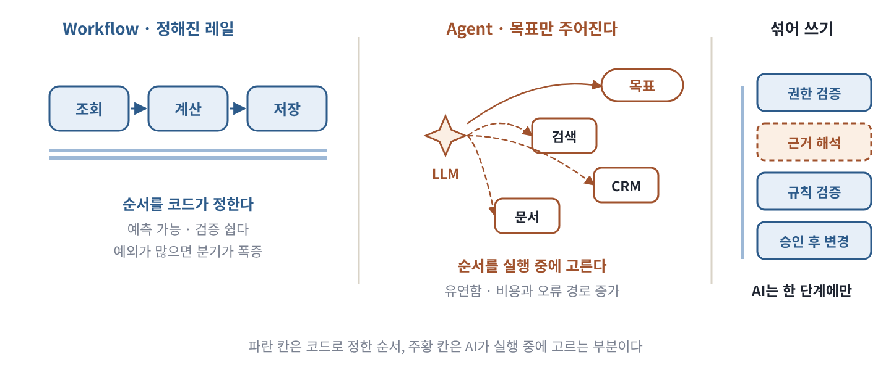

*Workflow는 협력의 순서를 코드가 정하고, Agent는 실행 중에 고른다. 실무에서는 정해진 흐름 중 한 단계에서만 AI가 판단하게 하는 방식이 많다*

#### 무엇이 쟁점인가

4장의 협력에서는 어떤 객체에게 어떤 메시지를 언제 보낼지를 설계자가 정한다.

- 재판에서 판사가 토끼를 부르고, 증인을 부르고, 판결하는 순서는 코드에 적혀 있다.
- 그런데 AI Agent는 목표만 받고, 어떤 도구를 어떤 순서로 쓸지를 실행 중에 스스로 고를 수 있다.
- 협력의 순서를 코드가 정할지, AI가 정하게 할지가 쟁점이다.

#### 쉽게 풀면

기차와 택시를 비교하면 된다.

- 기차는 레일이 깔려 있어서 어느 역을 어떤 순서로 지날지 미리 정해져 있다.
- 언제 어디에 도착할지 정확히 알 수 있지만, 레일이 없는 곳은 갈 수 없다.
- 택시 기사는 목적지만 듣고 길을 스스로 고른다.
- 막힌 길을 피해 갈 수 있지만, 어떤 길로 갈지 미리 알 수 없고 요금도 달라진다.

#### 알아 둘 개념과 이론

Anthropic은 2024년 12월 글 'Building effective agents'에서 이 둘을 구분했다.

- **Workflow**는 LLM(Large Language Model, 대규모 언어 모델)과 도구를 **미리 정한 코드 경로**로 엮은 시스템이고, **Agent**는 LLM이 자기 과정과 도구 사용을 **스스로 동적으로 정하는** 시스템이다.
- 같은 글은 가능한 한 단순한 방법부터 시작하고, 정말 필요할 때만 복잡도를 올리라고 권한다.
- OpenAI의 Agents SDK 문서도 LLM이 흐름을 정하는 방식과 코드가 흐름을 정하는 방식을 모두 지원하며, 둘을 섞을 수 있다고 설명한다.

둘의 장단점은 뚜렷하다. Workflow는 예측 가능하고 검증하기 쉽지만, 예외가 다양하면 분기가 폭증한다. Agent는 비정형 문제(자료 조사, 원인 찾기, 형식이 제각각인 문서 분석)에 강하지만, 비용과 지연이 늘고 잘못될 수 있는 경로도 많아진다.

#### 4장과의 연결

4.2.1에서 '하는 것'의 세 번째는 **다른 객체의 활동을 제어하고 조정하는 것**이었다.

- Workflow는 이 조정 책임을 코드가 맡는 것이고, Agent는 조정 책임의 일부를 AI에게 넘기는 것이다.
- 부록 C-1(오케스트레이션과 코레오그래피)가 '조정 책임을 한 곳에 둘지 나눌지'였다면, 이 논쟁은 '조정 책임을 결정적인 코드에 둘지, 확률적으로 답하는 AI에게 둘지'의 문제다.

해석을 덧붙이면, 핵심은 AI에게 **작업 수행의 유연성**을 주더라도 **비즈니스 책임의 경계**까지 바꾸게 두지 않는 것이다. 자료를 어떤 순서로 읽을지는 AI가 골라도 되지만, 권한 검증을 건너뛰거나 승인 없이 값을 바꿀지는 AI가 정할 일이 아니다.

#### 코드로 보기

아래 코드에서 볼 것은 AI가 자유롭게 움직이는 범위가 한 메서드 안으로 갇혀 있다는 점이다.

```java
class RiskReviewWorkflow {                              // ① 순서는 코드가 정함
    Proposal review(User user, OpportunityId id) {
        permission.check(user, id);                     // ② 결정적: 권한 검증
        Analysis a = riskAnalyst.analyze(id);           // ③ AI: 어떤 자료를 어떻게 읽을지는 자유
        policy.validate(a);                             // ④ 결정적: 규칙 검증
        return Proposal.pendingApproval(a);             // ⑤ 값을 바꾸지 않고 '승인 대기'로 끝냄
    }
}
```

1. ①의 Workflow가 협력의 순서를 정한다. 권한 검증, 분석, 규칙 검증, 승인 대기라는 순서는 AI가 바꿀 수 없다.
2. ②와 ④는 언제 실행해도 같은 결과가 나오는 결정적인 단계다. 일반 단위 테스트로 지킬 수 있다.
3. ③의 `riskAnalyst`만 AI이다. 그 안에서 어떤 문서를 먼저 읽고 어떤 도구를 부를지는 Agent가 정한다.
4. ⑤에서 결과는 '변경안'일 뿐이고, 공식 값은 승인 뒤에 따로 바뀐다. 이 구조는 부록 E-6과 이어진다.

Q. 그렇다면 AI가 업무 프로세스 자체를 다시 짜게 하는 것은 나쁜 AX(AI Transformation, AI 전환)일까?

> **답** 나쁘다고 단정할 수는 없지만, AI가 제안한 프로세스를 그대로 실행하게 두는 것은 대개 위험하다. 프로세스 재설계는 '제안'과 '확정'을 나눠서 다루는 편이 좋다.
>
> AI는 실행 기록을 보고 '이 승인 단계는 대부분 그냥 통과되니 생략해도 되겠다' 같은 개선안을 잘 찾아낼 수 있다. 이것은 수행 책임과 판단 보조로서 좋은 쓰임이다.
>
> 그러나 승인 단계를 실제로 없애는 것은 통제 책임을 바꾸는 일이다. 4장 관점에서 보면 협력의 모양 자체를 바꾸는 것이므로, 협력을 설계한 사람이 검토하고 확정해야 한다. AI의 제안은 설계 회의의 입력이 되고, 결정은 사람이 내린다.

**참고**

- [Chris Richardson, "Pattern: Saga" (microservices.io)](https://microservices.io/patterns/data/saga.html) — 부록 C-1
- [Anthropic, "Building effective agents" (2024.12)](https://www.anthropic.com/research/building-effective-agents) — 부록 C-2

---

## 부록 D. 책임 주체의 배분: 사람, 규칙, AI

> **이 부록의 맥락** 협력에 AI가 참여할 때 책임을 사람, 규칙, AI 중 누구에게 맡길지 다룬다. 책임을 수행, 판단, 통제로 나누고, Agent를 몇 개로 나눌지, 규약이 같으면 바꿔 끼울 수 있는지를 4장의 역할로 읽는다.

### D-1 책임의 세 유형: 수행, 판단, 통제

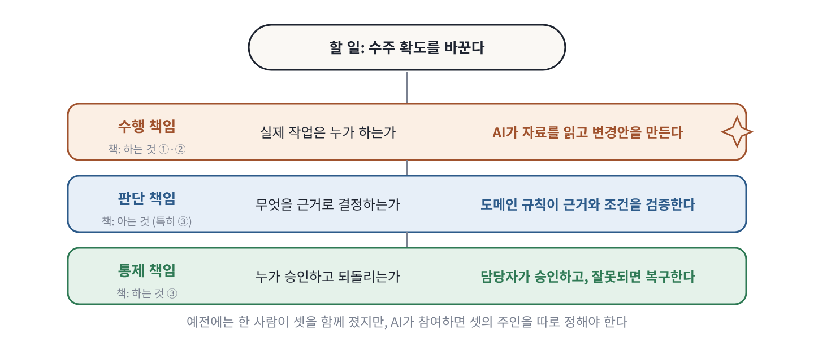

*같은 일이라도 수행, 판단, 통제 책임은 서로 다른 주인에게 맡길 수 있다. AI 설계는 이 셋을 나누는 데서 시작한다*

협력에 **AI**가 참여하면 책임을 누구에게 맡길지가 새 질문이 된다.

- 2024년 말부터 2026년까지 나온 Agent 설계 자료(Anthropic, OpenAI, OWASP, MCP와 A2A 명세 등)를 4장의 어휘로 다시 읽는다.
- 외부 자료에서 확인된 사실과 그것을 4장에 연결한 해석은 구분해서 적는다.
- 그 출발점으로, AI가 맡을 일을 책의 분류에 따라 세 갈래로 나눠 둔다.

**상황** 고객 관리 시스템(CRM, Customer Relationship Management)에서 수주 확도(계약이 성사될 가능성)를 바꾸는 일을 생각해 보자. 예전에는 영업 담당자가 자료를 보고, 규칙에 따라 판단하고, 관리자 승인을 받아 값을 바꿨다.

- AI를 들이면 자료를 읽고 변경안을 만드는 일은 AI가 할 수 있다.
- 문제는 '수주 확도를 바꾼다'는 일을 AI에게 통째로 맡겨도 되는지를 묻는다.

**책의 근거 ① 책임은 하나가 아니라 묶음이다.** 4.2.1에서 저자는 책임을 '객체에 의해 정의되는 응집도 있는 행위의 집합'이라고 정의한다.

- 그리고 라만의 분류를 따라 책임을 '하는 것' 세 가지(스스로 하는 것, 다른 객체의 행동을 시작시키는 것, 다른 객체의 활동을 제어하고 조정하는 것)와 '아는 것' 세 가지(개인적인 정보, 관련된 객체, 계산하거나 유도할 수 있는 것)로 나눈다.
- 즉 '수주 확도를 바꾼다'는 한 문장 안에도 성격이 다른 책임이 여러 개 들어 있다.

**책의 근거 ② 세 갈래는 이 분류를 다시 묶은 것이다.** 이 학습서는 책의 여섯 분류를 AI 상황에 맞게 세 묶음으로 부른다. '수행, 판단, 통제'라는 이름은 책의 용어가 아니라 정리를 위해 붙인 이름이다.

- **수행 책임**: 실제 작업을 하는 것. 책의 '스스로 하는 것'과 '다른 객체의 행동을 시작시키는 것'에 해당한다. 예: 자료를 읽고 변경안을 만드는 일.
- **판단 책임**: 무엇을 근거로 결정하는가. 책의 '아는 것', 특히 '계산하거나 유도할 수 있는 것'에 해당한다. 예: 근거가 규칙에 맞는지 판정하는 일.
- **통제 책임**: 누가 흐름을 쥐고 승인하고 되돌리는가. 책의 '다른 객체의 활동을 제어하고 조정하는 것'에 해당한다. 예: 승인하고, 잘못되면 복구하는 일.

책의 분류에서 세 갈래로, 다시 실제로 맡을 주체로 이어지는 흐름을 그리면 다음과 같다.

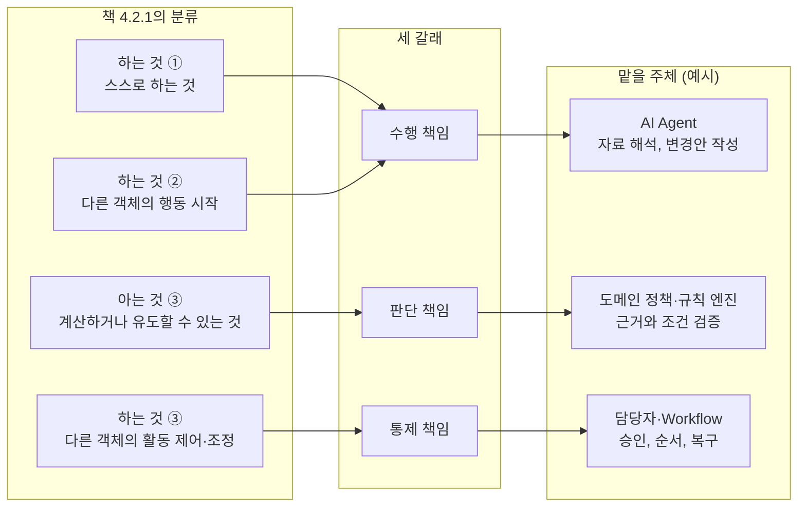

**책의 근거 ③ 왜 나눠서 맡겨야 하는가.** 세 가지 이유 모두 4장에서 나온다.

- **적절한 객체에게 맡긴다(4.5.1).** 책임 주도 설계는 책임을 그 일에 필요한 정보를 가장 잘 아는 객체(정보 전문가)에게 맡기라고 한다. 판단에 필요한 규칙은 도메인 정책이, 공식 값은 CRM이, 승인 권한은 담당자가 가지고 있다. 이 책임들을 정보가 없는 AI에게 묶어 주면 4.1.3 '논의해 보기'의 토끼처럼 자기 것이 아닌 일을 떠맡는 셈이다.
- **바꿔 끼울 수 있게 한다(4.3.5).** 대체 가능성은 동일한 책임의 수행을 뜻한다. 수행 책임만 떼어 하나의 역할로 두면, 그 자리에 규칙 엔진이든 AI든 사람이든 바꿔 끼울 수 있다. 세 책임이 한 덩어리로 AI 안에 들어가 있으면 AI를 바꾸거나 빼는 순간 판단과 통제까지 함께 사라진다.
- **협력이 모양을 정한다(4.4).** 'AI를 쓴다'는 기술부터 정하면 4.4.1의 '클래스부터 그리기'와 같은 오류가 된다. 먼저 협력에 필요한 책임을 나누고, 그다음에 어느 책임을 AI에게 맡길지 정하는 것이 4장의 순서다.

**정리** 4.2.1의 '하는 것'과 '아는 것'이라는 분류는 AI가 들어와도 그대로 유효하다.

- 달라지는 것은 한 사람이 함께 지던 책임을 **나눠서 서로 다른 주인에게 맡길 수 있게 되었다**는 점이고, 그래서 책임의 주인과 실행 주체를 따로 설계해야 한다.
- 부록 C-2, D-2, D-3, E-6, F-2는 모두 이 세 갈래 중 어디를 AI에게 맡길지에 대한 것이다.

### D-2 에이전트 구성: 단일 에이전트와 다중 에이전트

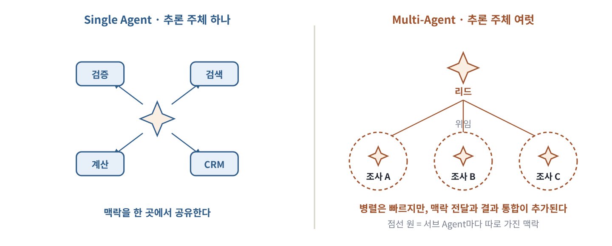

*Single Agent는 하나의 추론 주체가 여러 도구를 부르고, Multi-Agent는 리드가 여러 서브 Agent에게 일을 나눈다. 나누는 만큼 맥락 전달과 통합 비용이 생긴다*

#### 무엇이 쟁점인가

4장은 적절한 책임을 적절한 역할에게 나누라고 말한다. 이 말을 AI에 그대로 옮기면 '검색 Agent, CRM Agent, 분석 Agent, 검증 Agent'처럼 기능마다 Agent를 따로 만드는 설계가 나온다. 역할을 나누는 것이 곧 Agent를 나누는 것인지가 쟁점이다.

#### 쉽게 풀면

혼자 일하는 숙련자와 팀 프로젝트를 비교하면 된다.

- 숙련자 한 명은 여러 도구를 번갈아 쓰면서도 머릿속 맥락을 계속 이어 간다.
- 팀은 여러 갈래를 동시에 조사할 수 있어 빠르지만, 누가 무엇을 맡을지 나누고, 각자 알게 된 것을 공유하고, 마지막에 합치는 일이 따로 생긴다.
- 팀원이 많을수록 회의도 늘어난다.

#### 알아 둘 개념과 이론

**Single Agent**는 하나의 추론 주체가 여러 도구를 부르는 구조이고, **Multi-Agent**는 여러 추론 주체가 일을 나누고 위임하는 구조다. 차이는 모듈 개수가 아니라 **추론 주체의 개수**이다. Single Agent도 여러 역할과 도구를 쓸 수 있다.

Anthropic은 2025년 6월 자사 리서치 기능의 Multi-Agent 구조를 공개하며, Claude Opus 4를 리드로 두고 Claude Sonnet 4를 서브 Agent로 쓴 구성이 Opus 4 단일 Agent보다 **내부 리서치 평가에서 90.2% 더 좋은 성능**을 냈다고 보고했다.

- 여러 방향을 동시에 조사할 수 있는 복잡한 조사에서 이점이 컸고, 일부 복잡한 조사에서는 시간을 최대 90% 줄였다고 한다.
- 같은 글은 이런 구조가 일반 채팅보다 토큰(처리 비용의 단위)을 훨씬 많이 쓰며, 서로 강하게 의존하는 작업에는 잘 맞지 않는다는 한계도 함께 적었다.
- 즉 이 수치는 특정 모델 조합과 내부 평가의 결과이고, 일반 기업 업무에서도 같은 개선이 난다는 뜻은 아니다.
- OpenAI의 오케스트레이션 문서도 전문 Agent를 추가하기 전에 분리할 실질적 이익이 있는지 먼저 보고, 가능하면 단일 Agent부터 시작하라고 안내한다.

#### 4장과의 연결

4장의 **역할**과 AI의 **Agent**는 같은 개념이 아니다.

- 역할은 협력 안의 자리이고, 그 자리를 누가 맡을지는 별도의 결정이다(4.3.5).
- 예를 들어 '근거가 충분한지 판정한다'는 `EvidenceValidator` 역할은 일반 함수, 규칙 엔진, AI 모델, 사람 중 누구든 맡을 수 있다.
- 역할을 하나 정했다고 Agent를 하나 만들어야 하는 것은 아니다.

그래서 역할을 나눈 뒤에 따로 물어야 한다.

- '이 책임은 독립적인 추론이 필요한가, 아니면 정확하게 실행하면 되는 기능인가.' 검색은 일반 검색 도구로, 확도 계산은 규칙 엔진으로, 복잡한 문서의 의미 해석은 AI로 맡기는 편이 경제적이고 검증하기도 쉽다.
- 4장의 '적절한 책임을 적절한 객체에게'를 AI에 적용하면 이렇게 된다.

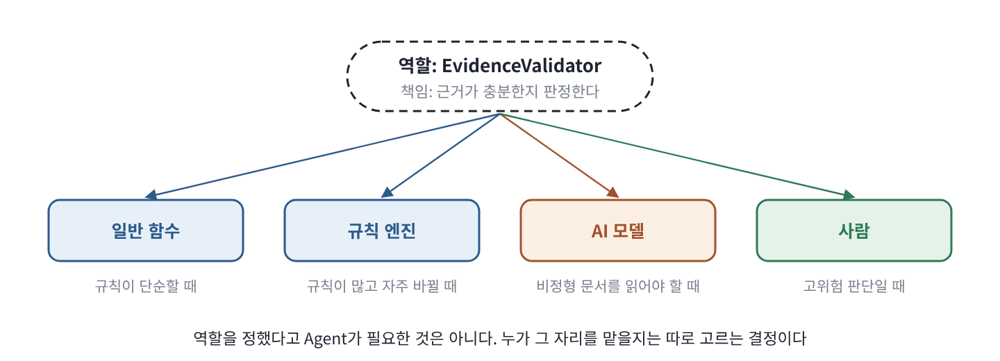

*하나의 역할은 함수, 규칙 엔진, AI 모델, 사람 누구든 맡을 수 있다. 4.3.5의 대체 가능성이 AI 시대에도 그대로 적용된다*

#### 코드로 보기

아래 코드에서 볼 것은 같은 역할 인터페이스에 규칙 구현과 AI 구현이 나란히 들어간다는 점이다.

```java
interface EvidenceValidator {                            // ① 역할: 근거가 충분한지 판정
    Verdict validate(Evidence e);
}

class RuleBasedValidator implements EvidenceValidator {  // ② 규칙으로 충분할 때
    public Verdict validate(Evidence e) {
        return e.count() >= 3 ? Verdict.ENOUGH : Verdict.LACKING;
    }
}

class LlmValidator implements EvidenceValidator {        // ③ 회의록처럼 비정형일 때만 AI
    public Verdict validate(Evidence e) { return llm.judge(e.text()); }
}
```

1. ①의 역할은 누가 맡을지 말하지 않는다. 협력하는 쪽은 `validate`만 부른다.
2. ②는 규칙 한 줄로 끝나는 경우다. 이 자리에 Agent를 둘 이유가 없다.
3. ③은 근거가 문장으로 흩어져 있어 해석이 필요할 때만 AI가 같은 자리를 맡는다. 바꿔 끼워도 협력은 그대로다.

Q. 4장의 책임 주도 설계를 AI Agent에 그대로 적용하면 어떤 문제가 생길까?

> **답** 역할을 Agent와 같은 것으로 보면, 필요 이상으로 많은 추론 주체가 생기는 문제가 생긴다. 책임을 나누는 것과 Agent를 나누는 것은 별개의 결정으로 봐야 한다.
>
> Agent가 늘어나면 Agent마다 맥락을 따로 가져야 하므로, 서로 맥락을 넘겨주고 결과를 합치는 일이 늘어난다. 비용과 지연이 커지고, 어디서 잘못됐는지 추적하기도 어려워진다. 부록 C-1에서 본 '조정자가 모든 것을 알아야 하는' 문제가 Agent 사이에서도 생긴다.
>
> 그래서 순서는 4.5.1과 같다. 먼저 협력과 책임을 정하고, 역할을 찾고, 그다음에 그 역할을 함수, 규칙, AI, 사람 중 누구에게 맡길지 정한다. Agent는 마지막 선택지 중 하나다.

### D-3 표준 규약과 대체 가능성: MCP와 A2A

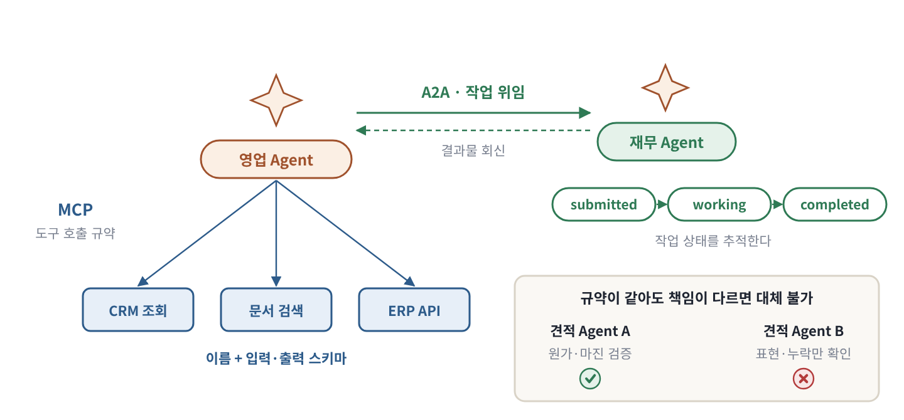

*MCP는 Agent가 도구를 부르는 규약이고, A2A는 Agent끼리 작업을 맡기고 상태를 주고받는 규약이다. 둘 다 메시지의 형식을 정할 뿐 책임까지 보장하지는 않는다*

#### 무엇이 쟁점인가

4.2.2는 책임을 메시지로 구체화하고, 4.3.5는 같은 책임을 수행하는 객체끼리 대체할 수 있다고 한다.

- 지금의 Agent 생태계에는 이 '메시지 형식'을 표준으로 정하려는 규약이 두 가지 있다.
- **MCP**(Model Context Protocol)와 **A2A**(Agent2Agent Protocol)이다.
- 같은 규약을 지키는 두 Agent라면 서로 대체할 수 있는지가 쟁점이다.

#### 쉽게 풀면

전기 콘센트를 떠올리면 된다.

- 플러그 모양이 맞으면 어떤 가전이든 꽂을 수 있다.
- 그러나 플러그가 맞는다고 그 가전이 내가 원하는 일을 하는 것은 아니다.
- 같은 콘센트에 꽂힌 전기 주전자와 헤어드라이어는 둘 다 '전기를 받는다'는 규약은 지키지만, 물을 끓여야 할 때 헤어드라이어를 대신 쓸 수는 없다.

#### 알아 둘 개념과 이론

**MCP**는 AI 애플리케이션이 외부의 데이터와 도구를 찾고 부르는 규약이다.

- 도구마다 이름, 설명, 입력 스키마(받을 값의 형식), 출력 형식을 명세한다.
- CRM 조회, 문서 검색, ERP(Enterprise Resource Planning, 전사적 자원 관리) API 호출 같은 것을 AI가 표준 방식으로 쓸 수 있게 한다.

**A2A**는 독립적인 Agent끼리 서로의 능력을 알아보고, 작업을 맡기고, 작업 상태를 추적하는 규약이다.

- 각 Agent는 자기가 무엇을 할 수 있는지 적은 카드(Agent Card)를 공개하고, 맡은 작업은 '접수됨, 진행 중, 완료됨' 같은 상태를 거치며 결과물을 돌려준다.
- 짧게 말해 MCP는 **Agent와 도구 사이**, A2A는 **Agent와 Agent 사이**의 규약이다.

#### 4장과의 연결

책의 협력은 '역할 정의 → 메시지 전송 → 책임 수행 → 응답'이었다. Agent 시스템에서는 이것이 '능력 발견 → 작업 위임 → 도구 또는 Agent 실행 → 결과 검증 → 응답'으로 늘어난다. 겉모습은 4장의 협력과 거의 같다.

그러나 4.3.5의 결론을 기억해야 한다.

- 대체 가능성은 **행위 호환성**이고, 행위 호환성은 **동일한 책임의 수행**이다.
- 메시지 형식이 같다는 것은 '플러그가 맞는다'는 뜻일 뿐이다.
- A2A를 지원하는 견적 분석 Agent가 둘 있어도, 하나는 원가와 마진을 검증하고 다른 하나는 표현과 누락 항목만 본다면 업무적으로는 대체할 수 없다.
- 4.3.5 보충의 '`testify()`를 구현했지만 늘 예외를 던지는 증인'과 같은 경우다.

그래서 Agent의 역할 명세에는 입출력보다 많은 것이 필요하다.

- 무슨 결과를 책임지는지, 실행 전에 갖춰야 할 조건, 공식 근거로 쓸 수 있는 데이터, 조회·제안·수정·실행 중 어디까지 할 수 있는지, 실패하거나 두 번 실행되면 어떻게 하는지, 성공을 무엇으로 판단하는지까지 적어야 한다.
- 4.2.2에서 책임을 먼저 정하고 메시지를 나중에 정했던 것처럼, AX에서는 그 메시지를 **검증 가능한 업무 계약**으로 만드는 일까지가 설계다.
- MCP와 A2A는 이 계약을 전달하는 수단이지, 계약 자체를 대신 써 주지는 않는다.

#### 코드로 보기

아래 코드에서 볼 것은 형식(시그니처)이 같아도 계약(책임)이 다르면 같은 자리에 넣으면 안 된다는 점이다.

```java
interface QuoteReviewer {                          // ① 형식: 견적을 받아 검토 결과를 돌려줌
    Review review(Quote q);
    // 계약: 원가 대비 마진이 기준 이상인지 검증해야 함   ② 책임은 주석이나 테스트로만 드러남
}

class MarginAgent implements QuoteReviewer { ... } // ③ 마진을 실제로 계산함
class StyleAgent  implements QuoteReviewer { ... } // ④ 문구와 누락 항목만 확인함

@Test void 마진이_기준_미만이면_반려한다() {         // ⑤ 계약을 테스트로 고정함
    assertThat(reviewer.review(lowMarginQuote).rejected()).isTrue();
}
```

1. ①의 형식만 보면 두 Agent 모두 `QuoteReviewer`이다. MCP나 A2A로 연결해도 똑같이 보인다.
2. ②의 계약은 시그니처에 드러나지 않는다. 그래서 명세와 테스트로 따로 적어야 한다.
3. ③과 ④는 컴파일러 입장에서는 서로 대체 가능하지만, ④는 마진을 보지 않으므로 계약을 어긴다.
4. ⑤처럼 계약을 테스트로 적어 두면 ④를 이 자리에 넣는 순간 실패하므로, 형식만 같은 가짜 대체를 막을 수 있다.

Q. 도구 호출 형식이 같은 두 AI Agent는 서로 대체 가능하다고 볼 수 있을까?

> **답** 형식이 같은 것은 대체 가능성의 필요조건일 뿐이고 충분조건은 아니다. 같은 요청에 같은 책임을 다하는지까지 확인해야 대체 가능하다고 말할 수 있다.
>
> 4.3.5에서 증인 역할을 맡으려면 입장하고 증언할 수 있어야 했다. 메서드 이름이 같아도 증언을 못 하면 증인이 아니다. Agent도 같다. 입력과 출력 형식이 같아도 판단 기준, 쓸 수 있는 데이터, 권한, 실패 처리가 다르면 업무 결과가 달라진다.
>
> 실무에서는 두 Agent에 같은 평가 세트를 돌려 결과가 계약을 만족하는지 확인한 뒤에야 바꿔 끼우는 것이 안전하다. 이 평가 방법이 다음 부록 F-2의 주제다.

### D-4 정리: AI 협력 시스템의 책임 배치

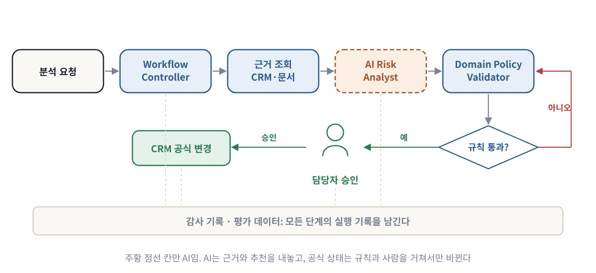

*AI는 분석과 근거 제시만 맡고, 규칙 검증과 사람의 승인을 거친 뒤에만 공식 데이터가 바뀌는 구조다*

부록 C-2, D-2, D-3, E-6, F-2의 내용을 겹쳐 하나의 구조로 그려 보면 아래와 같다. AI 기반 영업기회 위험 분석과 수주 확도 추천 기능을 새로 만든다고 가정한 것이다. 기술 문서가 제시한 공식 아키텍처가 아니라, 4장의 책임 주도 설계와 앞의 자료들을 조합한 하나의 제안이다.

요청이 들어오면 Workflow Controller가 협력의 순서를 관리하고(부록 C-2), 근거를 조회한 뒤 AI Risk Analyst에게 분석을 맡긴다.

- AI는 이 구조에서 한 칸뿐이다(부록 D-2).
- AI의 결과는 Domain Policy Validator가 규칙으로 검증하고, 통과하면 담당자가 승인한 뒤에야 CRM의 공식 값이 바뀐다(부록 E-6).
- 모든 단계는 감사 기록과 평가 데이터로 남는다(부록 F-2).

이 구조에서 각 구성 요소가 **맡지 않아야 할 책임**까지 함께 적어 두면 경계가 분명해진다.

| 구성 요소 | 맡는 책임 | 맡지 않아야 할 책임 |
| --- | --- | --- |
| CRM | 공식 업무 데이터 관리 | AI의 추론 |
| AI Risk Analyst | 위험 분석과 근거 제시 | 공식 수주 확도 확정 |
| Domain Policy Validator | 비즈니스 규칙 검증 | 비정형 문서의 자유로운 해석 |
| Workflow Controller | 협력과 상태 전이 조정 | 모든 도메인 판단을 직접 수행 |
| 담당자(사람) | 승인, 거절, 최종 업무 판단 | 반복적인 자료 수집 |
| 감사·평가 | 추적과 품질 측정 | 업무 의사결정 |

여기서 한 가지 구분이 특히 중요하다.

- AI가 검색으로 찾은 정보와 CRM에 기록된 공식 상태는 같은 것이 아니다.
- 회의록에 '수주 가능성이 높다'고 적혀 있어도, 그 문장은 판단의 **근거**이지 확정된 **값**이 아니다.
- AI가 찾은 정보는 제안의 근거로 쓰고, 공식 데이터의 변경은 규칙과 승인 절차를 거쳐 실행해야 한다.
- 2장의 말로 하면 상태를 바꾸는 행동의 책임은 그 상태의 주인에게 있다는 원칙을 AI에도 적용하는 것이다.

**AI가 들어와도 바뀌지 않는 것** AI가 참여하는 설계에서 확인한 것은 세 가지다.

- 첫째, 책임 주도 설계는 AI 시대에도 유효하되, 책임을 나눠 줄 대상이 객체에서 서비스, 도구, Agent, 사람으로 넓어진다.
- 둘째, Agent를 많이 만들고 자율성을 높이는 것이 곧 좋은 설계는 아니다.
- 결정적인 규칙과 확률적인 추론을 구분하고, 책임을 정확히 정의하는 것이 먼저다.
- 셋째, 설계의 성공 기준은 '메서드가 실행되었는가'에서 '업무가 올바른 상태에 도달했고, 그 과정이 안전하고 검증 가능했는가'로 옮겨 간다.
- 그래서 4장을 읽고 기억할 질문은 '어떤 객체를 만들 것인가'보다 먼저 이것이다.
- **어떤 결과를 보장해야 하며, 그 결과를 위해 누구에게 어떤 책임을 맡길 것인가.** 그 '누구'에 AI가 하나 더 늘었을 뿐이다.

**참고**

- [Anthropic, "How we built our multi-agent research system" (2025.06)](https://www.anthropic.com/engineering/multi-agent-research-system) · [OpenAI, Agents SDK 오케스트레이션 문서](https://developers.openai.com/api/docs/guides/agents/orchestration) — 부록 D-2
- [MCP, Tools 명세](https://modelcontextprotocol.io/specification/2025-11-25/server/tools) · [A2A, Protocol 명세](https://a2a-protocol.org/latest/specification/) — 부록 D-3

---

## 부록 E. 권한 설계

> **이 부록의 맥락** '역할'이라는 말이 가장 자주 쓰이는 권한 설계를 4장으로 읽는다. 관리자 등급, 유료와 무료와 베타 기능, RBAC와 규칙 기반 판정, 쿠버네티스 RBAC, AI에게 줄 권한, 시스템 상황별 권한 분리를 다룬다.

### E-1 권한의 역할과 4장의 역할 비교


*4장의 역할은 협력에서 지는 책임의 묶음이고, 권한 설계의 역할은 시스템에서 허락된 행동의 묶음이다. 둘 다 사람이 아니라 자리에 이름을 붙인다*

**요지** 4장의 역할은 '협력 안에서 무엇을 해 주는가(책임)'이고, 권한 설계의 역할은 '시스템에서 무엇을 해도 되는가(허락)'이다. 이름은 같지만 묻는 질문이 다르며, 둘을 섞으면 설계가 꼬다.

**같은 점** 둘 다 사람이나 객체가 아니라 '자리'에 이름을 붙인다.

- 4.3에서 판사 자리에 왕이든 여왕이든 들어갈 수 있었던 것처럼, '일반관리자' 자리에는 김 대리든 박 과장이든 들어갈 수 있다.
- 사람이 바뀌어도 자리의 정의는 바뀌지 않으므로, 권한을 사람에게 직접 주지 않고 역할에 준다.
- 이것이 RBAC(Role-Based Access Control, 역할 기반 접근 제어)의 출발점이다.

**다른 점** 4장의 역할은 '이 자리를 맡으면 이 메시지에 응답해야 한다'는 **의무**이다.

- 권한의 역할은 '이 자리를 맡으면 이 행동을 해도 된다'는 **허락**이다.
- 그래서 객체 설계에서는 '누가 판정하는가'를 따로 물어야 한다.
- 사용자가 슈퍼관리자인지 판정하는 일은 사용자 객체의 책임이 아니라 접근 정책(AccessPolicy)이라는 별도 객체의 책임이 된다.

**책임의 위치** 권한 판정을 곳곳의 `if (user.isSuperAdmin())`로 흩어 놓으면, 권한 규칙이 바뀔 때마다 모든 화면과 API를 고쳐야 한다. 4.5.1의 정보 전문가 원칙대로 '권한 규칙을 가장 잘 아는 객체'에게 판정 책임을 모으면, 나머지 객체는 '이 행동을 해도 되는가'를 묻기만 하면 된다.

**한 줄 정리** 권한의 역할은 허락의 묶음이고 4장의 역할은 책임의 묶음이며, 권한 판정 자체는 접근 정책 객체의 책임으로 모아야 한다.

### E-2 관리자 등급 체계: 슈퍼관리자와 일반관리자


*관리자 등급은 역할 계층으로 만들되, 요청과 승인은 서로 다른 사람이 맡도록 직무를 분리한다*

**요지** 관리자 등급은 역할 계층으로 설계하되, 슈퍼관리자라도 모든 일을 혼자 확정하지 못하게 직무를 분리해야 한다.

**역할 계층** 백오피스에는 보통 슈퍼관리자, 일반관리자, 운영자, 조회 전용 같은 등급이 있다.

- 상위 역할이 하위 역할의 권한을 물려받는 구조를 역할 계층(role hierarchy)이라고 한다.
- 미국 국립표준기술연구소(NIST)가 정리한 RBAC 모델(ANSI INCITS 359-2004 표준)도 사용자, 역할, 권한, 세션에 더해 역할 계층과 직무 분리를 핵심 구성으로 둔다.

**최소 권한** 각 역할에는 그 일을 하는 데 필요한 권한만 준다.

- 조회 전용 역할이 '혹시 몰라' 수정 권한까지 가지면, 계정 하나가 탈취되었을 때 피해 범위가 커진다.
- 4.3.5의 '객체는 역할보다 많은 것을 가질 수 있다'를 권한에 그대로 적용하면 위험해진다.
- 객체는 능력을 더 가져도 되지만, 권한은 역할이 허락한 만큼만 보여야 한다.

**직무 분리** 슈퍼관리자라도 '환불 요청'과 '환불 승인'을 혼자 다 하면 안 되는 업무가 있다.

- 이것을 직무 분리(Separation of Duties)라고 한다.
- 4장의 말로는 요청하는 역할과 승인하는 역할을 서로 다른 객체가 맡게 협력을 설계하는 것이다.
- 부록 E-6에서 본 '수행과 통제의 분리'와 같은 생각이다.

**슈퍼관리자는 역할이 아니라 예외다.** 모든 권한을 가진 계정은 편하지만, 감사 기록과 사용 시간 제한, 이중 승인 같은 별도 통제를 붙여 '평소에는 쓰지 않는 자리'로 관리하는 것이 일반적이다.

#### 보충

**코드로 보기** 아래 코드에서 볼 것은 화면과 서비스가 등급을 직접 비교하지 않고, 정책에게 '해도 되는가'만 묻는다는 점이다.

```java
enum Permission { REFUND_REQUEST, REFUND_APPROVE, USER_READ, USER_EDIT }

class Role {                                              // ① 권한의 묶음
    private final Set<Permission> grants;
    private final Role parent;                            // ② 역할 계층
    boolean allows(Permission p) {
        return grants.contains(p) || (parent != null && parent.allows(p));
    }
}

class AccessPolicy {                                      // ③ 판정 책임을 한 곳에
    boolean can(User user, Permission p, Refund refund) {
        if (p == Permission.REFUND_APPROVE && refund.requestedBy(user))
            return false;                                 // ④ 직무 분리: 자기 요청은 승인 불가
        return user.roles().stream().anyMatch(r -> r.allows(p));
    }
}
```

1. ①의 `Role`은 권한의 묶음이다. 사람이 아니라 자리에 권한을 준다.
2. ②의 `parent`가 역할 계층이다. 일반관리자는 운영자의 권한을 물려받는다.
3. ③의 `AccessPolicy`가 판정 책임을 모음. 화면, API, 배치 작업이 모두 이 객체에게 묻기만 한다.
4. ④는 직무 분리 규칙이다. 등급이 높아도 자기가 요청한 환불은 승인할 수 없다.

**한 줄 정리** 관리자 등급은 역할 계층으로 만들고, 최소 권한과 직무 분리를 접근 정책 객체 한 곳에서 판정한다.

### E-3 요금제와 베타 기능에 따른 기능 제어


*기능 사용 여부에는 기능 플래그, 요금제 자격, 역할 권한이라는 세 질문이 섞여 있다. 거절 이유에 따라 사용자에게 보여 줄 안내도 달라진다*

**요지** '이 기능을 쓸 수 있는가'에는 서로 다른 세 질문이 섞여 있다. 해도 되는가(권한), 돈을 냈는가(자격), 지금 켜져 있는가(기능 플래그). 셋을 다른 객체에 맡겨야 바뀔 때 서로 흔들리지 않는다.

**권한(Permission)** 사용자의 역할이 그 행동을 허락하는지를 묻는다. 관리자만 회원을 정지할 수 있다는 규칙이 여기에 해당한다.

**자격(Entitlement)** 사용자가 속한 요금제나 계약이 그 기능을 포함하는지를 묻는다. 무료 플랜은 프로젝트 3개까지, 유료 플랜은 무제한 같은 규칙이다. 자격은 결제와 계약에 따라 바뀌므로, 보안 규칙인 권한과 섞으면 영업 정책이 바뀔 때마다 보안 코드를 고치게 된다.

**기능 플래그(Feature Flag)** 기능이 지금 이 사용자에게 켜져 있는지를 묻는다.

- 베타 기능을 일부 사용자에게만 열거나, 문제가 생기면 배포 없이 끄는 데 쓴다.
- 플래그는 대개 임시이므로 정식 출시 후에는 지워야 한다.
- 플래그를 다루는 공통 인터페이스로 CNCF(Cloud Native Computing Foundation)의 OpenFeature 같은 표준도 나와 있다.

**협력으로 보면** '보고서 내보내기' 요청이 들어오면, 기능 플래그가 '켜져 있는가', 자격이 '요금제에 포함되는가', 권한이 '이 사용자가 해도 되는가'를 각자 판정하고, 하나라도 거절하면 기능을 막는다.

- 거절 이유도 다르게 보여 줄 수 있다.
- 플래그가 꺼져 있으면 기능을 숨기고, 자격이 없으면 업그레이드를 안내하고, 권한이 없으면 관리자에게 요청하라고 안내한다.


*요금제를 Plan이라는 역할로 두면 무료, 유료, 기업 요금제를 같은 자리에 바꿔 끼울 수 있다*

#### 보충

**코드로 보기** 아래 코드에서 볼 것은 세 판정이 서로 다른 역할로 나뉘어 있고, 요금제는 전략 패턴으로 갈아 끼운다는 점이다.

```java
interface Plan {                                          // ① 자격: 요금제가 역할
    boolean includes(Feature f);
    int projectLimit();
}
class FreePlan implements Plan { ... }                    // 프로젝트 3개, 내보내기 없음
class ProPlan  implements Plan { ... }                    // 무제한, 내보내기 포함

class FeatureGate {
    Decision check(User u, Feature f) {
        if (!flags.isEnabled(f, u))      return Decision.HIDDEN;     // ② 플래그: 베타
        if (!u.plan().includes(f))       return Decision.UPGRADE;    // ③ 자격: 요금제
        if (!policy.can(u, f.action()))  return Decision.FORBIDDEN;  // ④ 권한: 역할
        return Decision.ALLOWED;
    }
}
```

1. ①의 `Plan`이 자격을 맡는 역할이다. 새 요금제가 생기면 구현만 추가하면 된다(4.3.5 대체 가능성).
2. ②의 플래그는 배포와 실험의 문제다. 베타가 끝나면 이 줄을 지운다.
3. ③의 요금제 판정은 영업 정책의 문제다. 가격 정책이 바뀌어도 ④의 보안 규칙은 건드리지 않는다.
4. ④의 권한 판정은 부록 E-2의 `AccessPolicy`에게 맡긴다. 세 판정의 결과가 달라서 사용자에게 보여 줄 안내도 달라진다.

**한 줄 정리** 권한은 보안, 자격은 계약, 플래그는 배포의 문제이므로 세 객체로 나누어 협력시킨다.

### E-4 권한 판정 모델 비교: RBAC, ABAC, ReBAC


*RBAC는 역할로, ABAC는 속성과 규칙으로, ReBAC는 관계로 권한을 판정한다. 실무에서는 RBAC를 기본으로 두고 나머지로 보강하는 경우가 많다*

**요지** 권한을 '역할'로 미리 묶어 줄지(RBAC), 요청할 때마다 '규칙'으로 판정할지(ABAC와 정책 기반), '관계'로 판정할지(ReBAC)는 시스템의 성격에 따라 고른다. 실무에서는 섞어 쓴다.

**RBAC(역할 기반)** 사용자에게 역할을 주고, 역할에 권한을 준다.

- 단순하고 감사하기 쉬워서 사내 백오피스나 관리자 콘솔에 잘 맞다.
- 단점은 조건이 늘어날수록 역할이 폭증한다는 것이다.
- '서울 지점의 평일 근무 시간에만 환불을 승인하는 관리자'를 역할로 만들기 시작하면 역할이 수백 개가 된다.

**ABAC와 규칙 기반** 사용자 속성(부서, 등급), 자원 속성(금액, 소유자), 환경 속성(시간, 접속 위치)을 조합한 규칙으로 요청마다 판정한다.

- NIST SP 800-162(2014)가 ABAC(Attribute-Based Access Control, 속성 기반 접근 제어)를 정리했다.
- '금액이 100만 원 이하이고 자기 부서의 건이면 승인 가능' 같은 세밀한 규칙에 강하지만, 규칙이 많아지면 '왜 허락되었는가'를 추적하기 어려워진다.
- 그래서 규칙을 코드에서 떼어 정책 언어로 관리하는 정책 엔진을 많이 쓴다.
- CNCF의 OPA(Open Policy Agent)와 Rego, AWS가 2023년 공개한 Cedar가 대표적이다.

**ReBAC(관계 기반)** '이 문서의 소유자', '이 팀의 멤버'처럼 사용자와 자원 사이의 관계로 판정한다.

- 구글 드라이브식 공유 권한이 대표적이며, 구글이 2019년 논문으로 공개한 Zanzibar가 이 방식의 기준이 되었다.
- 협업 도구나 멀티테넌트 SaaS처럼 '누가 무엇을 공유받았는가'가 핵심인 시스템에 맞다.

**4장으로 보면** 세 모델 모두 '판정'이라는 책임을 어느 객체에 둘 것인가의 문제다.

- RBAC는 판정에 필요한 정보를 역할 묶음에, ABAC는 속성과 규칙에, ReBAC는 관계 그래프에 둔다.
- 어떤 모델을 쓰든 판정 책임을 `AccessPolicy`라는 하나의 역할 뒤에 숨겨 두면, 나중에 RBAC에서 ABAC로 바꿔도 협력하는 객체들은 바뀌지 않는다(4.3.5).


**한 줄 정리** 역할로 묶을지, 규칙으로 판정할지, 관계로 판정할지는 상황에 따라 고르되, 판정 책임은 하나의 정책 역할 뒤에 둔다.

### E-5 쿠버네티스 RBAC 구조


*쿠버네티스의 Role은 무엇을 해도 되는지 정의하고, RoleBinding은 그 역할을 누가 맡는지 연결한다. 4장의 역할과 객체의 분리와 같은 구조다*

**요지** 쿠버네티스 RBAC는 '무엇을 해도 되는가(Role)'와 '누가 그 자리를 맡는가(RoleBinding)'를 서로 다른 객체로 분리한다. 4장의 역할과 객체의 분리를 인프라에서 그대로 구현한 예다.

**네 가지 객체** `Role`은 한 네임스페이스 안에서 허락할 동사(get, list, create, delete 등)와 자원(pods, deployments 등)을 정의한다.

- `ClusterRole`은 같은 정의를 클러스터 전체 범위로 한다.
- `RoleBinding`과 `ClusterRoleBinding`은 그 역할을 사용자, 그룹, 서비스 계정(ServiceAccount)에 연결한다.
- 쿠버네티스 RBAC는 허락만 더하는 방식이라 '거부' 규칙이 없다.
- 그래서 처음부터 최소 권한으로 시작해야 한다.

**4장으로 보면** `Role`은 역할(책임과 허락의 정의)이고, `RoleBinding`은 그 역할을 누가 맡는지를 정하는 연결이다. 4.3.2에서 '판사'라는 자리와 그 자리에 앉는 왕을 나눴던 것과 같은 구조다. 역할 정의를 바꾸지 않고 바인딩만 바꿔서 담당자를 교체할 수 있다.

**실무 원칙** 사람에게 `cluster-admin`을 주는 대신 네임스페이스별 Role을 주고, 배포 파이프라인이나 AI Agent 같은 프로그램에는 사람 계정 대신 전용 서비스 계정을 만들어 필요한 동사만 허락한다. 부록 E-6의 권한 사다리를 인프라 수준에서 구현하는 방법이다.

#### 보충

**코드로 보기** 아래 YAML에서 볼 것은 역할 정의와 연결이 서로 다른 객체라는 점이다.

```yaml
apiVersion: rbac.authorization.k8s.io/v1
kind: Role                          # ① 역할: 무엇을 해도 되는가
metadata:
  namespace: sales
  name: deploy-reader
rules:
- apiGroups: ["apps"]
  resources: ["deployments"]
  verbs: ["get", "list", "watch"]   # ② 조회 동사만 허락
---
apiVersion: rbac.authorization.k8s.io/v1
kind: RoleBinding                   # ③ 연결: 누가 그 자리를 맡는가
metadata:
  namespace: sales
  name: risk-agent-reads-deploys
subjects:
- kind: ServiceAccount
  name: risk-analyst-agent          # ④ 사람이 아닌 AI Agent 전용 계정
  namespace: sales
roleRef:
  kind: Role
  name: deploy-reader
  apiGroup: rbac.authorization.k8s.io
```

1. ①의 `Role`은 sales 네임스페이스 안에서만 유효한 역할이다.
2. ②에서 조회 동사만 주었으므로 이 역할로는 배포를 바꾸거나 지울 수 없다(최소 권한).
3. ③의 `RoleBinding`이 역할과 맡는 주체를 연결한다. 역할 정의는 그대로 두고 연결만 바꿔 담당을 교체할 수 있다.
4. ④처럼 프로그램에는 전용 서비스 계정을 준다. 사람 관리자 계정을 AI에게 빌려주지 않는 것이 핵심이다.

**한 줄 정리** Role은 자리의 정의, RoleBinding은 자리를 맡는 주체이며, 이 분리가 4장의 역할과 객체의 분리다.

### E-6 AI 권한 범위와 사람의 승인


*AI에게 주는 권한을 조회부터 고위험 변경까지 단계로 나누고, 단계가 오를수록 통제를 두껍게 한다. 공식 표준이 아니라 실무용 예시다*

#### 무엇이 쟁점인가

4.2.1은 책임을 '하는 것'과 '아는 것'으로 나눈다. AI는 점점 많은 것을 '할 수 있게' 되고 있다. 그런데 AI가 어떤 일을 할 수 있다는 사실이, 그 일을 실행할 **권한**까지 가져야 한다는 뜻인지가 쟁점이다.

#### 쉽게 풀면

병원의 수련의를 떠올리면 된다.

- 수련의는 진료 기록을 보고, 진단을 제안하고, 처방안을 쓸 수 있다.
- 그러나 처방을 확정하고 수술을 결정하는 서명은 전문의가 한다.
- 수련의의 능력이 부족해서가 아니라, 잘못되었을 때 책임을 질 사람과 되돌리는 절차가 정해져 있어야 하기 때문이다.
- 경력이 쌓이면 혼자 처리할 수 있는 범위가 단계적으로 넓어진다.

#### 알아 둘 개념과 이론

OWASP(Open Worldwide Application Security Project)는 2025년판 LLM 애플리케이션 보안 위험 목록에 **과도한 자율 권한**(Excessive Agency)을 넣었다.

- AI에게 기능, 권한, 자율성을 지나치게 넓게 주면, 잘못된 입력이나 악의적인 지시가 실제 피해로 이어질 수 있다는 것이다.
- 2025년 12월에는 Agent 애플리케이션만을 다룬 별도의 보안 위험 10선(OWASP Top 10 for Agentic Applications)도 발표했다.
- OpenAI의 Agents SDK도 자동 검사(Guardrails)와 사람의 검토(Human-in-the-loop)를 구분하고, 민감한 작업이 실행되기 전에 승인을 기다리며 멈출 수 있게 지원한다.

이를 토대로 실무에서는 AI의 권한을 단계로 나눠 설계하곤 한다.

- 아래는 공식 표준이 아니라 실무용 예시다.
- L1 조회(검색, 요약), L2 추천(분석, 초안), L3 준비(변경안 생성), L4 실행(허용된 범위의 작업), L5 특권(계약 승인, 중요 데이터 삭제)이다.
- L1과 L2는 접근 권한과 결과 검증으로, L3는 실제 변경과 분리하는 것으로, L4는 정책 범위와 감사 기록으로, L5는 사람의 승인과 별도 권한 검증으로 통제한다.
- 다만 실제 위험은 업무와 데이터에 따라 달라진다.
- 조회만 하더라도 민감한 개인정보를 외부로 보낸다면 고위험 작업이 된다.

#### 4장과의 연결

4장에서 좋은 설계는 맡은 책임을 잘 수행하도록 역할을 나누는 것이었다.

- AI가 협력에 참여하면 한 가지가 더 필요하다.
- **작업을 수행할 능력과, 그 결과를 확정할 권한을 따로 설계하는 것**이다.
- 도입에서 나눈 세 갈래로 말하면, AI에게 수행 책임을 주더라도 통제 책임은 따로 둘 수 있어야 한다.

이것은 4.3.5의 '객체는 역할보다 더 많은 것을 가질 수 있다'를 거꾸로 본 것이기도 한다.

- AI 모델은 실제로는 훨씬 많은 일을 할 수 있지만, 협력 안에서는 역할이 허락한 책임과 권한만 보이게 해야 한다.
- 1장 1.1.3 보충의 인터페이스 분리 원칙을 권한에 적용하는 셈이다.
- AX 설계자는 AI의 기능 목록을 만드는 사람이 아니라, 사람과 규칙과 AI 사이의 **책임 경계**를 설계하는 사람이다.

#### 코드로 보기

아래 코드에서 볼 것은 AI에게 넘기는 도구 목록 자체가 권한의 경계라는 점이다.

```java
enum Level { READ, RECOMMEND, PREPARE, EXECUTE, PRIVILEGED }

class ToolGateway {
    Result call(Tool tool, Args args, Level granted) {
        if (tool.level().compareTo(granted) > 0)                 // ① 허락된 단계보다 높으면 거절
            return Result.denied(tool);
        if (tool.level() == Level.PRIVILEGED)                    // ② L5는 사람 승인 전까지 멈춤
            return approvals.request(tool, args);
        audit.record(tool, args);                                // ③ 실행은 모두 기록
        return tool.invoke(args);
    }
}

Level salesAnalyst = Level.PREPARE;                              // ④ 이 Agent는 변경안까지만
```

1. ①에서 도구마다 단계가 붙어 있고, Agent에게 허락된 단계보다 높은 도구는 아예 부를 수 없다. AI가 아무리 그럴듯하게 요청해도 막힌다.
2. ②에서 L5 도구는 바로 실행되지 않고 승인 요청으로 바뀐다. 사람이 승인해야 실제로 실행된다.
3. ③에서 실행한 모든 도구 호출을 감사 기록으로 남긴다. 부록 F-2의 Trace 평가 재료가 된다.
4. ④의 영업 분석 Agent는 L3까지만 허락받았으므로 변경안은 만들 수 있지만 CRM을 직접 고칠 수는 없다.

Q. AI의 정확도가 사람보다 높아지면 승인 단계를 없애도 될까?

> **답** 정확도가 높아지면 승인 대상을 줄일 수는 있지만, 통제 책임 자체를 없애는 것과는 다른 문제다. 승인 단계는 '누가 더 잘 맞히는가'가 아니라 '잘못됐을 때 누가 책임지고 되돌리는가'를 위한 것이기 때문이다.
>
> 실무에서는 단계적으로 넓힌다. 처음에는 L3(변경안)까지만 주고, 사람이 승인한 기록과 Agent 평가 결과(부록 F-2)가 쌓이면 위험이 낮은 작업부터 L4로 올린다. 금액이 작거나 되돌리기 쉬운 작업이 먼저 대상이 된다.
>
> 그래도 계약 승인이나 중요 데이터 삭제처럼 되돌리기 어렵고 피해가 큰 작업은 정확도와 상관없이 사람의 승인을 남겨 두는 편이 좋다. 정확도 99%여도 나머지 1%의 피해를 감당할 주체가 있어야 하기 때문이다.

### E-7 시스템 상황별 권한 분리


*사내 백오피스, B2C, 멀티테넌트 B2B, 인프라, AI Agent 시스템마다 기본 권한 모델과 꼭 분리할 축이 다르다*

**요지** 권한 설계에 정답 모델은 없고, 시스템이 어떤 상황에 있느냐에 따라 기본 모델과 분리해야 할 축이 달라진다.

**사내 백오피스** 사용자가 직원이고 업무 역할이 분명하므로 RBAC가 기본이다. 슈퍼관리자 통제와 직무 분리, 감사 기록이 핵심이다.

**B2C 유료 서비스** 권한보다 자격이 중심이다. 회원 대부분은 같은 권한을 가지지만 요금제에 따라 쓸 수 있는 기능이 다르다. 자격과 기능 플래그를 권한과 분리하는 것이 핵심이다.

**멀티테넌트 B2B SaaS** 고객사(테넌트)마다 자기 관리자가 있고, 테넌트 사이의 데이터 격리가 가장 중요하다. 테넌트 안에서는 RBAC, 테넌트 경계와 공유는 ReBAC나 규칙으로 판정하는 혼합형이 흔하다.

**인프라와 플랫폼** 쿠버네티스, 클라우드 IAM처럼 사람과 프로그램이 함께 접근한다. 네임스페이스나 프로젝트 단위로 역할을 나누고, 프로그램에는 서비스 계정과 최소 권한을 준다.

**AI Agent가 참여하는 시스템** AI는 사람 계정을 빌리지 않고 자기 역할과 서비스 계정을 가져야 한다. 조회와 추천까지만 허락하고, 상태 변경은 사람의 승인을 거치게 한다(부록 E-6). 무엇을 했는지는 모두 감사 기록으로 남긴다.


**한 줄 정리** 상황마다 중심이 되는 질문이 다르다. 백오피스는 '누가', B2C는 '얼마를 냈나', B2B는 '어느 고객사인가', 인프라와 AI는 '사람인가 프로그램인가'를 먼저 물음.

**정리** 권한 설계를 4장으로 읽으면 세 가지가 남는다.

- 첫째, 권한은 사람에게가 아니라 자리(역할)에 주고, 그 자리를 누가 맡는지는 따로 연결한다.
- 쿠버네티스의 Role과 RoleBinding이 이 분리를 그대로 보여 준다.
- 둘째, '해도 되는가'라는 판정은 곳곳의 조건문이 아니라 접근 정책이라는 하나의 역할에 책임을 모음. 그래야 RBAC에서 규칙 기반으로 바꾸어도 협력이 흔들리지 않는다.
- 셋째, 권한, 자격, 기능 플래그처럼 바뀌는 이유가 다른 판정은 서로 다른 객체에 맡긴다.
- 바뀌는 이유가 다르면 책임도 달라야 한다는 것은 4장 전체를 관통하는 원칙이다.

**참고**

- [OWASP, LLM06:2025 Excessive Agency](https://genai.owasp.org/llmrisk/llm062025-excessive-agency/) · [OWASP Top 10 for Agentic Applications (2025.12)](https://genai.owasp.org/resource/owasp-top-10-for-agentic-applications/) · [OpenAI, Guardrails와 사람 승인 문서](https://developers.openai.com/api/docs/guides/agents/guardrails-approvals) — 부록 E-6
- [NIST, Role Based Access Control (RBAC) 프로젝트와 ANSI INCITS 359-2004](https://csrc.nist.gov/projects/role-based-access-control) 
- [NIST SP 800-162, Guide to Attribute Based Access Control (2014)](https://doi.org/10.6028/NIST.SP.800-162) 
- [Google, "Zanzibar: Google's Consistent, Global Authorization System" (USENIX ATC 2019)](https://www.usenix.org/conference/atc19/presentation/pang) 
- [Open Policy Agent](https://www.openpolicyagent.org/) · [Cedar Policy Language](https://www.cedarpolicy.com/) 
- [OpenFeature](https://openfeature.dev/) 
- [Kubernetes 공식 문서, Using RBAC Authorization](https://kubernetes.io/docs/reference/access-authn-authz/rbac/) 

---

## 부록 F. 책임 이행 검증: 테스트와 평가

> **이 부록의 맥락** 객체와 AI가 약속한 책임을 실제로 지키는지 확인하는 방법을 다룬다. 목 객체를 얼마나 쓸지, AI의 품질을 어떻게 평가할지, 검증을 어떤 층으로 쌓을지 정리한다.

### F-1 목 객체 활용 범위: 고전파와 런던파


*고전파는 진짜 협력자와 함께 결과를 확인하고, 런던파는 협력자를 목 객체로 바꿔 어떤 메시지를 보냈는지 확인한다*

#### 무엇이 쟁점인가

4.5.3은 TDD에서 협력자를 목 객체로 대신할 수 있다고 했다. 그런데 목 객체를 **얼마나** 쓸지를 두고 TDD를 하는 사람들 사이에 오래된 의견 차이가 있다. 협력자를 가능한 한 진짜로 쓰자는 쪽과, 테스트 대상 외의 협력자는 모두 목으로 바꾸자는 쪽이다.

#### 쉽게 풀면

요리 실습을 평가한다고 해 보자. 한 방법은 완성된 요리를 맛보고 '맛이 맞는가'만 보는 것이다. 다른 방법은 요리하는 과정을 지켜보며 '소금을 언제 넣었는가, 불을 몇 분 켰는가'를 확인하는 것이다.

앞의 방법은 결과만 맞으면 과정을 바꿔도 통과하지만, 어느 단계가 틀렸는지 찾기 어렵다. 뒤의 방법은 어디가 틀렸는지 바로 알 수 있지만, 같은 맛을 내는 다른 순서로 요리하면 실패로 처리된다.

#### 알아 둘 개념과 이론

마틴 파울러는 2007년 글 'Mocks Aren't Stubs'에서 두 흐름을 정리했다.

- **고전파**(classicist, 디트로이트파라고도 부름)는 협력자를 가능한 한 진짜 객체로 쓰고, 테스트가 끝난 뒤의 **상태**(결과)를 확인한다.
- **런던파**(mockist)는 테스트 대상 외의 협력자를 목 객체로 바꾸고, 대상이 협력자에게 어떤 메시지를 보냈는지, 즉 **상호작용**을 확인한다.

런던파의 대표적인 책은 스티브 프리먼과 냇 프라이스의 『Growing Object-Oriented Software, Guided by Tests』(2009)이다.

- 이 책은 목 객체를 '아직 없는 협력자의 역할을 발견하는 도구'로 쓴다.
- 테스트를 쓰다가 '이 객체는 누군가에게 이런 메시지를 보내야 하네'라고 깨달으면, 그 협력자를 목으로 만들고 역할 인터페이스를 정의하는 방식이다.

#### 4장과의 연결

두 흐름은 4장의 다른 면을 강조한다.

- 런던파는 **협력과 메시지**를 테스트의 중심에 둔다.
- 4.5.3의 '테스트를 쓰면서 역할과 메시지를 발견한다'는 생각을 끝까지 밀고 간 것이고, 책임 주도 설계와 매우 잘 맞다.
- 고전파는 **책임의 결과**를 중심에 둔다.
- 객체가 약속한 일을 해냈는지를 보고, 안에서 누구에게 무엇을 부탁했는지는 캡슐화된 세부로 본다.

실무에서는 섞어 쓴다. 외부 시스템(결제, 메일)처럼 진짜로 부르기 어려운 협력자는 목으로, 도메인 객체끼리의 협력은 진짜 객체로 확인하는 경우가 많다.

#### 코드로 보기

아래 두 테스트는 같은 '캐시어가 커피를 내준다'를 확인한다. 볼 것은 마지막 줄에서 무엇을 확인하느냐다.

```java
// 고전파: 진짜 협력자를 쓰고 결과를 확인함
@Test
void 아메리카노를_주문하면_아메리카노가_나온다() {
    Cashier cashier = new Cashier(new Barista());          // ① 진짜 바리스타
    Coffee coffee = cashier.takeOrder("아메리카노");
    assertThat(coffee.menu()).isEqualTo("아메리카노");       // ② 결과(상태)를 확인
}

// 런던파: 협력자를 목으로 바꾸고 상호작용을 확인함
@Test
void 주문을_받으면_바리스타에게_제조를_요청한다() {
    Barista barista = mock(Barista.class);                 // ③ 목 바리스타
    Cashier cashier = new Cashier(barista);
    cashier.takeOrder("아메리카노");
    verify(barista).makeCoffee("아메리카노");               // ④ 보낸 메시지를 확인
}
```

1. ①에서 진짜 바리스타를 넣는다. 바리스타 코드에 버그가 있으면 이 테스트도 실패하므로, 어디가 틀렸는지 찾으려면 더 살펴봐야 한다.
2. ②에서 결과로 나온 커피만 확인한다. 캐시어가 내부적으로 바리스타를 어떻게 부르든 결과만 맞으면 통과한다.
3. ③에서 바리스타 역할을 목으로 대신한다. 바리스타가 아직 구현되지 않았어도 테스트를 쓸 수 있다.
4. ④에서 캐시어가 바리스타에게 `makeCoffee`를 보냈는지 확인한다. 협력의 모양이 테스트에 그대로 드러나지만, 캐시어가 다른 방식으로 커피를 구해도 이 테스트는 실패한다.

Q. 리팩터링할 때마다 목 객체를 쓴 테스트가 줄줄이 깨진다면 무엇을 의심해야 할까?

> **답** 테스트가 책임(결과)이 아니라 구현 세부(내부에서 보낸 메시지의 순서나 횟수)를 확인하고 있지 않은지 의심해야 한다.
>
> 리팩터링은 겉으로 보이는 동작은 그대로 두고 내부 구조만 바꾸는 작업이다. 테스트가 '내부에서 A에게 먼저 묻고 B에게 나중에 시킨다'까지 검증하면, 동작이 같아도 구조를 바꾸는 순간 테스트가 깨진다. 이런 테스트는 안전망이 아니라 변경을 가로막는 족쇄다.
>
> 해결 방법은 두 가지다.
>
> - 목으로는 역할 경계를 넘는 메시지만 확인한다. 외부 시스템이나 다른 모듈로 나가는 요청이 여기에 해당한다.
> - 같은 모듈 안의 도메인 객체끼리는 진짜 객체를 쓰고 결과로 확인한다.
>
> 4장 관점에서 보면 테스트가 확인할 대상은 객체가 바깥에 약속한 책임(공용 인터페이스)이다. 책임을 어떻게 수행하는지(구현)까지 테스트에 묶어 두면 안 된다.

### F-2 AI 품질 평가: 결정적 테스트와 에이전트 평가


*AI Agent는 대답, 실행 과정, 실제 결과 상태, 반복 신뢰성을 따로 평가해야 한다. 대답이 그럴듯해도 실제 상태가 바뀌지 않았다면 실패다*

#### 무엇이 쟁점인가

4.5.3의 TDD는 '같은 입력이면 같은 결과'라는 전제 위에 서 있다. 그런데 LLM은 같은 입력에도 다른 답을 낼 수 있고, Agent는 다른 경로로 같은 목표에 도달하기도 한다. 기존 TDD로 AI를 검증할 수 있는지, 다른 방법이 필요한지가 쟁점이다.

#### 쉽게 풀면

계산기 검사와 신입 사원 평가를 비교하면 된다.

- 계산기는 '2+3'을 넣으면 언제나 5가 나와야 하므로 한 번 확인하면 끝이다.
- 신입 사원은 같은 일을 맡겨도 매번 조금씩 다르게 처리한다.
- 그래서 보고서 내용이 맞는지, 일하는 과정이 규정에 맞았는지, 실제로 일이 처리되었는지, 그리고 여러 번 맡겨도 꾸준히 잘하는지를 따로 봐야 한다.
- '처리했습니다'라는 보고만 믿으면 안 된다.

#### 알아 둘 개념과 이론

Anthropic은 2026년 1월 글 'Demystifying evals for AI agents'에서 코드 기반 평가, 모델 기반 평가(LLM이 채점), 사람 평가를 섞어 쓰고, 최종 **결과**(Outcome)와 실행 **기록**(Trace, 어떤 도구를 어떤 순서로 불렀는지)을 구분해 보라고 권한다.

- 같은 글은 반복 시도 중 한 번이라도 성공하면 통과로 보는 **pass@k**와, k번 모두 성공해야 통과로 보는 **pass^k**를 구분한다.
- 업무 시스템처럼 매번 안정적이어야 하는 경우에는 pass^k가 더 중요하다.

평가자 자체도 틀릴 수 있다.

- 2026년 10월 공개된 연구 사전공개본 'TRACE: Diagnosing Verifier Brittleness in Agentic Evaluation'은 도구 이름만 바꿨는데 행동이 같은 프로그램의 점수가 잘못 떨어지는 사례와, 두 LLM 평가자가 같은 실행 기록에 서로 다른 기준을 적용하는 현상을 보고했다.
- 특정 연구 설정의 결과라 일반화할 수는 없지만, '평가 기준은 누가 검증하는가'라는 질문을 남긴다.

#### 4장과의 연결

부록 F-1에서 고전파는 **결과**를, 런던파는 **상호작용**을 확인했다.

- Agent 평가는 이 둘을 모두 쓰되 층을 나눈다.
- 대답이 맞는지(Answer), 올바른 도구와 권한으로 일했는지(Trace, 런던파의 관점), 실제 시스템 상태가 바뀌었는지(Outcome, 고전파의 관점), 반복해도 안정적인지(Reliability)를 따로 본다.

해석을 덧붙이면, 기존 TDD를 버릴 이유는 없다.

- 오히려 AI가 아닌 부분, 즉 도메인 규칙, 권한, 상태 전이, API 계약은 결정적인 테스트로 **더 단단히** 지켜야 한다.
- 부록 C-2의 Workflow 구조에서 파란 칸들이 바로 그 대상이다.
- AI 평가는 그 위에 더하는 층이다.
- 4장 관점에서 보면 테스트는 객체가 약속한 **책임**을 확인하는 것이고, AI의 책임은 '그럴듯한 답'이 아니라 '업무 목표의 달성'이므로 평가도 결과 상태까지 내려가야 한다.

#### 코드로 보기

아래 코드에서 볼 것은 AI의 대답이 아니라 실제 CRM 상태와 반복 성공률을 확인한다는 점이다.

```java
@Test void 확도_변경_요청은_승인_대기로만_남는다() {
    agent.handle("A사 확도를 75%로 올려 줘", salesUser);
    assertThat(crm.probability(A_COMPANY)).isEqualTo(40);           // ① Outcome: 공식 값은 그대로
    assertThat(approvals.pending(A_COMPANY)).hasSize(1);            // ② 승인 대기 건이 생김
    assertThat(trace.calledTools()).doesNotContain("crm.update");   // ③ Trace: 직접 수정 도구를 안 씀
}

@Test void 위험_근거_추출은_다섯_번_모두_성공한다() {                    // ④ Reliability: pass^5
    for (int i = 0; i < 5; i++) {
        assertThat(analyst.extract(meetingNote).risks()).contains("회신 지연");
    }
}
```

1. ①은 AI가 '변경했습니다'라고 말했는지가 아니라 CRM의 실제 값을 확인한다. 승인 전이므로 값은 그대로여야 한다.
2. ②는 공식 변경 대신 승인 대기 건이 생겼는지 확인한다. 부록 E-6의 L3 단계에 해당한다.
3. ③은 실행 기록을 보고 금지된 도구를 쓰지 않았는지 확인한다. 런던파의 상호작용 검증과 같은 생각이다.
4. ④는 같은 입력을 다섯 번 넣어 모두 성공해야 통과한다. 한 번만 성공해도 되는 pass@k보다 엄격하다.

Q. Agent가 올바른 결과를 냈는데 기존 테스트가 예상한 실행 순서와 달랐다면 실패일까?

> **답** 그 순서가 업무 계약의 일부가 아니라면 실패로 보지 않는 것이 맞다. 확인해야 하는 것은 결과 상태와 지켜야 할 경계이지, 특정 경로가 아니다.
>
> 부록 F-1의 질문 '리팩터링할 때마다 목 테스트가 깨진다면'과 같은 구조다. 테스트가 구현 세부(어떤 도구를 몇 번째에 불렀는가)에 묶이면, Agent가 더 나은 경로를 찾을 때마다 테스트가 깨진다. Agent는 경로를 스스로 고르는 존재이므로 이 문제가 객체보다 훨씬 자주 생긴다.
>
> 다만 순서 자체가 규칙인 경우는 다르다.
>
> - '권한 검증 전에는 데이터를 조회하면 안 된다', '승인 없이 수정 도구를 부르면 안 된다'는 순서가 아니라 통제 책임이므로 반드시 Trace로 확인해야 한다.
> - 즉 Trace 평가는 '반드시 지켜야 할 경계'에만 쓰고, 나머지는 Outcome으로 보는 것이 좋다.

### F-3 다층 검증 구조


*단위, 계약, 통합, 권한 테스트 위에 AI 품질 평가와 사용자 수용 테스트를 더하는 검증 구조*

**요지** 한 가지 테스트로 모든 책임을 확인할 수는 없으므로, 빠르고 결정적인 테스트를 아래에 두껍게 깔고 그 위에 AI 평가와 사람의 확인을 얹는다.

검증 단계도 여러 층이다. 정책 계산은 단위 테스트로, AI 결과의 형식과 조건은 계약 테스트로, CRM 저장은 통합 테스트로, '승인 없이 바뀌지 않는가'는 권한 테스트로, 근거와 허위 정보는 AI 평가로, 담당자가 실제로 위험을 알아차리고 조치하는지는 사용자 수용 테스트(UAT, User Acceptance Test)로 확인한다.

**4장으로 보면** 아래층은 객체 하나가 약속한 책임(공용 인터페이스)을 확인하고, 위층으로 갈수록 여러 객체와 사람이 함께 만든 협력의 결과를 확인한다. 부록 F-1의 고전파는 아래층에, 부록 F-2의 Outcome 평가는 위층에 해당한다.

**한 줄 정리** 책임은 객체 단위로, 협력은 시스템 단위로, AI는 결과와 반복 신뢰성으로 확인한다.

**참고**

- [Martin Fowler, "Mocks Aren't Stubs" (2007)](https://martinfowler.com/articles/mocksArentStubs.html) · Steve Freeman, Nat Pryce, 『Growing Object-Oriented Software, Guided by Tests』 (2009) — 부록 F-1
- [Anthropic, "Demystifying evals for AI agents" (2026.01)](https://www.anthropic.com/engineering/demystifying-evals-for-ai-agents) · ["TRACE: Diagnosing Verifier Brittleness in Agentic Evaluation" (2026.10, 사전공개본)](https://deeplearn.org/arxiv/842880/trace:-diagnosing-verifier-brittleness-in-agentic-evaluation) — 부록 F-2
- [Eiffel Software, Design by Contract](https://www.eiffel.com/values/design-by-contract/introduction/) · [Martin Fowler, "Test Driven Development"](https://martinfowler.com/bliki/TestDrivenDevelopment.html) — DbC, TDD
