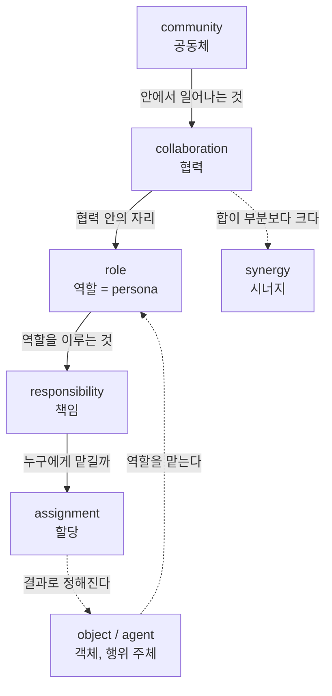
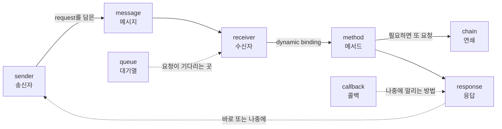
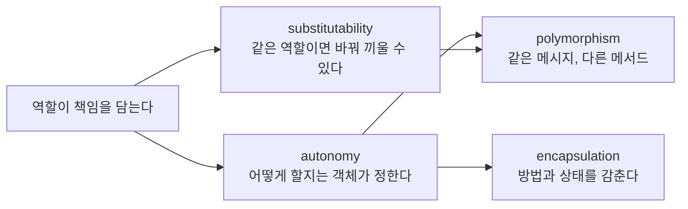
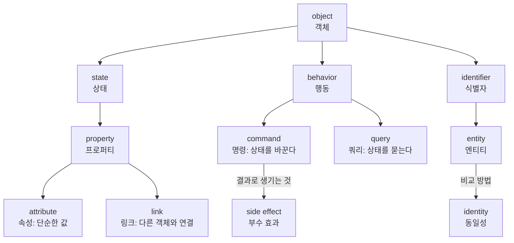
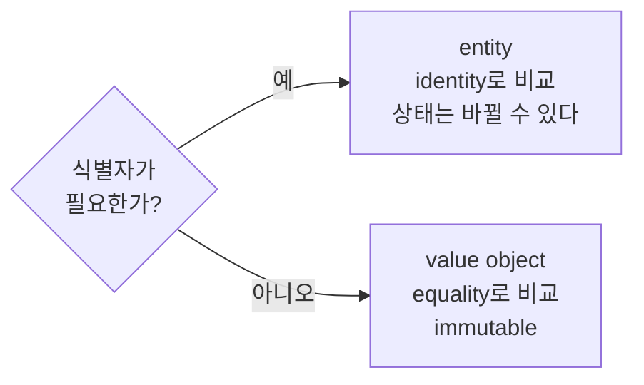
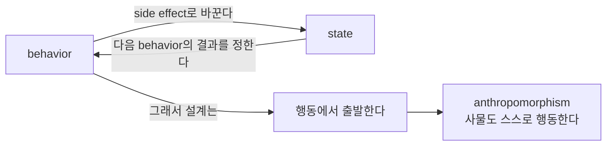
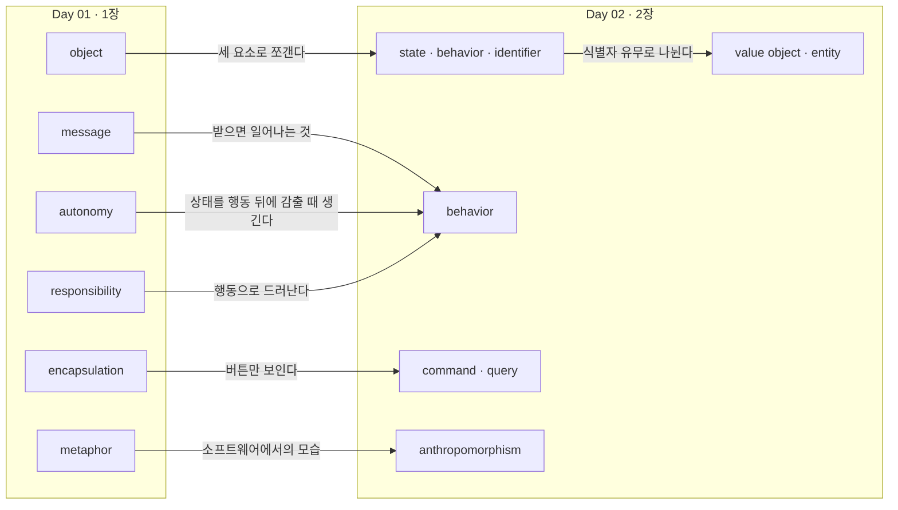

# 객체지향 단어장

읽은 만큼만 단어를 쌓음. 장마다 Day를 하나씩 열고, 복습할 때 '암기' 칸을 새 단어 → 헷갈림 → 외움으로 바꿈.

**보는 법**: 단어 \[발음\] · 뜻 · 책 속 쓰임(이 책에서 어떤 의미로 쓰이는지) · 예문 · 관련어

**구조도 보는 법**: 각 Day의 표 아래에 '단어 구조도'를 둠. 단어를 낱개로 외우기보다, 어떤 단어가 어떤 단어 안에 들어가는지(포함 관계), 어떤 순서로 이어지는지(흐름), 무엇과 짝을 이루는지(대비)를 함께 보면 오래 남음. 맨 끝의 'Day 연결 지도'는 장과 장 사이에서 단어가 어떻게 이어지는지 보여 줌.

## Day 01 — 1장 협력하는 객체들의 공동체

| # | 단어 | 뜻 | 책 속 쓰임 | 예문 | 관련어 | 암기 |
| --- | --- | --- | --- | --- | --- | --- |
| 1 | **synergy** \[ˈsɪnərdʒi\] | 시너지, 합작 효과 | 객체들의 협력은 각 객체를 더한 것보다 크다 (1장 여는 인용구) | The whole is greater than the sum of its parts. 전체는 부분의 합보다 큼. | collaboration | 새 단어 |
| 2 | **paradigm** \[ˈpærədaɪm\] | 패러다임, 사고의 틀 | 프로그램을 바라보고 설계하는 관점 자체 | Object orientation is a paradigm, not a syntax. 객체지향은 문법이 아니라 관점임. | procedural, functional | 새 단어 |
| 3 | **object** \[ˈɑːbdʒɪkt\] | 객체 | 상태와 행동을 가지고 스스로 판단하는 존재. 현실 사물의 복사본이 아님 | An `Account` object withdraws money by itself. 계좌 객체는 스스로 출금함. | class, instance | 새 단어 |
| 4 | **model / modeling** \[ˈmɑːdl\] | 모델, 모델링 | 문제를 이해하기 쉽게 단순화해 표현하는 것. 현실을 그대로 본뜨는 것이 아님 | A model is not a photo of reality. 모델은 현실의 사진이 아님. | domain model | 새 단어 |
| 5 | **abstraction** \[æbˈstrækʃn\] | 추상화 | 불필요한 세부를 제거하고 핵심만 남기는 것 | A subway map is an abstraction of the city. 지하철 노선도는 도시의 추상화임. | generalization, encapsulation | 새 단어 |
| 6 | **projection** \[prəˈdʒekʃn\] | 투영 | '소프트웨어는 실세계의 투영'이라는 통념. 저자가 반박하는 대상 | Software is not a projection of the real world. 소프트웨어는 실세계의 투영이 아님. | mimic, metaphor | 새 단어 |
| 7 | **metaphor** \[ˈmetəfɔːr\] | 은유, 비유 | 실세계 비유는 설계에는 부적합하지만 학습에는 효과적임 | A firewall in software is only a metaphor. 소프트웨어 방화벽은 비유일 뿐임. | analogy, mimic | 새 단어 |
| 8 | **encapsulation** \[ɪnˌkæpsjuˈleɪʃn\] | 캡슐화 | 상태와 처리 방법을 감추고 행동만 외부에 드러내는 것 | An object encapsulates its state and behavior. 객체는 상태와 행동을 캡슐화함. | autonomy, interface | 새 단어 |
| 9 | **autonomy** \[ɔːˈtɑːnəmi\] | 자율성 | 객체가 스스로 판단하고 결정하는 성질. 책임을 수행하는 방법을 스스로 선택함 | The barista decides how to make the coffee. 바리스타는 커피를 만드는 방법을 스스로 결정함. | encapsulation, polymorphism | 새 단어 |
| 10 | **message** \[ˈmesɪdʒ\] | 메시지 | 객체가 다른 객체와 소통하는 유일한 수단. 무엇을 해 달라는지만 담음 | The customer sends an order message to the cashier. 손님은 캐시어에게 주문 메시지를 보냄. | method, request | 새 단어 |
| 11 | **collaboration** \[kəˌlæbəˈreɪʃn\] | 협력 | 요청과 응답을 주고받으며 공동의 목표를 달성하는 것 | Objects collaborate to serve a cup of coffee. 객체들은 커피 한 잔을 제공하기 위해 협력함. | role, responsibility | 새 단어 |
| 12 | **seamlessness** \[ˈsiːmləsnəs\] | 연결완전성 | 분석에서 식별한 개념이 설계와 구현까지 같은 명칭과 의미로 이어지는 성질 | The word "Order" flows seamlessly from the meeting to the code. '주문'이라는 개념이 회의에서 코드까지 그대로 이어짐. | representational gap | 새 단어 |
| 13 | **role** \[roʊl\] | 역할 | 협력 안에서 차지하는 책임이나 임무. 관련성 높은 책임의 집합 | Anyone can play the cashier role. 누구든 캐시어 역할을 맡을 수 있음. | responsibility, persona | 새 단어 |
| 14 | **responsibility** \[rɪˌspɑːnsəˈbɪləti\] | 책임 | 역할에 따라 수행해야 하는 임무. 설계 품질을 결정하는 가장 중요한 요소 | The barista is responsible for making the coffee. 바리스타는 커피를 제조할 책임이 있음. | role, assignment | 새 단어 |
| 15 | **queue** \[kjuː\] | 대기열, 큐 | \[보충\] 주문 컵이 놓인 테이블. 먼저 들어온 요청을 먼저 처리함 | Orders wait in a queue for the barista. 주문은 대기열에서 바리스타를 기다림. | FIFO, message queue | 새 단어 |
| 16 | **callback** \[ˈkɔːlbæk\] | 콜백, 완료 통지 | \[보충\] 진동벨. 작업이 끝나면 요청자를 다시 호출하는 장치 | The buzzer is a callback for your coffee. 진동벨은 커피에 대한 콜백임. | asynchronous, Future | 새 단어 |
| 17 | **request** \[rɪˈkwest\] | 요청 | 스스로 해결할 수 없는 문제를 해결할 수 있는 상대에게 도움을 청하는 것 | The cashier requests a coffee from the barista. 캐시어는 바리스타에게 커피를 요청함. | message, call | 새 단어 |
| 18 | **response** \[rɪˈspɑːns\] | 응답 | 요청받은 쪽이 책임을 수행하고 결과를 돌려주는 것. 요청과 반대 방향으로 전달됨 | The buzzer is the cashier's response to your order. 진동벨은 주문에 대한 캐시어의 응답임. | return value, reply | 새 단어 |
| 19 | **chain** \[tʃeɪn\] | 연쇄 | 하나의 요청이 다른 요청을 유발하며 이어지는 것 | One request triggers a chain of requests. 하나의 요청이 요청의 연쇄를 일으킴. | call stack, cascade | 새 단어 |
| 20 | **community** \[kəˈmjuːnəti\] | 공동체 | 요청과 응답으로 협력하며 복잡한 문제를 해결하는 집단. 1장 제목의 핵심어 | An application is a community of collaborating objects. 애플리케이션은 협력하는 객체들의 공동체임. | collaboration, synergy | 새 단어 |
| 21 | **substitutability** \[ˌsʌbstɪˌtuːtəˈbɪləti\] | 대체 가능성 | 같은 역할을 수행하는 대상끼리는 요청자 입장에서 서로 바꿀 수 있는 성질 | Any cashier is substitutable for another. 어떤 캐시어든 다른 캐시어로 대체할 수 있음. | role, Liskov Substitution Principle | 새 단어 |
| 22 | **polymorphism** \[ˌpɑːliˈmɔːrfɪzəm\] | 다형성 | 동일한 요청에 대해 서로 다른 방식으로 응답할 수 있는 능력 | Each barista responds to the same request in a different way. 바리스타마다 같은 요청에 다른 방식으로 응답함. | autonomy, Open-Closed Principle | 새 단어 |
| 23 | **agent** \[ˈeɪdʒənt\] | 에이전트, 행위 주체 | 요청을 받아 자율적으로 처리하는 주체. 1.2.1에서 '사람'을 일반화한 표현 | Each agent decides how to handle a request. 각 에이전트는 요청을 처리하는 방법을 스스로 정함. | object, autonomy | 새 단어 |
| 24 | **method** \[ˈmeθəd\] | 메서드 | 메시지를 받은 객체가 요청을 실제로 처리하는 방법 | The same message can run different methods. 같은 메시지라도 다른 메서드가 실행될 수 있음. | message, implementation | 새 단어 |
| 25 | **persona** \[pərˈsoʊnə\] | 페르소나, 가면 | 협력에 참여하는 객체가 쓰는 얼굴. 역할을 가리키는 비유 | A role is a persona an object wears in a collaboration. 역할은 객체가 협력에서 쓰는 페르소나임. | role, interface | 새 단어 |
| 26 | **assignment** \[əˈsaɪnmənt\] | 할당 | 적절한 객체에게 적절한 책임을 맡기는 일. 객체지향 설계의 출발점 | Design starts with the assignment of responsibilities. 설계는 책임의 할당에서 시작됨. | Information Expert, GRASP | 새 단어 |
| 27 | **sender** \[ˈsendər\] | 송신자 | 메시지를 보내는 객체 | The customer is the sender of the order message. 손님은 주문 메시지의 송신자임. | receiver, message | 새 단어 |
| 28 | **receiver** \[rɪˈsiːvər\] | 수신자 | 메시지를 받아 어떤 메서드로 처리할지 스스로 정하는 객체 | The receiver chooses the method. 메서드는 수신자가 고름. | sender, method | 새 단어 |
| 29 | **dynamic binding** \[daɪˈnæmɪk ˈbaɪndɪŋ\] | 동적 바인딩 | \[보충\] 실행 시점에 어떤 메서드를 실행할지 결정하는 것 | The method is chosen at runtime by dynamic binding. 메서드는 동적 바인딩으로 실행 시점에 정해짐. | polymorphism, late binding | 새 단어 |

### Day 01 단어 구조도

29개 단어는 네 묶음으로 나뉨. 먼저 묶음을 잡고, 묶음 안에서 단어끼리의 관계를 봄.

| 묶음 | 질문 | 단어 |
| --- | --- | --- |
| ① 공동체의 구조 | 누가 무엇을 맡는가 | community, collaboration, role, responsibility, persona, assignment, object, agent |
| ② 소통의 흐름 | 어떻게 부탁하고 답하는가 | request, message, sender, receiver, method, dynamic binding, response, chain, queue, callback |
| ③ 객체의 성질 | 좋은 객체는 어떤 성질을 갖는가 | autonomy, encapsulation, polymorphism, substitutability |
| ④ 바라보는 관점 | 객체지향을 어떻게 이해해야 하는가 | paradigm, model, abstraction, projection, metaphor, seamlessness, synergy |

**① 포함 관계: 공동체에서 책임까지**

바깥에서 안쪽으로 갈수록 작은 단위가 됨. 객체(object)는 이 사다리 옆에서 역할을 '맡는' 존재임.

**② 흐름: 요청 하나가 응답이 되기까지**

**③ 로직 트리: 객체의 성질은 어디서 나오는가**

**④ 대비: 관점을 나타내는 단어들**

| 저자가 반박하는 쪽 | 저자가 받아들이는 쪽 |
| --- | --- |
| projection (실세계의 투영) | metaphor (실세계에서 이름만 빌린다) |
| 현실을 그대로 본뜬 model | 문제를 이해하기 위한 abstraction |
| 분석과 코드의 단어가 따로 놂 | seamlessness (같은 단어가 끝까지 이어진다) |

---

## Day 02 — 2장 이상한 나라의 객체

| # | 단어 | 뜻 | 책 속 쓰임 | 예문 | 관련어 | 암기 |
| --- | --- | --- | --- | --- | --- | --- |
| 1 | **state** \[steɪt\] | 상태 | 과거 행동의 결과를 요약한 정보. 현재만 보고 행동의 결과를 예측하게 함 | Alice's height is part of her state. 앨리스의 키는 앨리스의 상태임. | property, behavior | 새 단어 |
| 2 | **behavior** \[bɪˈheɪvjər\] | 행동 | 메시지에 반응해 상태를 바꾸거나 다른 객체에 메시지를 보내는 활동 | Only behavior can change the state. 상태를 바꾸는 것은 행동뿐임. | state, side effect | 새 단어 |
| 3 | **identifier** \[aɪˈdentɪfaɪər\] | 식별자 | 객체를 다른 객체와 구별하는 프로퍼티 | Alice is still Alice whatever her height. 앨리스는 키가 어떻든 앨리스임. | identity, entity | 새 단어 |
| 4 | **property** \[ˈprɑːpərti\] | 프로퍼티 | 상태를 구성하는 특징. 속성과 링크로 나뉨 | Height is a property, and 130cm is its value. 키는 프로퍼티이고, 130cm는 그 값임. | attribute, link | 새 단어 |
| 5 | **attribute** \[ˈætrɪbjuːt\] | 속성 | 프로퍼티 중 단순한 값 | Height is an attribute of Alice. 키는 앨리스의 속성임. | property, value | 새 단어 |
| 6 | **link** \[lɪŋk\] | 링크 | 프로퍼티 중 다른 객체와의 의미 있는 연결. 있어야 메시지를 보낼 수 있음 | A link lets Alice send a message to the beverage. 링크가 있어야 앨리스가 음료에 메시지를 보낼 수 있음. | property, collaboration | 새 단어 |
| 7 | **side effect** \[saɪd ɪˈfekt\] | 부수 효과 | 행동의 결과로 상태가 바뀌는 것 | Drinking has a side effect on Alice's height. 마시는 행동은 앨리스의 키에 부수 효과를 낳음. | behavior, pure function | 새 단어 |
| 8 | **value object** \[ˈvæljuː ˈɑːbdʒɪkt\] | 값 객체 | 식별자 없이 상태로 비교되는 불변의 값 | A thousand won is the same in any wallet. 1,000원은 어느 지갑에 있든 같은 1,000원임. | equality, immutable | 새 단어 |
| 9 | **entity** \[ˈentəti\] | 엔티티 | 식별자를 가진 객체. 상태가 바뀌어도 같은 객체로 봄 | A member stays the same after changing a nickname. 회원은 닉네임을 바꿔도 같은 회원임. | identity, identifier | 새 단어 |
| 10 | **equality** \[iˈkwɑːləti\] | 동등성 | 상태가 같으면 같다고 보는 비교 방식. 값에 씀 | Values are compared by equality. 값은 동등성으로 비교함. | value object | 새 단어 |
| 11 | **identity** \[aɪˈdentəti\] | 동일성 | 식별자가 같으면 같다고 보는 비교 방식. 객체에 씀 | Objects are compared by identity. 객체는 동일성으로 비교함. | entity, identifier | 새 단어 |
| 12 | **immutable** \[ɪˈmjuːtəbl\] | 불변의 | 만들어진 뒤 상태가 바뀌지 않는 성질 | Value objects should be immutable. 값 객체는 불변이어야 함. | value object, mutable | 새 단어 |
| 13 | **command** \[kəˈmænd\] | 명령 | 객체의 상태를 변경하는 작업. 기계 은유의 사각형 버튼 | `withdraw()` is a command. `withdraw()`는 명령임. | query, CQS | 새 단어 |
| 14 | **query** \[ˈkwɪri\] | 쿼리 | 객체의 상태를 조회하는 작업. 기계 은유의 둥근 버튼 | `balance()` is a query. `balance()`는 쿼리임. | command, CQS | 새 단어 |
| 15 | **anthropomorphism** \[ˌænθrəpəˈmɔːrfɪzəm\] | 의인화 | 사물에 사람처럼 판단하고 행동하는 능력을 부여하는 것 | In software, even an account withdraws money by itself. 소프트웨어에서는 계좌도 스스로 출금함. | metaphor, autonomy | 새 단어 |

### Day 02 단어 구조도

2장의 15개 단어는 거의 모두 '객체를 이루는 세 요소' 아래에 걸림. 그래서 Day 02는 하나의 트리로 정리됨.

**① 포함 관계: 객체 해부도**

**② 대비: 식별자가 있느냐 없느냐**

| 짝 | 왼쪽 | 오른쪽 |
| --- | --- | --- |
| attribute / link | 단순한 값 (키, 위치) | 다른 객체로 가는 연결 (음료) |
| command / query | 상태를 바꾼다, 반환값 없음 | 상태를 묻는다, 부수 효과 없음 |
| equality / identity | 상태가 같으면 같음 | 식별자가 같으면 같음 |
| value object / entity | immutable, 금액·날짜 | 상태가 바뀌어도 같은 객체, 회원·주문 |

**③ 로직 트리: 왜 행동이 먼저인가**

---

### Day 연결 지도

Day 01의 단어가 Day 02에서 어떻게 더 쪼개지고 이어지는지 보여 줌. 왼쪽은 1장, 오른쪽은 2장의 단어임.

한 줄로 요약하면, 1장은 객체들 '사이'(역할, 책임, 메시지)를 말하는 단어이고, 2장은 객체 '안쪽'(상태, 행동, 식별자)을 말하는 단어임. 두 장의 단어는 행동(behavior)과 메시지(message)에서 만남.
