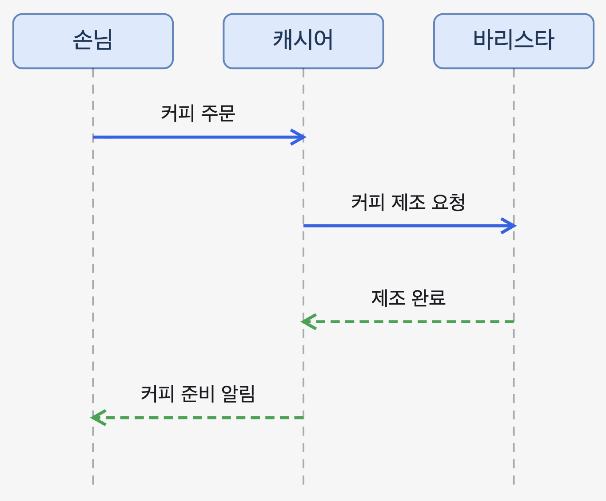

# 1, 2장

# 객체지향의 사실과 오해 — 1, 2장 정리

| 구분 | 1장. 협력하는 객체들의 공동체 | 2장. 이상한 나라의 객체 |
| --- | --- | --- |
| 핵심 주제 | 역할, 책임, 협력 | 상태, 행동, 식별자 |
| 대표 예시 | 손님 · 캐시어 · 바리스타 | 앨리스 · 음료 · 문 |
| 핵심 관점 | 객체는 메시지를 주고받으며 협력한다 | 객체는 행동을 통해 자신의 상태를 관리한다 |
| 설계의 초점 | 누구에게 어떤 책임을 부여할 것인가? | 어떤 행동을 제공하고 어떤 상태를 관리할 것인가? |

## 1장. 협력하는 객체들의 공동체

### 1. 객체지향의 중심은 클래스가 아니라 객체의 협력

객체지향은 현실 세계를 그대로 모방하는 것이 아니라, 자율적인 객체들이 서로 협력하여 시스템의 기능을 구현하도록 구성하는 방법이다.

- 역할(Role): 협력에 참여하는 객체가 맡는 임무
- 책임(Responsibility): 역할에 따라 객체가 수행해야 하는 행동
- 협력(Collaboration): 객체들이 요청과 응답을 주고받으며 공동의 목표를 달성하는 과정

### 2. 커피 주문 예시

손님이 커피를 주문하면 캐시어는 주문을 접수하고, 바리스타는 커피를 제조한다. 각자 맡은 책임은 다르지만, 커피 제공이라는 하나의 목표를 위해 협력한다.

### 3. 커피 주문 객체의 책임과 메서드

### 4. 역할의 네 가지 특징

1. 여러 객체가 동일한 역할을 수행할 수 있다. 서로 다른 바리스타가 같은 커피 제조 책임을 수행할 수 있다.
2. 역할은 대체 가능성을 의미한다. 요청자는 책임이 수행된다면 구체적인 담당자가 누구인지 몰라도 된다.
3. 책임 수행 방법은 자율적으로 선택할 수 있다. 바리스타마다 커피 제조 방법이 달라도 된다. 이는 다형성과 연결된다.
4. 하나의 객체가 여러 역할을 수행할 수 있다. 소규모 카페에서는 한 사람이 캐시어와 바리스타의 역할을 모두 맡을 수도 있다.

### 5. 메시지와 메서드의 차이

- 메시지(Message): 다른 객체에게 무엇을 해달라고 요청하는 것
- 메서드(Method): 메시지를 받은 객체가 요청을 실제로 처리하는 구체적인 방법

예를 들어 캐시어가 바리스타에게 `makeCoffee()` 메시지를 전달할 때, 캐시어는 커피가 만들어지기를 기대할 뿐 바리스타가 어떤 추출 방식을 사용하는지 알 필요가 없다.

핵심: 객체는 자신이 가진 상태와 행동을 하나의 단위로 묶고, 외부 객체의 요청을 자신만의 방법으로 처리하는 자율적인 존재여야 한다.

## 2장. 이상한 나라의 객체

### 1. 객체는 상태, 행동, 식별자를 가진다

2장에서는 앨리스가 음료를 마시거나 케이크를 먹으면서 몸의 크기를 바꾸는 이야기를 통해 객체의 본질을 설명한다.

- 상태(State): 현재 객체가 가지고 있는 정보
- 행동(Behavior): 객체가 수행할 수 있는 동작. 상태를 변경할 수 있다.
- 식별자(Identity): 상태가 바뀌어도 객체를 구별할 수 있게 하는 특성

### 2. 앨리스와 음료 객체의 UML 관계

앨리스의 `height`, `location`은 단순한 값을 나타내는 속성(Attribute) 이다. 반면 `beverage`는 다른 객체를 참조하는 링크(Link) 에 해당한다.

객체의 프로퍼티(Property)는 이러한 속성과 다른 객체와의 관계를 통해 표현된다.

### 3. 행동이 상태를 변경한다

책에서 설명한 앨리스의 상태 변화를 도식화하면 다음과 같다.

앨리스의 상태 변화 예시

키가 달라져도 동일한 앨리스 객체다.

여기서 중요한 관계는 두 가지다.

행동은 상태를 변경하고, 행동의 결과는 현재 상태에 의존한다.

예를 들어 `passThroughDoor()`를 호출해도 앨리스의 키가 문보다 크다면 통과할 수 없다. 따라서 음료를 마시거나 버섯을 먹어 키를 줄이는 행동이 먼저 필요하다.

### 4. 객체는 다른 객체의 상태를 직접 변경하지 않는다

앨리스가 음료를 마시면 다음 두 가지 변화가 일어난다.

- 앨리스의 키가 감소한다.
- 음료의 남은 양이 감소한다.

그렇다고 앨리스가 음료의 `quantity` 필드를 직접 변경하는 것은 아니다.

UML 시퀀스 다이어그램 — 앨리스와 음료의 협력

즉, 앨리스는 음료에게 `drunken(quantity)` 메시지를 전송하고, 음료 객체가 스스로 자신의 양을 감소시킨다.

이것이 캡슐화와 자율성이다. 객체의 내부 상태는 숨기고, 외부에는 행동을 제공한다.

### 5. 값의 동등성과 객체의 동일성

| 구분 | 값(Value) | 객체(Object) |
| --- | --- | --- |
| 비교 기준 | 상태(값) | 식별자 |
| 핵심 개념 | 동등성(Equality) | 동일성(Identity) |
| 예시 | 숫자 100과 숫자 100 | 키가 같은 서로 다른 두 앨리스 |
| 상태 변경 | 값 자체의 동일성은 유지 | 상태가 변해도 같은 객체일 수 있음 |

앨리스의 키가 130cm에서 40cm로 바뀌어도 앨리스는 여전히 동일한 앨리스다. 반대로 두 앨리스의 키가 모두 130cm라고 해서 동일한 객체가 되는 것은 아니다.

### 6. 기계로서의 객체 — 명령과 쿼리

- Command(명령): 객체의 상태를 변경하는 행동. 예: `eatCake()`
- Query(쿼리): 객체의 상태를 조회하는 행동. 예: `getHeight()`

외부에서는 객체가 제공하는 인터페이스를 통해서만 상태를 변경하거나 조회할 수 있다.

### 7. 행동이 상태를 결정한다

객체를 설계할 때 `height`, `location` 같은 상태부터 무작정 나열하면 객체가 외부에 단순히 데이터를 노출하는 구조가 될 수 있다.

따라서 먼저 객체가 협력 속에서 수행해야 할 행동과 책임을 결정하고, 그 행동을 수행하는 데 필요한 상태를 선택해야 한다.

객체지향 설계는 적절한 책임을 가진 자율적인 객체들이 메시지로 협력하도록 만드는 것이다.

---

**마음을 울렸던 문장**

- 행동이 상태를 결정한다.
- 행동은 상태를 변경하고, 행동의 결과는 현재 상태에 의존한다.
- 객체는 클래스가 아니다. 객체 위주로 한다.
- 이상한 나라의 비유가 적절했다. 트럼프 카드가 현실에서는 자기 자신을 뒤집을 수 없지만 객체 나라에서는 가능하다. 자신만의 이상한 객체 나라를 구축하자.