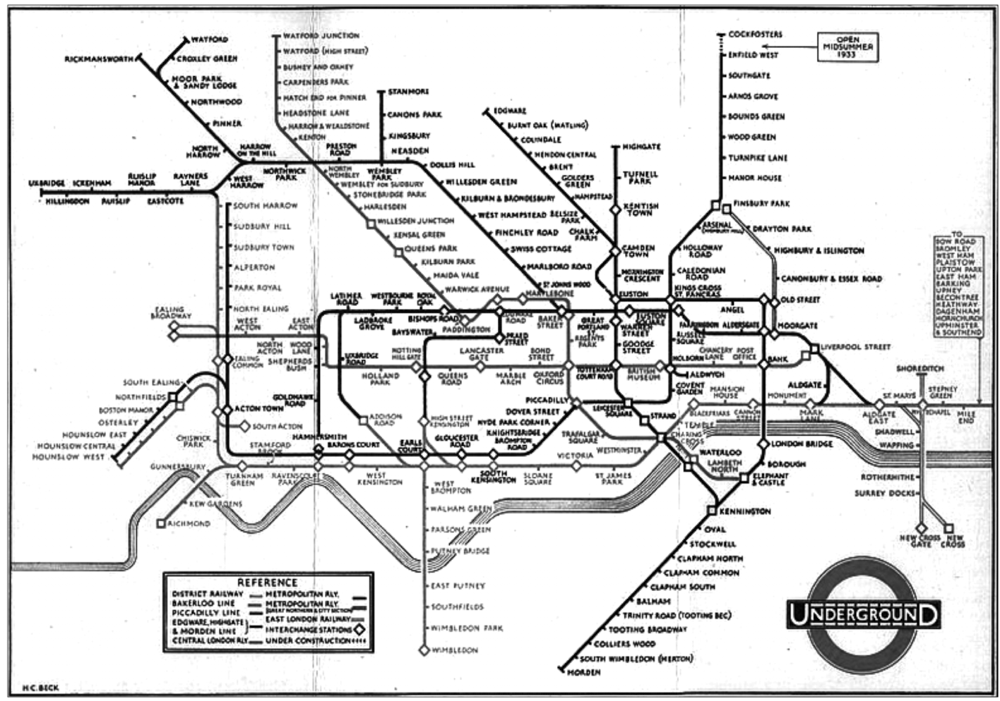

# 3장

# 3장. 타입과 추상화

## 1. 추상화를 통한 복잡성 극복

추상화(Abstraction)는 복잡한 현실에서 불필요한 세부사항을 제거하고, 중요한 특징만 남겨 단순화하는 과정이다.

런던 지하철 노선도를 예시



- 실제 지하철 노선은 지리적으로 복잡한 형태를 가지고 있음.
- 그러나 승객에게 중요한 것은 정확한 지형이 아니라 역의 위치 관계와 환승 정보임.
- 따라서 실제 지형을 단순화하고 필요한 정보만 표현한 노선도가 더 유용함.

### 추상화의 두 가지 방법

1. 공통점만 취하고 차이점은 버리는 일반화. 여러 사물의 공통적인 특징을 추출해 하나의 개념으로 묶음.
2. 중요한 부분을 강조하기 위해 불필요한 세부사항 제거. 목적에 필요한 정보에만 집중하고 나머지는 생략함.

추상화는 무조건 정보를 줄이는 게 아니라, 해결하려는 문제의 목적에 맞게 복잡성을 관리하는 수단이다.

## 2. 객체지향과 추상화

### 2-1. 개념과 분류

- 개념(Concept): 공통점을 기반으로 객체들을 묶기 위한 생각의 단위
- 분류(Classification): 객체에 특정 개념을 적용하여 그룹에 포함시키는 작업
- 인스턴스(Instance): 어떤 개념에 속하는 구체적인 객체

개념은 객체를 분류하기 위한 틀이고, 분류를 통해 복잡한 객체들의 세계를 단순하게 바라볼 수 있다.

### 2-2. 개념의 세 가지 관점

| 구분 | 의미 | 트럼프 예시 |
| --- | --- | --- |
| 심볼(Symbol) | 개념을 가리키는 이름 | 트럼프 |
| 내연(Intension) | 개념에 속하는 객체들의 공통적인 특징 | 몸이 납작하고 뒤집어질 수 있음 |
| 외연(Extension) | 해당 개념에 속하는 객체들의 집합 | 정원사, 병사, 왕, 여왕 등 |
- 심볼: 무엇이라고 부르는가?
- 내연: 어떤 특징을 가지고 있어야 하는가?
- 외연: 어떤 객체들이 포함되는가?

내연은 객체를 분류하기 위한 기준이고, 외연은 그 기준에 따라 분류된 결과이다.

### 2-3. 분류 = 추상화

개별 객체를 하나의 개념으로 분류하면 객체들 사이의 차이점을 무시할 수 있어. 그러면 복잡한 객체들을 하나하나 이해하지 않아도 공통적인 개념을 통해 다룰 수 있지.

## 3. 타입

### 3-1. 타입은 개념

- 타입은 공통점을 기반으로 객체들을 묶기 위한 틀이다.
- 타입 역시 심볼, 내연, 외연으로 설명할 수 있다.
- 특정 타입에 속하는 객체를 그 타입의 인스턴스라고 한다.

즉, 타입은 개별 객체를 하나하나 이해하는 대신 공통적인 특징으로 묶어 이해할 수 있게 해주는 개념이다.

### 3-2. 데이터 타입

1. 데이터의 타입은 데이터에 적용할 수 있는 연산에 의해 결정된다. 숫자는 덧셈과 뺄셈 같은 연산을 수행할 수 있고, 문자열은 연결이나 길이 확인 같은 연산을 수행할 수 있음.
2. 데이터의 내부 표현 방식은 외부에 감춰진다. 개발자는 데이터가 메모리에 어떻게 저장되는지 몰라도, 제공되는 연산을 통해 데이터를 사용할 수 있음.

또한 타입 시스템은 잘못된 연산이나 데이터 사용을 제한하는 역할을 한다.

### 3-3. 객체와 타입 — 행동이 우선

객체의 타입을 결정하는 것은 상태나 데이터가 아니라 행동이다.

- 동일한 행동을 수행하는 객체는 동일한 타입으로 분류할 수 있다.
- 동일한 데이터를 가지고 있더라도 행동이 다르면 다른 타입으로 분류될 수 있다.
- 동일한 타입의 객체라도 내부 데이터와 구현 방법은 서로 다를 수 있다.

이 내용은 다형성과 캡슐화로 연결돼.

| 개념 | 의미 |
| --- | --- |
| 다형성 | 동일한 메시지를 받은 객체들이 서로 다른 방식으로 응답할 수 있음 |
| 캡슐화 | 내부 상태와 구현을 숨기고 외부에는 행동을 제공함 |
| 책임-주도 설계 | 객체의 책임을 먼저 결정한 뒤 필요한 데이터를 설계함 |

<aside>
⭕

**책임-주도 설계**

책임 결정 → 데이터 결정 → 캡슐화

객체가 무엇을 해야 하는지 먼저 정하고, 그 행동을 수행하는 데 필요한 상태를 나중에 결정한다.

</aside>

반면 데이터-주도 설계는 데이터를 먼저 결정하고 그 후 책임을 부여하는 방식이다. 이런 방식이 유연하지 못한 설계로 이어질 수 있다고 지적해.

## 4. 타입의 계층

### 4-1. 일반화와 특수화

일반화(Generalization)는 여러 타입의 공통적인 행동을 추출하여 상위 타입으로 묶는 것이고, 특수화(Specialization)는 일반적인 타입에 추가적인 행동을 부여해 더 구체적인 타입을 만드는 것이다.

| 구분 | 일반적인 타입 | 특수한 타입 |
| --- | --- | --- |
| 예시 | 트럼프 | 트럼프 인간 |
| 행동의 수 | 상대적으로 적음 | 상대적으로 많음 |
| 외연의 크기 | 상대적으로 큼 | 상대적으로 작음 |
| 관계 | 슈퍼타입 | 서브타입 |


여기서 중요한 건 행동의 수와 외연의 크기가 반대 방향이다.

일반적인 타입일수록 요구하는 행동이 적기 때문에 더 많은 객체를 포함할 수 있다.

### 4-2. 슈퍼타입과 서브타입

- 슈퍼타입(Supertype): 더 일반적인 타입
- 서브타입(Subtype): 더 특수한 타입

서브타입은 슈퍼타입이 제공하는 모든 행동을 수행할 수 있어야 하며, 슈퍼타입을 대체할 수 있어야 해.

**행위적 호환성**: 데이터 구조가 비슷하거나 상속 관계가 존재한다고 해서 올바른 서브타입이 되는 것이 아니다. 실제 행동의 관점에서 대체 가능해야 한다는 점이 중요하다.

### 4-3. 일반화도 추상화의 도구

일반화를 통해 불필요한 특수한 행동을 무시하고 공통적인 행동에 집중할 수 있다.

앨리스는 트럼프 인간이 가진 '걷기'라는 특수한 행동에 관심이 없을 때 단순히 '트럼프'라는 더 일반적인 타입으로 바라볼 수 있다.

결과적으로 분류와 일반화/특수화는 모두 복잡성을 낮추기 위한 추상화 기법이다.

## 5. 정적 모델

### 5-1. 타입의 목적

앨리스는 음료를 마시거나 버섯을 먹으면 키가 변한다. 하지만 키가 변하더라도 앨리스라는 객체의 식별성은 유지된다.


타입을 이용하면 객체가 시간에 따라 변화하는 복잡성을 제거하고, 객체의 공통적이고 안정적인 특징을 표현할 수 있다.

### 5-2. 동적 모델과 정적 모델

네가 두 모델의 정의에 밑줄을 친 부분이야.

| 구분 | 동적 모델 | 정적 모델 |
| --- | --- | --- |
| 관점 | 객체 | 타입 |
| 초점 | 시간에 따른 상태와 행동의 변화 | 시간과 무관한 상태 및 행동의 구조 |
| 관련 표현 | 객체 다이어그램, 상태 변화 | 타입 다이어그램 |
| 개발 시점 | 실행 및 디버깅 | 설계 및 클래스 작성 |

객체지향 프로그램을 설계할 때는 정적인 타입 구조를 살펴보고, 실제 프로그램이 실행될 때는 객체의 상태 변화와 상호작용을 고려해야 한다.

### 5-3. 클래스와 타입은 다르다

타입은 객체를 분류하기 위한 개념이고, 클래스는 그 타입을 구현하기 위한 수단이다.

- **타입**: 개념적 분류 기준
- **클래스**: 프로그래밍 언어에서 제공하는 구현 메커니즘
- **객체**: 타입의 구체적인 인스턴스

클래스 중심이 아니라 객체의 행동과 책임을 중심으로 설계해야 한다.

## 설계


## 질문

#### Q1. 공통된 행동이 있다는 이유만으로 같은 타입으로 묶는 것이 항상 적절할까?

Bird 와 Airplane은 같은 `fly()` 행동을 가질 수 있다.

1. 공통 행동 정의 (추상화)

```java
interface Flyable {
    void fly();
}
```

2. 비행 방식 구현

```java
class WingFly implements Flyable {
    @Override
    public void fly() {
        System.out.println("날갯짓으로 비행");
    }
}

class EngineFly implements Flyable {
    @Override
    public void fly() {
        System.out.println("엔진으로 비행");
    }
}
```

3. Bird와 Airplane에 주입

```java
class Bird {
    private Flyable flyable;

    public Bird(Flyable flyable) {
        this.flyable = flyable;
    }

    public void performFly() {
        flyable.fly();
    }

    public void setFlyable(Flyable flyable) {
        this.flyable = flyable;
    }
}

class Airplane {
    private Flyable flyable;

    public Airplane(Flyable flyable) {
        this.flyable = flyable;
    }

    public void performFly() {
        flyable.fly();
    }
}
```

4. 실행

```java
Bird bird = new Bird(new WingFly());
Airplane airplane = new Airplane(new EngineFly());

bird.performFly();     // 날갯짓으로 비행
airplane.performFly(); // 엔진으로 비행
```

### Q2. 추상화는 복잡성을 낮춘다고 하는데, 왜 추상화가 많아지면 오히려 코드를 이해하기 어려워질까?

필요한 추상화와 과도한 추상화를 구분하는 기준이 무엇인가요..