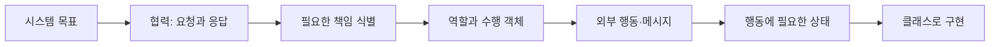
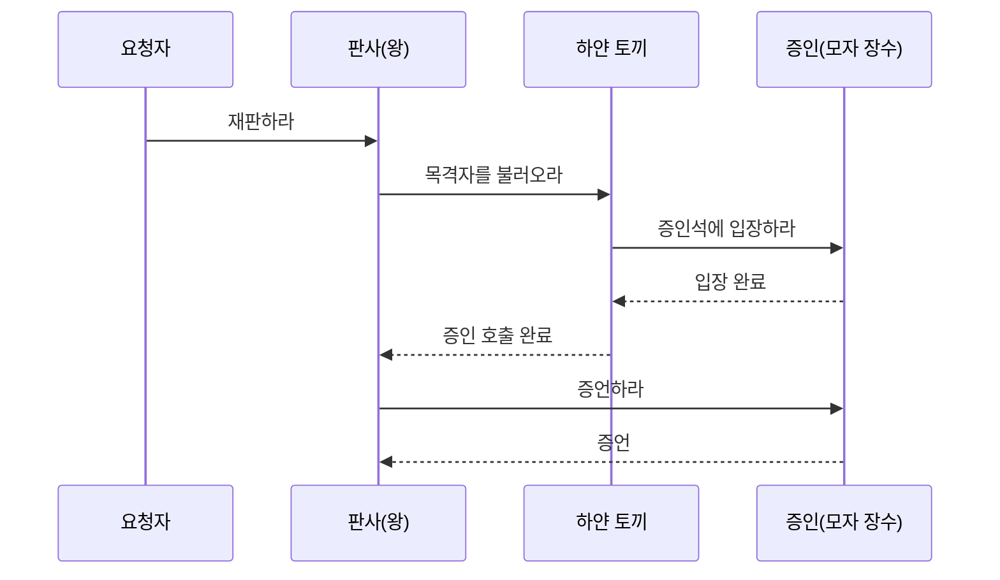
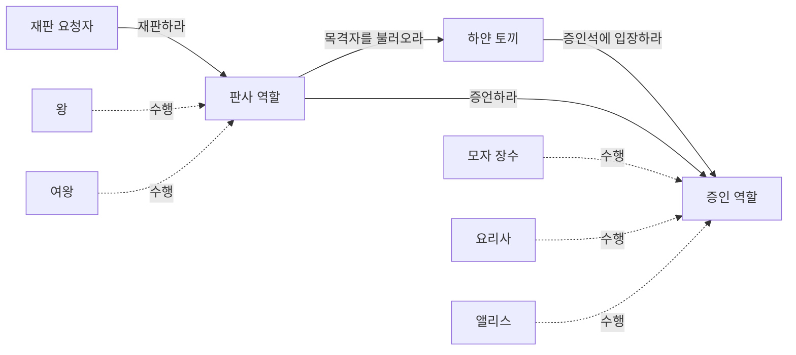
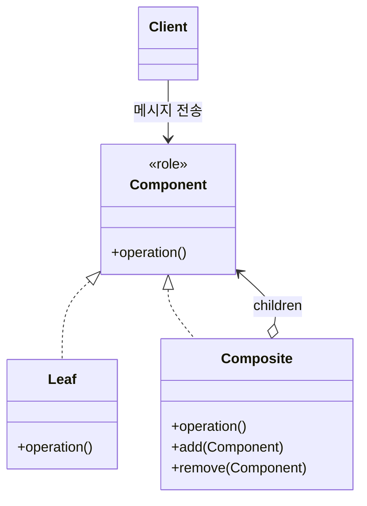

# 4장. 역할, 책임, 협력

## 1. 객체보다 협력 먼저

### 1-1. 현실 세계: 최후통첩 게임

사람의 행동은 개인의 고정된 성격만으로 충분히 설명되지 않는다.
상대와 관계를 맺고 요청·응답하는 문맥이 행동에 영향을 준다.
책은 이것을 객체 세계에 옮겨 협력이 객체의 행동과 상태를 결정한다는 설명으로 이어간다.

### 1-2. 객체 세계

- 2장: 상태보다 행동을 먼저 생각한다.
- 3장: 객체를 분류하는 것은 데이터(상태)가 아니라 행동이다.
- 4장: 그 행동은 무엇이 결정하는가? 협력이라는 문맥이다.

'행동 → 상태'라는 관점을 한 단계 확장하면 '협력 → 행동 → 상태'가 된다. 설계 시에는 그 사이에 책임과 역할을 명시적으로 배치한다.



## 2. 협력: 요청과 응답

협력은 한 사람이 다른 사람에게 도움을 요청할 때 시작된다. 요청받은 객체는 자기 책임을 수행하고 응답하며, 필요한 경우 다른 협력자에게 다시 요청한다. 따라서 협력은 연쇄적인 요청과 응답이다.

### 앨리스의 법정

협력의 목적: 하트 잭의 죄를 판단하는 재판을 진행

- 누군가 → 왕: 재판하라.
- 왕 → 하얀 토끼: 목격자를 불러오라.
- 하얀 토끼 → 모자 장수: 증인석에 입장하라.
- 왕 → 모자 장수: 증언하라.



**요청할 수 있다는 것은 무엇일까?**

왕은 재판을 진행할 수 있고, 토끼는 목격자를 알고 부를 수 있으며, 모자 장수는 증언에 필요한 정보를 갖고 있다. 요청에 응답할 책임과 이를 수행할 지식·행동이 있기 때문이다.

**예외) 증인이 나오지 않으면 누가 다음 행동을 결정해야 할까?**

토끼는 증인을 찾지 못했다고 왕에게 보고할 수 있고 직접 다른 증인을 찾을 수도 있다.
재판을 계속할지, 연기할지, 다른 증인을 부를지는 각각 누가 결정하는 것이 좋을까?
관중들의 의견, 판사의 판단, 토끼의 진행?

## 3. 책임: 객체가 무엇을 알고(knowing), 무엇을 할 수 있는가(doing)

책임은 어떤 객체가 요청에 적절히 응답할 수 있거나 응답할 의무가 있다는 것을 뜻한다. 객체지향 설계에서 중요한 능력은 적절한 책임을 적절한 객체에게 할당하는 것이다.

| 분류 | 의미 | 앨리스 법정의 예 |
| --- | --- | --- |
| Doing · 하는 것 | 스스로 계산·생성하거나, 다른 객체의 행동을 시작시키고, 조율한다. | 왕: 재판 진행·증인 호출 요청 / 토끼: 증인을 부름 |
| Knowing · 아는 것 | 자신의 정보, 관련 객체, 계산·도출 가능한 사실을 안다. | 토끼: 목격자 정보를 앎 / 모자 장수: 증언 가능한 사실을 앎 |

- 왕: 재판을 주관하고 협력자들의 활동을 조율할 책임
- 하얀 토끼: 목격자를 알고, 증인 출석을 요청할 책임
- 모자 장수: 출석하고, 자신이 아는 사실을 증언할 책임

### 책임과 메시지

책임은 수신 객체의 관점에서 '무엇을 할 수 있어야 하는가'를 개략적으로 나타낸다. 메시지는 송신자와 수신자의 관계에서 그 행동을 요청하는 구체적인 의사소통이다.

| 구분 | 질문 | 예시 |
| --- | --- | --- |
| 책임 | 모자 장수는 무엇을 해야 하나? | 재판에 필요한 사실을 증언한다 |
| 메시지 | 왕이 모자 장수에게 어떤 요청을 보내나? | `증언하라()` |
| 메서드 | 모자 장수는 내부에서 어떻게 처리하나? | 기억을 확인하고 진술 내용을 구성 |

하나의 책임이 여러 메시지로 나뉠 수 있다.
예를 들어 '재판을 운영한다'는 책임은 '증인을 부른다', '증언을 요청한다', '판단한다'라는 여러 메시지를 포함할 수 있다.

### 공용 인터페이스와 캡슐화

판사가 증인에게 '증언하라'고 요청한다. 판사는 증인이 기억을 어떤 순서로 정리하고 말하는 것까지 알아서는 안 된다.

외부에 제공되는 행동상의 계약을 뜻하는 더 넓은 개념이다. 이것을 구현과 분리하는 태도가 캡슐화와 객체의 자율성으로 이어진다.

> 공용 인터페이스 == public method

## 4. 역할: 서로 다른 객체가 같은 협력에 참여하는 방법

객체가 협력 안에서 수행하는 책임의 집합이 역할이다. 모자 장수는 실재하는 인물이고, '증인'은 재판에 참여할 때 맡는 역할이다. 왕은 인물이고, '판사'는 그 협력에서 맡는 역할이다.



### 역할의 장점: 단순성·유연성·재사용성

- 단순성: 세 가지 유사한 협력을 한 가지 추상적 협력으로 다룬다.
- 유연성: 같은 역할을 수행할 다른 객체로 교체할 수 있다.
- 재사용성: 특정 인물에 종속되지 않은 협력 구조를 다른 상황에서도 사용한다.

### 역할 = Java interface?

인터페이스, 추상 클래스, 상속 등..

```java
interface Witness {
		Sting message;
    Testimony testify(CaseContext context);
}

final class Hatter implements Witness {
    public Testimony testify(CaseContext context) {
        return Testimony.of("모자 장수의 진술");
    }
}

final class Alice implements Witness {
    public Testimony testify(CaseContext context) {
        return Testimony.of("앨리스의 진술");
    }
}
```

### 대체 가능성

역할을 대체할 수 있으려면 그 역할이 받는 메시지를 이해하고 책임을 수행할 수 있어야 한다. 하나의 객체가 역할이 요구하는 책임보다 더 많은 책임을 갖는 것은 가능하다.

## 5. 흔한 오류: 데이터나 클래스를 먼저 만들기

- **데이터 저장이 객체의 목적이다?** 데이터는 책임을 수행하기 위한 재료다. 객체는 행위를 수행하며 협력에 참여하기 위해서 존재한다.
- **객체지향은 클래스들의 정적 관계다?** 본질은 실제 객체가 서로 메시지를 주고받는 동적 협력이다.

왕을 독립적으로 분석한다면 '왕관, 수염, 왕좌, 이름' 같은 속성부터 생각난다. 그러나 재판 시스템에서 필요한 왕의 특징은 판사 역할로 재판을 진행하고 증언을 요구하는 행동이다. 앨리스의 예시에서 왕의 지위보다 역할이 중요하다. 처음에 설계할 때 맥락을 파악했다면 더 자연스러운 흐름을 가져갈 수 있다.

### 설계 순서 — 무엇을 먼저 결정할까?

1. 시스템 목표: 어떤 결과를 사용자에게 제공해야 하나?
2. 협력: 그 결과를 위해 어떤 요청과 응답이 필요한가?
3. 책임: 각 요청을 누가 책임져야 하는가?
4. 역할/객체: 책임을 수행할 적절한 객체 또는 교체 가능한 역할은 무엇인가?
5. 행동/상태: 수행할 메시지와 내부에 필요한 정보는 무엇인가?
6. 구현: 마지막으로 클래스 구조·필드·메서드를 정한다.

여기서 핵심은 협력적이면서 동시에 자율적인 객체다. 외부가 모든 세부 절차를 지시하는 객체도, 아무와도 협력하지 않는 '만능 객체'도 좋은 설계가 아니다.

## 6. 객체지향 설계 기법 세 가지

### 6-1. 책임-주도 설계(RDD)

시스템이 수행해야 하는 큰 책임을 작은 책임으로 나눈다. 이를 처리할 객체를 찾고, 그 객체가 혼자 처리하지 못하는 일은 다른 협력자에게 요청하게 만든다.

1. 시스템의 책임을 파악한다.
2. 책임을 적절한 크기로 나눈다.
3. 알맞은 객체 또는 역할에 할당한다.
4. 추가로 필요한 정보·서비스를 제공할 협력자를 찾는다.
5. 메시지로 연결해 협력 구조를 완성한다.

### 6-2. 디자인 패턴

디자인 패턴은 특정 상황에서 반복적으로 효과가 있었던 책임 분배와 협력 구조를 재사용하는 방법이다.

파일과 폴더를 구분하지 않고 동일한 '경로 변경' 메시지를 처리하게 만들고 싶다면, 클라이언트는 개별 파일(Leaf)인지 폴더(Composite)인지 몰라도 된다.



- Component: Client가 의존하는 공통 역할·계약
- Leaf: 자식이 없는 부분으로서 공통 요청을 처리
- Composite: 자식을 관리하면서 부분들을 전체처럼 다룸
- Client: 구체적 Leaf/Composite를 모르고 Component에 메시지를 전송

```java
import java.util.List;

interface Entry {
    int size();
}

record File(int bytes) implements Entry {
    public int size() {
        return bytes;
    }
}

record Folder(List<Entry> children) implements Entry {
    public int size() {
        int total = 0;
        for (Entry child : children) {
            total += child.size();
        }
        return total;
    }
    
    public void addChild();
}

class Main {
    public static void main(String[] args) {
        Entry file = new File(100);
        Entry folder = new Folder(List.of(file));

        System.out.println(file.size());   // 100
        System.out.println(folder.size()); // 100
    }
}
```

### 6-3. 테스트-주도 개발(TDD)

실패하는 테스트 → 통과시키는 간단한 구현 → 리팩터링의 피드백 사이클

책에서 TDD를 객체지향과 맥락의 관점에서 본다.

- 테스트 대상에게 어떤 요청을 보낼지 결정 → 책임/메시지를 생각한다.
- 어떤 응답을 기대할지 검증 → 외부에 보이는 계약을 생각한다.
- Stub으로 응답 제공 → 수신자가 협력자에게 응답.
- Mock으로 협력자에게 보낸 요청을 검증 → 협력의 상호작용을 생각한다.

테스트를 설계 피드백의 도구로 보는 측면을 강조한다.
